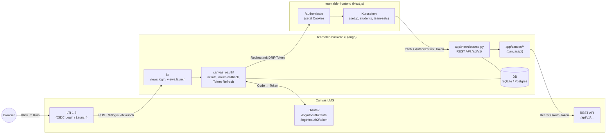
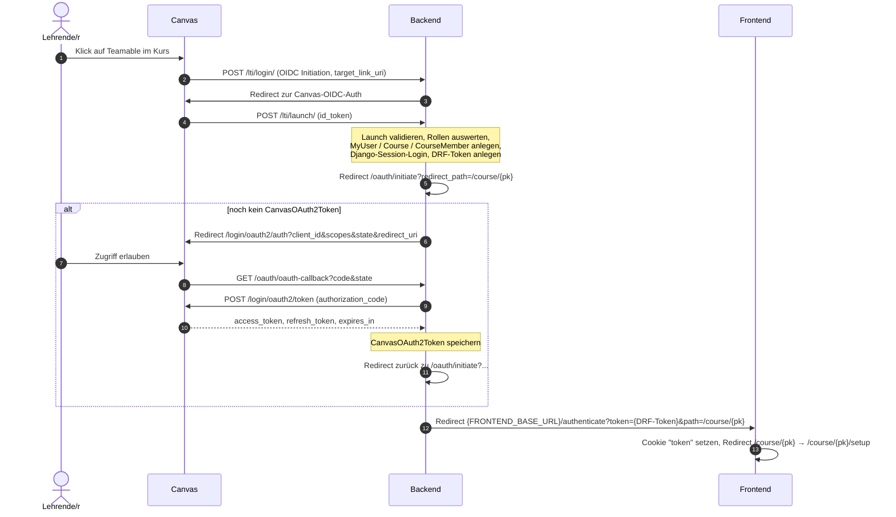
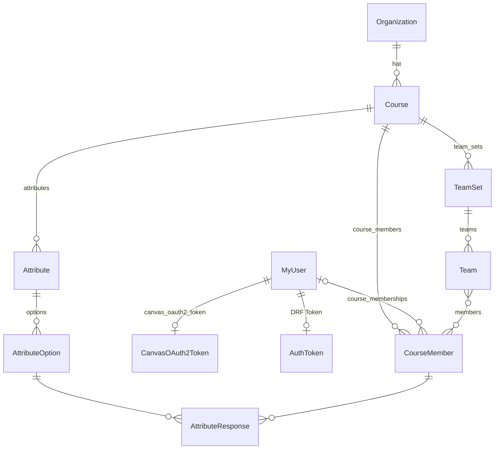

# Teamable: LMS-Anbindung (Ist-Stand)

Diese Doku beschreibt, **was Teamable heute vom LMS braucht** und wie die Anbindung im Code umgesetzt ist. Sie ist die Grundlage für Task #9 („Moodle-API untersuchen“). Eine vollständige Code-Doku ist nicht das Ziel. Behandelt wird nur, was mit der LMS-Anbindung zu tun hat.

- **Stand:** `teamable-backend` @ `183a36c`, `teamable-frontend` @ `98ce1c8`
- **Einziges unterstütztes LMS:** Canvas (`LMSTypeOptions.CANVAS`)
- Pfade ohne Präfix beziehen sich auf `teamable-backend/`. Pfade mit `frontend:` beziehen sich auf `teamable-frontend/`.

---

## Inhalt

1. [Kurzfassung: Was braucht Teamable vom LMS?](#1-kurzfassung-was-braucht-teamable-vom-lms)
2. [Architektur](#2-architektur)
3. [Canvas-Anbindung im Code](#3-canvas-anbindung-im-code)
4. [Datenmodell mit LMS-Bezug](#4-datenmodell-mit-lms-bezug)
5. [Ablauf aus Sicht der Lehrenden](#5-ablauf-aus-sicht-der-lehrenden)
6. [Anmeldung, Rechte und Token-Speicherung](#6-anmeldung-rechte-und-token-speicherung)
7. [Daten für die Team-Bildung](#7-daten-für-die-team-bildung)
8. [Lokales Setup (mit und ohne Canvas)](#8-lokales-setup-mit-und-ohne-canvas)
9. [Auffälligkeiten und offene Punkte](#9-auffälligkeiten-und-offene-punkte)

---

## 1. Kurzfassung: Was braucht Teamable vom LMS?

Das ist die LMS-neutrale Checkliste. Für Moodle muss für jede Zeile ein Gegenstück gefunden werden.

| # | Fähigkeit | Wozu | Canvas heute |
|---|-----------|------|--------------|
| 1 | **Tool-Start aus dem Kurs heraus mit SSO** | Lehrende öffnen Teamable aus dem Kurs. Teamable erfährt dabei, wer sie sind, in welchem Kurs sie sind und welche Rolle sie haben. | LTI 1.3 Launch (OIDC) mit den Custom Claims `canvas_course_id` und `canvas_user_id` |
| 2 | **API-Zugriff im Namen der Lehrperson** | Alle REST-Aufrufe laufen mit den Rechten der Lehrperson. | OAuth2 Authorization Code Flow mit Refresh Token |
| 3 | **Studierende eines Kurses auflisten** | Studierende importieren (Name, LMS-User-ID, SIS-ID) | `GET /api/v1/courses/:course_id/enrollments?type[]=StudentEnrollment` |
| 4 | **Aufgaben eines Kurses auflisten** | Notenquellen finden | `GET /api/v1/courses/:course_id/assignments` |
| 5 | **Noten je Aufgabe und Studierendem lesen** | Notenbasierte Team-Bildung | `GET /api/v1/courses/:course_id/assignments/:id/submissions` |
| 6 | **Umfrage oder Quiz im Kurs anlegen** *(optional)* | Opt-in: Studierende stimmen der Teilnahme zu | `POST /api/v1/courses/:course_id/quizzes` + `POST .../questions` (Classic Quizzes) |
| 7 | **Antworten auf diese Umfrage lesen** *(optional)* | Nur zugestimmte Studierende importieren | `GET .../quizzes/:id`, `.../questions`, `.../submissions`, `GET /api/v1/quiz_submissions/:id/questions` |
| 8 | **Gruppen anlegen und Mitglieder zuordnen** | Erzeugte Teams zurück ins LMS schreiben | `POST .../group_categories`, `POST /group_categories/:id/groups`, `POST /groups/:id/memberships` |
| 9 | **Deep Links ins LMS** *(nur UI)* | Links auf Quiz und Nutzerprofil | URL-Muster `{lms}/courses/{id}/quizzes/{id}` bzw. `.../users/{id}` |

**Nicht** aus dem LMS kommen derzeit: Sections, Beziehungen (Friend/Enemy), Profil-Attribute außer Noten und Projekte.

Die vollständige Liste der angefragten OAuth-Scopes steht in [`src/canvas_oauth/canvas.py`](../src/canvas_oauth/canvas.py) (`SCOPES_USED`). Sie entspricht genau den Endpunkten in der Tabelle oben plus `GET /api/v1/courses/:id`.

---

## 2. Architektur



**Kernaussagen**

- **Nur das Backend spricht mit dem LMS.** Das Frontend ruft ausschließlich die Teamable-REST-API auf (`frontend: src/app/(providers)/query-client-provider.tsx`, Basis-URL `BACKEND_BASE_URI`). Die einzige Ausnahme sind reine Links ins LMS (Opt-in-Quiz, Nutzerprofil).
- Es gibt **drei Kanäle** zum LMS:
  1. **LTI 1.3** (Browser → Backend, eingehend): Start und Identität. Library: `PyLTI1p3`. Code: [`src/lti/`](../src/lti/)
  2. **OAuth2** (Browser-Redirects + Server→Canvas): Zugriffsschlüssel. Code: [`src/canvas_oauth/`](../src/canvas_oauth/), eine eingebettete und angepasste Kopie von *django-canvas-oauth*
  3. **REST-API** (Server→Canvas, ausgehend): Daten lesen und schreiben. Library: `canvasapi==3.2.0`. Code: [`src/app/canvas/`](../src/app/canvas/)
- Alle LMS-Aktionen sind **synchron und vom Nutzer ausgelöst** (Button → POST → Canvas-Aufrufe → Antwort). Es gibt keine Hintergrundjobs, keinen Sync per Cron und keine Webhooks.
- Django-Apps: `accounts` (User, E-Mail-Login), `app` (Domäne + Canvas-Code), `lti`, `canvas_oauth`, `teamable` (Settings und URLs).

**URL-Einstieg** ([`src/teamable/urls.py`](../src/teamable/urls.py))

| Präfix | App |
|--------|-----|
| `/lti/` | LTI Login/Launch |
| `/oauth/` | Canvas OAuth (`initiate`, `oauth-callback`) |
| `/api/v1/` | Kurs-API ([`src/app/urls.py`](../src/app/urls.py)) |
| `/api/v1/accounts/` | User, Sign-up, Log-in |
| `/admin/` | Django-Admin (Org, Kurs, CourseMember anlegen, JWT erzeugen) |

---

## 3. Canvas-Anbindung im Code

### 3.1 Übersicht der Stellen

| Datei | Zweck |
|-------|-------|
| [`src/lti/views.py`](../src/lti/views.py) | LTI-OIDC-Login und LTI-Launch. Legt User, Kurs und CourseMember an. |
| [`src/lti/lti_util.py`](../src/lti/lti_util.py) | Lädt die LTI-Tool-Konfiguration aus ENV oder einer JSON-Datei |
| [`src/canvas_oauth/oauth.py`](../src/canvas_oauth/oauth.py) | `get_oauth_token`, `handle_missing_token`, `oauth_callback`, `initiate_oauth_check`, `refresh_oauth_token` |
| [`src/canvas_oauth/canvas.py`](../src/canvas_oauth/canvas.py) | Baut die Autorisierungs-URL (inkl. Scopes) und holt Tokens per `POST /login/oauth2/token` |
| [`src/canvas_oauth/middleware.py`](../src/canvas_oauth/middleware.py) | Fängt `MissingTokenError` ab und startet den OAuth-Flow |
| [`src/canvas_oauth/models.py`](../src/canvas_oauth/models.py) | `CanvasOAuth2Token` (Token-Speicher) |
| [`src/app/canvas/canvas_api.py`](../src/app/canvas/canvas_api.py) | `init_canvas()` gibt einen `canvasapi.Canvas(org.lms_api_url, oauth_token)` zurück |
| [`src/app/canvas/import_students.py`](../src/app/canvas/import_students.py) | Studierenden-Import (inkl. Opt-in-Filter) |
| [`src/app/canvas/import_attribute.py`](../src/app/canvas/import_attribute.py) | Noten-Import → Attribut „über/unter Median“ |
| [`src/app/canvas/opt_in_quiz.py`](../src/app/canvas/opt_in_quiz.py) | Opt-in-Quiz in Canvas anlegen |
| [`src/app/canvas/export_team.py`](../src/app/canvas/export_team.py) | Team-Set als Canvas-Gruppen exportieren |
| [`src/app/views/course.py`](../src/app/views/course.py) | REST-Endpunkte, die die Funktionen oben aufrufen |
| [`src/teamable/settings.py`](../src/teamable/settings.py) | `CANVAS_BASE_URL`, `CANVAS_OAUTH_*`, `LTI_ENABLED`, `SESSION_COOKIE_SAMESITE=None`, `SECURE_PROXY_SSL_HEADER` |

Jede Funktion in `app/canvas/*` prüft zuerst `course.organization.lms_type == CANVAS` und **kehrt sonst ohne Aktion zurück**. Das ist die einzige Abstraktion, die es heute gibt. Ein LMS-Interface oder Adapter existiert noch nicht.

### 3.2 Login (LTI 1.3) und Zugriffsschlüssel (OAuth2)



**Details zum LTI-Launch** ([`src/lti/views.py`](../src/lti/views.py) `launch`)

- Ausgewertete Claims:
  - `https://purl.imsglobal.org/spec/lti/claim/roles` → Rolle
  - `https://purl.imsglobal.org/spec/lti/claim/custom` → `canvas_course_id`, `canvas_user_id` (**Pflicht**: Die Werte müssen im Developer Key als Custom Fields konfiguriert sein, sonst bricht der Launch mit einer Exception ab)
  - `given_name`, `family_name` → Name
  - `https://purl.imsglobal.org/spec/lti/claim/context.label` → Kursname (nur beim ersten Anlegen)
  - `iss` → Teil des Usernamens
- Rollenabbildung: `Administrator`, `ContentDeveloper`, `Instructor` und `TeachingAssistant` werden zu `Instructor`. Alles andere wird zu `Student`.
- Angelegt bzw. aktualisiert wird Folgendes:
  - `MyUser` mit `username = "{canvas_user_id}+{iss}"` und unbrauchbarem Passwort
  - `Course` per `get_or_create(lms_course_id=canvas_course_id)`. Die Organisation ist immer `Organization.objects.first()`.
  - `CourseMember` per `get_or_create(user, course)` mit `lms_id = canvas_user_id`. Die Rolle wird bei jedem Launch neu gesetzt.
- In `DEBUG` wird `validate_deployment` übersprungen.
- Die LTI-Konfiguration (Issuer, Client-ID, Keys, Endpunkte) kommt entweder aus `LTI_CONF_JSON` + `LTI_CONF_JSON_PRIVATE_KEYS` (ENV) oder aus `LTI_CONF_FOLDER/LTI_CONF_FILE_NAME` (Datei, Default `src/lti/config/lti_config_settings.json`, steht in `.gitignore`). Ein Beispiel liegt nicht im Repo.

**Details zu OAuth2** ([`src/canvas_oauth/`](../src/canvas_oauth/))

- Endpunkte: `{CANVAS_OAUTH_CANVAS_DOMAIN}/login/oauth2/auth` und `/login/oauth2/token`. Die Domain kommt aus der ENV-Variablen `CANVAS_BASE_URL` und ist global, nicht pro Organisation.
- Scopes: siehe `SCOPES_USED` (Abschnitt 1)
- `state` und Redirect-URI liegen in der **Django-Session**. Deshalb gilt `SESSION_COOKIE_SAMESITE = None`, weil der Ablauf im Canvas-iframe bzw. cross-site läuft.
- Token-Refresh: `get_oauth_token()` prüft vor jedem API-Aufruf `expires_within(CANVAS_OAUTH_TOKEN_EXPIRATION_BUFFER)` (Default 0) und holt bei Bedarf per `grant_type=refresh_token` ein neues Access Token.
- Fehlt ein Token, wird `MissingTokenError` geworfen. Die `OAuthMiddleware` macht daraus einen Redirect zu Canvas. Das funktioniert nur bei Browser-Navigation. Bei `fetch`-Aufrufen aus dem Frontend schlägt der Redirect fehl, und die UI zeigt „Please relaunch Teamable from your Canvas dashboard“.

### 3.3 Datenabruf und Zurückschreiben

Alle Aufrufe laufen über `init_canvas(request, organization)`, also mit dem **OAuth-Token des aktuell eingeloggten Users** gegen `organization.lms_api_url`.

| Aktion (Backend-Funktion) | Auslöser | Canvas-Aufrufe (via `canvasapi`) | Ergebnis in Teamable |
|---|---|---|---|
| `import_students_from_canvas` | Button „Import students“ | `get_course`, `get_enrollments(type=["StudentEnrollment"])`; falls `lms_opt_in_quiz_id` gesetzt ist: `get_quiz`, `quiz.get_questions()`, `quiz.get_submissions()`, `submission.get_submission_questions()` | `CourseMember` (Role `Student`) per `upsert_course_member` (Schlüssel: `lms_id`). Felder: `first_name`/`last_name` aus `user.sortable_name` („Nachname, Vorname“), `lms_id = user.id`, `sis_user_id` |
| `import_gradebook_attribute_from_canvas` | Button „Import gradebook data“ | `get_course`, `get_assignments()`, je Assignment `get_submissions()` | Pro Assignment ein `Attribute` (`manage_type=Grade`) mit 2 Optionen + `AttributeResponse` pro Studierendem (siehe Abschnitt 7) |
| `create_opt_in_quiz_canvas` | Kachel „Generate opt-in quiz“ | `create_quiz({title:"Opt-in", quiz_type:"survey"})`, `quiz.create_question(...)` mit Antworten „Yes“ (weight 100) und „No“ (weight 0) | `Course.lms_opt_in_quiz_id = quiz.id` |
| `export_team_to_canvas` | Button „Export to Canvas“ | `create_group_category(name)` (bei `BadRequest` wird ein Suffix „(2)“, „(3)“ … angehängt, max. 20 Versuche), je Team `create_group(name)`, je Mitglied `group.create_membership(lms_id)` | Nur in Canvas. In Teamable wird nichts gespeichert, auch keine Canvas-Gruppen-IDs. |

**Wann wird geholt?** Nur auf Knopfdruck. Es gibt keinen automatischen Abgleich. Ein erneuter Import aktualisiert vorhandene Datensätze per Upsert, löscht aber keine Studierenden, die inzwischen aus dem Kurs entfernt wurden.

**Was wird zurückgeschrieben?** Nur zwei Dinge: das **Opt-in-Quiz** und die **Gruppen** (Group Category + Groups + Memberships). Noten oder andere Daten werden nie zurückgeschrieben.

**Opt-in-Logik:** Die Frage hat genau eine „richtige“ Antwort („Yes“, weight 100). Eine Submission zählt als Zustimmung, wenn `submission_question.correct` gesetzt ist oder, als Fallback, die gewählte `answer` der Antwort-ID von „Yes“ entspricht. Der Code nimmt genau eine Frage und eine Submission pro User an.

---

## 4. Datenmodell mit LMS-Bezug



| Modell.Feld | Bedeutung | Herkunft des Werts |
|---|---|---|
| `Organization.lms_type` | LMS-Typ, derzeit nur `"CANVAS"` | manuell im Django-Admin |
| `Organization.lms_api_url` | Basis-URL des LMS (ohne `/` am Ende). Wird für API-Aufrufe und Deep Links verwendet | manuell im Admin |
| `Course.lms_course_id` | Canvas-Kurs-ID | LTI-Launch (`custom.canvas_course_id`) oder manuell im Admin |
| `Course.lms_opt_in_quiz_id` | ID des Opt-in-Quiz in Canvas | gesetzt von `create_opt_in_quiz_canvas` (oder manuell) |
| `Course.lms_access_token` | **Legacy**: früher ein manuell eingetragenes Canvas-Token. Wird vom Code **nicht mehr gelesen**. Er ist nur noch über `CourseUpdateSerializer` (PUT/PATCH `/api/v1/courses/{id}/`) beschreibbar. | Admin/API |
| `Course.name` | Kursname | LTI `context.label` beim ersten Launch, sonst Admin |
| `CourseMember.lms_id` | Canvas-User-ID. Wird für den Import (Upsert-Schlüssel), Noten-Zuordnung (`submission.user_id`), Gruppen-Export und `lms_link` verwendet. Unique pro Kurs. | Import (`enrollment.user.id`) oder LTI (`custom.canvas_user_id`) |
| `CourseMember.sis_user_id` | Matrikelnummer bzw. SIS-ID. Anzeige, Suche und Sortierung in der Studierendenliste. Unique pro Kurs. | Import (`enrollment.sis_user_id`, falls vorhanden) |
| `CourseMember.first_name` / `last_name` | Name | Import (`sortable_name`) oder LTI (`given_name`/`family_name`) |
| `CourseMember.role` | `Student` / `Instructor` | Import → immer `Student`. LTI → aus den Rollen-Claims. |
| `CourseMember.user` | Verknüpfung zum Login-Account. Ist bei importierten Studierenden `NULL`. | LTI-Launch oder E-Mail-Sign-up per JWT |
| `CourseMember.lms_link` *(Property)* | `{lms_api_url}/courses/{lms_course_id}/users/{lms_id}` | berechnet |
| `Course.opt_in_quiz_link` *(Property)* | `{lms_api_url}/courses/{lms_course_id}/quizzes/{lms_opt_in_quiz_id}` | berechnet |
| `MyUser.username` | `"{canvas_user_id}+{iss}"` bei LTI-Usern, E-Mail bei Sign-up-Usern | LTI / Sign-up |
| `CanvasOAuth2Token.access_token` / `refresh_token` / `expires` | OAuth-Zugang zu Canvas, **pro User** (OneToOne), nicht pro Kurs | OAuth-Callback / Refresh |
| `Attribute` (`manage_type="Grade"`) | Ein Attribut pro Canvas-Assignment, Name `"{assignment.name} - {assignment.id}"` | Noten-Import |
| `AttributeOption` (`"Above Average"`/`"Below Average"`, Werte `Above`/`Below`) | Notenkategorie | Noten-Import |
| `AttributeResponse` | Zuordnung Studierende/r → Kategorie | Noten-Import |

Ohne LMS-Bezug, aber relevant: `Section` (wird **nicht** aus Canvas importiert, nur Admin bzw. `makefakeclass`), `Relationship`, `TeamSet`/`Team`, `TeamTemplate*`/`AttributeTemplate` (derzeit ungenutzt).

---

## 5. Ablauf aus Sicht der Lehrenden

Alle Kurs-Endpunkte liegen in [`src/app/views/course.py`](../src/app/views/course.py) (`CourseViewSet`, Router-Präfix `/api/v1/courses/`). Das Frontend sendet `Authorization: Token <token>` aus dem Cookie.

| # | Schritt in der Oberfläche | Frontend (Seite / Hook) | Backend-Endpunkt | LMS-Kontakt |
|---|---|---|---|---|
| 0 | Teamable in Canvas starten | – | `POST /lti/login/`, `POST /lti/launch/`, `GET /oauth/initiate`, `GET /oauth/oauth-callback` | ja (LTI + OAuth) |
| 0a | Token übernehmen | `/authenticate` (`frontend: src/app/(accounts)/authenticate/route.ts`) | – | nein |
| 0b | Start: User und Kurs laden | `/` → `/course/{id}/setup`; `use-auth-user-query.ts`, `useCourse.tsx` | `GET /api/v1/accounts/users/me/`, `GET /api/v1/courses/{id}/` | nein |
| 1 | Onboarding-Fortschritt anzeigen | Seite *Onboarding* (`setup/page.tsx`, `useSetupSteps.tsx`) | `GET /api/v1/courses/{id}/get_onboarding_progress/` | nein (liefert `opt_in_quiz_link`, `has_*`-Flags) |
| 2 | *(optional)* „Generate opt-in quiz“ / „View opt-in quiz“ | `GenerateOptInQuiz.tsx`, `use-create-opt-in-quiz.ts` | `POST /api/v1/courses/{id}/create_opt_in_quiz_lms/` | **schreibt** Quiz |
| 3 | „Import students“ (Onboarding oder Seite *Students*) | `use-import-students-from-lms.ts` | `POST /api/v1/courses/{id}/import_students_from_lms/` | **liest** Enrollments (+ Quiz-Antworten) |
| 4 | Studierendenliste ansehen, suchen, filtern | Seite *Students* (`useStudents.tsx`) | `GET /api/v1/courses/{id}/students/?page&search&sort&sections`, `GET /api/v1/course/{id}/sections/` | nein (Link „im LMS öffnen“ über `lms_link`) |
| 5 | „Define student profile“ | – (Schritt ist deaktiviert) | – | – |
| 6 | „Import gradebook data“ (Onboarding oder *Students*) | `use-import-student-gradebook-data.ts` | `POST /api/v1/courses/{id}/import_gradebook_attribute_from_lms/` | **liest** Assignments + Submissions |
| 7 | „(Optional) Project setup“ | – (deaktiviert) | – | – |
| 8 | „Generate teams“: Dialog zur Auswahl der Notenquelle | `GenerateTeamsAttributeSelector.tsx`, `use-grade-attributes.ts` | `GET /api/v1/courses/{id}/grade-attributes/` | nein |
| 9 | Teams erzeugen | `use-generate-teams.tsx` | `POST /api/v1/courses/{id}/generate_teams/` Body `{attribute}` → `{team_set_id}` | nein |
| 10 | Team-Sets und Teams ansehen | Seiten *Team sets* und *Team set* (`use-list-team-sets.ts`, `use-team-set.ts`) | `GET /api/v1/courses/{id}/get_team_sets/`, `GET /api/v1/courses/{id}/team-sets/{teamSetId}/` | nein |
| 11 | „Export to Canvas“ | Seite *Team set* (`use-export-team-set-lms.ts`) | `POST /api/v1/courses/{id}/export_team_to_lms/` Body `{team_set}` | **schreibt** Gruppen |

Die Onboarding-Schritte werden aus `get_onboarding_progress` abgeleitet: `has_students` → `has_attribute_responses` → `has_team_set`.

Weitere Endpunkte, die nicht aus dem Kursablauf aufgerufen werden: `PUT/PATCH /api/v1/courses/{id}/` (Kursdaten inkl. `lms_access_token`). Die Viewsets für Attribute, Teams, Sections und Relationships existieren zwar, sind aber **nicht geroutet**. Die Seite *Project sets* ruft `/api/v1/teamset-templates` auf, dieser Endpunkt existiert nicht.

---

## 6. Anmeldung, Rechte und Token-Speicherung

### 6.1 Lehrende: zwei Wege

**A) Über LTI (Produktivweg)**, siehe Abschnitt 3.2. Ergebnis: Django-Session, DRF-Token, Canvas-OAuth-Token. Nur auf diesem Weg entsteht ein Canvas-OAuth-Token, und nur dann funktionieren die LMS-Buttons.

**B) Über E-Mail und Passwort (Dev/Fallback)**
1. Im Admin wird ein `CourseMember` (Role `Instructor`, `user` leer) angelegt.
2. Die Admin-Aktion „Create JWT token for selected course members“ erzeugt ein JWT `{course_member_id}`, signiert mit `SECRET_KEY` (HS256, ohne Ablaufdatum).
3. Im Frontend `/accounts/signup?token=…` aufrufen → `POST /api/v1/accounts/sign-up/` `{email, password, token}`. Das Backend legt `MyUser` an und verknüpft ihn mit dem CourseMember. Das JWT ist nur einmal nutzbar, solange `user` leer ist.
4. `POST /api/v1/accounts/log-in/` `{email, password}` → `{token}` (DRF-Token) → Cookie.

Solche User haben **keinen** `CanvasOAuth2Token`. Sobald die Organisation vom Typ `CANVAS` ist, scheitern alle LMS-Aktionen.

### 6.2 Studierende

- Studierende **melden sich nicht an**. Sie existieren nur als Daten (`CourseMember` mit `user = NULL`), angelegt durch den Import.
- Ihre einzige Interaktion mit dem LMS ist das Ausfüllen des Opt-in-Quiz in Canvas.
- Ein LTI-Launch durch Studierende ist technisch möglich (Role `Student`). Sie würden dann aber ebenfalls in den OAuth-Flow geleitet und bekämen danach bei jedem Kurs-Endpunkt `403`.

### 6.3 Rechte

- [`src/app/permissions.py`](../src/app/permissions.py) `IsCourseInstructor`: `has_permission` gibt immer `True` zurück. Die eigentliche Prüfung erfolgt auf Objektebene über `Course.has_edit_permission`. Erlaubt sind Superuser, `is_staff` und User mit `CourseMember(role=Instructor)` im Kurs.
- Weil die Kurs-Endpunkte `get_object()` aufrufen, ist jeder Kurs-Endpunkt so geschützt.
- Auf Canvas-Seite gelten zusätzlich die Rechte der Lehrperson (OAuth läuft im Namen des Users) und die angefragten Scopes.
- Authentifizierung in DRF: `BasicAuthentication` + `TokenAuthentication` (die Session wird für die API nicht genutzt).

### 6.4 Wo liegen welche Tokens?

| Token | Erzeugt durch | Gespeichert in | Verwendet für |
|---|---|---|---|
| LTI `id_token` (JWT von Canvas) | Canvas beim Launch | nicht persistiert (PyLTI1p3 nutzt Session/Cache für `state`/`nonce`) | Identität beim Launch |
| Django-Session-Cookie | `auth_login` im LTI-Launch | Browser-Cookie + DB-Tabelle `django_session` | nur für den OAuth-Flow (`state`, Redirect-URIs, `request.user`) |
| **Canvas OAuth Access/Refresh Token** | `/oauth/oauth-callback` | DB-Tabelle `canvas_oauth_canvasoauth2token` (**Klartext**, 1 pro User) | alle Canvas-REST-Aufrufe (Bearer) |
| **DRF-Token** (Teamable-API) | LTI-Launch / `initiate` / Log-in | DB-Tabelle `authtoken_token`. Wird per **URL-Query** an das Frontend übergeben und dort im Cookie `token` gespeichert (nicht HttpOnly, Pfad `/`) | Header `Authorization: Token …` bei allen API-Aufrufen |
| Sign-up-JWT | Admin-Aktion | nirgends (zustandslos) | einmalige Verknüpfung CourseMember ↔ neuer User |
| `Course.lms_access_token` | manuell | DB | **ungenutzt** (Legacy) |
| LTI-Private-Key / Tool-Config | Betreiber | ENV (`LTI_CONF_JSON*`) oder Datei `src/lti/config/` | Signatur und Validierung bei LTI |
| `CANVAS_OAUTH_CLIENT_ID/SECRET` | Canvas Developer Key (API Key) | ENV / `.env` | OAuth-Token-Requests |

---

## 7. Daten für die Team-Bildung

Heute fließen genau **zwei Arten von LMS-Daten** ein:

1. **Teilnehmende**: Studierende aus den Enrollments, optional gefiltert durch das Opt-in-Quiz
2. **Noten**: pro Assignment aus den Submissions

Sections, Beziehungen, Projekte und Profil-Fragen spielen beim aktuellen Algorithmus keine Rolle.

### 7.1 Noten-Import ([`import_attribute.py`](../src/app/canvas/import_attribute.py))

Für **jedes** Assignment mit `grading_type` ∈ {`points`, `percent`} gilt:

1. Alle Submissions laden. Nur Submissions von bereits importierten Studierenden (`lms_id == submission.user_id`) werden berücksichtigt.
2. Score = `submission.score`. Fehlende Scores (`None`) zählen als **0**.
3. Nach Score aufsteigend sortieren. `median_index = (n + 1) // 2`.
4. Attribut `"{assignment.name} - {assignment.id}"` (`manage_type=Grade`) mit Optionen *Above Average* / *Below Average* anlegen oder wiederverwenden.
5. Die obere Hälfte (Index ≥ `median_index`) erhält *Above*, der Rest *Below*. Das wird per Upsert als `AttributeResponse` gespeichert.

Gespeichert wird also **keine Rohnote**, sondern nur die binäre Kategorie über oder unter dem Median.

### 7.2 Team-Generierung ([`src/app/services/team_generation.py`](../src/app/services/team_generation.py))

- Eingabe: ein Grade-Attribut (im Dialog „Select a grade source“ ausgewählt).
- Liste = alle *Above*-Studierenden, danach alle *Below*-Studierenden (innerhalb der Gruppen nicht nach Score sortiert).
- Paare werden aus dem ersten und letzten Eintrag der Liste gebildet, also jeweils eine *Above*- mit einer *Below*-Person. Bei ungerader Anzahl entsteht am Ende ein 3er-Team.
- Ergebnis: `TeamSet` „Study Buddy - n“ mit Teams „Team 1…k“.
- Ein Aufruf der externen Teamable-Algorithmus-API (`api.teamableanalytics.ok.ubc.ca`) ist im Code **auskommentiert**. Die ENV-Variablen `TEAM_GENERATION_API_URL/KEY` werden nicht gelesen.

### 7.3 Rückfluss ins LMS

Teams werden per Export als **Canvas Group Category** (Name = Team-Set-Name) mit einer **Group pro Team** angelegt. Die Mitglieder werden über `lms_id` zugeordnet. Mitglieder ohne `lms_id` werden übersprungen.

---

## 8. Lokales Setup (mit und ohne Canvas)

### 8.1 Ohne Canvas (empfohlen zum Testen der Oberfläche)

Trick: Wenn die Organisation **nicht** `lms_type=CANVAS` hat, kehren alle LMS-Funktionen sofort mit `200 OK` zurück, ohne Canvas oder OAuth zu kontaktieren.

**Backend** (Python 3.11):
```bash
cd teamable-backend
python -m venv venv && source venv/bin/activate      # Windows: venv\Scripts\activate
pip install -r requirements.txt
cp sample.env .env           # DEBUG=TRUE → SQLite, CORS offen
cd src
python manage.py migrate
python manage.py createsuperuser
python manage.py runserver   # http://localhost:8000
```

**Daten im Admin** (`http://localhost:8000/admin`):
1. `Organization` anlegen: Name beliebig, **LMS Type leer lassen**.
2. `Course` anlegen: Organisation wählen, LMS-Felder leer lassen.
3. Studierende erzeugen: `python manage.py makefakeclass <course_id> <anzahl_studierende> <anzahl_sections>`. Der Kurs muss vorher existieren, sonst schlägt der Befehl fehl, weil `organization` Pflicht ist.
4. Für die Team-Bildung ein Noten-Attribut **manuell** anlegen, weil der Import ohne Canvas nichts tut:
   - `Attribute`: `course`, `name` beliebig, `manage_type = Grade`, `value_type = String`, `max_selections = 1`
   - 2× `AttributeOption`: `label = "Above Average"` / `"Below Average"` (die Labels müssen exakt so lauten)
   - `AttributeResponse` je Studierendem → eine der beiden Optionen
5. Instructor-Account: `CourseMember` (Role `Instructor`, User leer) anlegen → in der Liste auswählen → Aktion „Create JWT token…“ → Token kopieren.

**Frontend** (Node 20.16):
```bash
cd teamable-frontend
cp sample.env .env           # BACKEND_BASE_URI=http://localhost:8000
nvm use && yarn && yarn dev  # http://localhost:3000
```
Danach `http://localhost:3000/accounts/signup?token=<JWT>` aufrufen, registrieren und das Onboarding nutzen. „Generate teams“ funktioniert mit dem manuell angelegten Attribut.

### 8.2 Mit Canvas

- `sample.env` enthält `CANVAS_BASE_URL`, `CANVAS_OAUTH_CLIENT_ID`, `CANVAS_OAUTH_CLIENT_SECRET`, `FRONTEND_BASE_URL` sowie `LTI_CONF_FOLDER`/`LTI_CONF_FILE_NAME`.
- In Canvas werden zwei **Developer Keys** benötigt:
  1. **LTI Key** (LTI 1.3) mit Redirect/Target `…/lti/launch/`, OIDC-Login `…/lti/login/` und den Custom Fields `canvas_course_id=$Canvas.course.id` und `canvas_user_id=$Canvas.user.id`
  2. **API Key** (OAuth2) mit Redirect-URI `…/oauth/oauth-callback` und aktivierten Scopes laut `SCOPES_USED`
- Die passende `lti_config_settings.json` (PyLTI1p3-Format, inkl. Private Key) unter `src/lti/config/` ablegen.
- In der Organisation `LMS Type = CANVAS` und `LMS API URL = CANVAS_BASE_URL` setzen.
- Eine lokale Canvas-Instanz per Docker ist in [`docs/local_canvas.md`](local_canvas.md) beschrieben. Die Anleitung stammt aus einem anderen Projekt und muss angepasst werden.
- Der README-Schritt „LMS Access Token in den Course eintragen“ ist **veraltet**. Dieses Feld wird nicht mehr genutzt, der Zugriff läuft ausschließlich über OAuth.

### 8.3 Docker / Produktion

`docker-compose.yml` startet nginx (Port 8002 → 8000), `web` (gunicorn, `scripts/runserver.sh`: collectstatic + migrate) und Postgres (`db.env`). Mit `DEBUG≠TRUE` sind `SERVER_NAME` und die Postgres-Variablen Pflicht.

---

## 9. Auffälligkeiten und offene Punkte

Diese Punkte sind für eine Moodle-Anbindung bzw. ein LMS-Abstraktionslayer relevant:

1. **Kein LMS-Adapter:** Der Canvas-Code ist direkt in `app/canvas/*` und `canvas_oauth/*` verdrahtet. Die Views importieren die Canvas-Funktionen direkt, und `LMSTypeOptions` kennt nur `CANVAS`. Für Moodle bietet sich eine Schnittstelle mit den Operationen aus Abschnitt 1 an.
2. **Zwei Quellen für die LMS-URL:** OAuth nutzt die globale ENV-Variable `CANVAS_BASE_URL`, die REST-Aufrufe nutzen `Organization.lms_api_url`.
3. **Mandantenfähigkeit:** Der LTI-Launch verwendet immer `Organization.objects.first()`. Kurse werden nur über `lms_course_id` gefunden, ohne Organisation bzw. Issuer.
4. **Upsert-Schlüssel beim Import:** `upsert_course_member` sucht nur nach `lms_id` und nicht nach `(course, lms_id)`. Dieselbe Person in zwei Kursen würde daher in den zuletzt importierten Kurs „umziehen“.
5. **Canvas-spezifische Annahmen:** Der Name wird aus `sortable_name` per Split am Komma gebildet. Das Opt-in nutzt Classic Quizzes inkl. „richtiger“ Antwort. Die Gruppen-Logik basiert auf Group Categories.
6. **Fehlerbehandlung bei fehlendem OAuth-Token:** Der Redirect durch die Middleware funktioniert bei API-`fetch`-Aufrufen nicht. Der Nutzer muss Teamable neu aus Canvas starten.
7. **Sicherheit:** `SECRET_KEY` ist hart codiert. OAuth-Tokens liegen im Klartext in der DB. Das DRF-Token wird per URL übertragen und in einem nicht-HttpOnly-Cookie gespeichert. Sign-up-JWTs laufen nicht ab.
8. **Ungenutzt oder unvollständig:** `Course.lms_access_token`, `TEAM_GENERATION_API_*`, nicht geroutete Viewsets, die Seite *Project sets* sowie die Onboarding-Schritte „Student profile“ und „Project setup“.
