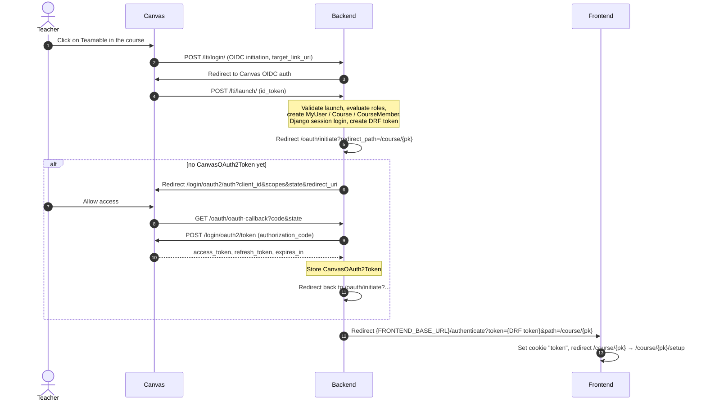

# Backend: LMS integration

This page describes **what Teamable currently needs from the LMS** and how the integration is implemented in the code. It is not meant to be complete code documentation. It only covers what relates to the LMS integration.

- **Version:** `teamable-backend` @ `183a36c`, `teamable-frontend` @ `98ce1c8`
- **Only supported LMS:** Canvas (`LMSTypeOptions.CANVAS`)
- Paths without a prefix refer to `teamable-backend/`. Paths with `frontend:` refer to `teamable-frontend/`.

---

## 1. Summary: What does Teamable need from the LMS?

This is the LMS-neutral checklist. For Moodle, a counterpart has to be found for every row.

| # | Capability | Purpose | Canvas today |
|---|-----------|------|--------------|
| 1 | **Launching the tool from within the course with SSO** | Teachers open Teamable from the course. Teamable learns who they are, which course they are in and which role they have. | LTI 1.3 launch (OIDC) with the custom claims `canvas_course_id` and `canvas_user_id` |
| 2 | **API access on behalf of the teacher** | All REST calls run with the teacher's permissions. | OAuth2 authorization code flow with refresh token |
| 3 | **List the students of a course** | Import students (name, LMS user ID, SIS ID) | `GET /api/v1/courses/:course_id/enrollments?type[]=StudentEnrollment` |
| 4 | **List the assignments of a course** | Find grade sources | `GET /api/v1/courses/:course_id/assignments` |
| 5 | **Read grades per assignment and student** | Grade-based team formation | `GET /api/v1/courses/:course_id/assignments/:id/submissions` |
| 6 | **Create a survey or quiz in the course** *(optional)* | Opt-in: students agree to take part | `POST /api/v1/courses/:course_id/quizzes` + `POST .../questions` (Classic Quizzes) |
| 7 | **Read the responses to this survey** *(optional)* | Only import students who agreed | `GET .../quizzes/:id`, `.../questions`, `.../submissions`, `GET /api/v1/quiz_submissions/:id/questions` |
| 8 | **Create groups and assign members** | Write the generated teams back to the LMS | `POST .../group_categories`, `POST /group_categories/:id/groups`, `POST /groups/:id/memberships` |
| 9 | **Deep links into the LMS** *(UI only)* | Links to the quiz and the user profile | URL pattern `{lms}/courses/{id}/quizzes/{id}` or `.../users/{id}` |

Currently **not** taken from the LMS: sections, relationships (friend/enemy), profile attributes other than grades, and projects.

The complete list of requested OAuth scopes is in [`src/canvas_oauth/canvas.py`](https://github.com/Teamable-Analytics/teamable-backend/blob/183a36c/src/canvas_oauth/canvas.py) (`SCOPES_USED`). It matches exactly the endpoints in the table above plus `GET /api/v1/courses/:id`.

---

## 2. Architecture


**Key points**

- **Only the backend talks to the LMS.** The frontend only calls the Teamable REST API (`frontend: src/app/(providers)/query-client-provider.tsx`, base URL `BACKEND_BASE_URI`). The only exception are plain links into the LMS (opt-in quiz, user profile).
- There are **three channels** to the LMS:
  1. **LTI 1.3** (browser → backend, incoming): launch and identity. Library: `PyLTI1p3`. Code: [`src/lti/`](https://github.com/Teamable-Analytics/teamable-backend/tree/183a36c/src/lti)
  2. **OAuth2** (browser redirects + server → Canvas): access key. Code: [`src/canvas_oauth/`](https://github.com/Teamable-Analytics/teamable-backend/tree/183a36c/src/canvas_oauth), an embedded and modified copy of *django-canvas-oauth*
  3. **REST API** (server → Canvas, outgoing): reading and writing data. Library: `canvasapi==3.2.0`. Code: [`src/app/canvas/`](https://github.com/Teamable-Analytics/teamable-backend/tree/183a36c/src/app/canvas)
- All LMS actions are **synchronous and triggered by the user** (button → POST → Canvas calls → response). There are no background jobs, no cron-based sync and no webhooks.
- Django apps: `accounts` (user, email login), `app` (domain + Canvas code), `lti`, `canvas_oauth`, `teamable` (settings and URLs).

**URL entry points** ([`src/teamable/urls.py`](https://github.com/Teamable-Analytics/teamable-backend/blob/183a36c/src/teamable/urls.py))

| Prefix | App |
|--------|-----|
| `/lti/` | LTI login/launch |
| `/oauth/` | Canvas OAuth (`initiate`, `oauth-callback`) |
| `/api/v1/` | Course API ([`src/app/urls.py`](https://github.com/Teamable-Analytics/teamable-backend/blob/183a36c/src/app/urls.py)) |
| `/api/v1/accounts/` | User, sign-up, log-in |
| `/admin/` | Django admin (create org, course, CourseMember, generate JWT) |

---

## 3. Canvas integration in the code

### 3.1 Overview of the relevant files

| File | Purpose |
|-------|-------|
| [`src/lti/views.py`](https://github.com/Teamable-Analytics/teamable-backend/blob/183a36c/src/lti/views.py) | LTI OIDC login and LTI launch. Creates user, course and CourseMember. |
| [`src/lti/lti_util.py`](https://github.com/Teamable-Analytics/teamable-backend/blob/183a36c/src/lti/lti_util.py) | Loads the LTI tool configuration from ENV or a JSON file |
| [`src/canvas_oauth/oauth.py`](https://github.com/Teamable-Analytics/teamable-backend/blob/183a36c/src/canvas_oauth/oauth.py) | `get_oauth_token`, `handle_missing_token`, `oauth_callback`, `initiate_oauth_check`, `refresh_oauth_token` |
| [`src/canvas_oauth/canvas.py`](https://github.com/Teamable-Analytics/teamable-backend/blob/183a36c/src/canvas_oauth/canvas.py) | Builds the authorization URL (incl. scopes) and fetches tokens via `POST /login/oauth2/token` |
| [`src/canvas_oauth/middleware.py`](https://github.com/Teamable-Analytics/teamable-backend/blob/183a36c/src/canvas_oauth/middleware.py) | Catches `MissingTokenError` and starts the OAuth flow |
| [`src/canvas_oauth/models.py`](https://github.com/Teamable-Analytics/teamable-backend/blob/183a36c/src/canvas_oauth/models.py) | `CanvasOAuth2Token` (token storage) |
| [`src/app/canvas/canvas_api.py`](https://github.com/Teamable-Analytics/teamable-backend/blob/183a36c/src/app/canvas/canvas_api.py) | `init_canvas()` returns a `canvasapi.Canvas(org.lms_api_url, oauth_token)` |
| [`src/app/canvas/import_students.py`](https://github.com/Teamable-Analytics/teamable-backend/blob/183a36c/src/app/canvas/import_students.py) | Student import (incl. opt-in filter) |
| [`src/app/canvas/import_attribute.py`](https://github.com/Teamable-Analytics/teamable-backend/blob/183a36c/src/app/canvas/import_attribute.py) | Grade import → attribute "above/below median" |
| [`src/app/canvas/opt_in_quiz.py`](https://github.com/Teamable-Analytics/teamable-backend/blob/183a36c/src/app/canvas/opt_in_quiz.py) | Create the opt-in quiz in Canvas |
| [`src/app/canvas/export_team.py`](https://github.com/Teamable-Analytics/teamable-backend/blob/183a36c/src/app/canvas/export_team.py) | Export a team set as Canvas groups |
| [`src/app/views/course.py`](https://github.com/Teamable-Analytics/teamable-backend/blob/183a36c/src/app/views/course.py) | REST endpoints that call the functions above |
| [`src/teamable/settings.py`](https://github.com/Teamable-Analytics/teamable-backend/blob/183a36c/src/teamable/settings.py) | `CANVAS_BASE_URL`, `CANVAS_OAUTH_*`, `LTI_ENABLED`, `SESSION_COOKIE_SAMESITE=None`, `SECURE_PROXY_SSL_HEADER` |

Every function in `app/canvas/*` first checks `course.organization.lms_type == CANVAS` and **otherwise returns without doing anything**. This is the only abstraction that exists today. There is no LMS interface or adapter yet.

### 3.2 Login (LTI 1.3) and access key (OAuth2)



**LTI launch details** ([`src/lti/views.py`](https://github.com/Teamable-Analytics/teamable-backend/blob/183a36c/src/lti/views.py) `launch`)

- Evaluated claims:
  - `https://purl.imsglobal.org/spec/lti/claim/roles` → role
  - `https://purl.imsglobal.org/spec/lti/claim/custom` → `canvas_course_id`, `canvas_user_id` (**required**: the values must be configured as custom fields in the developer key, otherwise the launch aborts with an exception)
  - `given_name`, `family_name` → name
  - `https://purl.imsglobal.org/spec/lti/claim/context.label` → course name (only when first created)
  - `iss` → part of the username
- Role mapping: `Administrator`, `ContentDeveloper`, `Instructor` and `TeachingAssistant` become `Instructor`. Everything else becomes `Student`.
- The following is created or updated:
  - `MyUser` with `username = "{canvas_user_id}+{iss}"` and an unusable password
  - `Course` via `get_or_create(lms_course_id=canvas_course_id)`. The organization is always `Organization.objects.first()`.
  - `CourseMember` via `get_or_create(user, course)` with `lms_id = canvas_user_id`. The role is set again on every launch.
- In `DEBUG`, `validate_deployment` is skipped.
- The LTI configuration (issuer, client ID, keys, endpoints) comes either from `LTI_CONF_JSON` + `LTI_CONF_JSON_PRIVATE_KEYS` (ENV) or from `LTI_CONF_FOLDER/LTI_CONF_FILE_NAME` (file, default `src/lti/config/lti_config_settings.json`, listed in `.gitignore`). There is no example in the repo.

**OAuth2 details** ([`src/canvas_oauth/`](https://github.com/Teamable-Analytics/teamable-backend/tree/183a36c/src/canvas_oauth))

- Endpoints: `{CANVAS_OAUTH_CANVAS_DOMAIN}/login/oauth2/auth` and `/login/oauth2/token`. The domain comes from the ENV variable `CANVAS_BASE_URL` and is global, not per organization.
- Scopes: see `SCOPES_USED` (section 1)
- `state` and the redirect URI are stored in the **Django session**. That is why `SESSION_COOKIE_SAMESITE = None` is set, because the flow runs in the Canvas iframe or cross-site.
- Token refresh: before every API call, `get_oauth_token()` checks `expires_within(CANVAS_OAUTH_TOKEN_EXPIRATION_BUFFER)` (default 0) and, if needed, fetches a new access token via `grant_type=refresh_token`.
- If there is no token, `MissingTokenError` is raised. The `OAuthMiddleware` turns it into a redirect to Canvas. This only works for browser navigation. For `fetch` calls from the frontend the redirect fails, and the UI shows "Please relaunch Teamable from your Canvas dashboard".

### 3.3 Fetching data and writing back

All calls go through `init_canvas(request, organization)`, i.e. with the **OAuth token of the currently logged-in user** against `organization.lms_api_url`.

| Action (backend function) | Trigger | Canvas calls (via `canvasapi`) | Result in Teamable |
|---|---|---|---|
| `import_students_from_canvas` | Button "Import students" | `get_course`, `get_enrollments(type=["StudentEnrollment"])`; if `lms_opt_in_quiz_id` is set: `get_quiz`, `quiz.get_questions()`, `quiz.get_submissions()`, `submission.get_submission_questions()` | `CourseMember` (role `Student`) via `upsert_course_member` (key: `lms_id`). Fields: `first_name`/`last_name` from `user.sortable_name` ("Last name, First name"), `lms_id = user.id`, `sis_user_id` |
| `import_gradebook_attribute_from_canvas` | Button "Import gradebook data" | `get_course`, `get_assignments()`, `get_submissions()` per assignment | One `Attribute` (`manage_type=Grade`) per assignment with 2 options + one `AttributeResponse` per student (see section 7) |
| `create_opt_in_quiz_canvas` | Tile "Generate opt-in quiz" | `create_quiz({title:"Opt-in", quiz_type:"survey"})`, `quiz.create_question(...)` with the answers "Yes" (weight 100) and "No" (weight 0) | `Course.lms_opt_in_quiz_id = quiz.id` |
| `export_team_to_canvas` | Button "Export to Canvas" | `create_group_category(name)` (on `BadRequest` a suffix "(2)", "(3)" … is appended, max. 20 attempts), `create_group(name)` per team, `group.create_membership(lms_id)` per member | Only in Canvas. Nothing is stored in Teamable, not even the Canvas group IDs. |

**When is data fetched?** Only when a button is pressed. There is no automatic sync. A new import updates existing records via upsert, but does not delete students who have since been removed from the course.

**What is written back?** Only two things: the **opt-in quiz** and the **groups** (group category + groups + memberships). Grades or other data are never written back.

**Opt-in logic:** The question has exactly one "correct" answer ("Yes", weight 100). A submission counts as consent if `submission_question.correct` is set or, as a fallback, the selected `answer` matches the answer ID of "Yes". The code assumes exactly one question and one submission per user.

---

## 4. Data model with LMS relation


| Model.field | Meaning | Source of the value |
|---|---|---|
| `Organization.lms_type` | LMS type, currently only `"CANVAS"` | set manually in the Django admin |
| `Organization.lms_api_url` | Base URL of the LMS (without trailing `/`). Used for API calls and deep links | set manually in the admin |
| `Course.lms_course_id` | Canvas course ID | LTI launch (`custom.canvas_course_id`) or manually in the admin |
| `Course.lms_opt_in_quiz_id` | ID of the opt-in quiz in Canvas | set by `create_opt_in_quiz_canvas` (or manually) |
| `Course.lms_access_token` | **Legacy**: formerly a manually entered Canvas token. **No longer read** by the code. It can only still be written via `CourseUpdateSerializer` (PUT/PATCH `/api/v1/courses/{id}/`). | Admin/API |
| `Course.name` | Course name | LTI `context.label` on the first launch, otherwise admin |
| `CourseMember.lms_id` | Canvas user ID. Used for the import (upsert key), grade mapping (`submission.user_id`), group export and `lms_link`. Unique per course. | Import (`enrollment.user.id`) or LTI (`custom.canvas_user_id`) |
| `CourseMember.sis_user_id` | Student ID number or SIS ID. Displayed, searched and sorted in the student list. Unique per course. | Import (`enrollment.sis_user_id`, if available) |
| `CourseMember.first_name` / `last_name` | Name | Import (`sortable_name`) or LTI (`given_name`/`family_name`) |
| `CourseMember.role` | `Student` / `Instructor` | Import → always `Student`. LTI → from the role claims. |
| `CourseMember.user` | Link to the login account. `NULL` for imported students. | LTI launch or email sign-up via JWT |
| `CourseMember.lms_link` *(property)* | `{lms_api_url}/courses/{lms_course_id}/users/{lms_id}` | computed |
| `Course.opt_in_quiz_link` *(property)* | `{lms_api_url}/courses/{lms_course_id}/quizzes/{lms_opt_in_quiz_id}` | computed |
| `MyUser.username` | `"{canvas_user_id}+{iss}"` for LTI users, email for sign-up users | LTI / sign-up |
| `CanvasOAuth2Token.access_token` / `refresh_token` / `expires` | OAuth access to Canvas, **per user** (OneToOne), not per course | OAuth callback / refresh |
| `Attribute` (`manage_type="Grade"`) | One attribute per Canvas assignment, name `"{assignment.name} - {assignment.id}"` | Grade import |
| `AttributeOption` (`"Above Average"`/`"Below Average"`, values `Above`/`Below`) | Grade category | Grade import |
| `AttributeResponse` | Assignment of a student → category | Grade import |

Not related to the LMS, but relevant: `Section` (**not** imported from Canvas, only via admin or `makefakeclass`), `Relationship`, `TeamSet`/`Team`, `TeamTemplate*`/`AttributeTemplate` (currently unused).

---

## 5. Flow from the teacher's perspective

All course endpoints are in [`src/app/views/course.py`](https://github.com/Teamable-Analytics/teamable-backend/blob/183a36c/src/app/views/course.py) (`CourseViewSet`, router prefix `/api/v1/courses/`). The frontend sends `Authorization: Token <token>` from the cookie.

| # | Step in the UI | Frontend (page / hook) | Backend endpoint | LMS contact |
|---|---|---|---|---|
| 0 | Launch Teamable in Canvas | – | `POST /lti/login/`, `POST /lti/launch/`, `GET /oauth/initiate`, `GET /oauth/oauth-callback` | yes (LTI + OAuth) |
| 0a | Take over the token | `/authenticate` (`frontend: src/app/(accounts)/authenticate/route.ts`) | – | no |
| 0b | Start: load user and course | `/` → `/course/{id}/setup`; `use-auth-user-query.ts`, `useCourse.tsx` | `GET /api/v1/accounts/users/me/`, `GET /api/v1/courses/{id}/` | no |
| 1 | Show onboarding progress | Page *Onboarding* (`setup/page.tsx`, `useSetupSteps.tsx`) | `GET /api/v1/courses/{id}/get_onboarding_progress/` | no (returns `opt_in_quiz_link`, `has_*` flags) |
| 2 | *(optional)* "Generate opt-in quiz" / "View opt-in quiz" | `GenerateOptInQuiz.tsx`, `use-create-opt-in-quiz.ts` | `POST /api/v1/courses/{id}/create_opt_in_quiz_lms/` | **writes** quiz |
| 3 | "Import students" (onboarding or page *Students*) | `use-import-students-from-lms.ts` | `POST /api/v1/courses/{id}/import_students_from_lms/` | **reads** enrollments (+ quiz responses) |
| 4 | View, search, filter the student list | Page *Students* (`useStudents.tsx`) | `GET /api/v1/courses/{id}/students/?page&search&sort&sections`, `GET /api/v1/course/{id}/sections/` | no (link "open in LMS" via `lms_link`) |
| 5 | "Define student profile" | – (step is disabled) | – | – |
| 6 | "Import gradebook data" (onboarding or *Students*) | `use-import-student-gradebook-data.ts` | `POST /api/v1/courses/{id}/import_gradebook_attribute_from_lms/` | **reads** assignments + submissions |
| 7 | "(Optional) Project setup" | – (disabled) | – | – |
| 8 | "Generate teams": dialog for choosing the grade source | `GenerateTeamsAttributeSelector.tsx`, `use-grade-attributes.ts` | `GET /api/v1/courses/{id}/grade-attributes/` | no |
| 9 | Generate teams | `use-generate-teams.tsx` | `POST /api/v1/courses/{id}/generate_teams/` body `{attribute}` → `{team_set_id}` | no |
| 10 | View team sets and teams | Pages *Team sets* and *Team set* (`use-list-team-sets.ts`, `use-team-set.ts`) | `GET /api/v1/courses/{id}/get_team_sets/`, `GET /api/v1/courses/{id}/team-sets/{teamSetId}/` | no |
| 11 | "Export to Canvas" | Page *Team set* (`use-export-team-set-lms.ts`) | `POST /api/v1/courses/{id}/export_team_to_lms/` body `{team_set}` | **writes** groups |

The onboarding steps are derived from `get_onboarding_progress`: `has_students` → `has_attribute_responses` → `has_team_set`.

Other endpoints that are not called from the course flow: `PUT/PATCH /api/v1/courses/{id}/` (course data incl. `lms_access_token`). The viewsets for attributes, teams, sections and relationships exist, but are **not routed**. The page *Project sets* calls `/api/v1/teamset-templates`, but this endpoint does not exist.

---

## 6. Login, permissions and token storage

### 6.1 Teachers: two ways

**A) Via LTI (production)**, see section 3.2. Result: Django session, DRF token, Canvas OAuth token. Only this way creates a Canvas OAuth token, and only then do the LMS buttons work.

**B) Via email and password (dev/fallback)**
1. A `CourseMember` (role `Instructor`, `user` empty) is created in the admin.
2. The admin action "Create JWT token for selected course members" creates a JWT `{course_member_id}`, signed with `SECRET_KEY` (HS256, without expiry).
3. Open `/accounts/signup?token=…` in the frontend → `POST /api/v1/accounts/sign-up/` `{email, password, token}`. The backend creates a `MyUser` and links it to the CourseMember. The JWT can only be used once, as long as `user` is empty.
4. `POST /api/v1/accounts/log-in/` `{email, password}` → `{token}` (DRF token) → cookie.

Such users have **no** `CanvasOAuth2Token`. As soon as the organization is of type `CANVAS`, all LMS actions fail.

### 6.2 Students

- Students **do not log in**. They only exist as data (`CourseMember` with `user = NULL`), created by the import.
- Their only interaction with the LMS is filling in the opt-in quiz in Canvas.
- An LTI launch by students is technically possible (role `Student`). They would then also be sent into the OAuth flow and afterwards get `403` on every course endpoint.

### 6.3 Permissions

- [`src/app/permissions.py`](https://github.com/Teamable-Analytics/teamable-backend/blob/183a36c/src/app/permissions.py) `IsCourseInstructor`: `has_permission` always returns `True`. The actual check happens at object level via `Course.has_edit_permission`. Allowed are superusers, `is_staff` and users with `CourseMember(role=Instructor)` in the course.
- Because the course endpoints call `get_object()`, every course endpoint is protected this way.
- On the Canvas side, the teacher's permissions (OAuth runs on behalf of the user) and the requested scopes also apply.
- Authentication in DRF: `BasicAuthentication` + `TokenAuthentication` (the session is not used for the API).

### 6.4 Where are which tokens stored?

| Token | Created by | Stored in | Used for |
|---|---|---|---|
| LTI `id_token` (JWT from Canvas) | Canvas on launch | not persisted (PyLTI1p3 uses session/cache for `state`/`nonce`) | Identity on launch |
| Django session cookie | `auth_login` in the LTI launch | Browser cookie + DB table `django_session` | only for the OAuth flow (`state`, redirect URIs, `request.user`) |
| **Canvas OAuth access/refresh token** | `/oauth/oauth-callback` | DB table `canvas_oauth_canvasoauth2token` (**plain text**, 1 per user) | all Canvas REST calls (bearer) |
| **DRF token** (Teamable API) | LTI launch / `initiate` / log-in | DB table `authtoken_token`. Passed to the frontend via **URL query** and stored there in the cookie `token` (not HttpOnly, path `/`) | Header `Authorization: Token …` on all API calls |
| Sign-up JWT | Admin action | nowhere (stateless) | one-time link CourseMember ↔ new user |
| `Course.lms_access_token` | manually | DB | **unused** (legacy) |
| LTI private key / tool config | Operator | ENV (`LTI_CONF_JSON*`) or file `src/lti/config/` | Signing and validation for LTI |
| `CANVAS_OAUTH_CLIENT_ID/SECRET` | Canvas developer key (API key) | ENV / `.env` | OAuth token requests |

---

## 7. Data for team formation

Today exactly **two kinds of LMS data** are used:

1. **Participants**: students from the enrollments, optionally filtered by the opt-in quiz
2. **Grades**: per assignment from the submissions

Sections, relationships, projects and profile questions play no role in the current algorithm.

### 7.1 Grade import ([`import_attribute.py`](https://github.com/Teamable-Analytics/teamable-backend/blob/183a36c/src/app/canvas/import_attribute.py))

For **every** assignment with `grading_type` ∈ {`points`, `percent`}:

1. Load all submissions. Only submissions from students who have already been imported (`lms_id == submission.user_id`) are considered.
2. Score = `submission.score`. Missing scores (`None`) count as **0**.
3. Sort by score in ascending order. `median_index = (n + 1) // 2`.
4. Create or reuse the attribute `"{assignment.name} - {assignment.id}"` (`manage_type=Grade`) with the options *Above Average* / *Below Average*.
5. The upper half (index ≥ `median_index`) gets *Above*, the rest *Below*. This is stored via upsert as `AttributeResponse`.

So **no raw grade** is stored, only the binary category above or below the median.

### 7.2 Team generation ([`src/app/services/team_generation.py`](https://github.com/Teamable-Analytics/teamable-backend/blob/183a36c/src/app/services/team_generation.py))

- Input: one grade attribute (chosen in the dialog "Select a grade source").
- List = all *Above* students, followed by all *Below* students (not sorted by score within the groups).
- Pairs are formed from the first and last entry of the list, so each pair has one *Above* and one *Below* person. With an odd number, a team of 3 is formed at the end.
- Result: `TeamSet` "Study Buddy - n" with teams "Team 1…k".
- A call to the external Teamable algorithm API (`api.teamableanalytics.ok.ubc.ca`) is **commented out** in the code. The ENV variables `TEAM_GENERATION_API_URL/KEY` are not read.

### 7.3 Writing back to the LMS

On export, teams are created as a **Canvas group category** (name = team set name) with **one group per team**. Members are assigned via `lms_id`. Members without `lms_id` are skipped.

---

## 8. Local setup (with and without Canvas)

### 8.1 Without Canvas (recommended for testing the UI)

Trick: If the organization does **not** have `lms_type=CANVAS`, all LMS functions return `200 OK` immediately without contacting Canvas or OAuth.

**Backend** (Python 3.11):
```bash
cd teamable-backend
python -m venv venv && source venv/bin/activate      # Windows: venv\Scripts\activate
pip install -r requirements.txt
cp sample.env .env           # DEBUG=TRUE → SQLite, CORS open
cd src
python manage.py migrate
python manage.py createsuperuser
python manage.py runserver   # http://localhost:8000
```

**Data in the admin** (`http://localhost:8000/admin`):
1. Create an `Organization`: any name, **leave LMS type empty**.
2. Create a `Course`: choose the organization, leave the LMS fields empty.
3. Generate students: `python manage.py makefakeclass <course_id> <number_of_students> <number_of_sections>`. The course must exist beforehand, otherwise the command fails because `organization` is required.
4. Create a grade attribute for team formation **manually**, because the import does nothing without Canvas:
   - `Attribute`: `course`, any `name`, `manage_type = Grade`, `value_type = String`, `max_selections = 1`
   - 2× `AttributeOption`: `label = "Above Average"` / `"Below Average"` (the labels must be exactly like this)
   - One `AttributeResponse` per student → one of the two options
5. Instructor account: create a `CourseMember` (role `Instructor`, user empty) → select it in the list → action "Create JWT token…" → copy the token.

**Frontend** (Node 20.16):
```bash
cd teamable-frontend
cp sample.env .env           # BACKEND_BASE_URI=http://localhost:8000
nvm use && yarn && yarn dev  # http://localhost:3000
```
Then open `http://localhost:3000/accounts/signup?token=<JWT>`, register and use the onboarding. "Generate teams" works with the manually created attribute.

### 8.2 With Canvas

- `sample.env` contains `CANVAS_BASE_URL`, `CANVAS_OAUTH_CLIENT_ID`, `CANVAS_OAUTH_CLIENT_SECRET`, `FRONTEND_BASE_URL` as well as `LTI_CONF_FOLDER`/`LTI_CONF_FILE_NAME`.
- Two **developer keys** are needed in Canvas:
  1. **LTI key** (LTI 1.3) with redirect/target `…/lti/launch/`, OIDC login `…/lti/login/` and the custom fields `canvas_course_id=$Canvas.course.id` and `canvas_user_id=$Canvas.user.id`
  2. **API key** (OAuth2) with redirect URI `…/oauth/oauth-callback` and the scopes from `SCOPES_USED` enabled
- Place the matching `lti_config_settings.json` (PyLTI1p3 format, incl. private key) under `src/lti/config/`.
- In the organization, set `LMS Type = CANVAS` and `LMS API URL = CANVAS_BASE_URL`.
- A local Canvas instance via Docker is described in [`docs/local_canvas.md`](https://github.com/Teamable-Analytics/teamable-backend/blob/183a36c/docs/local_canvas.md). The guide comes from another project and needs to be adapted.
- The README step "enter the LMS access token in the course" is **outdated**. This field is no longer used; access works exclusively via OAuth.

### 8.3 Docker / production

`docker-compose.yml` starts nginx (port 8002 → 8000), `web` (gunicorn, `scripts/runserver.sh`: collectstatic + migrate) and Postgres (`db.env`). With `DEBUG≠TRUE`, `SERVER_NAME` and the Postgres variables are required.

---

## 9. Issues and open points

These points are relevant for a Moodle integration or an LMS abstraction layer:

1. **No LMS adapter:** The Canvas code is wired directly into `app/canvas/*` and `canvas_oauth/*`. The views import the Canvas functions directly, and `LMSTypeOptions` only knows `CANVAS`. For Moodle, an interface with the operations from section 1 would make sense.
2. **Two sources for the LMS URL:** OAuth uses the global ENV variable `CANVAS_BASE_URL`, the REST calls use `Organization.lms_api_url`.
3. **Multi-tenancy:** The LTI launch always uses `Organization.objects.first()`. Courses are only looked up by `lms_course_id`, without organization or issuer.
4. **Upsert key on import:** `upsert_course_member` only searches by `lms_id`, not by `(course, lms_id)`. The same person in two courses would therefore "move" to the course imported last.
5. **Canvas-specific assumptions:** The name is built from `sortable_name` by splitting at the comma. The opt-in uses Classic Quizzes incl. a "correct" answer. The group logic is based on group categories.
6. **Error handling for a missing OAuth token:** The redirect by the middleware does not work for API `fetch` calls. The user has to relaunch Teamable from Canvas.
7. **Security:** `SECRET_KEY` is hard-coded. OAuth tokens are stored in plain text in the DB. The DRF token is passed via the URL and stored in a non-HttpOnly cookie. Sign-up JWTs do not expire.
8. **Unused or incomplete:** `Course.lms_access_token`, `TEAM_GENERATION_API_*`, unrouted viewsets, the page *Project sets* and the onboarding steps "Student profile" and "Project setup".
