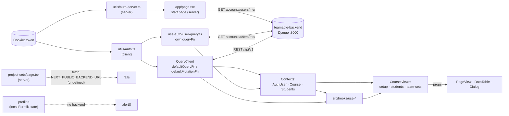

# Frontend: Code inventory

> **Purpose:** This page maps the current state of `teamable-frontend`: project structure, key files, data flows and all existing views. It is the starting point for the upcoming implementation in Epic 2 (Automate Team Generation). It describes the code as it is and does not evaluate it.
>
> **Version:** `teamable-frontend` @ [`98ce1c8`](https://github.com/Teamable-Analytics/teamable-frontend/tree/98ce1c8), `teamable-backend` @ [`183a36c`](https://github.com/Teamable-Analytics/teamable-backend/tree/183a36c) (as of 2026-10-29). Paths are relative to `teamable-frontend/` unless stated otherwise.
>
> **Important upfront:** The frontend is already connected to `teamable-backend` and contains no mock data. Every view that shows data loads it from the backend REST API, with two exceptions: Profiles keeps its own data only locally, and Project Sets calls an endpoint that does not exist. Without a running backend, only the static pages (login, signup, 401, privacy, 404) can be opened, and logging in does not work. The start page `/` fails with HTTP 500, and the course views cannot load their course (`GET courses/{id}/`). The LMS-specific parts are described in [Frontend: LMS integration](frontend-lms-integration.md).

**Claude Artifact** https://claude.ai/artifact/QMTdvhY9XSAHpRmnQL7UZi#setup

---

## 1. Technical overview

| Topic | Status |
|---|---|
| Framework | Next.js 14.0.4 (App Router), React 18, TypeScript 5 (`strict`), see [package.json](https://github.com/Teamable-Analytics/teamable-frontend/blob/98ce1c8/package.json) |
| Data fetching | TanStack React Query v5 with a global default `queryFn`; mutations call the shared `defaultMutationFn` |
| State | React Query cache, three React contexts (auth user, course, students), a global toast store |
| UI | Tailwind CSS 3, shadcn/ui (Radix), lucide and Radix icons, TanStack Table, dnd-kit |
| Forms | Formik + Yup |
| Node | v20.16.0 (`.nvmrc`) |
| Configuration | `.env` with `BACKEND_BASE_URI`, value `http://localhost:8000` in [sample.env](https://github.com/Teamable-Analytics/teamable-frontend/blob/98ce1c8/sample.env). The Project Sets page also reads `NEXT_PUBLIC_BACKEND_URL`, which is defined neither in `sample.env` nor in `next.config.js` |
| Code quality | ESLint (`next/core-web-vitals`, `@tanstack/eslint-plugin-query` and own style rules) |
| CI | [check.yml](https://github.com/Teamable-Analytics/teamable-frontend/blob/98ce1c8/.github/workflows/check.yml): `yarn lint` and `tsc`. No tests, no build |
| Tests | Jest and Cypress are set up, each with one example test only |
| Deployment | [Dockerfile](https://github.com/Teamable-Analytics/teamable-frontend/blob/98ce1c8/Dockerfile) (`yarn build` in the image) + [docker-compose.yml](https://github.com/Teamable-Analytics/teamable-frontend/blob/98ce1c8/docker-compose.yml) (port 8003 → 3000) |

### Starting the frontend

```bash
nvm use               # Node 20.16.0
cp sample.env .env
yarn                  # install dependencies (missing in the README)
yarn dev              # http://localhost:3000
```

The setup in the [README](https://github.com/Teamable-Analytics/teamable-frontend/blob/98ce1c8/README.md) needs a running `teamable-backend` on port 8000 and an instructor signup token for the first account. For setups without Canvas, see section 8 of [Frontend: LMS integration](frontend-lms-integration.md).

All commands work at this commit with Node 20.16.0 and Yarn 1.22.22:

| Command | Result |
|---|---|
| `yarn lint` | No warnings or errors |
| `yarn tsc` | No errors |
| `yarn test` | One example test, passes |
| `yarn build` | Successful. The route list has the same 14 entries as the view table in [section 4](#4-views); the 404 page appears as `/_not-found` |

### Folder structure

```
teamable-frontend/
├── src/
│   ├── app/                              → Next.js App Router (folder = route)
│   │   ├── layout.tsx                    → root layout: font, QueryClientProvider, Toaster
│   │   ├── page.tsx                      → "/": redirects to signup, 401 or the user's first course
│   │   ├── not-found.tsx                 → 404 page
│   │   ├── (providers)/                  → QueryClient (fetch logic) + AuthUserContext
│   │   ├── (accounts)/                   → login, signup, 401, authenticate (route handler)
│   │   ├── (marketing)/privacy/          → privacy page
│   │   └── (app)/                        → app area with AuthUserContextProvider (client-side redirect to login)
│   │       └── course/[courseId]/        → CourseContext + navbar for all course views
│   │           ├── (hooks)/useCourse.tsx → loads the course
│   │           ├── components/           → GenerateTeamsAttributeSelector (dialog)
│   │           ├── setup/                → onboarding wizard (main flow)
│   │           ├── students/             → student table, filters in its own context
│   │           ├── team-sets/            → team set list + [teamSetId] detail page
│   │           ├── profiles/             → question editor (placeholder, no backend)
│   │           └── project-sets/         → project set list (not working)
│   ├── components/                       → Navbar, Footer, Logo, SearchBar, selectors
│   │   ├── ui/                           → 24 shadcn/ui building blocks incl. DataTable
│   │   └── views/Page.tsx                → page frame of the course views and privacy: breadcrumbs, title, actions
│   ├── hooks/                            → 14 files: 12 backend hooks, logout, toasts
│   ├── _temp_types/                      → hand-written types of the backend responses
│   ├── lib/utils.ts                      → cn() (merges Tailwind classes)
│   ├── routes.ts                         → auth routes
│   └── types.ts                          → Action, NonEmptyArray
├── utils/                                → auth header from the cookie (client/server), title()
├── public/                               → logo, login image (plus two unused SVGs)
├── test/, cypress/                       → example tests
└── next.config.js, tailwind.config.{js,ts}, Dockerfile, docker-compose.yml
```

**Conventions:**

- **Route groups:** `( … )` folders add no URL segment. They are used for layout areas (`(app)`, `(accounts)`, `(marketing)`), for the provider files (`(providers)`) and for private subfolders inside routes (`(hooks)`, `(components)`, `(table)`).
- **Hook files:**
  - `src/hooks/` uses kebab-case (`use-generate-teams.tsx`).
  - Hooks inside route folders use camelCase (`useCourse.tsx`, `useSetupSteps.tsx`, `useStudents.tsx`).
- **Component files:**
  - Most own components outside `components/ui/` are PascalCase (`Navbar.tsx`, `SetupStepDetailCard.tsx`).
  - Kebab-case or lowercase: `components/ui/*`, `students/(table)/*`, all `columns.tsx`, `(providers)/*` and `components/icons.tsx`.
- **Import aliases:** `@/*` → `src/*` and `@public/*` → `public/*` ([tsconfig.json](https://github.com/Teamable-Analytics/teamable-frontend/blob/98ce1c8/tsconfig.json)). `utils/` sits outside `src/` and is imported with relative paths.

---

## 2. Key files

| File | Purpose |
|---|---|
| [(providers)/query-client-provider.tsx](https://github.com/Teamable-Analytics/teamable-frontend/blob/98ce1c8/src/app/%28providers%29/query-client-provider.tsx) | Central fetch logic. `defaultQueryFn` (GET, `queryKey[0]` = path) and `defaultMutationFn` (POST) call `${BACKEND_BASE_URI}/api/v1/…` with `Authorization: Token …` (lines 18–65) |
| [(providers)/auth-user-provider.tsx](https://github.com/Teamable-Analytics/teamable-frontend/blob/98ce1c8/src/app/%28providers%29/auth-user-provider.tsx) | `AuthUserContext`: loads `accounts/users/me/` and redirects to the login if nobody is logged in (lines 35–47). It only wraps the `(app)` routes, so its code for sending logged-in users away from the login and signup pages never runs |
| [hooks/use-auth-user-query.ts](https://github.com/Teamable-Analytics/teamable-frontend/blob/98ce1c8/src/hooks/use-auth-user-query.ts) | Hook with its own `queryFn` for `accounts/users/me/` (not the default one). The start page calls the same fetch function `authUserQueryFn` on the server |
| [course/[courseId]/(hooks)/useCourse.tsx](https://github.com/Teamable-Analytics/teamable-frontend/blob/98ce1c8/src/app/%28app%29/course/%5BcourseId%5D/%28hooks%29/useCourse.tsx) | `CourseContext`: loads `courses/{id}/`, provides `courseId`, name, sections and `lmsType`. Shows "Course not found" if no course comes back (lines 35–69) |
| [hooks/use-generate-teams.tsx](https://github.com/Teamable-Analytics/teamable-frontend/blob/98ce1c8/src/hooks/use-generate-teams.tsx) | Team generation: `POST courses/{id}/generate_teams/` with `{ attribute }`, then a toast with a link to the new team set (lines 21–44) |
| [course/[courseId]/components/GenerateTeamsAttributeSelector.tsx](https://github.com/Teamable-Analytics/teamable-frontend/blob/98ce1c8/src/app/%28app%29/course/%5BcourseId%5D/components/GenerateTeamsAttributeSelector.tsx) | Dialog: select a grade attribute, then `onSubmit({ attribute })` |
| [components/GradeSourceAttributeSelector.tsx](https://github.com/Teamable-Analytics/teamable-frontend/blob/98ce1c8/src/components/GradeSourceAttributeSelector.tsx) | Combobox over `GET courses/{id}/grade-attributes/` |
| [setup/(hooks)/useSetupSteps.tsx](https://github.com/Teamable-Analytics/teamable-frontend/blob/98ce1c8/src/app/%28app%29/course/%5BcourseId%5D/setup/%28hooks%29/useSetupSteps.tsx) | Wizard logic: 5 steps, the current step is derived from `OnboardingProgress` (lines 19–111) |
| [students/(hooks)/useStudents.tsx](https://github.com/Teamable-Analytics/teamable-frontend/blob/98ce1c8/src/app/%28app%29/course/%5BcourseId%5D/students/%28hooks%29/useStudents.tsx) | Filter, sort and pagination state, synced with the URL query, server-side pagination (lines 108–344) |
| [components/views/Page.tsx](https://github.com/Teamable-Analytics/teamable-frontend/blob/98ce1c8/src/components/views/Page.tsx) | `PageView`: shared page frame with breadcrumbs, title and action buttons |
| [components/ui/data-table.tsx](https://github.com/Teamable-Analytics/teamable-frontend/blob/98ce1c8/src/components/ui/data-table.tsx) | Generic table: search, sorting, optional pagination, `rowAction` |
| [(accounts)/authenticate/route.ts](https://github.com/Teamable-Analytics/teamable-frontend/blob/98ce1c8/src/app/%28accounts%29/authenticate/route.ts) | Entry point after the LMS launch: sets the `token` cookie from the query parameter and redirects |
| [_temp_types/](https://github.com/Teamable-Analytics/teamable-frontend/tree/98ce1c8/src/_temp_types) | Types of the backend responses (see [section 3.4](#34-data-shapes)) |

---

## 3. Data flows

### 3.1 Where the data comes from

- **Backend:** Almost all data comes from `teamable-backend` via REST. There are 12 backend hooks in `src/hooks/` plus the queries in `useCourse.tsx` and `useStudents.tsx`. The complete list of calls is in section 9 of [Frontend: LMS integration](frontend-lms-integration.md).
- **Local only:** The Profiles view keeps its data in a Formik state only. "Save" shows the values in an `alert()` ([CategoricalSingle.tsx:195](https://github.com/Teamable-Analytics/teamable-frontend/blob/98ce1c8/src/app/%28app%29/course/%5BcourseId%5D/profiles/%28components%29/CategoricalSingle.tsx#L195)).
- **Hard-coded:**
  - texts: wizard steps, privacy text, signup quote
  - the "Unassigned Students" pseudo-team on the team set detail page
  - the navbar links
- **Mock data:** none in the app. `cypress/fixtures/example.json` is unused Cypress boilerplate.

### 3.2 How data moves

- **Server state** lives in the React Query cache. The query key is the API path. Exception: `accounts/users/me/` uses the path plus the auth header as key.
- **Server components outside the cache:**
  - The start page `/` fetches `accounts/users/me/` on the server.
  - The Project Sets page calls `fetch` directly with `NEXT_PUBLIC_BACKEND_URL`.
- **Contexts:** three React contexts share data across components:
  - `AuthUserContext` (logged-in user)
  - `CourseContext` (current course)
  - `StudentsContext` (filters and the current student page)
- **Pages** get their data from hooks and contexts and pass it to `PageView`, `DataTable` and dialogs via props.
- **Actions** use the `Action` object ([types.ts](https://github.com/Teamable-Analytics/teamable-frontend/blob/98ce1c8/src/types.ts)): `onClick` → mutation → usually `refetch()` of the affected query.
- **Feedback** is shown through a global toast store ([use-toast.ts](https://github.com/Teamable-Analytics/teamable-frontend/blob/98ce1c8/src/hooks/use-toast.ts)).
- **Authentication:**
  - The cookie `token` is set by the login ([use-login.ts:20](https://github.com/Teamable-Analytics/teamable-frontend/blob/98ce1c8/src/hooks/use-login.ts#L20)) or by `/authenticate`.
  - `utils/auth.ts` (client) and `utils/auth-server.ts` (server) build the `Authorization` header from it.



### 3.3 Flow "generate teams"

1. The user clicks "Generate teams". The button exists in two places:
   - the onboarding wizard ([useSetupSteps.tsx:64-71](https://github.com/Teamable-Analytics/teamable-frontend/blob/98ce1c8/src/app/%28app%29/course/%5BcourseId%5D/setup/%28hooks%29/useSetupSteps.tsx#L64-L71))
   - the team set list ([team-sets/page.tsx:35-43](https://github.com/Teamable-Analytics/teamable-frontend/blob/98ce1c8/src/app/%28app%29/course/%5BcourseId%5D/team-sets/page.tsx#L35-L43))
2. The dialog `GenerateTeamsAttributeSelector` opens and loads `GET courses/{id}/grade-attributes/`.
3. The user selects one grade attribute.
4. `POST courses/{id}/generate_teams/` with `{ "attribute": <id> }`. The response is `{ "team_set_id": <id> }`.
5. A toast with a "View" button links to `/course/{id}/team-sets/{teamSetId}`.
6. The detail page loads `GET courses/{id}/team-sets/{teamSetId}/` and shows the teams and their members in a read-only table.
7. Optionally: "Export to {LMS}" sends `POST courses/{id}/export_team_to_lms/` with `{ "team_set": <id> }`.

How the backend forms the teams is described in section 7.2 of [Backend: LMS integration](backend-lms-integration.md).

### 3.4 Data shapes

The types in [`src/_temp_types/`](https://github.com/Teamable-Analytics/teamable-frontend/tree/98ce1c8/src/_temp_types) are written by hand and mirror the JSON responses of the backend. They are not checked at runtime.

| Type | Fields | File |
|---|---|---|
| `TeamSet` | `id`, `name`, `teams: Team[]`, `unassigned_students: Student[]` | `teamSet.ts` |
| `Team` | `id`, `name`, `slug`, `members: Student[]` | `team.ts` |
| `Student` | `id`, `lms_id`, `sis_user_id`, `lms_link`, `name`, `first_name`, `last_name`, `sections?`, `role` | `student.ts` |
| `Course` | `id`, `name`, `organization { name, lms_type }`, `sections`, `lms_course_id` | `course.ts`, `organization.ts` |
| `OnboardingProgress` | `opt_in_quiz_link`, `has_created_opt_in_quiz`, `has_students`, `has_attribute`, `has_attribute_responses`, `has_team_set` | `onboarding.ts` |
| `AuthUser` | `id`, `username`, `first_name`, `last_name`, `email`, `is_staff`, `course_memberships: { course }[]` | `user.ts` |
| `PaginatedList<T>` | `count`, `next`, `previous`, `results: T[]` | `pagination.ts` |
| `GradeAttribute` | `id`, `name` | `src/hooks/use-grade-attributes.ts` |
| Generate teams | request `{ attribute: number }`, response `{ team_set_id: number }` | `src/hooks/use-generate-teams.tsx` |

Not used anywhere at the moment:

- `projects.ts` (`Project`, `ProjectRequirement`, `RequirementOperator`)
- `relationship.ts` (`Relationship` with friend/enemy values; the comment says it is "consistent with the team formation algorithms")
- `AnonUser` in `user.ts`

### 3.5 Integration points for Epic 2

These are the places in the current code that the team generation touches. They are only marked here.

| Topic | Place in the code |
|---|---|
| Request of the team generation (today only `attribute`) | [use-generate-teams.tsx:8-10, 23-28](https://github.com/Teamable-Analytics/teamable-frontend/blob/98ce1c8/src/hooks/use-generate-teams.tsx#L8-L28), [GenerateTeamsAttributeSelector.tsx](https://github.com/Teamable-Analytics/teamable-frontend/blob/98ce1c8/src/app/%28app%29/course/%5BcourseId%5D/components/GenerateTeamsAttributeSelector.tsx) |
| Result types | `teamSet.ts`, `team.ts`; unused related types in `projects.ts`, `relationship.ts` |
| Result display (read-only today) | [team-sets/[teamSetId]/page.tsx](https://github.com/Teamable-Analytics/teamable-frontend/blob/98ce1c8/src/app/%28app%29/course/%5BcourseId%5D/team-sets/%5BteamSetId%5D/page.tsx), `columns.tsx` |
| Student profile questions (local only today) | `course/[courseId]/profiles/`, disabled wizard step `STUDENT_PROFILES` ([useSetupSteps.tsx:164-171](https://github.com/Teamable-Analytics/teamable-frontend/blob/98ce1c8/src/app/%28app%29/course/%5BcourseId%5D/setup/%28hooks%29/useSetupSteps.tsx#L164-L171)) |
| Projects (not working today) | `course/[courseId]/project-sets/`, disabled wizard step `PROJECT_SETUP` ([useSetupSteps.tsx:189-196](https://github.com/Teamable-Analytics/teamable-frontend/blob/98ce1c8/src/app/%28app%29/course/%5BcourseId%5D/setup/%28hooks%29/useSetupSteps.tsx#L189-L196)) |
| Backend access | `query-client-provider.tsx:18-65` for almost all calls; additionally `use-auth-user-query.ts:14-32` and `project-sets/page.tsx:9-21` |

---

## 4. Views

### 4.1 Overview of all views

`C/` = `src/app/(app)/course/[courseId]/`. Status:

- **Complete:** works as intended (with the backend where the view needs one).
- **Partial:** works, but parts are disabled or commented out.
- **Placeholder:** UI only, no backend.
- **Not working:** fails at runtime.

| View | Route | File | Purpose | Data source | Status |
|---|---|---|---|---|---|
| Start | `/` | `src/app/page.tsx` | Redirect: no user → signup, no course → 401, otherwise setup of the user's **first** course. Reached after the email login and via "Home" and the logo; the LMS launch skips it | `GET accounts/users/me/` (server) | Complete |
| Login | `/accounts/login` | `(accounts)/accounts/login/page.tsx`, `LogInForm.tsx` | Login with email and password | `POST accounts/log-in/` | Complete |
| Signup | `/accounts/signup?token=` | `(accounts)/accounts/signup/page.tsx`, `SignupForm.tsx` | Registration with invitation token, then automatic login | `POST accounts/sign-up/`, `POST accounts/log-in/` | Complete |
| Auth error | `/accounts/401` | `(accounts)/accounts/401/page.tsx` | Static error message | – | Complete |
| Authenticate (route handler, no UI) | `/authenticate?token=&path=` | `(accounts)/authenticate/route.ts` | Sets the token cookie after the LMS launch and redirects | Query parameters | Complete; missing parameters return a plain object instead of a `Response` |
| Privacy | `/privacy` | `(marketing)/privacy/page.tsx` | Privacy text, linked in the footer | Hard-coded | Complete (text says "Study Buddy", line 32) |
| Course index | `/course/[courseId]` | `C/page.tsx` | Redirect to `setup` | – | Complete |
| Onboarding | `/course/[courseId]/setup` | `C/setup/page.tsx` | 5-step wizard: import students → define profile → import grades → project setup → generate teams | `GET get_onboarding_progress/`; `POST import_students_from_lms/`, `create_opt_in_quiz_lms/`, `import_gradebook_attribute_from_lms/`, `generate_teams/`; `GET grade-attributes/` | Partial: steps 2 and 4 are disabled and show placeholder text |
| Students | `/course/[courseId]/students` | `C/students/page.tsx` | Paginated, searchable student list; import from the LMS | `GET students/?…`; `POST import_students_from_lms/`, `import_gradebook_attribute_from_lms/` | Partial: section filter and column are commented out |
| Team sets | `/course/[courseId]/team-sets` | `C/team-sets/page.tsx` | List of team sets, "Generate teams" | `GET get_team_sets/`, `GET grade-attributes/`; `POST generate_teams/` | Complete |
| Team set detail | `/course/[courseId]/team-sets/[teamSetId]` | `C/team-sets/[teamSetId]/page.tsx` | Teams with members, "Unassigned Students" row, export to the LMS | `GET team-sets/{teamSetId}/`; `POST export_team_to_lms/` | Complete (read-only) |
| Profiles | `/course/[courseId]/profiles` | `C/profiles/page.tsx` | Editor for single- and multiple-choice questions with preview and drag and drop | Local Formik state | Placeholder, not linked anywhere |
| Project sets | `/course/[courseId]/project-sets` | `C/project-sets/page.tsx` | List of project sets | `fetch` to `NEXT_PUBLIC_BACKEND_URL/api/v1/teamset-templates` (server) | Not working, not linked anywhere |
| 404 | any unknown route | `src/app/not-found.tsx` | "Page not found" | – | Complete |

**Notes on the table:**

- **Paths:** Endpoint paths of the course views are relative to `courses/{courseId}/`.
- **Shared data:** All course views also load `GET courses/{courseId}/` through the `CourseProvider` ([C/layout.tsx:14](https://github.com/Teamable-Analytics/teamable-frontend/blob/98ce1c8/src/app/%28app%29/course/%5BcourseId%5D/layout.tsx#L14)).
- **Why Project Sets does not work:**
  - `NEXT_PUBLIC_BACKEND_URL` is not defined.
  - No auth header is sent.
  - The endpoint `teamset-templates` does not exist in `teamable-backend`.
  - Clicking a row redirects to `project-sets/{id}`, which has no route.
  - When the page is opened, the server fails with `Failed to parse URL from undefined/api/v1/teamset-templates`. This does not depend on the backend, because the variable is undefined.

**Navigation and layouts:**

- **Navbar:** the menu has only Onboarding, Students and Manage Teams (= team sets). The logo links to `/` ([Navbar.tsx](https://github.com/Teamable-Analytics/teamable-frontend/blob/98ce1c8/src/components/Navbar.tsx)). The breadcrumb "Home" on every course view also points to `/`.
- **Layouts:**
  - root (`app/layout.tsx`)
  - app area with auth context and footer (`(app)/layout.tsx`)
  - course with navbar (`C/layout.tsx`)
  - marketing with plain navbar and footer (`(marketing)/layout.tsx`)
  - accounts (`(accounts)/accounts/layout.tsx`)

### 4.2 Summary

- **Main flow:** The working app consists of the onboarding wizard, the student list, and team sets with a detail page. Together they cover the flow import students → import grades → generate teams → view and export teams.
- **Everything else:** Profiles and Project Sets exist as routes but are not linked and have no working backend connection. The related wizard steps (define profile, project setup) are disabled. The remaining views are login, signup, error and privacy pages, or redirects.
- **Tests:** none for the app code; only the two example tests exist.

---

## 5. Open points

| Topic | Current state |
|---|---|
| Wording of the ticket | The ticket describes the frontend as "without a backend connection yet". In the code, the frontend is connected to `teamable-backend` (see above). The team should confirm whether Epic 2 builds on this connection |
| Multiple courses | The LMS launch opens the course it was started from ([teamable-backend lti/views.py:150](https://github.com/Teamable-Analytics/teamable-backend/blob/183a36c/src/lti/views.py#L150)). The start page `/` always opens the user's first course ([page.tsx:13](https://github.com/Teamable-Analytics/teamable-frontend/blob/98ce1c8/src/app/page.tsx#L13)); this affects the email login and every click on "Home" or the logo. There is no course selection, so another course can only be reached by a new LMS launch from that course or by changing the URL |
| Team generation parameters | The UI sends only one grade attribute. All other options of the team formation are not part of the frontend today |
| Tests | No tests for the app code exist; CI does not run tests |
