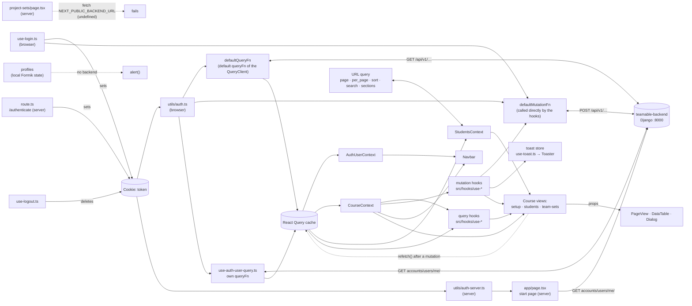

# Frontend: Code inventory

> **Purpose:** This page maps the current state of `teamable-frontend`: project structure, key files, data flows and all existing views. It is the starting point for the upcoming implementation in Epic 2 (Automate Team Generation). It describes the code as it is and does not evaluate it.
>
> **Version:** `teamable-frontend` @ [`98ce1c8`](https://github.com/Teamable-Analytics/teamable-frontend/tree/98ce1c8), `teamable-backend` @ [`183a36c`](https://github.com/Teamable-Analytics/teamable-backend/tree/183a36c) (as of 2026-10-29). Paths are relative to `teamable-frontend/` unless stated otherwise.
>
> **Important upfront:** The frontend is already connected to `teamable-backend` and contains no mock data. Every view that shows data loads it from the backend REST API, with two exceptions: Profiles keeps its own data only locally, and Project Sets calls an endpoint that does not exist. Without a running backend, only the static pages (login, signup, 401, privacy, 404) can be opened, and logging in does not work. The start page `/` fails with HTTP 500, and the course views cannot load their course (`GET courses/{id}/`). The LMS-specific parts are described in [Frontend: LMS integration](frontend-lms-integration.md).

**Overview for developers:** [Teamable Frontend Map](https://claude.ai/artifact/QMTdvhY9XSAHpRmnQL7UZi) (interactive version of this page with views, flows, files and backend calls)

## At a glance

- **What it is:** The web interface of Teamable for teachers. They import students and grades from the LMS (currently Canvas), generate teams and export the teams back to the LMS. There is no interface for students.
- **Connected to the backend:** Every view that shows data loads it live from `teamable-backend` (Django, REST under `/api/v1`). There is no mock data. Without a running backend, only the static pages open and logging in fails, so frontend work needs the backend running locally.
- **One working main flow:** import students → import grades → generate teams → view teams and export them to the LMS. It is covered by the three pages in the navbar: Onboarding (5-step wizard, 2 steps disabled), Students and Team sets.
- **Team generation is very simple today:** The UI sends exactly one grade attribute. The backend pairs "strong" and "weak" students; the call to an external algorithm API is commented out. The result can only be viewed, not edited.
- **Two pages exist but do not work:**
  - Profiles is a question editor without backend; saving writes nothing.
  - Project Sets calls an endpoint that does not exist.
  - Neither is linked in the navbar.
- **Technology:** Next.js 14, React 18, TypeScript, TanStack Query, Tailwind with shadcn/ui. The response types are written by hand. Only two example tests exist; CI runs lint and `tsc`.
- **Where to look next:** all pages are in [section 4](#4-views), the places Epic 2 touches in [section 3.5](#35-integration-points-for-epic-2), and what is missing or not working in [section 5](#5-known-gaps).

---

## 1. Technical overview

| Topic | Status |
|---|---|
| Framework | Next.js 14.0.4 (App Router), React 18, TypeScript 5 (`strict`), see [package.json](https://github.com/Teamable-Analytics/teamable-frontend/blob/98ce1c8/package.json) |
| Data fetching | TanStack React Query v5 with a global default `queryFn`; mutations call the shared `defaultMutationFn` |
| State | React Query cache, three React contexts (auth user, course, students), a global toast store |
| UI | Tailwind CSS 3, shadcn/ui (Radix), lucide and Radix icons, TanStack Table, dnd-kit |
| Forms | Formik + Yup |
| Node | v20.16.0 (`.nvmrc`) |
| Configuration | `.env` with `BACKEND_BASE_URI`, value `http://localhost:8000` in [sample.env](https://github.com/Teamable-Analytics/teamable-frontend/blob/98ce1c8/sample.env). The Project Sets page also reads `NEXT_PUBLIC_BACKEND_URL`, which is defined neither in `sample.env` nor in `next.config.js` |
| Code quality | ESLint (`next/core-web-vitals`, `@tanstack/eslint-plugin-query` and own style rules) |
| CI | [check.yml](https://github.com/Teamable-Analytics/teamable-frontend/blob/98ce1c8/.github/workflows/check.yml): `yarn lint` and `tsc`. No tests, no build |
| Tests | Jest and Cypress are set up, each with one example test only |
| Deployment | [Dockerfile](https://github.com/Teamable-Analytics/teamable-frontend/blob/98ce1c8/Dockerfile) (`yarn build` in the image) + [docker-compose.yml](https://github.com/Teamable-Analytics/teamable-frontend/blob/98ce1c8/docker-compose.yml) (port 8003 → 3000) |

### Starting the frontend

```bash
nvm use               # Node 20.16.0
cp sample.env .env
yarn                  # install dependencies (missing in the README)
yarn dev              # http://localhost:3000
```

The setup in the [README](https://github.com/Teamable-Analytics/teamable-frontend/blob/98ce1c8/README.md) needs a running `teamable-backend` on port 8000 and an instructor signup token for the first account. For setups without Canvas, see section 8 of [Frontend: LMS integration](frontend-lms-integration.md).

All commands work at this commit with Node 20.16.0 and Yarn 1.22.22:

| Command | Result |
|---|---|
| `yarn lint` | No warnings or errors |
| `yarn tsc` | No errors |
| `yarn test` | One example test, passes |
| `yarn build` | Successful. The route list has the same 14 entries as the view table in [section 4](#4-views); the 404 page appears as `/_not-found` |

### Folder structure

Every folder in `src/app/` is a URL segment, and a `page.tsx` (or `route.ts`) makes it reachable. Folders in `( … )` add no segment.

```
teamable-frontend/
├── src/
│   ├── app/
│   │   ├── layout.tsx                         → root layout of all pages: font, QueryClientProvider, Toaster
│   │   ├── page.tsx                           → "/": redirects to signup, 401 or the user's first course
│   │   ├── not-found.tsx                      → 404 page
│   │   ├── globals.css                        → Tailwind base styles and theme colours (CSS variables)
│   │   ├── favicon.ico
│   │   ├── (providers)/                       → no pages, shared logic only
│   │   │   ├── query-client-provider.tsx      → all backend calls: defaultQueryFn (GET), defaultMutationFn (POST)
│   │   │   └── auth-user-provider.tsx         → AuthUserContext: who is logged in, redirect to the login
│   │   ├── (accounts)/
│   │   │   ├── accounts/
│   │   │   │   ├── layout.tsx                 → bare layout (no navbar, no footer)
│   │   │   │   ├── login/                     → /accounts/login: page.tsx + (components)/LogInForm.tsx
│   │   │   │   ├── signup/                    → /accounts/signup: page.tsx + (components)/SignupForm.tsx
│   │   │   │   └── 401/page.tsx               → /accounts/401: static error page
│   │   │   └── authenticate/route.ts          → /authenticate: sets the token cookie after the LMS launch
│   │   ├── (marketing)/
│   │   │   ├── layout.tsx                     → plain navbar + footer
│   │   │   └── privacy/page.tsx               → /privacy
│   │   └── (app)/
│   │       ├── layout.tsx                     → AuthUserContextProvider (client-side redirect to the login) + footer
│   │       └── course/[courseId]/             → /course/{courseId}/…
│   │           ├── layout.tsx                 → CourseProvider (loads the course) + navbar for all course views
│   │           ├── page.tsx                   → redirects to setup
│   │           ├── (hooks)/useCourse.tsx      → CourseContext: GET courses/{id}/
│   │           ├── components/
│   │           │   └── GenerateTeamsAttributeSelector.tsx → dialog "select a grade attribute"
│   │           ├── setup/                     → /…/setup: onboarding wizard
│   │           │   ├── page.tsx
│   │           │   ├── (hooks)/useSetupSteps.tsx → the 5 steps, their state and actions
│   │           │   └── (components)/          → SetupStepDetailCard.tsx (step list), GenerateOptInQuiz.tsx
│   │           ├── students/                  → /…/students: student list
│   │           │   ├── page.tsx               → page with the two import buttons
│   │           │   ├── (hooks)/useStudents.tsx → StudentsContext: search, sorting, pages, synced with the URL
│   │           │   └── (table)/               → student-table, student-table-toolbar, columns,
│   │           │                                student-table-sections-filter (not used, commented out)
│   │           ├── team-sets/                 → /…/team-sets: team set list + "Generate teams"
│   │           │   ├── page.tsx, columns.tsx
│   │           │   └── [teamSetId]/           → /…/team-sets/{id}: teams and members, export to the LMS
│   │           │       └── page.tsx, columns.tsx
│   │           ├── profiles/                  → /…/profiles: question editor (placeholder, no backend)
│   │           │   ├── page.tsx
│   │           │   └── (components)/          → CategoricalSingle.tsx, CategoricalMulti.tsx
│   │           └── project-sets/              → /…/project-sets: project set list (not working)
│   │               └── page.tsx, columns.tsx
│   ├── components/
│   │   ├── Navbar.tsx                         → navbar of the course views: menu, course name, logout
│   │   ├── NavbarPlain.tsx                    → navbar of the privacy page
│   │   ├── Footer.tsx                         → footer with the privacy link
│   │   ├── Logo.tsx, icons.tsx                → logo and icons
│   │   ├── SearchBar.tsx                      → search field of the DataTable
│   │   ├── GradeSourceAttributeSelector.tsx   → combobox of the grade attributes
│   │   ├── InputErrorMessage.tsx              → error text below form fields (login, signup)
│   │   ├── ui/                                → 24 shadcn/ui building blocks (button, dialog, table, data-table, …)
│   │   └── views/Page.tsx                     → PageView: frame of the course views and privacy (breadcrumbs, title, actions)
│   ├── hooks/                                 → 14 files: 12 backend hooks, logout, toasts (see section 2)
│   ├── _temp_types/                           → 15 hand-written type files for the backend responses (see section 3.4)
│   ├── lib/utils.ts                           → cn(): merges Tailwind classes
│   ├── routes.ts                              → paths of the auth pages
│   └── types.ts                               → Action, NonEmptyArray
├── utils/
│   ├── auth.ts, auth-server.ts                → auth header from the cookie (browser / server)
│   └── string.ts                              → title(): capitalises a word
├── public/                                    → logo.svg; login-image.webp (imported on the login page, not shown);
│                                                next.svg, vercel.svg (unused)
├── test/spec.test.ts                          → Jest example test
├── cypress/                                   → Cypress example spec, fixture and support files
├── .github/workflows/check.yml                → CI: yarn lint and tsc
└── configuration files                        → see the table below
```

| Configuration file | Purpose |
|---|---|
| `package.json`, `yarn.lock` | Dependencies and scripts (`dev`, `build`, `start`, `lint`, `format`, `test`, `cypress:open`); the lockfile is Yarn 1 (`yarn lockfile v1`) |
| `.nvmrc` | Node version 20.16.0 |
| `sample.env` | Template for `.env` with `BACKEND_BASE_URI` |
| `next.config.js` | Loads `.env`, passes `BACKEND_BASE_URI` to the app, imports SVGs as components (`@svgr/webpack`) |
| `tsconfig.json` | TypeScript in `strict` mode, aliases `@/*` and `@public/*` |
| `index.d.ts` | Allows importing `.svg` and `.webp` files in TypeScript |
| `tailwind.config.js` | Active Tailwind configuration: theme, colours, animations, plugin `tailwindcss-animate`. `components.json` also points to this file |
| `tailwind.config.ts` | Not used: the installed Tailwind 3.4.1 loads `tailwind.config.js` first |
| `postcss.config.js` | Runs Tailwind and Autoprefixer |
| `components.json` | Configuration for adding shadcn/ui components |
| `.eslintrc.json` | ESLint rules |
| `jest.config.ts` | Jest; compiles TypeScript with `@swc/jest` |
| `cypress.config.ts` | Cypress for end-to-end and component tests (Next.js with webpack) |
| `Dockerfile` | Image based on `node:20.16.0`; runs `yarn` and `yarn build` |
| `docker-compose.yml` | Starts the image with `yarn start` and `.env`; port 8003 → 3000 |
| `.gitignore` | Keeps `.env`, `node_modules/` and `.next/` out of git |
| `README.md` | Setup guide (without the install step `yarn`) |

**Conventions:**

- **Route groups:** `( … )` folders add no URL segment. They are used in three ways:
  - **Areas with their own layout:** `(app)` and `(marketing)`.
  - **Grouping without a layout:** `(accounts)` groups `accounts/`, which has its own layout, and `authenticate/`. `(providers)` holds the provider files.
  - **Helper files inside route folders:** `(hooks)`, `(components)` and `(table)`.
- **Hook files:**
  - `src/hooks/` uses kebab-case (`use-generate-teams.tsx`).
  - Hooks inside route folders use camelCase (`useCourse.tsx`, `useSetupSteps.tsx`, `useStudents.tsx`). `useCourse.tsx` and `useStudents.tsx` also contain their context provider (`CourseProvider`, `StudentsProvider`).
- **Hook pattern:**
  - Query hooks call `useQuery` with the API path as query key and return the query result.
  - Mutation hooks wrap `useMutation` and return a function `<action>Async` (e.g. `generateTeamsAsync`, `loginAsync`) together with the mutation state.
  - They show toasts on success and on error. Exception: the login shows a toast only on errors. The two import hooks also show a toast when the import starts.
- **Component files:**
  - Most own components outside `components/ui/` are PascalCase (`Navbar.tsx`, `SetupStepDetailCard.tsx`).
  - Kebab-case or lowercase: `components/ui/*`, `students/(table)/*`, all `columns.tsx`, `(providers)/*` and `components/icons.tsx`.
  - Next.js file names are lowercase by convention: `page.tsx`, `layout.tsx`, `not-found.tsx`, `route.ts`.
  - The column definitions of a table sit in a `columns.tsx` next to its page.
- **Server and client components:** 6 of the 19 route files are client components (`"use client"`):
  - the login page, the course layout, setup, students, team sets and the team set detail page
  - the other 13 route files run on the server, among them the start page, Profiles (which renders client components) and Project Sets
- **Code style:** enforced by ESLint ([.eslintrc.json](https://github.com/Teamable-Analytics/teamable-frontend/blob/98ce1c8/.eslintrc.json)) and checked in CI:
  - no semicolons, 2-space indentation, 1TBS braces
  - double quotes in JSX, trailing commas in multi-line lists, newline at the end of a file
  - the code also uses double quotes for imports (408 of 410 import statements in `src/` and `utils/`; the two exceptions are the `@radix-ui/react-icons` imports in the Profiles editor), although ESLint does not enforce it
- **Import aliases:**
  - `@/*` → `src/*` and `@public/*` → `public/*` ([tsconfig.json](https://github.com/Teamable-Analytics/teamable-frontend/blob/98ce1c8/tsconfig.json)). `@public/*` is used in two files (`Logo.tsx`, login page).
  - `utils/` sits outside `src/` and is imported with relative paths, e.g. `../../../../../../../utils/string` in the team set detail page.

---

## 2. Key files

| File | Purpose |
|---|---|
| [(providers)/query-client-provider.tsx](https://github.com/Teamable-Analytics/teamable-frontend/blob/98ce1c8/src/app/%28providers%29/query-client-provider.tsx) | Central fetch logic for almost all backend calls (lines 18–65). `defaultQueryFn` (GET) takes the path from `queryKey[0]`. The mutation hooks call `defaultMutationFn` (POST). Both send the request to `${BACKEND_BASE_URI}/api/v1/<path>/`, appending the trailing slash, with `Authorization: Token …` when the cookie exists. `defaultMutationFn` throws an error for failed responses (usually the parsed response body). `defaultQueryFn` does not check the status, so an error response is stored as data |
| [(providers)/auth-user-provider.tsx](https://github.com/Teamable-Analytics/teamable-frontend/blob/98ce1c8/src/app/%28providers%29/auth-user-provider.tsx) | `AuthUserContext` and the hook `useAuthUser()`, which the navbar and the logout use. Loads `accounts/users/me/` through `use-auth-user-query.ts` and redirects to the login if nobody is logged in (lines 35–47). It only wraps the `(app)` routes, so its code for sending logged-in users away from the login and signup pages never runs |
| [hooks/use-auth-user-query.ts](https://github.com/Teamable-Analytics/teamable-frontend/blob/98ce1c8/src/hooks/use-auth-user-query.ts) | Hook with its own fetch function `authUserQueryFn` for `accounts/users/me/` (not the default `queryFn`). It returns the user, or `null` on HTTP 401, and only runs when the cookie exists. The start page calls `authUserQueryFn` on the server |
| [course/[courseId]/(hooks)/useCourse.tsx](https://github.com/Teamable-Analytics/teamable-frontend/blob/98ce1c8/src/app/%28app%29/course/%5BcourseId%5D/%28hooks%29/useCourse.tsx) | `CourseProvider` loads `GET courses/{id}/` and provides `courseId`, name, sections and `lmsType` through `useCourse()`. Shows an empty page while loading and "Course not found" if no course comes back (lines 35–69). `useCourse()` is used by the navbar, the setup, students and team set pages and 9 of the hooks |
| [hooks/use-generate-teams.tsx](https://github.com/Teamable-Analytics/teamable-frontend/blob/98ce1c8/src/hooks/use-generate-teams.tsx) | `POST courses/{id}/generate_teams/` with `{ attribute }`. On success a toast with a "View" button opens the new team set; on error a toast asks to relaunch Teamable from Canvas (lines 21–54) |
| [course/[courseId]/components/GenerateTeamsAttributeSelector.tsx](https://github.com/Teamable-Analytics/teamable-frontend/blob/98ce1c8/src/app/%28app%29/course/%5BcourseId%5D/components/GenerateTeamsAttributeSelector.tsx) | Dialog around `GradeSourceAttributeSelector`. "Generate teams" stays disabled until an attribute is selected, then calls `onSubmit({ attribute })` and closes the dialog. Used in the onboarding and on the team sets page |
| [components/GradeSourceAttributeSelector.tsx](https://github.com/Teamable-Analytics/teamable-frontend/blob/98ce1c8/src/components/GradeSourceAttributeSelector.tsx) | Searchable combobox over `GET courses/{id}/grade-attributes/` (through `use-grade-attributes.ts`); shows "Loading attributes..." while loading |
| [setup/(hooks)/useSetupSteps.tsx](https://github.com/Teamable-Analytics/teamable-frontend/blob/98ce1c8/src/app/%28app%29/course/%5BcourseId%5D/setup/%28hooks%29/useSetupSteps.tsx) | Wizard logic: the 5 steps, the actions of steps 1, 3 and 5, and the dialog of step 5 (lines 19–101). The current step is derived from `OnboardingProgress` (lines 103–111); the step texts are in lines 156–211 |
| [students/(hooks)/useStudents.tsx](https://github.com/Teamable-Analytics/teamable-frontend/blob/98ce1c8/src/app/%28app%29/course/%5BcourseId%5D/students/%28hooks%29/useStudents.tsx) | `StudentsProvider` and `useStudents()` (lines 108–344): search, sorting (`first_name`, `last_name`, `id`), page and page size, synced with the URL query. Only the current page is loaded from the backend (server-side pagination) |
| [components/views/Page.tsx](https://github.com/Teamable-Analytics/teamable-frontend/blob/98ce1c8/src/components/views/Page.tsx) | `PageView`: frame of the course views and privacy with breadcrumbs, title and action buttons (on small screens in a menu) |
| [components/ui/data-table.tsx](https://github.com/Teamable-Analytics/teamable-frontend/blob/98ce1c8/src/components/ui/data-table.tsx) | Generic table: search on one column, sorting, optional pagination, click on a row (`rowAction`). Used by team sets, the team set detail and project sets. The student list uses its own table with server-side pagination (`students/(table)/student-table.tsx`) |
| [(accounts)/authenticate/route.ts](https://github.com/Teamable-Analytics/teamable-frontend/blob/98ce1c8/src/app/%28accounts%29/authenticate/route.ts) | Entry point after the LMS launch: reads `token` and `path` from the URL, sets the cookie `token` (path `/`) and redirects to `path` (lines 7–18) |
| [_temp_types/](https://github.com/Teamable-Analytics/teamable-frontend/tree/98ce1c8/src/_temp_types) | Types of the backend responses (see [section 3.4](#34-data-shapes)) |

**All hooks in [`src/hooks/`](https://github.com/Teamable-Analytics/teamable-frontend/tree/98ce1c8/src/hooks):**

| Hook | Task | Backend call | Used in |
|---|---|---|---|
| `use-auth-user-query.ts` | Who is logged in? Returns the user or `null` | `GET accounts/users/me/` | `auth-user-provider.tsx`; its fetch function also in `src/app/page.tsx` (server) |
| `use-login.ts` | Log in, set the cookie, go to `/` | `POST accounts/log-in/` with `{ email, password }` | `LogInForm.tsx`, `use-sign-up.ts` |
| `use-sign-up.ts` | Register, then log in automatically | `POST accounts/sign-up/` with `{ email, password, token }` | `SignupForm.tsx` |
| `use-logout.ts` | Delete the cookie, show a toast, go to the login page | – | `Navbar.tsx` |
| `use-onboarding-progress.ts` | Progress of the onboarding wizard | `GET courses/{id}/get_onboarding_progress/` | `useSetupSteps.tsx`, `GenerateOptInQuiz.tsx` |
| `use-import-students-from-lms.ts` | Import students from the LMS | `POST courses/{id}/import_students_from_lms/` | `useSetupSteps.tsx`, `students/page.tsx` |
| `use-create-opt-in-quiz.ts` | Create the opt-in quiz in the LMS | `POST courses/{id}/create_opt_in_quiz_lms/` | `GenerateOptInQuiz.tsx` |
| `use-import-student-gradebook-data.ts` | Import grades from the LMS gradebook | `POST courses/{id}/import_gradebook_attribute_from_lms/` | `useSetupSteps.tsx`, `students/page.tsx` |
| `use-grade-attributes.ts` | Available grade attributes | `GET courses/{id}/grade-attributes/` | `GradeSourceAttributeSelector.tsx` |
| `use-generate-teams.tsx` | Generate teams | `POST courses/{id}/generate_teams/` with `{ attribute }` | `useSetupSteps.tsx`, `team-sets/page.tsx` |
| `use-list-team-sets.ts` | All team sets of the course, without their teams | `GET courses/{id}/get_team_sets/` | `team-sets/page.tsx` |
| `use-team-set.ts` | One team set with its teams and unassigned students | `GET courses/{id}/team-sets/{teamSetId}/` | `team-sets/[teamSetId]/page.tsx` |
| `use-export-team-set-lms.ts` | Export a team set to the LMS | `POST courses/{id}/export_team_to_lms/` with `{ team_set }` | `team-sets/[teamSetId]/page.tsx` |
| `use-toast.ts` | Global store for messages (toasts), one at a time | – | `components/ui/toaster.tsx` (shows them) and 8 of the hooks above |

Backend calls outside these hooks:

- `useCourse.tsx` loads the course (`GET courses/{id}/`).
- `useStudents.tsx` loads the current page of the student list (`GET courses/{id}/students/?page=&per_page=&sort=&search=&sections=`).
- `project-sets/page.tsx` makes the broken call described in [section 4.1](#41-overview-of-all-views).

---

## 3. Data flows

### 3.1 Where the data comes from

- **Backend:** Almost all data comes from `teamable-backend` via REST. There are 12 backend hooks in `src/hooks/` plus the queries in `useCourse.tsx` and `useStudents.tsx`. The complete list of calls is in section 9 of [Frontend: LMS integration](frontend-lms-integration.md).
- **Local only:** The Profiles view has two separate Formik forms (single choice and multiple choice). "Save Question" only shows the values in an `alert()` ([CategoricalSingle.tsx:195](https://github.com/Teamable-Analytics/teamable-frontend/blob/98ce1c8/src/app/%28app%29/course/%5BcourseId%5D/profiles/%28components%29/CategoricalSingle.tsx#L195), [CategoricalMulti.tsx:193](https://github.com/Teamable-Analytics/teamable-frontend/blob/98ce1c8/src/app/%28app%29/course/%5BcourseId%5D/profiles/%28components%29/CategoricalMulti.tsx#L193)). Nothing is saved; the values are lost on reload.
- **URL:**
  - The route parameters `courseId` and `teamSetId` decide which course and which team set are loaded.
  - The student list mirrors its filters in the URL query (`page`, `per_page`, `sort`, `search`, `sections`). It reads them once when the page opens and writes every change back with `history.replaceState` ([useStudents.tsx:192-238](https://github.com/Teamable-Analytics/teamable-frontend/blob/98ce1c8/src/app/%28app%29/course/%5BcourseId%5D/students/%28hooks%29/useStudents.tsx#L192-L238)).
  - The signup page reads the invitation `token`; `/authenticate` reads `token` and `path`.
- **Cookie and configuration:** the API token in the cookie `token` and the backend address `BACKEND_BASE_URI` from `.env` (both see 3.2).
- **Hard-coded:**
  - texts: wizard steps, privacy text, signup quote
  - the LMS name "Canvas": in the wizard texts and in the error toasts of the five LMS and team mutations ("Please relaunch Teamable from your Canvas dashboard"). Only the export button and the titles of the export toasts use the `lmsType` of the course
  - the "Unassigned Students" pseudo-team on the team set detail page, with the fixed `id: 1` ([team-sets/[teamSetId]/page.tsx:26-31](https://github.com/Teamable-Analytics/teamable-frontend/blob/98ce1c8/src/app/%28app%29/course/%5BcourseId%5D/team-sets/%5BteamSetId%5D/page.tsx#L26-L31))
  - the navbar links
- **Mock data:** none in the app. `cypress/fixtures/example.json` is unused Cypress boilerplate.

### 3.2 How data moves

- **Server state** lives in the React Query cache:
  - The query key is the API path. For the student list the path includes the query string, so every filter change is a new query. The search field changes the filter on every keystroke (no debounce), so every keystroke sends a request.
  - Exception: `accounts/users/me/` uses the path plus the auth header as key and its own `queryFn`.
  - The `QueryClient` only sets the default `queryFn` ([query-client-provider.tsx:67-71](https://github.com/Teamable-Analytics/teamable-frontend/blob/98ce1c8/src/app/%28providers%29/query-client-provider.tsx#L67-L71)); all other options are TanStack defaults.
  - `defaultQueryFn` does not check the HTTP status. An error response is stored as normal data; only network errors count as a failed query.
  - No code changes the cache directly: there is no `invalidateQueries`, `setQueryData` or `useQueryClient`. Data is only updated by calling `refetch()` of a query.
- **Mutations** do not go through the `QueryClient`. Each mutation hook calls the exported function `defaultMutationFn` directly inside `useMutation`.
- **The browser calls the backend directly:**
  - `next.config.js` inserts `BACKEND_BASE_URI` into the client bundle at build time ([next.config.js:16-18](https://github.com/Teamable-Analytics/teamable-frontend/blob/98ce1c8/next.config.js#L16-L18)).
  - There is no proxy and no API route in Next.js; the only route handler is `/authenticate`.
  - This needs CORS in the backend. `teamable-backend` allows all origins only when `DEBUG` is on ([settings.py:164-165](https://github.com/Teamable-Analytics/teamable-backend/blob/183a36c/src/teamable/settings.py#L164-L165)).
- **Server components outside the cache:**
  - The start page `/` fetches `accounts/users/me/` on the server, with `authUserQueryFn` and the header from `utils/auth-server.ts`.
  - The Project Sets page calls `fetch` directly with `NEXT_PUBLIC_BACKEND_URL`.
- **Contexts:** three React contexts share data across components:
  - `AuthUserContext` (logged-in user): provided by `(app)/layout.tsx`, used by the navbar and the logout
  - `CourseContext` (current course): provided by `C/layout.tsx`, used by the navbar, the setup, students (through `useStudents.tsx` and the table toolbar), team sets and team set detail views, and by 9 of the 12 backend hooks. Profiles and Project Sets are inside the provider but do not read it
  - `StudentsContext` (filters, the current page of the student list, `refetch`): provided by `students/page.tsx`, used by that page (for `refetch`), the student table and its toolbar
- **Pages** get their data from hooks and contexts and pass it to `PageView`, `DataTable` and dialogs via props. Exception: the student table reads `StudentsContext` itself.
- **Actions:** The buttons in `PageView` and in the wizard steps are described by the `Action` object `{ onClick, content, loading }` ([types.ts](https://github.com/Teamable-Analytics/teamable-frontend/blob/98ce1c8/src/types.ts)).
  - Usual flow: `onClick` → `mutateAsync` → `refetch()` of the query on the same page.
  - `refetch()` only runs after a successful mutation; on an error `mutateAsync` throws and the rest of `onClick` is skipped.
  - "Generate teams" only opens the dialog. The mutation and the `refetch()` run in the dialog's `onSubmit`, and the dialog closes only after success.
  - "Export to {LMS}" calls the mutation without a `refetch()`.
  - "Generate opt-in quiz" is not an `Action` but a clickable `div` in `GenerateOptInQuiz.tsx` with the same flow. Once the quiz exists, the same `div` opens `opt_in_quiz_link` in a new tab.
- **Feedback** is shown through a global toast store ([use-toast.ts](https://github.com/Teamable-Analytics/teamable-frontend/blob/98ce1c8/src/hooks/use-toast.ts)). It shows one toast at a time (`TOAST_LIMIT = 1`); a new toast replaces the previous one. The `Toaster` sits in the root layout.
- **Authentication:**
  - The cookie `token` is set by the login in the browser ([use-login.ts:20](https://github.com/Teamable-Analytics/teamable-frontend/blob/98ce1c8/src/hooks/use-login.ts#L20)) or by `/authenticate` on the server ([route.ts:17](https://github.com/Teamable-Analytics/teamable-frontend/blob/98ce1c8/src/app/%28accounts%29/authenticate/route.ts#L17)). The logout deletes it ([use-logout.ts:16](https://github.com/Teamable-Analytics/teamable-frontend/blob/98ce1c8/src/hooks/use-logout.ts#L16)).
  - `utils/auth.ts` (browser) and `utils/auth-server.ts` (server) build the `Authorization: Token …` header from it.

**Example: how a page gets its data** (team set list):

1. The page calls the hook `use-list-team-sets.ts`.
2. The hook passes only the path `courses/{id}/get_team_sets` as query key.
3. `defaultQueryFn` in `query-client-provider.tsx` turns it into the request `${BACKEND_BASE_URI}/api/v1/courses/{id}/get_team_sets/` with the `Authorization` header from the cookie.
4. The response is stored in the React Query cache, and the page shows it in a `DataTable`.

**Example: how an action runs** ("Import students" on the students page):

1. The action's `onClick` calls `importStudentsAsync()` from `use-import-students-from-lms.ts`.
2. The hook first shows the toast "Importing students".
3. `defaultMutationFn` sends `POST courses/{id}/import_students_from_lms/` without a body.
4. The toast "Imported students" or "Unable to import students" replaces the first toast.
5. After a successful import the page calls `refetch()` of the student list. The same button in the wizard refetches the onboarding progress instead.

**Ways to log in:**

| Way | Flow | Where the user lands |
|---|---|---|
| Launch from Canvas | Backend → `/authenticate?token=…&path=…` sets the cookie (server) | The course the launch came from |
| Email login | `/accounts/login` → `POST accounts/log-in/` → cookie (browser) → `/` | Setup page of the user's first course (`/accounts/401` without a course) |
| Signup | `/accounts/signup?token=…` → `POST accounts/sign-up/` → automatic login → `/` | Setup page of the user's first course (`/accounts/401` without a course) |
| Logout | Cookie is deleted, toast, `accounts/users/me/` is loaded again | `/accounts/login` |
| Not logged in, opens `/` | The start page gets HTTP 401 from `accounts/users/me/` | `/accounts/signup` |
| Not logged in, opens a course view | `AuthUserContextProvider` finds no user | `/accounts/login` |

The course views are protected only in the browser: there is no `middleware.ts`, and `AuthUserContextProvider` redirects only after the page has loaded ([auth-user-provider.tsx:35-47](https://github.com/Teamable-Analytics/teamable-frontend/blob/98ce1c8/src/app/%28providers%29/auth-user-provider.tsx#L35-L47)). Whether the data may be read is decided by the backend (see section 6.3 of [Frontend: LMS integration](frontend-lms-integration.md)).



### 3.3 Flow "generate teams"

1. The user clicks "Generate teams". The button exists in two places:
   - the onboarding wizard ([useSetupSteps.tsx:64-71](https://github.com/Teamable-Analytics/teamable-frontend/blob/98ce1c8/src/app/%28app%29/course/%5BcourseId%5D/setup/%28hooks%29/useSetupSteps.tsx#L64-L71))
   - the team set list ([team-sets/page.tsx:35-43](https://github.com/Teamable-Analytics/teamable-frontend/blob/98ce1c8/src/app/%28app%29/course/%5BcourseId%5D/team-sets/page.tsx#L35-L43))
2. The dialog `GenerateTeamsAttributeSelector` opens. Its combobox loads `GET courses/{id}/grade-attributes/` and shows "Loading attributes..." until the list arrives.
3. The user selects one grade attribute. Until then the "Generate teams" button in the dialog is disabled.
4. `POST courses/{id}/generate_teams/` with `{ "attribute": <id> }`. The backend checks that the attribute belongs to the course (HTTP 400 otherwise) and answers `{ "team_set_id": <id> }` ([views/course.py:48-58, 167-179](https://github.com/Teamable-Analytics/teamable-backend/blob/183a36c/src/app/views/course.py#L48-L179)).
5. On success:
   - a toast "Teams generated successfully" with a "View" button links to `/course/{id}/team-sets/{teamSetId}`
   - the dialog closes
   - the page calls `refetch()`: the wizard reloads the onboarding progress, the team set list reloads the list
6. On error: a toast asks to relaunch Teamable from Canvas, and the dialog stays open.
7. The detail page loads `GET courses/{id}/team-sets/{teamSetId}/` and shows the teams and their members in a read-only table:
   - The last row is the "Unassigned Students" pseudo-team (see [section 3.1](#31-where-the-data-comes-from)).
   - The search field matches team names and member names.
   - Clicking a member opens their `lms_link` in a new tab, if it exists.
8. Optionally: "Export to {LMS}" sends `POST courses/{id}/export_team_to_lms/` with `{ "team_set": <id> }`.

When the dialog is opened again, the combobox shows "Select attribute..." again, but the dialog still remembers the last selected attribute. The "Generate teams" button is therefore already enabled and sends that attribute ([GenerateTeamsAttributeSelector.tsx:24-26](https://github.com/Teamable-Analytics/teamable-frontend/blob/98ce1c8/src/app/%28app%29/course/%5BcourseId%5D/components/GenerateTeamsAttributeSelector.tsx#L24-L26)).

How the backend forms the teams is described in section 7.2 of [Backend: LMS integration](backend-lms-integration.md).

### 3.4 Data shapes

The types in [`src/_temp_types/`](https://github.com/Teamable-Analytics/teamable-frontend/tree/98ce1c8/src/_temp_types) are written by hand to mirror the JSON responses of the backend. They are not checked at runtime. The column "Backend source" names the serializer in `teamable-backend` that produces the response.

| Type | Fields | Backend source | File |
|---|---|---|---|
| `TeamSet` | `id`, `name`, `teams: Team[]`, `unassigned_students: Student[]` | `DisplaySingleTeamSetSerializer` | `teamSet.ts` |
| Team set list (`Omit<TeamSet, "teams">[]`) | `id`, `name`, `unassigned_students` | `DisplayManyTeamSetSerializer` | `src/hooks/use-list-team-sets.ts` |
| `Team` | `id`, `name`, `slug`, `members: Student[]` | `DisplaySingleTeamSerializer` | `team.ts` |
| `Student` | `id`, `lms_id`, `sis_user_id`, `lms_link: string \| null`, `name`, `first_name`, `last_name`, `sections?: CourseSection[]`, `role: CourseRole` | `CourseMemberSerializer`; team members: `DisplayCourseMemberSerializer` (without `sections`) | `student.ts` |
| `CourseRole` | `"Student"` or `"Instructor"` | `UserRole` | `courseMember.ts` |
| `Course` | `id`, `name`, `organization: { name, lms_type }`, `sections: CourseSection[]`, `lms_course_id` | `CourseViewSerializer` | `course.ts`, `organization.ts` |
| `CourseSection` | `id`, `name`, `description` | `SectionSerializer` | `course.ts` |
| `LmsType` | only `"CANVAS"` | `LMSTypeOptions` | `organization.ts` |
| `OnboardingProgress` | `opt_in_quiz_link: string`, `has_created_opt_in_quiz`, `has_students`, `has_attribute`, `has_attribute_responses`, `has_team_set` | `OnboardingProgressSerializer` | `onboarding.ts` |
| `AuthUser` | `id`, `username`, `first_name`, `last_name`, `email`, `is_staff`, `course_memberships: { course }[]` | `MyUserSerializer` | `user.ts` |
| `PaginatedList<T>` | `count`, `next`, `previous`, `results: T[]` | DRF `PageNumberPagination` | `pagination.ts` |
| `GradeAttribute` | `id`, `name` | `AttributeSerializer` | `src/hooks/use-grade-attributes.ts` |
| Login | request `{ email, password }`, response `{ token }` | `UserLoginSerializer` | `accounts.ts` |
| Sign-up | request `{ email, password, token? }`, response `{ email }` | `UserRegistrationSerializer` | `accounts.ts` |
| Error responses | field errors `string[]` plus `non_field_errors?` | DRF validation errors | `django.ts` |
| Generate teams | request `{ attribute: number }`, response `{ team_set_id: number }` | `GenerateTeamsSerializer`, response built in the view | `src/hooks/use-generate-teams.tsx` |
| `ProjectSet`, `ApiTeamSetTemplate` | `id`, `name`, `numProjects`; template with `teams`, `createdAt`, `updatedAt` | endpoint not reachable (see [section 4.1](#41-overview-of-all-views)) | `projectSet.ts`, `api/teams.ts` (used only by Project Sets) |

**Differences to the backend** (`teamable-backend` @ `183a36c`):

- `CourseSection.description` is never sent: `SectionSerializer` returns only `id` and `name` ([serializers/section.py:9](https://github.com/Teamable-Analytics/teamable-backend/blob/183a36c/src/app/serializers/section.py#L9)).
- `OnboardingProgress.opt_in_quiz_link` is typed as `string`, but the backend sends `null` as long as no quiz exists ([models/course.py:52-56](https://github.com/Teamable-Analytics/teamable-backend/blob/183a36c/src/app/models/course.py#L52-L56)).
- The team set list type still contains `unassigned_students`, but the backend sends only `id` and `name` ([serializers/teams.py:59-62](https://github.com/Teamable-Analytics/teamable-backend/blob/183a36c/src/app/serializers/teams.py#L59-L62)).
- `lms_type` is typed as `"CANVAS"`, but the backend field also allows `null` ([models/organization.py:13-14](https://github.com/Teamable-Analytics/teamable-backend/blob/183a36c/src/app/models/organization.py#L13-L14)).

Not used anywhere at the moment:

- `projects.ts` (`Project`, `ProjectRequirement`, `RequirementOperator`, and a second copy of `ProjectSet`)
- `relationship.ts` (`Relationship` with friend/enemy values; the comment says it is "consistent with the team formation algorithms")
- `AnonUser` in `user.ts`
- the constants `COURSE_ROLES` and `LMS_TYPES`: they only serve to derive the types `CourseRole` and `LmsType`

### 3.5 Integration points for Epic 2

These are the places in the current code that the team generation touches. They are only marked here.

| Topic | Place in the code |
|---|---|
| Request of the team generation (today only `attribute`) | [use-generate-teams.tsx:8-10, 23-28](https://github.com/Teamable-Analytics/teamable-frontend/blob/98ce1c8/src/hooks/use-generate-teams.tsx#L8-L28), [GenerateTeamsAttributeSelector.tsx](https://github.com/Teamable-Analytics/teamable-frontend/blob/98ce1c8/src/app/%28app%29/course/%5BcourseId%5D/components/GenerateTeamsAttributeSelector.tsx) |
| Backend side of this request | `GenerateTeamsSerializer` and `generate_teams` in [teamable-backend views/course.py:48-58, 161-179](https://github.com/Teamable-Analytics/teamable-backend/blob/183a36c/src/app/views/course.py#L48-L179), [services/team_generation.py](https://github.com/Teamable-Analytics/teamable-backend/blob/183a36c/src/app/services/team_generation.py) |
| Wizard state (which step is current or done) | `getCurrentStep` and `STEP_COMPLETED` in [useSetupSteps.tsx:103-119](https://github.com/Teamable-Analytics/teamable-frontend/blob/98ce1c8/src/app/%28app%29/course/%5BcourseId%5D/setup/%28hooks%29/useSetupSteps.tsx#L103-L119), based on `OnboardingProgress` |
| Result types | `teamSet.ts`, `team.ts`; unused related types in `projects.ts`, `relationship.ts` |
| Result display (read-only today) | [team-sets/[teamSetId]/page.tsx](https://github.com/Teamable-Analytics/teamable-frontend/blob/98ce1c8/src/app/%28app%29/course/%5BcourseId%5D/team-sets/%5BteamSetId%5D/page.tsx), `columns.tsx` |
| Student profile questions (local only today) | `course/[courseId]/profiles/`, disabled wizard step `STUDENT_PROFILES` ([useSetupSteps.tsx:164-171](https://github.com/Teamable-Analytics/teamable-frontend/blob/98ce1c8/src/app/%28app%29/course/%5BcourseId%5D/setup/%28hooks%29/useSetupSteps.tsx#L164-L171)) |
| Projects (not working today) | `course/[courseId]/project-sets/`, disabled wizard step `PROJECT_SETUP` ([useSetupSteps.tsx:189-196](https://github.com/Teamable-Analytics/teamable-frontend/blob/98ce1c8/src/app/%28app%29/course/%5BcourseId%5D/setup/%28hooks%29/useSetupSteps.tsx#L189-L196)). In the backend, `TeamSetTemplateViewSet` and `TeamSetTemplateSerializer` exist ([views/teams.py:27-29](https://github.com/Teamable-Analytics/teamable-backend/blob/183a36c/src/app/views/teams.py#L27-L29)) but are not registered in [app/urls.py](https://github.com/Teamable-Analytics/teamable-backend/blob/183a36c/src/app/urls.py) |
| Backend access | `query-client-provider.tsx:18-65` for almost all calls; additionally `use-auth-user-query.ts:14-32` and `project-sets/page.tsx:9-21` |

---

## 4. Views

### 4.1 Overview of all views

`C/` = `src/app/(app)/course/[courseId]/`. Status:

- **Complete:** works as intended (with the backend where the view needs one).
- **Partial:** works, but parts are disabled or commented out.
- **Placeholder:** UI only, no backend.
- **Not working:** fails at runtime.

| View | Route | File | Purpose | Data source | Status |
|---|---|---|---|---|---|
| Start | `/` | `src/app/page.tsx` | Redirect: no user → signup, no course → 401, otherwise setup of the user's **first** course. Reached after the email login and via "Home" and the logo; the LMS launch skips it | `GET accounts/users/me/` (server) | Complete |
| Login | `/accounts/login` | `(accounts)/accounts/login/page.tsx`, `LogInForm.tsx` | Login with email and password | `POST accounts/log-in/` | Complete |
| Signup | `/accounts/signup?token=` | `(accounts)/accounts/signup/page.tsx`, `SignupForm.tsx` | Registration with invitation token, then automatic login | `POST accounts/sign-up/`, `POST accounts/log-in/` | Complete |
| Auth error | `/accounts/401` | `(accounts)/accounts/401/page.tsx` | Static error message | – | Complete |
| Authenticate (route handler, no UI) | `/authenticate?token=&path=` | `(accounts)/authenticate/route.ts` | Sets the token cookie after the LMS launch and redirects | Query parameters | Complete; missing parameters return a plain object instead of a `Response` |
| Privacy | `/privacy` | `(marketing)/privacy/page.tsx` | Privacy text, linked in the footer | Hard-coded | Complete (text says "Study Buddy", line 32) |
| Course index | `/course/[courseId]` | `C/page.tsx` | Redirect to `setup` | – | Complete |
| Onboarding | `/course/[courseId]/setup` | `C/setup/page.tsx` | 5-step wizard: import students → define profile → import grades → project setup → generate teams | `GET get_onboarding_progress/`; `POST import_students_from_lms/`, `create_opt_in_quiz_lms/`, `import_gradebook_attribute_from_lms/`, `generate_teams/`; `GET grade-attributes/` | Partial: steps 2 and 4 are disabled and show placeholder text |
| Students | `/course/[courseId]/students` | `C/students/page.tsx` | Paginated, searchable student list; import from the LMS | `GET students/?…`; `POST import_students_from_lms/`, `import_gradebook_attribute_from_lms/` | Partial: section filter and column are commented out |
| Team sets | `/course/[courseId]/team-sets` | `C/team-sets/page.tsx` | List of team sets (only the name; newest first, sorted by the backend), "Generate teams". Clicking a row opens the detail page | `GET get_team_sets/`, `GET grade-attributes/`; `POST generate_teams/` | Complete |
| Team set detail | `/course/[courseId]/team-sets/[teamSetId]` | `C/team-sets/[teamSetId]/page.tsx` | Teams with members, "Unassigned Students" row, export to the LMS. Clicking a member opens their LMS profile | `GET team-sets/{teamSetId}/`; `POST export_team_to_lms/` | Complete (read-only) |
| Profiles | `/course/[courseId]/profiles` | `C/profiles/page.tsx` | Editor for single- and multiple-choice questions with preview and drag and drop (both cards are titled "Multiple Choice Question") | Local Formik state | Placeholder, not linked anywhere |
| Project sets | `/course/[courseId]/project-sets` | `C/project-sets/page.tsx` | List of project sets | `fetch` to `NEXT_PUBLIC_BACKEND_URL/api/v1/teamset-templates` (server) | Not working, not linked anywhere |
| 404 | any unknown route | `src/app/not-found.tsx` | "Page not found" | – | Complete |

**Notes on the table:**

- **Paths:** Endpoint paths of the course views are relative to `courses/{courseId}/`.
- **Shared data:** All course views also load `GET courses/{courseId}/` through the `CourseProvider` ([C/layout.tsx:14](https://github.com/Teamable-Analytics/teamable-frontend/blob/98ce1c8/src/app/%28app%29/course/%5BcourseId%5D/layout.tsx#L14)).
- **Why Project Sets does not work:**
  - `NEXT_PUBLIC_BACKEND_URL` is not defined.
  - No auth header is sent.
  - The endpoint `teamset-templates` does not exist in `teamable-backend`. A `TeamSetTemplateViewSet` exists in `views/teams.py`, but `app/urls.py` only registers `courses` and `course/<id>/sections/`.
  - Clicking a row redirects to `project-sets/{id}`, which has no route.
  - When the page is opened, the server fails with `Failed to parse URL from undefined/api/v1/teamset-templates`. This does not depend on the backend, because the variable is undefined.

**Navigation and layouts:**

- **Navbar:** the menu has only Onboarding, Students and Manage Teams (= team sets). The logo links to `/` ([Navbar.tsx](https://github.com/Teamable-Analytics/teamable-frontend/blob/98ce1c8/src/components/Navbar.tsx)). The breadcrumb "Home" on every course view also points to `/`.
- **Layouts:**
  - root (`app/layout.tsx`)
  - app area with auth context and footer (`(app)/layout.tsx`)
  - course with navbar (`C/layout.tsx`)
  - marketing with plain navbar and footer (`(marketing)/layout.tsx`)
  - accounts (`(accounts)/accounts/layout.tsx`)

### 4.2 Onboarding steps

The wizard is defined in [useSetupSteps.tsx](https://github.com/Teamable-Analytics/teamable-frontend/blob/98ce1c8/src/app/%28app%29/course/%5BcourseId%5D/setup/%28hooks%29/useSetupSteps.tsx). The current step and the check marks are derived from `GET courses/{id}/get_onboarding_progress/` (lines 103–119).

| # | Step | What happens | Done when | Status |
|---|---|---|---|---|
| 1 | Import students | Import students from the LMS. As long as no students are imported, an opt-in quiz can be created in Canvas first | `has_students` | Active |
| 2 | Define student profile | Placeholder text only | `has_attribute` (never shown, because the step is disabled) | Disabled |
| 3 | Elicit student information | Import grades from the LMS gradebook | `has_attribute_responses` | Active |
| 4 | (Optional) Project setup | Placeholder text only | never | Disabled |
| 5 | Generate teams | Select a grade attribute, generate teams | `has_team_set` | Active |

- **Current step:** 1 while there are no students, then 3 until grades exist, then 5. Once a team set exists, no step is marked as current.
- **Selection:** The wizard opens on the current step. Disabled steps cannot be selected. Every active step keeps its button, also after it is done.

### 4.3 Summary

- **Main flow:** The working app consists of the onboarding wizard, the student list, and team sets with a detail page. Together they cover the flow import students → import grades → generate teams → view and export teams.
- **Everything else:** Profiles and Project Sets exist as routes but are not linked and have no working backend connection. The related wizard steps (define profile, project setup) are disabled. The remaining views are login, signup, error and privacy pages, or redirects.
- **Tests:** none for the app code; only the two example tests exist.

---

## 5. Known gaps

What is missing or not working in the current code:

| Topic | Current state |
|---|---|
| **Views** | |
| Profiles | Question editor without backend. "Save Question" only shows an `alert()` in both forms; nothing is stored. Not linked |
| Project Sets | Not working (see [section 4.1](#41-overview-of-all-views)). Not linked. In the backend, `TeamSetTemplateViewSet` exists but is not registered as a URL |
| Onboarding | Steps 2 (define student profile) and 4 (project setup) are disabled and show placeholder text ([useSetupSteps.tsx:164-196](https://github.com/Teamable-Analytics/teamable-frontend/blob/98ce1c8/src/app/%28app%29/course/%5BcourseId%5D/setup/%28hooks%29/useSetupSteps.tsx#L164-L196)) |
| Student list | The section filter ([student-table-toolbar.tsx:34-40](https://github.com/Teamable-Analytics/teamable-frontend/blob/98ce1c8/src/app/%28app%29/course/%5BcourseId%5D/students/%28table%29/student-table-toolbar.tsx#L34-L40)) and the section column ([columns.tsx:63-90](https://github.com/Teamable-Analytics/teamable-frontend/blob/98ce1c8/src/app/%28app%29/course/%5BcourseId%5D/students/%28table%29/columns.tsx#L63-L90)) are commented out. The backend still filters by the URL parameter `sections` |
| Results | Generated teams can only be viewed, not edited, renamed or deleted. `dnd-kit` is installed but only used in the Profiles editor |
| **Team generation** | |
| Input | The UI sends only one grade attribute. Profiles, projects and relationships are not used |
| Algorithm | The grade import already split the students at the median into "Above Average" and "Below Average". `generate_teams` puts the above group first and the below group last and pairs the students from both ends of this list. When 3 students are left, they form one team of three ([team_generation.py:68-100](https://github.com/Teamable-Analytics/teamable-backend/blob/183a36c/src/app/services/team_generation.py#L68-L100)). The team sets are named "Study Buddy - {n}" (line 70), the teams "Team {n}" |
| Edge cases | Students without a response for the chosen attribute are not placed in a team and appear as unassigned in this team set. If no student has a response, an empty team set is created. If exactly one student has one, the backend fails (`pop()` on an empty list), and the UI shows the error toast |
| External API | A request to an external team generation API is commented out (lines 29–66). It uses the same endpoint (`api/generate/teams/`) and the same top-level payload keys (`algorithm_options`, `students`, `team_generation_options`) as the API in the `algorithms` repository. The commented code contains a hard-coded API key (line 32) |
| Generate teams dialog | After reopening, the dialog sends the previously selected attribute although the combobox shows "Select attribute..." (see [section 3.3](#33-flow-generate-teams)) |
| **Courses and access** | |
| Multiple courses | No course selection. The LMS launch opens the course it was started from ([teamable-backend lti/views.py:149-151](https://github.com/Teamable-Analytics/teamable-backend/blob/183a36c/src/lti/views.py#L149-L151)). The start page `/` always opens the user's first course ([page.tsx:13](https://github.com/Teamable-Analytics/teamable-frontend/blob/98ce1c8/src/app/page.tsx#L13)); this affects the email login, the signup and every click on "Home" or the logo |
| Students in several courses | The student import looks up existing students only by `lms_id`, not by course ([course_member.py:109-110](https://github.com/Teamable-Analytics/teamable-backend/blob/183a36c/src/app/models/course_member.py#L109-L110)). Importing a student who is already in another Teamable course therefore moves them to the new course |
| Student access | There is no student UI. Students who launch Teamable from Canvas see "Course not found", because the backend only lets instructors, staff and superusers open a course |
| Authentication | `/authenticate` without `token` or `path` returns a plain object instead of a `Response` and fails with a server error. There is no logout endpoint; the DRF token never expires. The course views are only protected in the browser (no `middleware.ts`) |
| **LMS** | |
| Organization without LMS type | If `organization.lms_type` is `null`, `title(lmsType)` throws an error and the team set detail page crashes (see section 4 of [Frontend: LMS integration](frontend-lms-integration.md)) |
| Hard-coded Canvas | "Canvas" is hard-coded in the wizard texts, in five error toasts and in the privacy text. The privacy text also still says "Study Buddy" |
| **Code base** | |
| Types | Written by hand, not checked at runtime. Four fields differ from the backend responses (see [section 3.4](#34-data-shapes)). The backend has no OpenAPI schema (no `drf-spectacular` or `drf-yasg` in `requirements.txt`) |
| Error handling of queries | `defaultQueryFn` does not check the HTTP status, so error responses are stored as data (see [section 3.2](#32-how-data-moves)). Apart from "Course not found", no view shows a message when loading data fails |
| Tests | No tests for the app code. The only tests are two placeholders: Jest checks `expect(1).toBe(1)`, and the Cypress spec only opens `example.cypress.io`. CI runs lint and `tsc` on every push, no tests and no build |
