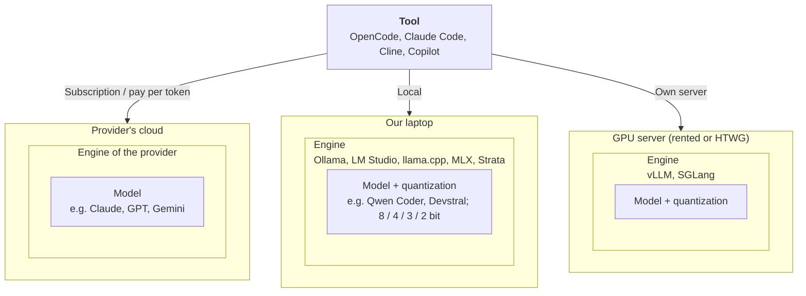

# Overview

An AI coding setup is built from several building blocks. This page explains what each block is, what it is needed for, and names a few examples. The detail pages compare the options within each block.

## Building blocks

Every setup starts with a tool. The operating model decides where the model runs, and with it which blocks we have to choose and run ourselves.

The boxes show what runs inside what: the model runs inside an engine, and the engine runs on hardware.

| # | Block | What it is | Needed for |
|---|---|---|---|
| 1 | **Tool** | The program we work with: in the terminal, in VS Code or as its own editor | Which features we get: agent mode, chat, autocomplete |
| 2 | **Operating model** | Where the model runs and how it is paid for | Costs, data privacy and setup effort |
| 3 | **Engine** | Software that runs a model on our own hardware | Only if we run the model ourselves |
| 4 | **Model + quantization** | The language model that generates the answers, possibly compressed to fewer bits per value | Quality of the results; whether the model fits onto our hardware |
| 5 | **Hardware** | Laptop or server the model runs on | Which models run at a usable speed |

## 1. Tool

The tool is what we interact with. It sends our request together with the relevant code to the model, shows the answer and, in agent mode, carries out the model's actions: it edits files, runs commands and repeats this until the task is done. The tool has a large influence on the result, not only the model.

There are three kinds of tools:

| Kind | Examples | Strengths | Weaknesses |
|---|---|---|---|
| **Terminal tools** | [OpenCode](https://opencode.ai), [Claude Code](https://docs.claude.com/en/docs/claude-code/overview), [Codex CLI](https://github.com/openai/codex), [Gemini CLI](https://github.com/google-gemini/gemini-cli), [Aider](https://aider.chat) | Independent of the editor; strong in agent mode; can be scripted | No autocomplete while typing; changes are reviewed in the terminal or with Git |
| **VS Code extensions** | [GitHub Copilot](https://github.com/features/copilot), [Cline](https://cline.bot), [Roo Code](https://roocode.com), [Kilo Code](https://kilocode.ai) | Work inside our editor; changes are shown as diffs in the editor; easy start | Bound to VS Code; not every extension offers autocomplete |
| **AI editors** | [Cursor](https://cursor.com), [Devin Desktop](https://devin.ai/desktop) (formerly Windsurf) | Agent mode, chat and autocomplete in one product | A separate editor based on VS Code; mostly bound to the provider's subscription |

Some terminal tools also come with a VS Code extension, for example Claude Code. Tools also differ in which models they accept: OpenCode, Cline and Roo Code can connect to almost any provider or local engine, while Claude Code is built for Anthropic's models.

The tools and their differences are described on [Tools](2-tools.md).

## 2. Operating model

The operating model decides where the model runs:

- **Local:** the model runs on our own laptops.
- **Own server:** the model runs on a GPU server for the whole team.
- **Pay per token:** we pay per request through an API; the provider runs the model.
- **Subscription:** a fixed monthly price per person; the provider runs the model.

Advantages, disadvantages and combinations are described on [Operating models](3-operating-models.md).

## 3. Engine

An engine loads a model into memory, runs it and offers it through an API on `localhost` or on a server. The tool connects to this API, usually in the OpenAI-compatible format. An engine is only needed if we run the model ourselves.

| Kind | Examples |
|---|---|
| **Desktop apps with a user interface** | [LM Studio](https://lmstudio.ai), [Strata](https://github.com/niko1221/strata) |
| **Command line and background service** | [Ollama](https://ollama.com), [llama.cpp](https://github.com/ggml-org/llama.cpp), [MLX](https://github.com/ml-explore/mlx) (mainly Apple Silicon) |
| **Servers for several users** | [vLLM](https://docs.vllm.ai), [SGLang](https://docs.sglang.io) |

The engines and when to use which are described on [Engines](4-engines.md).

## 4. Model

The model generates the answers and decides on the next step in agent mode. There are two groups:

- **Proprietary models** such as Claude, GPT or Gemini are only available through the provider, by subscription or API.
- **Open-weight models** such as [Qwen](https://qwenlm.github.io), [Devstral](https://mistral.ai/news/devstral) or [DeepSeek](https://www.deepseek.com) can be downloaded and run on our own hardware, or used cheaply through an API.

Properties that matter for us:

- **Tool calling:** In agent mode the model has to call tools such as "edit file" or "run command" reliably. Many small models fail at this.
- **Context window:** Agents read whole files and need a large context. A large context also needs additional memory.
- **Licence:** Open-weight models come with different licences, e.g. Apache 2.0, MIT or their own.

Models we run ourselves are usually quantized: stored with fewer bits per value, so that they fit on smaller hardware at the cost of some quality.

Models, their variants and quantization are described on [Models](5-models.md).

## 5. Hardware

The hardware decides which models fit into memory and how fast they answer. It only matters if we run the model ourselves.

- **RAM:** the main memory of the computer. A model can run from it without a graphics card, but slowly.
- **VRAM:** the memory of the graphics card. A model that fits completely into it runs fast.
- **Unified memory:** On Macs with Apple Silicon, CPU and GPU share the same memory, so a large part of the RAM can be used like VRAM.
- **Memory bandwidth:** how fast data can be read from memory. It mainly decides how fast a model answers.

How much memory a model needs is described under [Quantization](5-models.md#quantization), the hardware in more detail on [Hardware](6-hardware.md). The team's hardware is collected in the [survey](7-requirements.md#survey).

## Requirements

Which of these options fit us depends on what the team needs: the mode we mainly use, how intensively we use AI, how often we hit limits and which hardware we have. The decisions and the survey are described on [Requirements](7-requirements.md).
