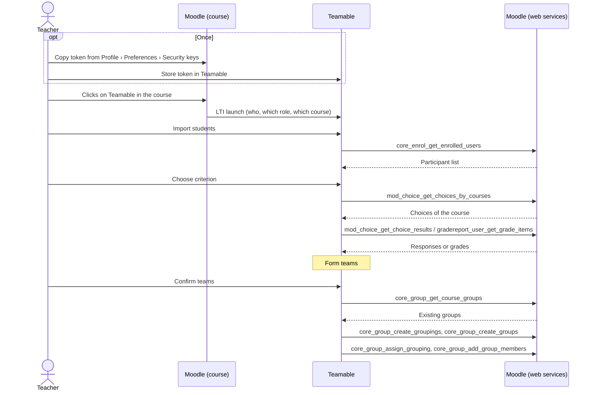

# Moodle API

This page describes which interfaces Teamable Analytics can use to talk to Moodle, how to authenticate there and which endpoints replace the current Canvas integration in Moodle. It is based on the HTWG Moodle in version **4.5.14**. The current Canvas integration is described in [Backend: LMS integration](../../current-state/backend-lms-integration.md) and [Previous Canvas integration](bisherige-canvas-anbindung.md).

## The HTWG instance

This information comes from publicly accessible endpoints of [moodle.htwg-konstanz.de/moodle](https://moodle.htwg-konstanz.de/moodle/) (as of 14.10.2026):

| Property | Value | Source |
| --- | --- | --- |
| Moodle version | **4.5.14** (LTS) | `UPGRADING.md` |
| Web services | enabled (`enablewebservices: 1`) | `tool_mobile_get_public_config` |
| REST protocol | enabled: `webservice/rest/server.php` responds with `invalidtoken` instead of a notice about disabled web services | Call without token |
| Moodle app service | enabled (`enablemobilewebservice: 1`) | `tool_mobile_get_public_config` |
| Login type | `typeoflogin: 1`: username and password directly in the app, no SSO | `tool_mobile_get_public_config` |

The public configuration can be queried without logging in:

```bash
curl -s "https://moodle.htwg-konstanz.de/moodle/lib/ajax/service-nologin.php" \
  -H 'Content-Type: application/json' \
  -d '[{"index":0,"methodname":"tool_mobile_get_public_config","args":{}}]'
```

## LTI in Moodle

[LTI 1.3](https://www.imsglobal.org/spec/lti/v1p3) is an open standard for embedding an external tool in an LMS. Moodle supports it just like Canvas. Teachers then open Teamable directly from their Moodle course, without a second login.

### Setup

1. **Registration (once, Moodle admin):** Under *Site administration › Plugins › Activity modules › External tool › Manage tools*, Teamable is [added as an LTI 1.3 tool](https://docs.moodle.org/405/en/LTI_External_tools). This exchanges Teamable's login and redirect URLs and the keys. Moodle also supports [dynamic registration](https://moodlelti.theedtech.dev/dynreg/): the admin only enters a registration URL from Teamable, and both sides negotiate the rest themselves.
2. **Adding it to a course (teachers):** The teacher adds Teamable to their course as an [*External tool*](https://docs.moodle.org/405/en/LTI_External_tool_activity) activity.

### What Moodle sends on launch

On click, Moodle sends a signed data record (JWT) to Teamable. The fields (claims) relevant for Teamable:

| Data | LTI claim | Value in Moodle |
| --- | --- | --- |
| User | `sub` | Moodle user ID |
| Course | `https://purl.imsglobal.org/spec/lti/claim/context` → `id`, `label`, `title` | Course ID, short name, full name |
| Role | `https://purl.imsglobal.org/spec/lti/claim/roles` | e.g. `…/membership#Instructor`, `…/membership#Learner` |
| Identifier (e.g. student ID number) | `https://purl.imsglobal.org/spec/lti/claim/lis` → `person_sourcedid` | The user's `idnumber` |
| Name, email | `given_name`, `family_name`, `name`, `email` | only if the tool's privacy settings allow it |

**Difference to Canvas:** Teamable currently expects the Canvas-specific custom fields `canvas_course_id` and `canvas_user_id`. In Moodle, the same information is in the standard fields `sub` and `context.id`. Teamable would therefore have to read the standard fields.

**Limit:** The LTI launch only tells Teamable *who* the person is and *which course* they come from. To fetch participants, grades or surveys, Teamable additionally needs one of the [APIs](#apis) and therefore [authentication](#authentication).

## Authentication

With Canvas, Teamable gets a token on behalf of the teacher via OAuth2. This option does **not** exist for the web services in Moodle 4.5. Instead, there are these options:

| Option | How | Advantages | Disadvantages |
| --- | --- | --- | --- |
| **Token per teacher** | The computing centre allows teachers to generate tokens for a Teamable service themselves (`moodle/webservice:createtoken`). The teacher copies it from *Profile › Preferences › Security keys* and stores it in Teamable. Alternatively, the computing centre issues the tokens. | Access exactly to the teacher's own courses, with their own permissions | One manual step per teacher. The token does not expire and has to be stored securely. |
| **Global token** (technical user) | A dedicated Moodle account for Teamable with one token on the server. Permissions limited e.g. to a course category, token restricted to the server's IP. | Invisible to teachers, no manual step | One key opens many courses. More delicate in terms of data protection, permissions have to be maintained by the computing centre. |
| **App service token** (`moodle_mobile_app`) | Anyone can get a token with username and password via `login/token.php`. | Usable at HTWG right away, ideal for testing | For testing only: Teamable would have to accept passwords, the token can use all app functions, and creating groups is not included. |
| **LTI key** (OAuth2 client credentials) | Teamable authenticates with the key from the LTI registration. | No token from teachers needed | Only valid for the [LTI services](#lti-services-nrps-ags), not for the web services |
| **OAuth2** | – | – | Not available for the web services in 4.5. Only the [new REST API in 5.3](#differences-between-45-htwg-and-53) offers OAuth2 clients. |

!!! note "OAuth2 in Moodle 4.5"
    Moodle 4.5 only knows OAuth2 as a *client*, e.g. for logging in via Microsoft, and internally for the LTI services. There is no OAuth2 flow through which an external tool gets a token for the web services.

For the token options, the computing centre has to create a dedicated external service for Teamable that contains exactly the required functions (see [Request to the computing centre](#request-to-the-computing-centre)).

## APIs

Moodle 4.5 offers these interfaces:

| Interface | Purpose | For Teamable |
| --- | --- | --- |
| **Web services via REST** | All functions for reading and writing | Main way: participants, grades, surveys, groups |
| **LTI services (NRPS, AGS)** | Participant list and the tool's own grade columns for an LTI tool | Addition if Teamable is embedded via LTI |
| **AJAX interface** (`lib/ajax/service.php`) | The same functions for Moodle's own user interface, with a browser session | Not usable for external tools |
| **New REST API** (`r.php/api/rest/v2/…`) | Separate API with fixed URLs per resource | In 4.5 only two endpoints (templates, user preferences) and no token authentication. Not usable, see [Differences](#differences-between-45-htwg-and-53). |

### Web services via REST

[*Web services*](https://docs.moodle.org/405/en/Web_services) is Moodle's name for all functions that Moodle offers to the outside, e.g. `core_enrol_get_enrolled_users`. *REST* is the protocol used to call them. So REST is not a separate API, but one way to reach the web services. [How to create and enable a web service](https://docs.moodle.org/405/en/How_to_create_and_enable_a_web_service) describes how the admin sets up a service.

At HTWG, web services and the REST protocol are already enabled (see [The HTWG instance](#the-htwg-instance)).

#### Structure of a call

All functions go through a single endpoint:

```text
https://moodle.htwg-konstanz.de/moodle/webservice/rest/server.php
    ?wstoken=<token>
    &wsfunction=<function_name>
    &moodlewsrestformat=json
    &<parameters>
```

- **Parameters:** Arrays in PHP notation, e.g. `courseids[0]=42` or `options[0][name]=onlyactive&options[0][value]=1`.
- **Permissions:** Every call runs with the permissions of the user the token belongs to. With a teacher's token, Teamable sees exactly their courses.
- **Errors:** Moodle reports errors **with HTTP status 200**. They can only be recognised from the content:

    ```json
    {"exception": "core\\exception\\moodle_exception", "errorcode": "invalidtoken", "message": "Ungültiges Token - Token wurde nicht gefunden"}
    ```

    Every response therefore has to be checked for `exception` or `errorcode`. Only `errorcode` is stable; `message` depends on the instance's language (German at HTWG, as above).

Example: fetching the first three participants of a course.

```bash
curl -s "https://moodle.htwg-konstanz.de/moodle/webservice/rest/server.php" \
  -d wstoken=$MOODLE_TOKEN \
  -d wsfunction=core_enrol_get_enrolled_users \
  -d moodlewsrestformat=json \
  -d courseid=<course-id> \
  -d "options[0][name]=limitnumber" -d "options[0][value]=3"
```

#### Possible flow

This assumes a launch via LTI and data access via web services with the teacher's token.



#### Endpoints

The table maps every Canvas endpoint that Teamable uses today to its counterpart in Moodle.

| Purpose | Canvas (`/api/v1`) | Moodle function | Capability |
| --- | --- | --- | --- |
| Load course | `GET /courses/:id` | `core_course_get_courses_by_field` (`field=id`) | – |
| Load participant list | `GET /courses/:id/enrollments?type[]=StudentEnrollment` | `core_enrol_get_enrolled_users`, filtered by role `student` | `moodle/course:viewparticipants` |
| Find opt-in survey | `GET /courses/:id/quizzes/:id` | `mod_choice_get_choices_by_courses` | – |
| Load answer options | `GET /courses/:id/quizzes/:id/questions` | included in `mod_choice_get_choice_results` | – |
| Load responses | `GET /courses/:id/quizzes/:id/submissions` and `GET /quiz_submissions/:id/questions` | `mod_choice_get_choice_results` (`options[].userresponses[]`) | `mod/choice:readresponses` |
| Load assignments | `GET /courses/:id/assignments` | `gradereport_user_get_grade_items` (all grade items) | `gradereport/user:view` |
| Load scores | `GET /courses/:id/assignments/:id/submissions` | `gradereport_user_get_grade_items` (`graderaw` per user) | additionally `moodle/grade:viewall` |
| Create opt-in survey | `POST /courses/:id/quizzes` | **Gap:** not possible via the API, the teacher creates a choice | – |
| Create question | `POST /courses/:id/quizzes/:id/questions` | **Gap:** as above | – |
| Create group category | `POST /courses/:id/group_categories` | `core_group_create_groupings` | `moodle/course:managegroups` |
| Create one group per team | `POST /group_categories/:id/groups` | `core_group_create_groups` and `core_group_assign_grouping` | `moodle/course:managegroups` |
| Add members | `POST /groups/:id/memberships` | `core_group_add_group_members` | `moodle/course:managegroups` |

In addition, there are functions that Canvas does not need:

| Function | Purpose |
| --- | --- |
| `core_webservice_get_site_info` | Check the token: who does it belong to, which functions are enabled? |
| `core_enrol_get_users_courses` | List the teacher's courses |
| `core_group_get_course_groups`, `core_group_get_course_groupings` | Check before the export which groups already exist. Group names must be unique across the whole course. |
| `core_group_delete_groups` | Clean up the groups of an aborted export |
| `mod_feedback_get_feedbacks_by_courses`, `mod_feedback_get_responses_analysis` | Alternative to a choice: responses from a non-anonymous feedback survey |

The teacher needs all of these permissions in their course. The role *Teacher* (`editingteacher`) has them by default. *Non-editing teacher* (`teacher`) cannot create groups.

### LTI services (NRPS, AGS)

If Teamable is registered as an LTI 1.3 tool, Moodle can enable two services for it. Teamable authenticates with the key from the registration; no token from the teacher is needed.

**NRPS (Names and Role Provisioning Services)** provides the participant list of a course:

```text
GET …/mod/lti/services.php/CourseSection/{course-id}/bindings/{tool-id}/memberships
```

The response contains the Moodle user ID, `idnumber`, roles and status, and name and email only if the tool's privacy settings allow it. NRPS does not provide groups, grades or surveys. NRPS is therefore an alternative to `core_enrol_get_enrolled_users`, but not a replacement for the other web services.

**AGS (Assignment and Grade Services)** exchanges grades. However, the tool only sees **its own** grade columns, not the grades from Moodle assignments or quizzes. AGS is therefore not enough for Teamable's grade import.

## Request to the computing centre

For access via the web services, the computing centre has to create a dedicated external service. This list can be copied directly into the request.

**Requested:** an external service "Teamable Analytics" (short name e.g. `teamable`) with these functions:

```text
core_webservice_get_site_info
core_enrol_get_users_courses
core_course_get_courses_by_field
core_enrol_get_enrolled_users
core_group_get_course_groups
core_group_get_course_groupings
core_group_create_groupings
core_group_create_groups
core_group_assign_grouping
core_group_add_group_members
core_group_delete_groups
mod_choice_get_choices_by_courses
mod_choice_get_choice_results
mod_feedback_get_feedbacks_by_courses
mod_feedback_get_responses_analysis
gradereport_user_get_grade_items
```

**Tokens:** The simplest option is tokens per teacher, which teachers may generate themselves (`moodle/webservice:createtoken` for this service) or which the computing centre issues. The alternative is a technical user (see [Authentication](#authentication)).

**Permissions:** The teacher needs these permissions in their course. The role *Teacher* (`editingteacher`) has them by default:

- `moodle/course:viewparticipants`, `moodle/course:enrolreview`
- `moodle/course:managegroups`
- `moodle/course:useremail`, `moodle/user:viewdetails`
- `gradereport/user:view`, `moodle/grade:viewall`
- `mod/feedback:view`, `mod/feedback:viewreports`, `mod/choice:readresponses`

**LTI:** If Teamable is to be launched from the course, the computing centre also has to register it as an LTI 1.3 tool (see [Setup](#setup)).

## Available fields

### On launch (via LTI)

| Source | Field | Use in Teamable |
| --- | --- | --- |
| LTI launch | `sub`, `given_name`, `family_name`, role | Account and course membership of the person opening the tool |
| LTI launch | `context.id`, `context.label`, `context.title` | Create or find the course |

### Via the web services

| Source | Field | Use in Teamable |
| --- | --- | --- |
| `core_enrol_get_enrolled_users` | `id` | Unique identification of the students |
| | `firstname`, `lastname` | First and last name |
| | `idnumber` | Identifier like the SIS ID in Canvas, if maintained and visible |
| | `roles[].shortname` | Only import students (`student`) |
| | `email`, `groups[]`, `customfields[]` | Possible, not used by Teamable today |
| `mod_choice_get_choice_results` | Response per user | Opt-in or topic preference |
| `gradereport_user_get_grade_items` | `itemname`, `graderaw` per user | Grade criterion (above/below median) |

!!! warning "So far only checked with a student account"
    A real call against the HTWG Moodle with the token of a student account returned only **ID, name, email, profile picture and role** per person. `idnumber`, groups and profile fields were missing. What a teacher receives in addition is only derived from the Moodle code. The fields above are therefore upper bounds. How to check this is described under [Checking the teacher's view](#checking-the-teachers-view).

## Differences between 4.5 (HTWG) and 5.3

Checked in the Moodle code of the branches `MOODLE_405_STABLE` and `MOODLE_503_STABLE` and in the Moodle documentation for 5.3.

### Authentication

| | 4.5 | 5.3 |
| --- | --- | --- |
| Web service tokens | As described above | Unchanged |
| Personal access tokens | – | New: users create them themselves in their preferences (`moodle/api:createtoken`, granted to all authenticated users by default). With scopes that limit access. |
| OAuth2 clients | – | New: the admin registers an application, users log in and give consent. Requires installed Composer dependencies. |

Both new token types **only apply to the new REST API**, not to the web services. Conversely, web service tokens do not work with the new REST API.

### API

| | 4.5 | 5.3 |
| --- | --- | --- |
| Web services (`webservice/rest/server.php`) | Available | Still available, unchanged |
| New REST API (`r.php/api/rest/v2`) | Basic framework with two endpoints: templates and user preferences. No token authentication. | With token authentication. Endpoints for templates, user preferences, question banks and the management of OAuth2 clients. |

So 5.3 does not help Teamable yet: the new REST API with OAuth2 would be the right way, but even in 5.3 it has no endpoints for courses, participants, grades or groups. Even after an upgrade, the web services remain the way to the data.

### LTI

No differences relevant to Teamable found. In 5.3, the NRPS and AGS services are still located under `mod/lti/service/`.

## Implications for Teamable

- **The LTI launch can be carried over.** Instead of the Canvas custom fields, Teamable would have to read the standard fields `sub` and `context.id`. The computing centre has to register the tool once.
- **Authentication for data access is the biggest gap.** There is no OAuth2 flow like with Canvas. Possible options are a token per teacher, transferred once by hand, or a global token for a technical user. Both require a dedicated service from the computing centre.
- **Almost all Canvas endpoints have a counterpart.** Participants, grades, responses and groups are available via the web services.
- **Teamable cannot create the opt-in survey itself.** The teacher creates it as a choice in Moodle, or a custom Moodle plugin is needed.
- **Groups are written back differently.** Instead of a group category there are groupings, group names must be unique across the whole course, and the export consists of several calls without a shared transaction.
- **An upgrade to 5.3 does not change any of this.**

## Open questions

- [ ] Which fields do the functions return with a teacher's token (see [Checking the teacher's view](#checking-the-teachers-view))?
- [ ] Will the computing centre set up a dedicated service for Teamable, and how will the tokens be distributed (see [Request to the computing centre](#request-to-the-computing-centre))?
- [ ] Will the computing centre register Teamable as an LTI 1.3 tool?
- [ ] Does HTWG maintain custom profile fields such as degree programme or semester, and is `idnumber` populated?
- [ ] Which fields may be processed, and for how long may they be stored? To be agreed with HTWG's data protection office.

### Checking the teacher's view

Without a teacher account at HTWG, the teacher's view can be checked with a local Moodle 4.5 from [moodle-docker](https://github.com/moodlehq/moodle-docker):

1. Start Moodle 4.5 (`MOODLE_405_STABLE`) with moodle-docker.
2. Enable web services and REST. Create a service with the functions from the [request to the computing centre](#request-to-the-computing-centre).
3. Create a course with a teacher (`editingteacher`), a non-editing teacher (`teacher`) and three students. Add a profile field, a group, a choice, a non-anonymous feedback survey and a grade.
4. Issue a token for both teachers and call all functions.
5. Record the fields actually returned on this page.

The local Moodle cannot reproduce HTWG's privacy settings (e.g. visible profile fields). A final confirmation therefore requires a teacher account on the HTWG Moodle.

## Sources

### Standards

- [1EdTech – LTI 1.3](https://www.imsglobal.org/spec/lti/v1p3)
- [1EdTech – LTI Names and Role Provisioning Services](https://www.imsglobal.org/spec/lti-nrps/v2p0)
- [1EdTech – LTI Assignment and Grade Services](https://www.imsglobal.org/spec/lti-ags/v2p0)

### Moodle documentation

- [Using web services (4.5)](https://docs.moodle.org/405/en/Using_web_services)
- [Mobile web services (4.5)](https://docs.moodle.org/405/en/Mobile_web_services)
- [LTI External tools (4.5)](https://docs.moodle.org/405/en/LTI_External_tools)
- [Developer Docs – External Services (4.5)](https://moodledev.io/docs/4.5/apis/subsystems/external)
- [REST API tokens (5.3)](https://docs.moodle.org/503/en/REST_API_tokens)

### Moodle source code

- [`lib/db/services.php` – function definitions with capabilities (4.5)](https://github.com/moodle/moodle/blob/MOODLE_405_STABLE/lib/db/services.php)
- [`lib/db/access.php` – default role permissions (4.5)](https://github.com/moodle/moodle/blob/MOODLE_405_STABLE/lib/db/access.php)
- [`mod/lti/service/memberships` – NRPS (4.5)](https://github.com/moodle/moodle/tree/MOODLE_405_STABLE/mod/lti/service/memberships)
- [`mod/lti/service/gradebookservices` – AGS (4.5)](https://github.com/moodle/moodle/tree/MOODLE_405_STABLE/mod/lti/service/gradebookservices)
- [`lib/classes/router/route_loader_interface.php` – path of the new REST API (4.5)](https://github.com/moodle/moodle/blob/MOODLE_405_STABLE/lib/classes/router/route_loader_interface.php)
- [moodle-docker – local Moodle environment](https://github.com/moodlehq/moodle-docker)
- [Routes of the new REST API in 5.3 (`classes/route/api`)](https://github.com/moodle/moodle/tree/MOODLE_503_STABLE/public/lib/classes/route/api)
