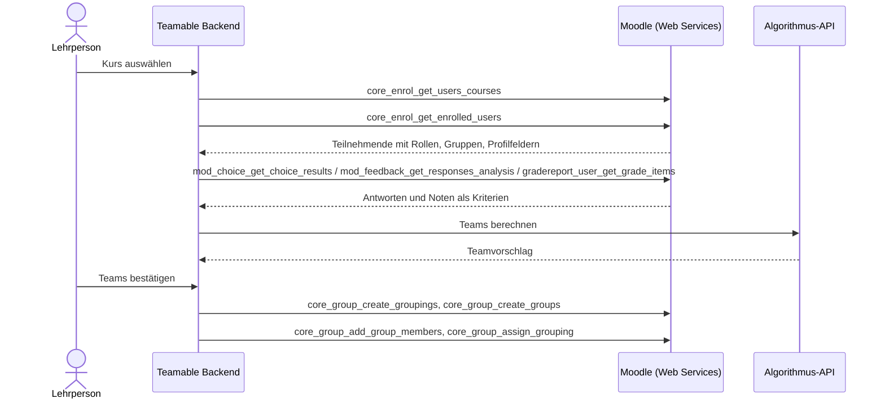

# Moodle-API – verfügbare Endpunkte

Diese Seite beschreibt, welche Kurs- und Studierendendaten Teamable Analytics aus Moodle abrufen kann, über welche Schnittstellen das möglich ist und wie sich die Daten auf das bestehende Datenmodell abbilden lassen.

!!! abstract "Kurzfassung"
    - Die **klassischen Moodle Web Services** liefern alle Daten, die wir brauchen: Kurse, Teilnehmende mit Rollen, bestehende Gruppen, Profilfelder, Umfrage- und Bewertungsdaten. Außerdem können sie **Teams als Moodle-Gruppen zurückschreiben**.
    - Im **HTWG-Moodle (4.5.14)** sind Web Services und das REST-Protokoll bereits aktiv. Es fehlt nur ein eigener externer Service für Teamable, den das Rechenzentrum anlegen muss. Die nötigen Funktionen stehen unter [Anfrage an das Rechenzentrum](#anfrage-an-das-rechenzentrum).
    - Alle Canvas-Funktionen des UBC-Systems haben eine Moodle-Entsprechung, mit einer Ausnahme: Den Opt-in-Test kann das System nicht selbst anlegen.

## Die HTWG-Instanz

Die folgenden Angaben stammen aus öffentlich erreichbaren Endpunkten von [moodle.htwg-konstanz.de/moodle](https://moodle.htwg-konstanz.de/moodle/) (Stand: 14.10.2026):

| Eigenschaft | Wert | Quelle |
| --- | --- | --- |
| Moodle-Version | **4.5.14** (LTS) | `UPGRADING.md` |
| Web Services | aktiviert (`enablewebservices: 1`) | `tool_mobile_get_public_config` |
| REST-Protokoll | aktiviert: `webservice/rest/server.php` antwortet mit `invalidtoken` statt mit einem Hinweis auf deaktivierte Web Services | Aufruf ohne Token |
| Service der Moodle-App | aktiviert (`enablemobilewebservice: 1`) | `tool_mobile_get_public_config` |
| Login-Art | `typeoflogin: 1`: Login mit Benutzername und Passwort direkt in der App, kein SSO | `tool_mobile_get_public_config` |

Die Abfrage der öffentlichen Konfiguration lässt sich ohne Login wiederholen:

```bash
curl -s "https://moodle.htwg-konstanz.de/moodle/lib/ajax/service-nologin.php" \
  -H 'Content-Type: application/json' \
  -d '[{"index":0,"methodname":"tool_mobile_get_public_config","args":{}}]'
```

## Schnittstellen im Überblick

| Schnittstelle | Authentifizierung | Umfang | Für uns |
| --- | --- | --- | --- |
| **Web Services** – `webservice/rest/server.php` | Web-Service-Token (pro Nutzer und Service) | Hunderte `core_*`-/`mod_*`-Funktionen | **Empfohlen** – deckt alle benötigten Daten ab |
| **LTI 1.3 Advantage** – Names and Role Provisioning Services | OAuth 2 Client Credentials nach Registrierung als LTI-Tool | Nur Teilnehmerliste (Mitglieder + Rollen) | Ergänzung für den Login aus dem Kurs heraus |
| **Neue REST API** – `api/rest/v2/…` | Personal Access Token oder OAuth-2-Client | Erst ab Moodle 5.3, dort nur wenige Bereiche | Nicht nutzbar, da die HTWG 4.5 betreibt |

## Ablauf



## Grundlagen der Web Services

### Aufbau eines Aufrufs

Alle Funktionen laufen über einen einzigen Endpunkt:

```text
https://moodle.htwg-konstanz.de/moodle/webservice/rest/server.php
    ?wstoken=<token>
    &wsfunction=<funktionsname>
    &moodlewsrestformat=json
    &<funktionsparameter>
```

Array-Parameter werden in PHP-Notation übergeben, z. B. `courseids[0]=42` oder `options[0][name]=onlyactive&options[0][value]=1`.

Jeder Token gehört zu genau einem **Nutzer** und einem **externen Service**:

- **Nutzer:** Jeder Aufruf läuft mit den Rechten dieses Nutzers. Mit dem Token einer Lehrperson sehen wir also genau deren Kurse.
- **Service:** Er legt fest, welche Funktionen mit dem Token aufrufbar sind.

### Token beschaffen

| Weg | Wie | Voraussetzung |
| --- | --- | --- |
| Vom Admin ausgestellt | *Website-Administration › Server › Webservices › Tokens verwalten* | Admin-Rechte |
| Selbst erzeugt | `login/token.php?username=…&password=…&service=<service_kurzname>` | Capability `moodle/webservice:createtoken`, für den App-Service `moodle/webservice:createmobiletoken` |

!!! warning "Token des App-Service nur für Tests"
    Der Service der Moodle-App (`moodle_mobile_app`) ist an der HTWG aktiv. Damit kann sich jede Person mit ihren Zugangsdaten selbst einen Token holen und die lesenden Funktionen ausprobieren. **Für Teamable selbst eignet sich dieser Weg aber nicht:**

- Teamable müsste Passwörter entgegennehmen.
- Der Token hat Zugriff auf alle Funktionen der App, nicht nur auf die benötigten.
- Die Funktionen zum **Anlegen von Gruppen** (`core_group_create_groups`, `core_group_add_group_members`, `core_group_create_groupings`, `core_group_assign_grouping`) gehören **nicht** zum App-Service.

### Nötige Einrichtung in Moodle

| Schritt | HTWG-Stand |
| --- | --- |
| Web Services aktivieren | ✔ erledigt |
| REST-Protokoll aktivieren | ✔ erledigt |
| `webservice/rest:use` für Nutzende | ✔ wird beim Aktivieren des App-Service automatisch an alle angemeldeten Nutzenden vergeben |
| Externen Service für Teamable mit den benötigten Funktionen anlegen | offen |
| Tokens für diesen Service ausstellen bzw. Selbst-Erzeugung erlauben | offen |

## Übersicht der Endpunkte

Die Capabilities stammen aus der Funktionsdefinition in Moodle 4.5 (`lib/db/services.php` bzw. `db/services.php` des jeweiligen Plugins). Zusätzlich prüft jede Funktion den Kurszugriff und die Datenschutzeinstellungen. Die Spalte „App“ zeigt, ob die Funktion zum Service der Moodle-App gehört und sich damit schon jetzt testen lässt.

### Kurse

| Funktion | Zweck und wichtige Felder | Capability | App |
| --- | --- | --- | --- |
| `core_webservice_get_site_info` | Token prüfen: aktueller Nutzer, Moodle-Version, freigegebene Funktionen | – | ✔ |
| `core_enrol_get_users_courses` | Kurse eines Nutzers: `id`, `shortname`, `fullname`, `startdate`, `enddate` | `moodle/course:viewparticipants` | ✔ |
| `core_course_get_courses_by_field` | Kurs nach `id`, `shortname`, `idnumber` oder `category` suchen | – | ✔ |
| `core_course_get_enrolled_courses_by_timeline_classification` | Kurse des aktuellen Nutzers nach vergangen / laufend / zukünftig | – | ✔ |

### Teilnehmende

| Funktion | Zweck und wichtige Felder | Capability | App |
| --- | --- | --- | --- |
| `core_enrol_get_enrolled_users` | **Kernfunktion:** alle Teilnehmenden eines Kurses mit `id`, `firstname`, `lastname`, `email`, `idnumber`, `roles[]`, `groups[]`, `customfields[]` | `moodle/course:viewparticipants`; für E-Mail und verborgene Felder zusätzlich `moodle/course:useremail`, `moodle/user:viewhiddendetails` | ✔ |
| `core_user_get_course_user_profiles` | Detailprofil einzelner Nutzer im Kurs, inkl. `customfields[]` | `moodle/user:viewdetails` | ✔ |

Nützliche `options` für `core_enrol_get_enrolled_users`:

| Option | Wirkung |
| --- | --- |
| `onlyactive` | Nur aktive Einschreibungen (ohne gesperrte Studierende); benötigt `moodle/course:enrolreview` |
| `withcapability` | Nur Nutzer mit einer Capability, z. B. `mod/assign:submit` für nur Studierende; benötigt `moodle/role:review` |
| `groupid` | Nur Mitglieder einer Gruppe |
| `userfields` | Zurückgegebene Felder einschränken (Datensparsamkeit) |
| `limitfrom`, `limitnumber`, `sortby`, `sortdirection` | Paging und Sortierung |

!!! tip "Kriterien aus Profilfeldern"
    `core_enrol_get_enrolled_users` liefert `customfields[]` mit. Selbst definierte Profilfelder (z. B. Studiengang oder Semester, falls die HTWG sie pflegt) kommen also direkt mit der Teilnehmerliste, ohne zusätzlichen Aufruf.

### Gruppen (Teams zurückschreiben)

| Funktion | Zweck und wichtige Felder | Capability | App |
| --- | --- | --- | --- |
| `core_group_get_course_groups` | Bestehende Gruppen eines Kurses: `id`, `name`, `idnumber` | `moodle/course:managegroups` | ✔ |
| `core_group_get_course_groupings` | Bestehende Gruppierungen eines Kurses | `moodle/course:managegroups`* | ✔ |
| `core_group_create_groupings` | Gruppierung für einen Teamsatz anlegen (z. B. „Teamable – Projekt A“) | `moodle/course:managegroups`* | ✘ |
| `core_group_create_groups` | Gruppen (Teams) anlegen | `moodle/course:managegroups` | ✘ |
| `core_group_assign_grouping` | Gruppen einer Gruppierung zuordnen | `moodle/course:managegroups`* | ✘ |
| `core_group_add_group_members` | Nutzer zu Gruppen hinzufügen | `moodle/course:managegroups` | ✘ |

\* Nicht in `services.php` angegeben, wird aber in der Funktion selbst geprüft.

### Kriterien und Leistungsdaten

| Funktion | Zweck und wichtige Felder | Capability | App |
| --- | --- | --- | --- |
| `mod_choice_get_choice_results` | Ergebnisse einer *Abstimmung* (z. B. Opt-in, Themenwunsch): `options[].userresponses[]` | `mod/choice:readresponses`* | ✔ |
| `mod_feedback_get_responses_analysis` | Antworten einer *Feedback*-Umfrage je Nutzer, wenn nicht anonym: `attempts[].responses[]` | `mod/feedback:viewreports` | ✔ |
| `gradereport_user_get_grade_items` | Alle Bewertungsaspekte mit Noten je Nutzer: `itemname`, `graderaw`, `percentageformatted` | `gradereport/user:view` | ✔ |

\* Nicht in `services.php` angegeben, wird aber in der Funktion selbst geprüft.

??? note "Weitere Funktionen mit geringer Relevanz"
    | Funktion | Zweck |
    | --- | --- |
    | `core_course_get_courses` | Kursdetails per ID (Capability `moodle/course:view` u. a.) |
    | `core_course_get_contents` | Abschnitte und Aktivitäten eines Kurses, z. B. um eine Umfrage zu finden |
    | `core_enrol_get_enrolled_users_with_capability` | Teilnehmende gruppiert nach Capability (nicht im App-Service) |
    | `core_user_get_users_by_field` | Nutzer nach `id`, `idnumber`, `username` oder `email` |
    | `core_group_get_group_members` | Mitglieder bestimmter Gruppen (nicht im App-Service) |
    | `core_cohort_get_cohorts`, `core_cohort_get_cohort_members` | Globale Gruppen (Kohorten), nur relevant falls die HTWG Kohorten pflegt (Capability `moodle/cohort:view`, nicht im App-Service) |
    | `mod_feedback_get_analysis` | Auswertung einer Feedback-Umfrage ohne Bezug zu Personen |
    | `mod_quiz_get_quizzes_by_courses`, `mod_quiz_get_user_best_grade` | Tests und beste Bewertung, z. B. für einen Test zur Selbsteinschätzung |
    | `mod_assign_get_assignments`, `mod_assign_get_grades` | Aufgaben und ihre Bewertungen |
    | `gradereport_user_get_grades_table` | Bewertungsübersicht als Tabelle |

## Anfrage an das Rechenzentrum

Diese Liste kann direkt in die Anfrage übernommen werden.

**Gewünscht:** ein externer Service „Teamable Analytics“ (Kurzname z. B. `teamable`) mit diesen Funktionen:

```text
core_webservice_get_site_info
core_enrol_get_users_courses
core_course_get_courses_by_field
core_enrol_get_enrolled_users
core_group_get_course_groups
core_group_get_course_groupings
core_group_create_groupings
core_group_create_groups
core_group_assign_grouping
core_group_add_group_members
mod_choice_get_choice_results
mod_feedback_get_responses_analysis
gradereport_user_get_grade_items
```

**Tokens:** Am einfachsten sind Tokens **pro Lehrperson**. Eine Lehrperson mit der Rolle *Trainer/in* hat in ihren eigenen Kursen bereits alle nötigen Rechte. Möglich sind zwei Varianten:

- **Selbst erzeugt:** Das Rechenzentrum erlaubt den Lehrenden, für diesen Service selbst Tokens zu erzeugen (Capability `moodle/webservice:createtoken`). Die Lehrperson trägt ihren Token dann in Teamable ein.
- **Vom Admin ausgestellt:** Das Rechenzentrum stellt die Tokens auf Anfrage aus.

Ein technischer Nutzer mit Rechten auf alle Kurse wäre die Alternative, ist aber datenschutzrechtlich deutlich heikler.

Die Lehrperson braucht in ihrem Kurs diese Rechte, die die Trainer-Rolle standardmäßig mitbringt:

- `moodle/course:viewparticipants`, `moodle/course:enrolreview`
- `moodle/course:managegroups`
- `moodle/course:useremail`, `moodle/user:viewdetails`
- `gradereport/user:view`, `mod/feedback:viewreports`, `mod/choice:readresponses`

## Beispielaufruf

```bash
curl -s "https://moodle.htwg-konstanz.de/moodle/webservice/rest/server.php" \
  -d wstoken=$MOODLE_TOKEN \
  -d wsfunction=core_enrol_get_enrolled_users \
  -d moodlewsrestformat=json \
  -d courseid=42 \
  -d "options[0][name]=onlyactive" -d "options[0][value]=1" \
  -d "options[1][name]=userfields" -d "options[1][value]=id,firstname,lastname,email,idnumber,groups,roles,customfields"
```

```json
[
  {
    "id": 1337,
    "firstname": "Erika",
    "lastname": "Mustermann",
    "fullname": "Erika Mustermann",
    "email": "erika.mustermann@htwg-konstanz.de",
    "idnumber": "301234",
    "roles": [{ "roleid": 5, "name": "", "shortname": "student", "sortorder": 0 }],
    "groups": [{ "id": 17, "name": "Team A", "description": "", "descriptionformat": 1 }],
    "customfields": [{ "type": "text", "value": "MSI", "name": "Studiengang", "shortname": "studiengang" }]
  }
]
```

(Antwort gekürzt. Feldnamen wie in Moodle 4.5, Werte frei erfunden.)

!!! tip "Selbst ausprobieren"
    Lesende Funktionen lassen sich mit dem eigenen HTWG-Account über den App-Service testen, ohne das Rechenzentrum. Studierende haben in ihren Kursen standardmäßig `moodle/course:viewparticipants`.

1. Den Token holen und als `MOODLE_TOKEN` setzen: `curl -s https://moodle.htwg-konstanz.de/moodle/login/token.php -d username=… -d password=… -d service=moodle_mobile_app`
2. Den Beispielaufruf oben mit einer eigenen Kurs-ID ausführen.

    Den Token anschließend unter *Einstellungen › Sicherheitsschlüssel* wieder löschen.

## Alternativen innerhalb von Moodle

### LTI 1.3 Advantage – Names and Role Provisioning Services

Wird Teamable Analytics als LTI-1.3-Tool registriert, kann Moodle ihm den Dienst *IMS LTI Names and Role Provisioning* freigeben. In den Tool-Einstellungen heißt die Option *„Use this service to retrieve members' information as per privacy settings“*.

Beim Start aus einem Kurs ruft das Tool dann die Teilnehmerliste ab:

- Moodle-User-ID und `idnumber`, Rollen und Status
- Name und E-Mail nur, wenn die Datenschutzeinstellungen des Tools das Übermitteln erlauben (*Name / E-Mail des Nutzers an Tool übermitteln*)

**Vorteile:**

- Kein Web-Service-Token nötig.
- Funktioniert genauso in Canvas und anderen LMS.
- Lehrende binden das Tool selbst in ihren Kurs ein.

**Nachteile:**

- Liefert nur die Teilnehmerliste, keine Bewertungen, Gruppen oder Profilfelder.
- Kann keine Teams zurückschreiben.
- Das Tool muss einmalig vom Moodle-Admin registriert werden.

!!! tip "LTI 1.3 ist im Backend schon vorhanden"
    Das UBC-Backend implementiert den LTI-1.3-Launch bereits mit `pylti1p3` (`src/lti/views.py`). Allerdings liest der Launch Kurs und Nutzer aus den **Canvas-spezifischen Custom Claims** `canvas_course_id` und `canvas_user_id`. Moodle sendet diese Angaben in den Standard-Claims:

| Angabe | LTI-Claim | Wert in Moodle |
| --- | --- | --- |
| Nutzer | `sub` | Moodle-User-ID |
| Kurs | `https://purl.imsglobal.org/spec/lti/claim/context` → `id` | Moodle-Kurs-ID |
| Matrikelnummer o. Ä. | `https://purl.imsglobal.org/spec/lti/claim/lis` → `person_sourcedid` | `idnumber` |

Außerdem nimmt der Launch bisher immer die erste `Organization` (`Organization.objects.first()`), statt sie anhand des Ausstellers (`iss`) zuzuordnen.

### CSV-Export (Rückfallebene)

Lehrende können ohne Admin exportieren:

- Teilnehmende über *Teilnehmer/innen › Tabellendaten herunterladen als CSV*
- Bewertungen über *Bewertungen › Export*

Gruppen lassen sich über den CSV-Import *Gruppen importieren* wieder einspielen. Das ist der manuelle Weg, falls kein API-Zugang gewährt wird.

### Neue REST API (ab Moodle 5.3)

Moodle 5.3 führt eine neue REST API unter `/api/rest/v2/…` ein, mit Personal Access Tokens, die jeder Nutzer selbst erzeugen kann, und mit OAuth-2-Clients. Kurse, Einschreibungen und Gruppen deckt sie in 5.3 noch nicht ab. Für die HTWG (4.5) ist sie erst nach einem Upgrade relevant.

## Abgleich mit dem bestehenden UBC-System

Das UBC-Backend greift über die Bibliothek `canvasapi` auf Canvas zu (`src/app/canvas/`). Für jede dieser Funktionen gibt es eine Moodle-Entsprechung:

| Funktion im UBC-System | Canvas-Aufruf | Entsprechung in Moodle |
| --- | --- | --- |
| Studierende importieren (`import_students.py`) | `course.get_enrollments(type=["StudentEnrollment"])` | `core_enrol_get_enrolled_users` mit `onlyactive`, gefiltert auf Rolle `student` |
| Opt-in-Test anlegen (`opt_in_quiz.py`) | `course.create_quiz(...)` | **Keine Entsprechung** – `core_courseformat_create_module` unterstützt in 4.5 nur Unterabschnitte, keine Abstimmungen oder Umfragen. Die Lehrperson legt eine *Abstimmung* manuell an. |
| Opt-in auswerten (`import_students.py`) | `quiz.get_submissions()` | `mod_choice_get_choice_results` |
| Notenkriterium importieren (`import_attribute.py`) | `course.get_assignments()`, `assignment.get_submissions()` | `gradereport_user_get_grade_items` (alle Bewertungsaspekte auf einmal) |
| Teams exportieren (`export_team.py`) | `create_group_category`, `create_group`, `create_membership` | `core_group_create_groupings`, `core_group_create_groups`, `core_group_assign_grouping`, `core_group_add_group_members` |

### Abbildung auf das Datenmodell

Die Moodle-Daten lassen sich ohne neue Entitäten auf die bestehenden Django-Modelle (`src/app/models/`) abbilden. Das künftige interne Datenmodell kann davon abweichen; die Tabelle zeigt nur, dass Moodle alle heute genutzten Felder liefern kann.

| Modell im UBC-System | Feld | Quelle in Moodle |
| --- | --- | --- |
| `Organization` | `lms_type`, `lms_api_url` | neuer Wert `MOODLE` in `LMSTypeOptions`; `https://moodle.htwg-konstanz.de/moodle` |
| `Course` | `lms_course_id` | Kurs-`id` |
| `Course` | `lms_opt_in_quiz_id` | ID der Opt-in-*Abstimmung* (`mod_choice`) |
| `Course` | `lms_access_token` | Web-Service-Token (bisher ungenutzt, da Canvas per OAuth arbeitet) |
| `CourseMember` | `lms_id` | Moodle-User-`id` |
| `CourseMember` | `sis_user_id` | `idnumber` (falls gepflegt, meist die Matrikelnummer) |
| `CourseMember` | `first_name`, `last_name` | `firstname`, `lastname` |
| `CourseMember` | `role` | `roles[].shortname`: `student` → `Student`, `editingteacher` / `teacher` → `Instructor` |
| `Section` | – | Moodle-Gruppen (`groups[]`), falls Übungsgruppen als Sektionen dienen sollen |
| `Attribute` / `AttributeOption` / `AttributeResponse` | – | Profilfelder, Antworten aus Abstimmung oder Feedback, Noten |
| `TeamSet` | `name` | Gruppierung |
| `Team` | `name`, `members` | Gruppe und Mitglieder |

## Offene Fragen

- [ ] Richtet das Rechenzentrum einen eigenen externen Service ein, und wie werden die Tokens verteilt (siehe [Anfrage an das Rechenzentrum](#anfrage-an-das-rechenzentrum))?
- [ ] Werden an der HTWG eigene Profilfelder wie Studiengang oder Semester gepflegt, und ist `idnumber` belegt?
- [ ] Datenschutz (DSGVO): Welche Felder dürfen wir verarbeiten? Mit der Option `userfields` nur das Nötige abrufen.
- [ ] Soll Teamable zusätzlich als LTI-Tool registriert werden (Login aus dem Kurs heraus)?

## Fazit

| Kriterium | Bewertung (Web Services) |
| --- | --- |
| Umsetzungsaufwand | **Gering bis mittel** – einfache HTTP/JSON-Aufrufe. Für den Import reichen 2–3 Funktionen, für den Team-Export 4. |
| Flexibilität | **Moodle-spezifisch** – pro LMS ist ein eigener Adapter nötig. LTI wäre LMS-unabhängig, deckt aber nur die Teilnehmerliste ab. |
| Abhängigkeiten | **Mittel** – Web Services und REST sind an der HTWG bereits aktiv. Das Rechenzentrum muss nur einen Service anlegen und Tokens ermöglichen. |

Technisch bietet sich an, die Zugriffe in `src/app/canvas/` hinter eine gemeinsame LMS-Schnittstelle zu legen, mit je einer Implementierung für Canvas und Moodle. So bleibt das System offen für weitere Datenquellen wie den CSV-Import.

## Quellen

### Moodle-Dokumentation (Version 4.5)

- [Using web services](https://docs.moodle.org/405/en/Using_web_services)
- [Mobile web services](https://docs.moodle.org/405/en/Mobile_web_services)
- [LTI External tools](https://docs.moodle.org/405/en/LTI_External_tools)
- [Developer Docs – External Services](https://moodledev.io/docs/4.5/apis/subsystems/external)

### Moodle-Quellcode (Branch `MOODLE_405_STABLE`)

- [`lib/db/services.php` – Funktionsdefinitionen mit Capabilities](https://github.com/moodle/moodle/blob/MOODLE_405_STABLE/lib/db/services.php)
- [`enrol/externallib.php` – `core_enrol_get_enrolled_users`](https://github.com/moodle/moodle/blob/MOODLE_405_STABLE/enrol/externallib.php)
- [`mod/lti/locallib.php` – LTI-Claims](https://github.com/moodle/moodle/blob/MOODLE_405_STABLE/mod/lti/locallib.php)
- [`mod/lti/service/memberships` – Names and Role Provisioning](https://github.com/moodle/moodle/tree/MOODLE_405_STABLE/mod/lti/service/memberships)

### Weitere

- [Moodle 5.3 – Personal access tokens](https://docs.moodle.org/503/en/Personal_access_tokens)
- [1EdTech – LTI Names and Role Provisioning Services](https://www.imsglobal.org/spec/lti-nrps/v2p0)
- [`teamable-backend` (Commit `183a36c`) – Canvas-Anbindung](https://github.com/Teamprojekt-MSI-BIT-SS26/teamable-backend/tree/183a36c/src/app/canvas), [LTI](https://github.com/Teamprojekt-MSI-BIT-SS26/teamable-backend/blob/183a36c/src/lti/views.py), [Modelle](https://github.com/Teamprojekt-MSI-BIT-SS26/teamable-backend/tree/183a36c/src/app/models)
