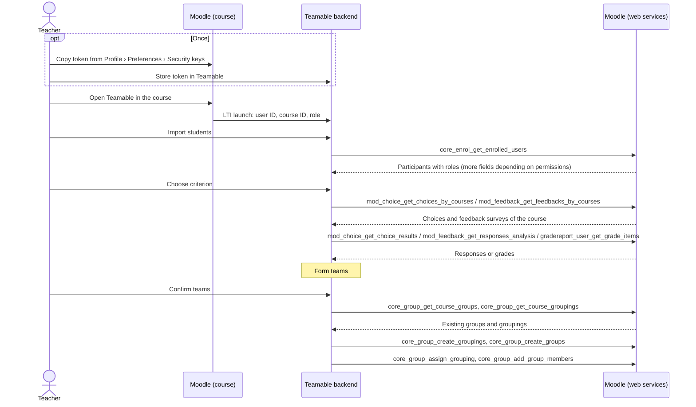

# Moodle API – available endpoints

This page describes the ways Teamable Analytics can obtain course and student data from Moodle, which endpoints are relevant and how to use them.

!!! abstract "Summary"
    - Moodle offers five ways to get the data:
        - **Web services:** REST calls with a token. They provide all required data and can write teams back as groups.
        - **LTI 1.3 Advantage:** Launch from within the course. Provides the participant list and grades in the tool's own columns.
        - **CSV export:** Done manually by the teacher. Groups can be imported, but without members.
        - **Custom Moodle plugin:** Can do everything, but has to be installed by the computing centre.
        - **New REST API:** Only from Moodle 5.3, so not available at HTWG.
    - In the **HTWG Moodle (4.5.14)**, web services and the REST protocol are already enabled. What is missing is a dedicated external service for Teamable, which the computing centre has to create. The required functions are listed under [Request to the computing centre](#request-to-the-computing-centre).
    - Limits of the web services in Moodle 4.5:
        - There is no OAuth2 flow through which an external tool obtains a token automatically. The token is transferred by hand, or a technical user handles the access.
        - Activities such as choices or feedback surveys cannot be created via the API.

!!! warning "Not yet verified: the teacher's view"
    All real calls against the HTWG Moodle so far were made with the token of a **student account**. There, the participant list only contained ID, name, email, profile picture and role.

    What a **teacher** receives in addition is only derived from the Moodle code and has not been measured yet. This concerns e.g. `idnumber`, groups, profile fields, grades of all students and the responses in choices and feedback surveys. The fields in the [endpoint overview](#endpoint-overview) are therefore upper bounds. How to check this without the computing centre is described under [Checking the teacher's view](#checking-the-teachers-view).

## What data Teamable needs

To put the relevant endpoints into context: Teamable forms teams for a course. For this, it needs from the LMS

- the **course** and the **role** of the person opening Teamable,
- the **participants** with name, identifier and role,
- **criteria** for team formation, e.g. answers from a survey or grades,
- a way to **write the finished teams back as groups**.

## The HTWG instance

The following information comes from publicly accessible endpoints of [moodle.htwg-konstanz.de/moodle](https://moodle.htwg-konstanz.de/moodle/) (as of 14.10.2026):

| Property | Value | Source |
| --- | --- | --- |
| Moodle version | **4.5.14** (LTS) | `UPGRADING.md` |
| Web services | enabled (`enablewebservices: 1`) | `tool_mobile_get_public_config` |
| REST protocol | enabled: `webservice/rest/server.php` responds with `invalidtoken` instead of a notice about disabled web services | Call without token |
| Moodle app service | enabled (`enablemobilewebservice: 1`) | `tool_mobile_get_public_config` |
| Login type | `typeoflogin: 1`: login with username and password directly in the app, no SSO | `tool_mobile_get_public_config` |

The public configuration can be queried again without logging in:

```bash
curl -s "https://moodle.htwg-konstanz.de/moodle/lib/ajax/service-nologin.php" \
  -H 'Content-Type: application/json' \
  -d '[{"index":0,"methodname":"tool_mobile_get_public_config","args":{}}]'
```

## Overview of the options

| Option | Authentication | Scope | At HTWG |
| --- | --- | --- | --- |
| **Web services** – `webservice/rest/server.php` | Web service token (per user and service) | Hundreds of `core_*`/`mod_*` functions, read and write | Enabled. A dedicated service has to be created. |
| **LTI 1.3 Advantage** – NRPS and AGS | Signed launch, then OAuth 2 client credentials | Participant list with roles. Grades only in the tool's own columns. | Tool has to be registered. |
| **CSV export and import** | None, the teacher works in the user interface | Export participants and grades, import groups without members | Usable right away |
| **Custom Moodle plugin** | Depends on the implementation | Anything, including things the web services cannot do | Plugin has to be installed. |
| **New REST API** – `api/rest/v2/…` | Personal access token or OAuth 2 client | Only from Moodle 5.3, with few areas covered there | Not available (4.5) |

## Possible flow

The diagram shows how Teamable could work together with Moodle. It assumes a launch via LTI and data access via web services with the teacher's token.



## Web service basics

### Structure of a call

All functions go through a single endpoint:

```text
https://moodle.htwg-konstanz.de/moodle/webservice/rest/server.php
    ?wstoken=<token>
    &wsfunction=<function_name>
    &moodlewsrestformat=json
    &<function_parameters>
```

Array parameters are passed in PHP notation, e.g. `courseids[0]=42` or `options[0][name]=onlyactive&options[0][value]=1`.

Every token belongs to exactly one **user** and one **external service**:

- **User:** Every call runs with this user's permissions. With a teacher's token, we therefore see exactly their courses.
- **Service:** It defines which functions can be called with the token.

### Obtaining a token

| Way | How | Requirement |
| --- | --- | --- |
| Issued by the admin | *Site administration › Server › Web services › Manage tokens* | Admin permissions |
| Self-generated | `login/token.php?username=…&password=…&service=<service_shortname>` | Capability `moodle/webservice:createtoken`, for the app service `moodle/webservice:createmobiletoken` |

!!! warning "Use app service tokens for testing only"
    The Moodle app service (`moodle_mobile_app`) is enabled at HTWG. With it, anyone can obtain a token with their own credentials and try out the read functions. **This approach is not suitable for Teamable itself, though:**

    - Teamable would have to accept passwords.
    - The token has access to all functions of the app, not only the required ones.
    - The functions for **creating groups** (`core_group_create_groups`, `core_group_add_group_members`, `core_group_create_groupings`, `core_group_assign_grouping`) are **not** part of the app service.

### Required setup in Moodle

| Step | HTWG status |
| --- | --- |
| Enable web services | ✔ done |
| Enable REST protocol | ✔ done |
| `webservice/rest:use` for users | ✔ granted automatically to all authenticated users when the app service is enabled |
| Create an external service for Teamable with the required functions | open |
| Issue tokens for this service or allow self-generation | open |

## Endpoint overview

The capabilities come from the function definitions in Moodle 4.5 (`lib/db/services.php` or the plugin's `db/services.php`). In addition, every function checks course access and the privacy settings. The column "App" shows whether the function is part of the Moodle app service and can therefore already be tested now.

The listed fields are the ones a function returns **at most according to the Moodle code**. What actually comes back depends on the token user's permissions and the instance's privacy settings.

### Courses

| Function | Purpose and key fields | Capability | App |
| --- | --- | --- | --- |
| `core_webservice_get_site_info` | Check the token: current user, Moodle version, enabled functions | – | ✔ |
| `core_enrol_get_users_courses` | Courses of a user: `id`, `shortname`, `fullname`, `startdate`, `enddate` | `moodle/course:viewparticipants` | ✔ |
| `core_course_get_courses_by_field` | Find a course by `id`, `shortname`, `idnumber` or `category` | – | ✔ |
| `core_course_get_enrolled_courses_by_timeline_classification` | Courses of the current user by past / in progress / future | – | ✔ |

### Participants

| Function | Purpose and key fields | Capability | App |
| --- | --- | --- | --- |
| `core_enrol_get_enrolled_users` | **Core function:** all participants of a course. Possible fields include `id`, `firstname`, `lastname`, `email`, `idnumber`, `roles[]`, `groups[]`, `customfields[]`. Returned at HTWG from a student's view: only `id`, name, `email`, profile picture, `roles[]` | `moodle/course:viewparticipants`; for email and hidden fields additionally `moodle/course:useremail`, `moodle/user:viewhiddendetails` | ✔ |
| `core_user_get_course_user_profiles` | Detailed profile of individual users in the course, incl. `customfields[]` | `moodle/user:viewdetails` | ✔ |

Useful `options` for `core_enrol_get_enrolled_users`:

| Option | Effect |
| --- | --- |
| `onlyactive` | Only active enrolments (without suspended students); requires `moodle/course:enrolreview` |
| `withcapability` | Only users with a capability, e.g. `mod/assign:submit` for students only; requires `moodle/role:review` |
| `groupid` | Only members of one group |
| `userfields` | Restrict the returned fields (data minimisation) |
| `limitfrom`, `limitnumber`, `sortby`, `sortdirection` | Paging and sorting |

`core_enrol_get_enrolled_users` can additionally return `customfields[]`. Custom profile fields (e.g. degree programme or semester, if HTWG maintains them) would then come directly with the participant list. From a student's view, they are not included at HTWG.

The role is in `roles[].shortname`. Standard Moodle has these roles in a course:

| Short name | Role | Note |
| --- | --- | --- |
| `student` | Student | Called "Studierende" at HTWG |
| `editingteacher` | Teacher | Has all permissions Teamable needs |
| `teacher` | Non-editing teacher | Can read participants, grades and responses, but **cannot create groups** (`moodle/course:managegroups` is missing). `onlyactive` and email addresses are also not available without additional permissions. |

### Groups (writing teams back)

| Function | Purpose and key fields | Capability | App |
| --- | --- | --- | --- |
| `core_group_get_course_groups` | Existing groups of a course: `id`, `name`, `idnumber` | `moodle/course:managegroups` | ✔ |
| `core_group_get_course_groupings` | Existing groupings of a course | `moodle/course:managegroups`* | ✔ |
| `core_group_create_groupings` | Create a grouping for a team set (e.g. "Teamable – Project A") | `moodle/course:managegroups`* | ✘ |
| `core_group_create_groups` | Create groups (teams) | `moodle/course:managegroups` | ✘ |
| `core_group_assign_grouping` | Assign groups to a grouping | `moodle/course:managegroups`* | ✘ |
| `core_group_add_group_members` | Add users to groups | `moodle/course:managegroups` | ✘ |
| `core_group_delete_groups` | Delete groups, e.g. to clean up a failed export | `moodle/course:managegroups` | ✘ |

\* Not declared in `services.php`, but checked inside the function itself.

### Criteria and performance data

| Function | Purpose and key fields | Capability | App |
| --- | --- | --- | --- |
| `mod_choice_get_choices_by_courses` | List the *choices* of a course to pick the right one: `id`, `name` | – | ✔ |
| `mod_choice_get_choice_results` | Results of a choice (e.g. opt-in, topic preference): `options[].userresponses[]` | `mod/choice:readresponses`* | ✔ |
| `mod_feedback_get_feedbacks_by_courses` | List the *feedback* surveys of a course: `id`, `name`, `anonymous` | `mod/feedback:view` | ✔ |
| `mod_feedback_get_responses_analysis` | Responses of a feedback survey per user, if not anonymous: `attempts[].responses[]` | `mod/feedback:viewreports` | ✔ |
| `gradereport_user_get_grade_items` | All grade items with grades per user: `itemname`, `graderaw`, `percentageformatted` | `gradereport/user:view`, for all users additionally `moodle/grade:viewall`* | ✔ |

\* Not declared in `services.php`, but checked inside the function itself.

Teamable cannot create choices or feedback surveys itself: in Moodle 4.5, `core_courseformat_create_module` only supports subsections. The teacher creates them in Moodle, and Teamable then finds them via the two list functions.

??? note "Other functions of lower relevance"
    | Function | Purpose |
    | --- | --- |
    | `core_course_get_courses` | Course details by ID (capability `moodle/course:view` among others) |
    | `core_course_get_contents` | Sections and activities of a course |
    | `core_enrol_get_enrolled_users_with_capability` | Participants grouped by capability (not in the app service) |
    | `core_user_get_users_by_field` | Users by `id`, `idnumber`, `username` or `email` |
    | `core_group_get_group_members` | Members of specific groups (not in the app service) |
    | `core_cohort_get_cohorts`, `core_cohort_get_cohort_members` | Site-wide groups (cohorts), only relevant if HTWG maintains cohorts (capability `moodle/cohort:view`, not in the app service) |
    | `mod_feedback_get_analysis` | Analysis of a feedback survey without reference to individuals |
    | `mod_quiz_get_quizzes_by_courses`, `mod_quiz_get_user_best_grade` | Quizzes and best grade, e.g. for a self-assessment quiz |
    | `mod_assign_get_assignments`, `mod_assign_get_grades` | Assignments and their grades |
    | `gradereport_user_get_grades_table` | Grade overview as a table |

## Request to the computing centre

This list can be copied directly into the request.

**Requested:** an external service "Teamable Analytics" (short name e.g. `teamable`) with these functions:

```text
core_webservice_get_site_info
core_enrol_get_users_courses
core_course_get_courses_by_field
core_enrol_get_enrolled_users
core_group_get_course_groups
core_group_get_course_groupings
core_group_create_groupings
core_group_create_groups
core_group_assign_grouping
core_group_add_group_members
core_group_delete_groups
mod_choice_get_choices_by_courses
mod_choice_get_choice_results
mod_feedback_get_feedbacks_by_courses
mod_feedback_get_responses_analysis
gradereport_user_get_grade_items
```

**Tokens:** The simplest option is tokens **per teacher**. A teacher with the role *Teacher* (`editingteacher`) already has all required permissions in their own courses. There are two variants:

- **Self-generated:** The computing centre allows teachers to generate tokens for this service themselves (capability `moodle/webservice:createtoken`). Moodle then creates the token automatically as soon as the teacher opens *Profile › Preferences › Security keys*. From there, they copy it into Teamable. The token does not expire until they reset it there.
- **Issued by the admin:** The computing centre issues the tokens on request.

The alternative is a **technical user**: a dedicated Moodle account for Teamable with a single token on the server. Its permissions can be limited to a course category, and the token can be restricted to the IP address of the Teamable server. From a data protection perspective, this is still more delicate, because one key opens many courses.

In their course, the teacher needs these permissions, which the role *Teacher* has by default:

- `moodle/course:viewparticipants`, `moodle/course:enrolreview`
- `moodle/course:managegroups`
- `moodle/course:useremail`, `moodle/user:viewdetails`
- `gradereport/user:view`, `moodle/grade:viewall`
- `mod/feedback:view`, `mod/feedback:viewreports`, `mod/choice:readresponses`

## Example call

Real call against the HTWG Moodle with the token of a **student account** (app service), limited to three participants:

```bash
curl -s "https://moodle.htwg-konstanz.de/moodle/webservice/rest/server.php" \
  -d wstoken=$MOODLE_TOKEN \
  -d wsfunction=core_enrol_get_enrolled_users \
  -d moodlewsrestformat=json \
  -d courseid=<course-id> \
  -d "options[0][name]=limitnumber" -d "options[0][value]=3"
```

Response (one of three people, anonymised: names, IDs and email addresses replaced, structure and field names unchanged):

```json
[
  {
    "id": 1001,
    "firstname": "Erika",
    "lastname": "Mustermann",
    "fullname": "Erika Mustermann",
    "email": "erika.mustermann@htwg-konstanz.de",
    "profileimageurlsmall": "https://moodle.htwg-konstanz.de/moodle/theme/image.php/boost/core/1/u/f2",
    "profileimageurl": "https://moodle.htwg-konstanz.de/moodle/theme/image.php/boost/core/1/u/f1",
    "roles": [
      {
        "roleid": 5,
        "name": "Studierende",
        "shortname": "student",
        "sortorder": 0
      }
    ]
  }
]
```

From a student's view, the HTWG instance therefore only returns **ID, name, email, profile picture and role**. At HTWG the role is called "Studierende", its short name is `student` as in standard Moodle. Fields such as `username`, `idnumber`, `groups` or `customfields` are missing. With a teacher's token, further fields are added depending on permissions and privacy settings (see [Checking the teacher's view](#checking-the-teachers-view)).

!!! tip "Try it yourself"
    Read functions can be tested with your own HTWG account via the app service, without the computing centre. Students have `moodle/course:viewparticipants` in their courses by default.

    Obtain the token in a way that keeps the password out of the shell history:

    ```bash
    read -r -p "Username: " U; read -r -s -p "Password: " P; echo
    MOODLE_TOKEN=$(curl -s https://moodle.htwg-konstanz.de/moodle/login/token.php \
      --data-urlencode "username=$U" --data-urlencode "password=$P" \
      -d service=moodle_mobile_app | sed -E 's/.*"token":"([^"]+)".*/\1/'); unset P
    ```

    Then run the example call above with one of your own course IDs (the ID is in the course URL `…/course/view.php?id=…`).

    The token remains valid until it is reset under *Profile › Preferences › Security keys*. Anyone who uses the Moodle app usually gets the same token as the app and has to log in there again after the reset.

## Checking the teacher's view

Without a teacher account at HTWG, the teacher's view can be checked with a local Moodle 4.5 from [moodle-docker](https://github.com/moodlehq/moodle-docker):

1. Start Moodle 4.5 (`MOODLE_405_STABLE`) with moodle-docker.
2. Enable web services and REST. Create a service with the functions from the [request to the computing centre](#request-to-the-computing-centre).
3. Create a course with a teacher (`editingteacher`), a non-editing teacher (`teacher`) and three students. Add a profile field, a group, a choice, a non-anonymous feedback survey and a grade.
4. Issue a token for both teachers and call all functions.
5. Record the fields actually returned on this page.

The local Moodle cannot reproduce HTWG's privacy settings (e.g. visible profile fields). A final confirmation therefore requires a teacher account on the HTWG Moodle.

## Using the web services

### Detecting errors

Moodle reports errors **with HTTP status 200**. The error can only be recognised from the content:

```json
{"exception": "core\\exception\\moodle_exception", "errorcode": "invalidtoken", "message": "Ungültiges Token - Token wurde nicht gefunden"}
```

A client must therefore check every response for an object with `exception` or `errorcode` instead of relying on the HTTP status. The messages (`message`) are written in the instance's language (German at HTWG, as above) and are not suitable for case distinctions; only `errorcode` is stable.

### Creating groups

Writing back a team set consists of four calls: create grouping, create groups, assign groups, add members. The following applies:

- **Group names must be unique across the whole course**, not only within a grouping. The same applies to groupings. Moodle rejects duplicate names (*"Group with the same name already exists in the course"*). Identically named teams from two team sets ("Team 1") therefore need a prefix, e.g. the name of the team set.
- **No transaction across all calls:** Each individual call runs in a database transaction, but the sequence as a whole does not. If it breaks off halfway, a partial state remains.
- **`idnumber` as key:** Groups and groupings can be given an `idnumber` that is unique per course, e.g. `teamable-<teamset-id>-<team>`. Before creating, use `core_group_get_course_groups` or `core_group_get_course_groupings` to check what already exists and only create what is missing. Leftovers can be removed with `core_group_delete_groups`.
- **Adding members** again is harmless: `core_group_add_group_members` ignores existing memberships.

### Identity and freshness

- **Stable key:** The Moodle user ID is only unique within one instance. A user is therefore identified by *instance URL + user ID*, not by the email address, which can change. LTI (`sub`) and web services return the same user ID.
- **Snapshot:** A fetch reflects the state at the time of the call. Anyone who enrols or unenrols afterwards is missing from or remains in the fetched data.

### Tokens and data protection

- **Tokens are credentials.** A teacher's token allows reading participant data and creating groups in their courses. A Moodle token **does not expire**. It must therefore be stored encrypted per person, must not appear in any API response or log, and must be revocable by the teacher.
- **Data minimisation:** Use the `userfields` option to fetch only the fields that are actually needed.

## Other options in Moodle

### LTI 1.3 Advantage

If Teamable Analytics is registered as an LTI 1.3 tool, teachers launch it directly from their Moodle course. On launch, Moodle sends user, course and role in standard fields (claims):

| Data | LTI claim | Value in Moodle |
| --- | --- | --- |
| User | `sub` | Moodle user ID |
| Course | `https://purl.imsglobal.org/spec/lti/claim/context` → `id` | Moodle course ID |
| Role | `https://purl.imsglobal.org/spec/lti/claim/roles` | e.g. `…/membership#Instructor`, `…/membership#Learner` |
| Student ID number or similar | `https://purl.imsglobal.org/spec/lti/claim/lis` → `person_sourcedid` | `idnumber` |
| Name, email | `name`, `given_name`, `family_name`, `email` | only if the tool's privacy settings allow it |

In addition, Moodle can enable two services for the tool:

**Names and Role Provisioning Services (NRPS)** – option *"Use this service to retrieve members' information as per privacy settings"*. The tool uses it to fetch the participant list:

```text
GET …/mod/lti/services.php/CourseSection/{course-id}/bindings/{tool-type-id}/memberships
```

- Moodle user ID, `idnumber`, roles and status
- Name and email only if the tool's privacy settings allow sending them (*Share launcher's name / email with tool*)
- Moodle 4.5 does not offer a groups service.

**Assignment and Grade Services (AGS)** – option *"Use this service for grade sync and column management"*. With it, however, the tool only sees **its own grade columns**: those it created itself and those of its LTI activities (`get_lineitems` in `mod/lti/service/gradebookservices`). Existing grades from assignments or quizzes cannot be read via AGS.

**Advantages:**

- No web service token needed. Access works via a key that Moodle knows from the registration.
- A standard that works the same way in Canvas and other LMS.
- Teachers add the tool to their course themselves. Course and role are known at launch, a separate account in Teamable is not needed.

**Disadvantages:**

- Only provides the participant list and grades in the tool's own columns. No survey responses, groups or profile fields.
- Cannot write teams back as groups.
- The tool has to be registered once by the Moodle admin.

!!! note "Not to be confused with “Publish as LTI tool”"
    Moodle also has the feature *Publish as LTI tool* (`enrol_lti`). It turns a Moodle course itself into a tool that **another** LMS embeds. That is the opposite direction and not relevant for Teamable.

### CSV export and import

Teachers can export without an admin:

- Participants via *Participants › Download table data as CSV*
- Grades via *Grades › Export*

The way back only works halfway: the CSV import *Import groups* creates groups and groupings, but **no members**. Only columns such as `groupname`, `groupingname` and `groupidnumber` are allowed (`group/import.php`). Teachers then have to assign the members by hand.

### Custom Moodle plugin

A local plugin (`local_teamable`) runs inside Moodle and can ship its own web service functions and a ready-made service (`db/services.php`). This makes it possible to work around the limits of the standard functions:

- Automatically create choices or feedback surveys for Teamable in the course.
- Return all required data in one call and create groups in one step, even within one transaction.
- Handle access itself, e.g. issue tokens to teachers automatically.

This requires PHP development following Moodle's guidelines. The computing centre has to install the plugin and maintain it with every Moodle upgrade. It cannot be used for Canvas or other LMS.

### New REST API (from Moodle 5.3)

Moodle 5.3 introduces a new REST API under `/api/rest/v2/…`, with personal access tokens that every user can generate themselves, and with OAuth 2 clients. In 5.3 it does not yet cover courses, enrolments and groups. For HTWG (4.5), it only becomes relevant after an upgrade.

## Open questions

- [ ] Which fields do the functions return with a teacher's token (see [Checking the teacher's view](#checking-the-teachers-view))?
- [ ] Will the computing centre set up a dedicated external service, and how will tokens be distributed (see [Request to the computing centre](#request-to-the-computing-centre))?
- [ ] Does HTWG maintain custom profile fields such as degree programme or semester, and is `idnumber` populated?
- [ ] Which fields may be processed, and for how long may they be stored? To be agreed with HTWG's data protection office.
- [ ] Would the computing centre be willing to register Teamable as an LTI 1.3 tool or to install a plugin?

## Assessment of the options

Assessed against the criteria from [Optionen zur Datenübertragung](uebertragungsoptionen.md), with respect to the HTWG Moodle:

| Option | Implementation effort | Flexibility | Dependencies | Data |
| --- | --- | --- | --- | --- |
| **Web services** | **Low to medium:** simple HTTP/JSON calls. 3–5 functions for the import, 4 for writing back. | **Moodle-specific:** each LMS needs its own access. | **Medium:** web services and REST are enabled. The computing centre has to create a service and enable tokens. | Participants, surveys, grades, read and write groups |
| **LTI 1.3 (NRPS, AGS)** | **Medium:** launch with signed tokens, key management, registration | **High:** a standard also supported by Canvas and other LMS | **Medium:** the computing centre has to register the tool. | Participant list with roles, grades only in own columns, no writing back of groups |
| **CSV export/import** | **Low:** file upload and parser | **High:** any LMS with CSV export, even without an LMS | **None** | Participants and grades. Groups back only without members, the rest by hand. |
| **Custom plugin** | **High:** PHP development following Moodle's guidelines, maintenance with every upgrade | **Low:** Moodle only | **High:** the computing centre has to install and operate the plugin. | Everything, including creating surveys |
| **New REST API** | – | – | Moodle 5.3, not available at HTWG | Courses, enrolments and groups still missing in 5.3 |

The options are not mutually exclusive. LTI is suitable for launching from the course, the web services for data access, CSV as a fallback without approvals.

## Sources

### Moodle documentation (version 4.5)

- [Using web services](https://docs.moodle.org/405/en/Using_web_services)
- [Mobile web services](https://docs.moodle.org/405/en/Mobile_web_services)
- [LTI External tools](https://docs.moodle.org/405/en/LTI_External_tools)
- [Publish as LTI tool](https://docs.moodle.org/405/en/Publish_as_LTI_tool)
- [Developer Docs – External Services](https://moodledev.io/docs/4.5/apis/subsystems/external)
- [Developer Docs – Local plugins](https://moodledev.io/docs/4.5/apis/plugintypes/local)

### Moodle source code (branch `MOODLE_405_STABLE`)

- [`lib/db/services.php` – function definitions with capabilities](https://github.com/moodle/moodle/blob/MOODLE_405_STABLE/lib/db/services.php)
- [`lib/db/access.php` – default role permissions](https://github.com/moodle/moodle/blob/MOODLE_405_STABLE/lib/db/access.php)
- [`enrol/externallib.php` – `core_enrol_get_enrolled_users`](https://github.com/moodle/moodle/blob/MOODLE_405_STABLE/enrol/externallib.php)
- [`group/externallib.php` – group functions (transactions, name check)](https://github.com/moodle/moodle/blob/MOODLE_405_STABLE/group/externallib.php)
- [`grade/report/user/classes/external/user.php` – permission check for grades](https://github.com/moodle/moodle/blob/MOODLE_405_STABLE/grade/report/user/classes/external/user.php)
- [`mod/lti/locallib.php` – LTI claims](https://github.com/moodle/moodle/blob/MOODLE_405_STABLE/mod/lti/locallib.php)
- [`mod/lti/service/memberships` – Names and Role Provisioning](https://github.com/moodle/moodle/tree/MOODLE_405_STABLE/mod/lti/service/memberships)
- [`mod/lti/service/gradebookservices` – Assignment and Grade Services](https://github.com/moodle/moodle/tree/MOODLE_405_STABLE/mod/lti/service/gradebookservices)

### Other

- [Moodle 5.3 – Personal access tokens](https://docs.moodle.org/503/en/Personal_access_tokens)
- [1EdTech – LTI Names and Role Provisioning Services](https://www.imsglobal.org/spec/lti-nrps/v2p0)
- [1EdTech – LTI Assignment and Grade Services](https://www.imsglobal.org/spec/lti-ags/v2p0)
- [moodle-docker – local Moodle environment](https://github.com/moodlehq/moodle-docker)
