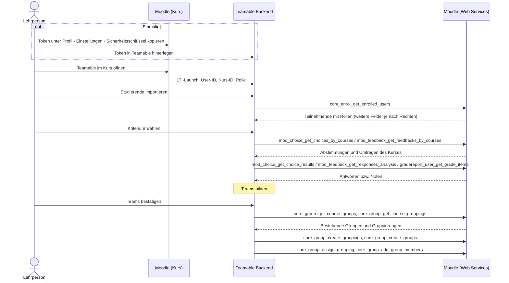

# Moodle-API – verfügbare Endpunkte

Diese Seite beschreibt, über welche Wege Teamable Analytics Kurs- und Studierendendaten aus Moodle bekommen kann, welche Endpunkte dafür relevant sind und wie man sie nutzt.

!!! abstract "Kurzfassung"
    - Moodle bietet fünf Wege an die Daten:
        - **Web Services:** REST-Aufrufe mit einem Token. Sie liefern alle benötigten Daten und können Teams als Gruppen zurückschreiben.
        - **LTI 1.3 Advantage:** Start aus dem Kurs heraus. Liefert die Teilnehmerliste und Noten in eigenen Spalten des Tools.
        - **CSV-Export:** Manuell durch die Lehrperson. Gruppen lassen sich importieren, aber ohne Mitglieder.
        - **Eigenes Moodle-Plugin:** Kann alles, muss aber vom Rechenzentrum installiert werden.
        - **Neue REST API:** Erst ab Moodle 5.3, an der HTWG also nicht verfügbar.
    - Im **HTWG-Moodle (4.5.14)** sind Web Services und das REST-Protokoll bereits aktiv. Es fehlt ein eigener externer Service für Teamable, den das Rechenzentrum anlegen muss. Die nötigen Funktionen stehen unter [Anfrage an das Rechenzentrum](#anfrage-an-das-rechenzentrum).
    - Grenzen der Web Services in Moodle 4.5:
        - Es gibt keinen OAuth2-Ablauf, über den ein externes Tool automatisch einen Token bekommt. Der Token wird von Hand übertragen, oder ein technischer Nutzer übernimmt den Zugriff.
        - Aktivitäten wie Abstimmungen oder Umfragen lassen sich nicht per API anlegen.

!!! warning "Noch nicht verifiziert: Sicht von Lehrenden"
    Alle echten Aufrufe gegen das HTWG-Moodle liefen bisher mit dem Token eines **Studierenden-Accounts**. Die Teilnehmerliste enthielt dort nur ID, Name, E-Mail, Profilbild und Rolle.

    Was eine **Lehrperson** zusätzlich erhält, ist nur aus dem Moodle-Code abgeleitet und noch nicht gemessen. Das betrifft z. B. `idnumber`, Gruppen, Profilfelder, Noten aller Studierenden und die Antworten in Abstimmungen und Umfragen. Die Felder in der [Übersicht der Endpunkte](#ubersicht-der-endpunkte) sind deshalb Obergrenzen. Wie sich das ohne Rechenzentrum prüfen lässt, steht unter [Sicht von Lehrenden prüfen](#sicht-von-lehrenden-prufen).

## Welche Daten Teamable braucht

Zur Einordnung, welche Endpunkte relevant sind: Teamable bildet Teams für einen Kurs. Dafür braucht es aus dem LMS

- den **Kurs** und die **Rolle** der Person, die Teamable öffnet,
- die **Teilnehmenden** mit Name, Kennung und Rolle,
- **Kriterien** für die Teambildung, z. B. Antworten aus einer Umfrage oder Noten,
- einen Weg, die fertigen **Teams als Gruppen zurückzuschreiben**.

## Die HTWG-Instanz

Die folgenden Angaben stammen aus öffentlich erreichbaren Endpunkten von [moodle.htwg-konstanz.de/moodle](https://moodle.htwg-konstanz.de/moodle/) (Stand: 14.10.2026):

| Eigenschaft | Wert | Quelle |
| --- | --- | --- |
| Moodle-Version | **4.5.14** (LTS) | `UPGRADING.md` |
| Web Services | aktiviert (`enablewebservices: 1`) | `tool_mobile_get_public_config` |
| REST-Protokoll | aktiviert: `webservice/rest/server.php` antwortet mit `invalidtoken` statt mit einem Hinweis auf deaktivierte Web Services | Aufruf ohne Token |
| Service der Moodle-App | aktiviert (`enablemobilewebservice: 1`) | `tool_mobile_get_public_config` |
| Login-Art | `typeoflogin: 1`: Login mit Benutzername und Passwort direkt in der App, kein SSO | `tool_mobile_get_public_config` |

Die Abfrage der öffentlichen Konfiguration lässt sich ohne Login wiederholen:

```bash
curl -s "https://moodle.htwg-konstanz.de/moodle/lib/ajax/service-nologin.php" \
  -H 'Content-Type: application/json' \
  -d '[{"index":0,"methodname":"tool_mobile_get_public_config","args":{}}]'
```

## Wege im Überblick

| Weg | Authentifizierung | Umfang | An der HTWG |
| --- | --- | --- | --- |
| **Web Services** – `webservice/rest/server.php` | Web-Service-Token (pro Nutzer und Service) | Hunderte `core_*`-/`mod_*`-Funktionen, lesend und schreibend | Aktiv. Ein eigener Service muss angelegt werden. |
| **LTI 1.3 Advantage** – NRPS und AGS | Signierter Launch, danach OAuth 2 Client Credentials | Teilnehmerliste mit Rollen. Noten nur in eigenen Spalten des Tools. | Tool muss registriert werden. |
| **CSV-Export und -Import** | Keine, die Lehrperson arbeitet in der Oberfläche | Teilnehmende und Bewertungen exportieren, Gruppen ohne Mitglieder importieren | Sofort nutzbar |
| **Eigenes Moodle-Plugin** | Je nach Umsetzung | Beliebig, auch Dinge, die die Web Services nicht können | Plugin muss installiert werden. |
| **Neue REST API** – `api/rest/v2/…` | Personal Access Token oder OAuth-2-Client | Erst ab Moodle 5.3, dort nur wenige Bereiche | Nicht verfügbar (4.5) |

## Möglicher Ablauf

Das Diagramm zeigt, wie Teamable mit Moodle zusammenarbeiten könnte. Angenommen ist ein Start per LTI und der Datenzugriff über Web Services mit dem Token der Lehrperson.



## Grundlagen der Web Services

### Aufbau eines Aufrufs

Alle Funktionen laufen über einen einzigen Endpunkt:

```text
https://moodle.htwg-konstanz.de/moodle/webservice/rest/server.php
    ?wstoken=<token>
    &wsfunction=<funktionsname>
    &moodlewsrestformat=json
    &<funktionsparameter>
```

Array-Parameter werden in PHP-Notation übergeben, z. B. `courseids[0]=42` oder `options[0][name]=onlyactive&options[0][value]=1`.

Jeder Token gehört zu genau einem **Nutzer** und einem **externen Service**:

- **Nutzer:** Jeder Aufruf läuft mit den Rechten dieses Nutzers. Mit dem Token einer Lehrperson sehen wir also genau deren Kurse.
- **Service:** Er legt fest, welche Funktionen mit dem Token aufrufbar sind.

### Token beschaffen

| Weg | Wie | Voraussetzung |
| --- | --- | --- |
| Vom Admin ausgestellt | *Website-Administration › Server › Webservices › Tokens verwalten* | Admin-Rechte |
| Selbst erzeugt | `login/token.php?username=…&password=…&service=<service_kurzname>` | Capability `moodle/webservice:createtoken`, für den App-Service `moodle/webservice:createmobiletoken` |

!!! warning "Token des App-Service nur für Tests"
    Der Service der Moodle-App (`moodle_mobile_app`) ist an der HTWG aktiv. Damit kann sich jede Person mit ihren Zugangsdaten selbst einen Token holen und die lesenden Funktionen ausprobieren. **Für Teamable selbst eignet sich dieser Weg aber nicht:**

    - Teamable müsste Passwörter entgegennehmen.
    - Der Token hat Zugriff auf alle Funktionen der App, nicht nur auf die benötigten.
    - Die Funktionen zum **Anlegen von Gruppen** (`core_group_create_groups`, `core_group_add_group_members`, `core_group_create_groupings`, `core_group_assign_grouping`) gehören **nicht** zum App-Service.

### Nötige Einrichtung in Moodle

| Schritt | HTWG-Stand |
| --- | --- |
| Web Services aktivieren | ✔ erledigt |
| REST-Protokoll aktivieren | ✔ erledigt |
| `webservice/rest:use` für Nutzende | ✔ wird beim Aktivieren des App-Service automatisch an alle angemeldeten Nutzenden vergeben |
| Externen Service für Teamable mit den benötigten Funktionen anlegen | offen |
| Tokens für diesen Service ausstellen bzw. Selbst-Erzeugung erlauben | offen |

## Übersicht der Endpunkte

Die Capabilities stammen aus der Funktionsdefinition in Moodle 4.5 (`lib/db/services.php` bzw. `db/services.php` des jeweiligen Plugins). Zusätzlich prüft jede Funktion den Kurszugriff und die Datenschutzeinstellungen. Die Spalte „App“ zeigt, ob die Funktion zum Service der Moodle-App gehört und sich damit schon jetzt testen lässt.

Die genannten Felder sind die, die eine Funktion **laut Moodle-Code höchstens** liefert. Was tatsächlich zurückkommt, hängt von den Rechten des Token-Nutzers und den Datenschutzeinstellungen der Instanz ab.

### Kurse

| Funktion | Zweck und wichtige Felder | Capability | App |
| --- | --- | --- | --- |
| `core_webservice_get_site_info` | Token prüfen: aktueller Nutzer, Moodle-Version, freigegebene Funktionen | – | ✔ |
| `core_enrol_get_users_courses` | Kurse eines Nutzers: `id`, `shortname`, `fullname`, `startdate`, `enddate` | `moodle/course:viewparticipants` | ✔ |
| `core_course_get_courses_by_field` | Kurs nach `id`, `shortname`, `idnumber` oder `category` suchen | – | ✔ |
| `core_course_get_enrolled_courses_by_timeline_classification` | Kurse des aktuellen Nutzers nach vergangen / laufend / zukünftig | – | ✔ |

### Teilnehmende

| Funktion | Zweck und wichtige Felder | Capability | App |
| --- | --- | --- | --- |
| `core_enrol_get_enrolled_users` | **Kernfunktion:** alle Teilnehmenden eines Kurses. Möglich sind u. a. `id`, `firstname`, `lastname`, `email`, `idnumber`, `roles[]`, `groups[]`, `customfields[]`. An der HTWG aus Studierendensicht geliefert: nur `id`, Name, `email`, Profilbild, `roles[]` | `moodle/course:viewparticipants`; für E-Mail und verborgene Felder zusätzlich `moodle/course:useremail`, `moodle/user:viewhiddendetails` | ✔ |
| `core_user_get_course_user_profiles` | Detailprofil einzelner Nutzer im Kurs, inkl. `customfields[]` | `moodle/user:viewdetails` | ✔ |

Nützliche `options` für `core_enrol_get_enrolled_users`:

| Option | Wirkung |
| --- | --- |
| `onlyactive` | Nur aktive Einschreibungen (ohne gesperrte Studierende); benötigt `moodle/course:enrolreview` |
| `withcapability` | Nur Nutzer mit einer Capability, z. B. `mod/assign:submit` für nur Studierende; benötigt `moodle/role:review` |
| `groupid` | Nur Mitglieder einer Gruppe |
| `userfields` | Zurückgegebene Felder einschränken (Datensparsamkeit) |
| `limitfrom`, `limitnumber`, `sortby`, `sortdirection` | Paging und Sortierung |

`core_enrol_get_enrolled_users` kann zusätzlich `customfields[]` liefern. Selbst definierte Profilfelder (z. B. Studiengang oder Semester, falls die HTWG sie pflegt) kämen dann direkt mit der Teilnehmerliste. Aus Studierendensicht sind sie an der HTWG nicht enthalten.

Die Rolle steht in `roles[].shortname`. Im Moodle-Standard gibt es im Kurs diese Rollen:

| Kurzname | Rolle | Hinweis |
| --- | --- | --- |
| `student` | Studierende | An der HTWG „Studierende“ |
| `editingteacher` | Trainer/in | Hat alle Rechte, die Teamable braucht |
| `teacher` | Trainer/in ohne Bearbeitungsrecht | Kann Teilnehmende, Noten und Antworten lesen, aber **keine Gruppen anlegen** (`moodle/course:managegroups` fehlt). Auch `onlyactive` und E-Mail-Adressen sind ohne Zusatzrechte nicht verfügbar. |

### Gruppen (Teams zurückschreiben)

| Funktion | Zweck und wichtige Felder | Capability | App |
| --- | --- | --- | --- |
| `core_group_get_course_groups` | Bestehende Gruppen eines Kurses: `id`, `name`, `idnumber` | `moodle/course:managegroups` | ✔ |
| `core_group_get_course_groupings` | Bestehende Gruppierungen eines Kurses | `moodle/course:managegroups`* | ✔ |
| `core_group_create_groupings` | Gruppierung für einen Teamsatz anlegen (z. B. „Teamable – Projekt A“) | `moodle/course:managegroups`* | ✘ |
| `core_group_create_groups` | Gruppen (Teams) anlegen | `moodle/course:managegroups` | ✘ |
| `core_group_assign_grouping` | Gruppen einer Gruppierung zuordnen | `moodle/course:managegroups`* | ✘ |
| `core_group_add_group_members` | Nutzer zu Gruppen hinzufügen | `moodle/course:managegroups` | ✘ |
| `core_group_delete_groups` | Gruppen löschen, z. B. um einen fehlerhaften Export aufzuräumen | `moodle/course:managegroups` | ✘ |

\* Nicht in `services.php` angegeben, wird aber in der Funktion selbst geprüft.

### Kriterien und Leistungsdaten

| Funktion | Zweck und wichtige Felder | Capability | App |
| --- | --- | --- | --- |
| `mod_choice_get_choices_by_courses` | *Abstimmungen* eines Kurses auflisten, um die richtige auszuwählen: `id`, `name` | – | ✔ |
| `mod_choice_get_choice_results` | Ergebnisse einer Abstimmung (z. B. Opt-in, Themenwunsch): `options[].userresponses[]` | `mod/choice:readresponses`* | ✔ |
| `mod_feedback_get_feedbacks_by_courses` | *Feedback*-Umfragen eines Kurses auflisten: `id`, `name`, `anonymous` | `mod/feedback:view` | ✔ |
| `mod_feedback_get_responses_analysis` | Antworten einer Feedback-Umfrage je Nutzer, wenn nicht anonym: `attempts[].responses[]` | `mod/feedback:viewreports` | ✔ |
| `gradereport_user_get_grade_items` | Alle Bewertungsaspekte mit Noten je Nutzer: `itemname`, `graderaw`, `percentageformatted` | `gradereport/user:view`, für alle Nutzer zusätzlich `moodle/grade:viewall`* | ✔ |

\* Nicht in `services.php` angegeben, wird aber in der Funktion selbst geprüft.

Abstimmungen und Umfragen kann Teamable nicht selbst anlegen: `core_courseformat_create_module` unterstützt in Moodle 4.5 nur Unterabschnitte. Die Lehrperson legt sie in Moodle an, Teamable findet sie dann über die beiden Listen-Funktionen.

??? note "Weitere Funktionen mit geringer Relevanz"
    | Funktion | Zweck |
    | --- | --- |
    | `core_course_get_courses` | Kursdetails per ID (Capability `moodle/course:view` u. a.) |
    | `core_course_get_contents` | Abschnitte und Aktivitäten eines Kurses |
    | `core_enrol_get_enrolled_users_with_capability` | Teilnehmende gruppiert nach Capability (nicht im App-Service) |
    | `core_user_get_users_by_field` | Nutzer nach `id`, `idnumber`, `username` oder `email` |
    | `core_group_get_group_members` | Mitglieder bestimmter Gruppen (nicht im App-Service) |
    | `core_cohort_get_cohorts`, `core_cohort_get_cohort_members` | Globale Gruppen (Kohorten), nur relevant falls die HTWG Kohorten pflegt (Capability `moodle/cohort:view`, nicht im App-Service) |
    | `mod_feedback_get_analysis` | Auswertung einer Feedback-Umfrage ohne Bezug zu Personen |
    | `mod_quiz_get_quizzes_by_courses`, `mod_quiz_get_user_best_grade` | Tests und beste Bewertung, z. B. für einen Test zur Selbsteinschätzung |
    | `mod_assign_get_assignments`, `mod_assign_get_grades` | Aufgaben und ihre Bewertungen |
    | `gradereport_user_get_grades_table` | Bewertungsübersicht als Tabelle |

## Anfrage an das Rechenzentrum

Diese Liste kann direkt in die Anfrage übernommen werden.

**Gewünscht:** ein externer Service „Teamable Analytics“ (Kurzname z. B. `teamable`) mit diesen Funktionen:

```text
core_webservice_get_site_info
core_enrol_get_users_courses
core_course_get_courses_by_field
core_enrol_get_enrolled_users
core_group_get_course_groups
core_group_get_course_groupings
core_group_create_groupings
core_group_create_groups
core_group_assign_grouping
core_group_add_group_members
core_group_delete_groups
mod_choice_get_choices_by_courses
mod_choice_get_choice_results
mod_feedback_get_feedbacks_by_courses
mod_feedback_get_responses_analysis
gradereport_user_get_grade_items
```

**Tokens:** Am einfachsten sind Tokens **pro Lehrperson**. Eine Lehrperson mit der Rolle *Trainer/in* (`editingteacher`) hat in ihren eigenen Kursen bereits alle nötigen Rechte. Möglich sind zwei Varianten:

- **Selbst erzeugt:** Das Rechenzentrum erlaubt den Lehrenden, für diesen Service selbst Tokens zu erzeugen (Capability `moodle/webservice:createtoken`). Moodle legt den Token dann automatisch an, sobald die Lehrperson *Profil › Einstellungen › Sicherheitsschlüssel* öffnet. Von dort kopiert sie ihn in Teamable. Der Token läuft nicht ab, bis sie ihn dort zurücksetzt.
- **Vom Admin ausgestellt:** Das Rechenzentrum stellt die Tokens auf Anfrage aus.

Die Alternative ist ein **technischer Nutzer**: ein eigenes Moodle-Konto für Teamable mit einem einzigen Token auf dem Server. Seine Rechte lassen sich auf eine Kurskategorie beschränken, und der Token lässt sich auf die IP-Adresse des Teamable-Servers einschränken. Datenschutzrechtlich ist das trotzdem heikler, weil ein Schlüssel viele Kurse öffnet.

Die Lehrperson braucht in ihrem Kurs diese Rechte, die die Rolle *Trainer/in* standardmäßig mitbringt:

- `moodle/course:viewparticipants`, `moodle/course:enrolreview`
- `moodle/course:managegroups`
- `moodle/course:useremail`, `moodle/user:viewdetails`
- `gradereport/user:view`, `moodle/grade:viewall`
- `mod/feedback:view`, `mod/feedback:viewreports`, `mod/choice:readresponses`

## Beispielaufruf

Echter Aufruf gegen das HTWG-Moodle mit dem Token eines **Studierenden-Accounts** (App-Service), begrenzt auf drei Teilnehmende:

```bash
curl -s "https://moodle.htwg-konstanz.de/moodle/webservice/rest/server.php" \
  -d wstoken=$MOODLE_TOKEN \
  -d wsfunction=core_enrol_get_enrolled_users \
  -d moodlewsrestformat=json \
  -d courseid=<kurs-id> \
  -d "options[0][name]=limitnumber" -d "options[0][value]=3"
```

Antwort (eine von drei Personen, anonymisiert: Namen, IDs und E-Mail-Adressen ersetzt, Struktur und Feldnamen unverändert):

```json
[
  {
    "id": 1001,
    "firstname": "Erika",
    "lastname": "Mustermann",
    "fullname": "Erika Mustermann",
    "email": "erika.mustermann@htwg-konstanz.de",
    "profileimageurlsmall": "https://moodle.htwg-konstanz.de/moodle/theme/image.php/boost/core/1/u/f2",
    "profileimageurl": "https://moodle.htwg-konstanz.de/moodle/theme/image.php/boost/core/1/u/f1",
    "roles": [
      {
        "roleid": 5,
        "name": "Studierende",
        "shortname": "student",
        "sortorder": 0
      }
    ]
  }
]
```

Aus der Sicht von Studierenden liefert die HTWG-Instanz also nur **ID, Name, E-Mail, Profilbild und Rolle**. Die Rolle heißt an der HTWG „Studierende“, ihr Kurzname ist wie im Moodle-Standard `student`. Felder wie `username`, `idnumber`, `groups` oder `customfields` fehlen. Mit dem Token einer Lehrperson kommen je nach Rechten und Datenschutzeinstellungen weitere Felder hinzu (siehe [Sicht von Lehrenden prüfen](#sicht-von-lehrenden-prufen)).

!!! tip "Selbst ausprobieren"
    Lesende Funktionen lassen sich mit dem eigenen HTWG-Account über den App-Service testen, ohne das Rechenzentrum. Studierende haben in ihren Kursen standardmäßig `moodle/course:viewparticipants`.

    Den Token so holen, dass das Passwort nicht in der Shell-History landet:

    ```bash
    read -r -p "Benutzername: " U; read -r -s -p "Passwort: " P; echo
    MOODLE_TOKEN=$(curl -s https://moodle.htwg-konstanz.de/moodle/login/token.php \
      --data-urlencode "username=$U" --data-urlencode "password=$P" \
      -d service=moodle_mobile_app | sed -E 's/.*"token":"([^"]+)".*/\1/'); unset P
    ```

    Danach den Beispielaufruf oben mit einer eigenen Kurs-ID ausführen (die ID steht in der Kurs-URL `…/course/view.php?id=…`).

    Der Token bleibt gültig, bis er unter *Profil › Einstellungen › Sicherheitsschlüssel* zurückgesetzt wird. Wer die Moodle-App nutzt, bekommt meist denselben Token wie die App und muss sich dort nach dem Zurücksetzen neu anmelden.

## Sicht von Lehrenden prüfen

Ohne Lehrenden-Account an der HTWG lässt sich die Lehrendensicht mit einem lokalen Moodle 4.5 aus [moodle-docker](https://github.com/moodlehq/moodle-docker) prüfen:

1. Moodle 4.5 (`MOODLE_405_STABLE`) mit moodle-docker starten.
2. Web Services und REST aktivieren. Einen Service mit den Funktionen aus der [Anfrage an das Rechenzentrum](#anfrage-an-das-rechenzentrum) anlegen.
3. Einen Kurs mit einer Lehrperson (`editingteacher`), einer Lehrperson ohne Bearbeitungsrecht (`teacher`) und drei Studierenden anlegen. Dazu ein Profilfeld, eine Gruppe, eine Abstimmung, eine nicht anonyme Feedback-Umfrage und eine Bewertung.
4. Für beide Lehrenden einen Token ausstellen und alle Funktionen aufrufen.
5. Die tatsächlich gelieferten Felder auf dieser Seite eintragen.

Die Datenschutzeinstellungen der HTWG (z. B. sichtbare Profilfelder) kann das lokale Moodle nicht nachbilden. Eine abschließende Bestätigung braucht daher einen Lehrenden-Account am HTWG-Moodle.

## Nutzung der Web Services

### Fehler erkennen

Moodle meldet Fehler **mit HTTP-Status 200**. Den Fehler erkennt man nur am Inhalt:

```json
{"exception": "core\\exception\\moodle_exception", "errorcode": "invalidtoken", "message": "Ungültiges Token - Token wurde nicht gefunden"}
```

Ein Client muss daher jede Antwort auf ein Objekt mit `exception` bzw. `errorcode` prüfen, statt sich auf den HTTP-Status zu verlassen. Die Meldungstexte (`message`) sind in der Sprache der Instanz verfasst und eignen sich nicht für Fallunterscheidungen, nur `errorcode` ist stabil.

### Gruppen anlegen

Das Zurückschreiben eines Team-Sets besteht aus vier Aufrufen: Gruppierung anlegen, Gruppen anlegen, Gruppen zuordnen, Mitglieder hinzufügen. Dabei gilt:

- **Gruppennamen müssen im ganzen Kurs eindeutig sein**, nicht nur innerhalb einer Gruppierung. Das gilt auch für Gruppierungen. Moodle lehnt doppelte Namen ab (*„Group with the same name already exists in the course“*). Gleich benannte Teams aus zwei Team-Sets („Team 1“) brauchen daher ein Präfix, z. B. den Namen des Team-Sets.
- **Keine Transaktion über alle Aufrufe:** Jeder einzelne Aufruf läuft in einer Datenbank-Transaktion, die Abfolge als Ganzes aber nicht. Bricht sie in der Mitte ab, bleibt ein halber Zustand zurück.
- **`idnumber` als Schlüssel:** Gruppen und Gruppierungen können eine `idnumber` bekommen, die pro Kurs eindeutig ist, z. B. `teamable-<teamset-id>-<team>`. Vor dem Anlegen mit `core_group_get_course_groups` bzw. `core_group_get_course_groupings` prüfen, was schon existiert, und nur Fehlendes anlegen. Mit `core_group_delete_groups` lassen sich Reste entfernen.
- **Mitglieder** erneut hinzuzufügen ist unkritisch: `core_group_add_group_members` ignoriert bestehende Mitgliedschaften.

### Identität und Aktualität

- **Stabiler Schlüssel:** Die Moodle-User-ID ist nur innerhalb einer Instanz eindeutig. Ein Nutzer wird daher über *Instanz-URL + User-ID* identifiziert, nicht über die E-Mail-Adresse, die sich ändern kann. LTI (`sub`) und Web Services liefern dieselbe User-ID.
- **Momentaufnahme:** Ein Abruf gibt den Stand zum Zeitpunkt des Aufrufs wieder. Wer sich danach ein- oder ausschreibt, fehlt bzw. bleibt in den abgerufenen Daten.

### Token und Datenschutz

- **Tokens sind Zugangsdaten.** Ein Token einer Lehrperson erlaubt, in deren Kursen Teilnehmerdaten zu lesen und Gruppen anzulegen. Ein Moodle-Token läuft **nicht ab**. Er muss deshalb pro Person verschlüsselt gespeichert werden, darf in keiner API-Antwort und keinem Log auftauchen und muss sich von der Lehrperson widerrufen lassen.
- **Datensparsamkeit:** Mit der Option `userfields` nur die Felder abrufen, die tatsächlich gebraucht werden.

## Weitere Wege in Moodle

### LTI 1.3 Advantage

Wird Teamable Analytics als LTI-1.3-Tool registriert, starten Lehrende es direkt aus ihrem Moodle-Kurs. Beim Start (Launch) übermittelt Moodle Nutzer, Kurs und Rolle in Standardfeldern (Claims):

| Angabe | LTI-Claim | Wert in Moodle |
| --- | --- | --- |
| Nutzer | `sub` | Moodle-User-ID |
| Kurs | `https://purl.imsglobal.org/spec/lti/claim/context` → `id` | Moodle-Kurs-ID |
| Rolle | `https://purl.imsglobal.org/spec/lti/claim/roles` | z. B. `…/membership#Instructor`, `…/membership#Learner` |
| Matrikelnummer o. Ä. | `https://purl.imsglobal.org/spec/lti/claim/lis` → `person_sourcedid` | `idnumber` |
| Name, E-Mail | `name`, `given_name`, `family_name`, `email` | nur wenn die Datenschutzeinstellungen des Tools es erlauben |

Zusätzlich kann Moodle dem Tool zwei Dienste freigeben:

**Names and Role Provisioning Services (NRPS)** – Option *„Use this service to retrieve members' information as per privacy settings“*. Das Tool ruft damit die Teilnehmerliste ab:

```text
GET …/mod/lti/services.php/CourseSection/{kurs-id}/bindings/{tool-typ-id}/memberships
```

- Moodle-User-ID, `idnumber`, Rollen und Status
- Name und E-Mail nur, wenn die Datenschutzeinstellungen des Tools das Übermitteln erlauben (*Name / E-Mail des Nutzers an Tool übermitteln*)
- Einen Gruppen-Dienst bietet Moodle 4.5 nicht.

**Assignment and Grade Services (AGS)** – Option *„Use this service for grade sync and column management“*. Das Tool sieht damit aber **nur seine eigenen Bewertungsspalten**: solche, die es selbst angelegt hat, und die seiner LTI-Aktivitäten (`get_lineitems` in `mod/lti/service/gradebookservices`). Bestehende Noten aus Aufgaben oder Tests sind über AGS nicht lesbar.

**Vorteile:**

- Kein Web-Service-Token nötig. Der Zugriff läuft über einen Schlüssel, den Moodle bei der Registrierung kennt.
- Standard, der genauso in Canvas und anderen LMS funktioniert.
- Lehrende binden das Tool selbst in ihren Kurs ein. Kurs und Rolle sind beim Start bekannt, ein eigenes Konto in Teamable ist nicht nötig.

**Nachteile:**

- Liefert nur die Teilnehmerliste und Noten in eigenen Spalten. Keine Umfrage-Antworten, Gruppen oder Profilfelder.
- Kann keine Teams als Gruppen zurückschreiben.
- Das Tool muss einmalig vom Moodle-Admin registriert werden.

!!! note "Nicht verwechseln: „Publish as LTI tool“"
    Moodle hat auch die Funktion *Veröffentlichen als LTI-Tool* (`enrol_lti`). Damit wird ein Moodle-Kurs selbst zum Tool, das ein **anderes** LMS einbindet. Das ist die umgekehrte Richtung und für Teamable nicht relevant.

### CSV-Export und -Import

Lehrende können ohne Admin exportieren:

- Teilnehmende über *Teilnehmer/innen › Tabellendaten herunterladen als CSV*
- Bewertungen über *Bewertungen › Export*

Der Rückweg ist nur halb möglich: Der CSV-Import *Gruppen importieren* legt Gruppen und Gruppierungen an, aber **keine Mitglieder**. Erlaubt sind nur Spalten wie `groupname`, `groupingname` und `groupidnumber` (`group/import.php`). Die Mitglieder müssen Lehrende danach von Hand zuordnen.

### Eigenes Moodle-Plugin

Ein lokales Plugin (`local_teamable`) läuft innerhalb von Moodle und kann eigene Web-Service-Funktionen und einen fertigen Service mitbringen (`db/services.php`). Damit lassen sich die Grenzen der Standard-Funktionen umgehen:

- Abstimmungen oder Umfragen für Teamable automatisch im Kurs anlegen.
- Alle benötigten Daten in einem Aufruf liefern und Gruppen in einem Schritt anlegen, auch in einer Transaktion.
- Den Zugang selbst regeln, z. B. Tokens automatisch für Lehrende ausstellen.

Dafür braucht es Entwicklung in PHP nach den Moodle-Regeln. Das Rechenzentrum muss das Plugin installieren und bei jedem Moodle-Upgrade mitpflegen. Für Canvas oder andere LMS ist es nicht nutzbar.

### Neue REST API (ab Moodle 5.3)

Moodle 5.3 führt eine neue REST API unter `/api/rest/v2/…` ein, mit Personal Access Tokens, die jeder Nutzer selbst erzeugen kann, und mit OAuth-2-Clients. Kurse, Einschreibungen und Gruppen deckt sie in 5.3 noch nicht ab. Für die HTWG (4.5) ist sie erst nach einem Upgrade relevant.

## Offene Fragen

- [ ] Welche Felder liefern die Funktionen mit dem Token einer Lehrperson (siehe [Sicht von Lehrenden prüfen](#sicht-von-lehrenden-prufen))?
- [ ] Richtet das Rechenzentrum einen eigenen externen Service ein, und wie werden die Tokens verteilt (siehe [Anfrage an das Rechenzentrum](#anfrage-an-das-rechenzentrum))?
- [ ] Werden an der HTWG eigene Profilfelder wie Studiengang oder Semester gepflegt, und ist `idnumber` belegt?
- [ ] Welche Felder dürfen verarbeitet werden, und wie lange dürfen sie gespeichert werden? Abstimmung mit dem Datenschutz der HTWG.
- [ ] Wäre das Rechenzentrum bereit, Teamable als LTI-1.3-Tool zu registrieren oder ein Plugin zu installieren?

## Bewertung der Wege

Bewertet nach den Kriterien aus [Optionen zur Datenübertragung](uebertragungsoptionen.md), bezogen auf das HTWG-Moodle:

| Weg | Umsetzungsaufwand | Flexibilität | Abhängigkeiten | Daten |
| --- | --- | --- | --- | --- |
| **Web Services** | **Gering bis mittel:** einfache HTTP/JSON-Aufrufe. 3–5 Funktionen für den Import, 4 für das Zurückschreiben. | **Moodle-spezifisch:** Für jedes LMS ist ein eigener Zugriff nötig. | **Mittel:** Web Services und REST sind aktiv. Das Rechenzentrum muss einen Service anlegen und Tokens ermöglichen. | Teilnehmende, Umfragen, Noten, Gruppen lesen und schreiben |
| **LTI 1.3 (NRPS, AGS)** | **Mittel:** Launch mit signierten Tokens, Schlüsselverwaltung, Registrierung | **Hoch:** Standard, den auch Canvas und andere LMS unterstützen | **Mittel:** Das Rechenzentrum muss das Tool registrieren. | Teilnehmerliste mit Rollen, Noten nur in eigenen Spalten, kein Zurückschreiben von Gruppen |
| **CSV-Export/-Import** | **Gering:** Datei-Upload und Parser | **Hoch:** jedes LMS mit CSV-Export, auch ohne LMS | **Keine** | Teilnehmende und Noten. Gruppen nur ohne Mitglieder zurück, Rest von Hand. |
| **Eigenes Plugin** | **Hoch:** PHP-Entwicklung nach Moodle-Regeln, Pflege bei jedem Upgrade | **Gering:** nur Moodle | **Hoch:** Das Rechenzentrum muss das Plugin installieren und betreiben. | Alles, auch Umfragen anlegen |
| **Neue REST API** | – | – | Moodle 5.3, an der HTWG nicht verfügbar | Kurse, Einschreibungen und Gruppen fehlen in 5.3 noch |

Die Wege schließen sich nicht aus. LTI eignet sich für den Start aus dem Kurs, die Web Services für den Datenzugriff, CSV als Rückfallebene ohne Freigaben.

## Quellen

### Moodle-Dokumentation (Version 4.5)

- [Using web services](https://docs.moodle.org/405/en/Using_web_services)
- [Mobile web services](https://docs.moodle.org/405/en/Mobile_web_services)
- [LTI External tools](https://docs.moodle.org/405/en/LTI_External_tools)
- [Publish as LTI tool](https://docs.moodle.org/405/en/Publish_as_LTI_tool)
- [Developer Docs – External Services](https://moodledev.io/docs/4.5/apis/subsystems/external)
- [Developer Docs – Local plugins](https://moodledev.io/docs/4.5/apis/plugintypes/local)

### Moodle-Quellcode (Branch `MOODLE_405_STABLE`)

- [`lib/db/services.php` – Funktionsdefinitionen mit Capabilities](https://github.com/moodle/moodle/blob/MOODLE_405_STABLE/lib/db/services.php)
- [`lib/db/access.php` – Standardrechte der Rollen](https://github.com/moodle/moodle/blob/MOODLE_405_STABLE/lib/db/access.php)
- [`enrol/externallib.php` – `core_enrol_get_enrolled_users`](https://github.com/moodle/moodle/blob/MOODLE_405_STABLE/enrol/externallib.php)
- [`group/externallib.php` – Gruppenfunktionen (Transaktionen, Namensprüfung)](https://github.com/moodle/moodle/blob/MOODLE_405_STABLE/group/externallib.php)
- [`grade/report/user/classes/external/user.php` – Rechteprüfung der Noten](https://github.com/moodle/moodle/blob/MOODLE_405_STABLE/grade/report/user/classes/external/user.php)
- [`mod/lti/locallib.php` – LTI-Claims](https://github.com/moodle/moodle/blob/MOODLE_405_STABLE/mod/lti/locallib.php)
- [`mod/lti/service/memberships` – Names and Role Provisioning](https://github.com/moodle/moodle/tree/MOODLE_405_STABLE/mod/lti/service/memberships)
- [`mod/lti/service/gradebookservices` – Assignment and Grade Services](https://github.com/moodle/moodle/tree/MOODLE_405_STABLE/mod/lti/service/gradebookservices)

### Weitere

- [Moodle 5.3 – Personal access tokens](https://docs.moodle.org/503/en/Personal_access_tokens)
- [1EdTech – LTI Names and Role Provisioning Services](https://www.imsglobal.org/spec/lti-nrps/v2p0)
- [1EdTech – LTI Assignment and Grade Services](https://www.imsglobal.org/spec/lti-ags/v2p0)
- [moodle-docker – lokale Moodle-Umgebung](https://github.com/moodlehq/moodle-docker)
