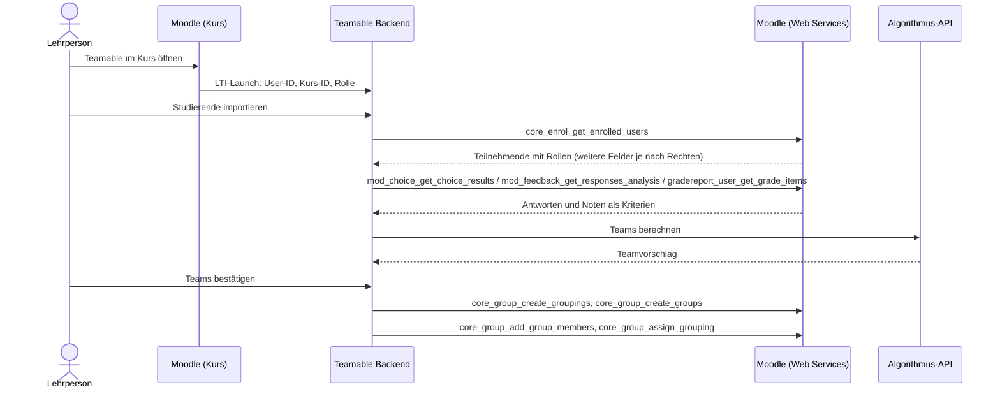

# Moodle-API – verfügbare Endpunkte

Diese Seite beschreibt, welche Kurs- und Studierendendaten Teamable Analytics aus Moodle abrufen kann, über welche Schnittstellen das möglich ist und wie sich die Daten auf das bestehende Datenmodell abbilden lassen.

!!! abstract "Kurzfassung"
    - Die **klassischen Moodle Web Services** bieten Funktionen für alle Daten, die wir brauchen: Kurse, Teilnehmende mit Rollen, Gruppen, Profilfelder, Umfrage- und Bewertungsdaten. Außerdem können sie **Teams als Moodle-Gruppen zurückschreiben**.
    - **Verifiziert** ist an der HTWG bisher nur die Sicht von Studierenden: Die Teilnehmerliste enthält dort nur ID, Name, E-Mail, Profilbild und Rolle. Welche weiteren Felder (z. B. `idnumber`, Gruppen, Profilfelder) eine Lehrperson erhält, ist **noch offen**.
    - Im **HTWG-Moodle (4.5.14)** sind Web Services und das REST-Protokoll bereits aktiv. Es fehlt ein eigener externer Service für Teamable, den das Rechenzentrum anlegen muss. Die nötigen Funktionen stehen unter [Anfrage an das Rechenzentrum](#anfrage-an-das-rechenzentrum).
    - Fast alle Canvas-Funktionen des UBC-Systems haben eine Moodle-Entsprechung, mit zwei Ausnahmen:
        - Für die Anmeldung per OAuth2 gibt es in Moodle 4.5 keinen Ersatz. Den Token holt sich Teamable bei Canvas automatisch über eine Zustimmungsseite. Bei Moodle muss er von Hand übertragen werden, oder ein technischer Nutzer übernimmt den Zugriff.
        - Den Opt-in-Test kann das System nicht selbst anlegen.

## Die HTWG-Instanz

Die folgenden Angaben stammen aus öffentlich erreichbaren Endpunkten von [moodle.htwg-konstanz.de/moodle](https://moodle.htwg-konstanz.de/moodle/) (Stand: 14.10.2026):

| Eigenschaft | Wert | Quelle |
| --- | --- | --- |
| Moodle-Version | **4.5.14** (LTS) | `UPGRADING.md` |
| Web Services | aktiviert (`enablewebservices: 1`) | `tool_mobile_get_public_config` |
| REST-Protokoll | aktiviert: `webservice/rest/server.php` antwortet mit `invalidtoken` statt mit einem Hinweis auf deaktivierte Web Services | Aufruf ohne Token |
| Service der Moodle-App | aktiviert (`enablemobilewebservice: 1`) | `tool_mobile_get_public_config` |
| Login-Art | `typeoflogin: 1`: Login mit Benutzername und Passwort direkt in der App, kein SSO | `tool_mobile_get_public_config` |

Die Abfrage der öffentlichen Konfiguration lässt sich ohne Login wiederholen:

```bash
curl -s "https://moodle.htwg-konstanz.de/moodle/lib/ajax/service-nologin.php" \
  -H 'Content-Type: application/json' \
  -d '[{"index":0,"methodname":"tool_mobile_get_public_config","args":{}}]'
```

## Schnittstellen im Überblick

| Schnittstelle | Authentifizierung | Umfang | Für uns |
| --- | --- | --- | --- |
| **Web Services** – `webservice/rest/server.php` | Web-Service-Token (pro Nutzer und Service) | Hunderte `core_*`-/`mod_*`-Funktionen | **Empfohlen** – deckt alle benötigten Daten ab |
| **LTI 1.3 Advantage** – Names and Role Provisioning Services | OAuth 2 Client Credentials nach Registrierung als LTI-Tool | Nur Teilnehmerliste (Mitglieder + Rollen) | Ergänzung für den Login aus dem Kurs heraus |
| **Neue REST API** – `api/rest/v2/…` | Personal Access Token oder OAuth-2-Client | Erst ab Moodle 5.3, dort nur wenige Bereiche | Nicht nutzbar, da die HTWG 4.5 betreibt |

## Ablauf

Das Diagramm zeigt den Ablauf des UBC-Systems, übertragen auf Moodle. Angenommen ist ein Login per LTI und der Datenzugriff über Web Services mit dem Token der Lehrperson. Die Algorithmus-API ist als Ziel eingezeichnet: Im UBC-Code ist ihr Aufruf auskommentiert, stattdessen bildet das Backend selbst einfache Paare („Study Buddy“).



## Grundlagen der Web Services

### Aufbau eines Aufrufs

Alle Funktionen laufen über einen einzigen Endpunkt:

```text
https://moodle.htwg-konstanz.de/moodle/webservice/rest/server.php
    ?wstoken=<token>
    &wsfunction=<funktionsname>
    &moodlewsrestformat=json
    &<funktionsparameter>
```

Array-Parameter werden in PHP-Notation übergeben, z. B. `courseids[0]=42` oder `options[0][name]=onlyactive&options[0][value]=1`.

Jeder Token gehört zu genau einem **Nutzer** und einem **externen Service**:

- **Nutzer:** Jeder Aufruf läuft mit den Rechten dieses Nutzers. Mit dem Token einer Lehrperson sehen wir also genau deren Kurse.
- **Service:** Er legt fest, welche Funktionen mit dem Token aufrufbar sind.

### Token beschaffen

| Weg | Wie | Voraussetzung |
| --- | --- | --- |
| Vom Admin ausgestellt | *Website-Administration › Server › Webservices › Tokens verwalten* | Admin-Rechte |
| Selbst erzeugt | `login/token.php?username=…&password=…&service=<service_kurzname>` | Capability `moodle/webservice:createtoken`, für den App-Service `moodle/webservice:createmobiletoken` |

!!! warning "Token des App-Service nur für Tests"
    Der Service der Moodle-App (`moodle_mobile_app`) ist an der HTWG aktiv. Damit kann sich jede Person mit ihren Zugangsdaten selbst einen Token holen und die lesenden Funktionen ausprobieren. **Für Teamable selbst eignet sich dieser Weg aber nicht:**

    - Teamable müsste Passwörter entgegennehmen.
    - Der Token hat Zugriff auf alle Funktionen der App, nicht nur auf die benötigten.
    - Die Funktionen zum **Anlegen von Gruppen** (`core_group_create_groups`, `core_group_add_group_members`, `core_group_create_groupings`, `core_group_assign_grouping`) gehören **nicht** zum App-Service.

### Nötige Einrichtung in Moodle

| Schritt | HTWG-Stand |
| --- | --- |
| Web Services aktivieren | ✔ erledigt |
| REST-Protokoll aktivieren | ✔ erledigt |
| `webservice/rest:use` für Nutzende | ✔ wird beim Aktivieren des App-Service automatisch an alle angemeldeten Nutzenden vergeben |
| Externen Service für Teamable mit den benötigten Funktionen anlegen | offen |
| Tokens für diesen Service ausstellen bzw. Selbst-Erzeugung erlauben | offen |

## Übersicht der Endpunkte

Die Capabilities stammen aus der Funktionsdefinition in Moodle 4.5 (`lib/db/services.php` bzw. `db/services.php` des jeweiligen Plugins). Zusätzlich prüft jede Funktion den Kurszugriff und die Datenschutzeinstellungen. Die Spalte „App“ zeigt, ob die Funktion zum Service der Moodle-App gehört und sich damit schon jetzt testen lässt.

Die genannten Felder sind die, die eine Funktion **laut Moodle-Code höchstens** liefert. Was tatsächlich zurückkommt, hängt von den Rechten des Token-Nutzers und den Datenschutzeinstellungen der Instanz ab.

### Kurse

| Funktion | Zweck und wichtige Felder | Capability | App |
| --- | --- | --- | --- |
| `core_webservice_get_site_info` | Token prüfen: aktueller Nutzer, Moodle-Version, freigegebene Funktionen | – | ✔ |
| `core_enrol_get_users_courses` | Kurse eines Nutzers: `id`, `shortname`, `fullname`, `startdate`, `enddate` | `moodle/course:viewparticipants` | ✔ |
| `core_course_get_courses_by_field` | Kurs nach `id`, `shortname`, `idnumber` oder `category` suchen | – | ✔ |
| `core_course_get_enrolled_courses_by_timeline_classification` | Kurse des aktuellen Nutzers nach vergangen / laufend / zukünftig | – | ✔ |

### Teilnehmende

| Funktion | Zweck und wichtige Felder | Capability | App |
| --- | --- | --- | --- |
| `core_enrol_get_enrolled_users` | **Kernfunktion:** alle Teilnehmenden eines Kurses. Möglich sind u. a. `id`, `firstname`, `lastname`, `email`, `idnumber`, `roles[]`, `groups[]`, `customfields[]`. An der HTWG aus Studierendensicht geliefert: nur `id`, Name, `email`, Profilbild, `roles[]` | `moodle/course:viewparticipants`; für E-Mail und verborgene Felder zusätzlich `moodle/course:useremail`, `moodle/user:viewhiddendetails` | ✔ |
| `core_user_get_course_user_profiles` | Detailprofil einzelner Nutzer im Kurs, inkl. `customfields[]` | `moodle/user:viewdetails` | ✔ |

Nützliche `options` für `core_enrol_get_enrolled_users`:

| Option | Wirkung |
| --- | --- |
| `onlyactive` | Nur aktive Einschreibungen (ohne gesperrte Studierende); benötigt `moodle/course:enrolreview` |
| `withcapability` | Nur Nutzer mit einer Capability, z. B. `mod/assign:submit` für nur Studierende; benötigt `moodle/role:review` |
| `groupid` | Nur Mitglieder einer Gruppe |
| `userfields` | Zurückgegebene Felder einschränken (Datensparsamkeit) |
| `limitfrom`, `limitnumber`, `sortby`, `sortdirection` | Paging und Sortierung |

`core_enrol_get_enrolled_users` kann zusätzlich `customfields[]` liefern. Selbst definierte Profilfelder (z. B. Studiengang oder Semester, falls die HTWG sie pflegt) kämen dann direkt mit der Teilnehmerliste. Aus Studierendensicht sind sie an der HTWG nicht enthalten.

### Gruppen (Teams zurückschreiben)

| Funktion | Zweck und wichtige Felder | Capability | App |
| --- | --- | --- | --- |
| `core_group_get_course_groups` | Bestehende Gruppen eines Kurses: `id`, `name`, `idnumber` | `moodle/course:managegroups` | ✔ |
| `core_group_get_course_groupings` | Bestehende Gruppierungen eines Kurses | `moodle/course:managegroups`* | ✔ |
| `core_group_create_groupings` | Gruppierung für einen Teamsatz anlegen (z. B. „Teamable – Projekt A“) | `moodle/course:managegroups`* | ✘ |
| `core_group_create_groups` | Gruppen (Teams) anlegen | `moodle/course:managegroups` | ✘ |
| `core_group_assign_grouping` | Gruppen einer Gruppierung zuordnen | `moodle/course:managegroups`* | ✘ |
| `core_group_add_group_members` | Nutzer zu Gruppen hinzufügen | `moodle/course:managegroups` | ✘ |

\* Nicht in `services.php` angegeben, wird aber in der Funktion selbst geprüft.

### Kriterien und Leistungsdaten

| Funktion | Zweck und wichtige Felder | Capability | App |
| --- | --- | --- | --- |
| `mod_choice_get_choice_results` | Ergebnisse einer *Abstimmung* (z. B. Opt-in, Themenwunsch): `options[].userresponses[]` | `mod/choice:readresponses`* | ✔ |
| `mod_feedback_get_responses_analysis` | Antworten einer *Feedback*-Umfrage je Nutzer, wenn nicht anonym: `attempts[].responses[]` | `mod/feedback:viewreports` | ✔ |
| `gradereport_user_get_grade_items` | Alle Bewertungsaspekte mit Noten je Nutzer: `itemname`, `graderaw`, `percentageformatted` | `gradereport/user:view` | ✔ |

\* Nicht in `services.php` angegeben, wird aber in der Funktion selbst geprüft.

??? note "Weitere Funktionen mit geringer Relevanz"
    | Funktion | Zweck |
    | --- | --- |
    | `core_course_get_courses` | Kursdetails per ID (Capability `moodle/course:view` u. a.) |
    | `core_course_get_contents` | Abschnitte und Aktivitäten eines Kurses, z. B. um eine Umfrage zu finden |
    | `core_enrol_get_enrolled_users_with_capability` | Teilnehmende gruppiert nach Capability (nicht im App-Service) |
    | `core_user_get_users_by_field` | Nutzer nach `id`, `idnumber`, `username` oder `email` |
    | `core_group_get_group_members` | Mitglieder bestimmter Gruppen (nicht im App-Service) |
    | `core_cohort_get_cohorts`, `core_cohort_get_cohort_members` | Globale Gruppen (Kohorten), nur relevant falls die HTWG Kohorten pflegt (Capability `moodle/cohort:view`, nicht im App-Service) |
    | `mod_feedback_get_analysis` | Auswertung einer Feedback-Umfrage ohne Bezug zu Personen |
    | `mod_quiz_get_quizzes_by_courses`, `mod_quiz_get_user_best_grade` | Tests und beste Bewertung, z. B. für einen Test zur Selbsteinschätzung |
    | `mod_assign_get_assignments`, `mod_assign_get_grades` | Aufgaben und ihre Bewertungen |
    | `gradereport_user_get_grades_table` | Bewertungsübersicht als Tabelle |

## Anfrage an das Rechenzentrum

Diese Liste kann direkt in die Anfrage übernommen werden.

**Gewünscht:** ein externer Service „Teamable Analytics“ (Kurzname z. B. `teamable`) mit diesen Funktionen:

```text
core_webservice_get_site_info
core_enrol_get_users_courses
core_course_get_courses_by_field
core_enrol_get_enrolled_users
core_group_get_course_groups
core_group_get_course_groupings
core_group_create_groupings
core_group_create_groups
core_group_assign_grouping
core_group_add_group_members
mod_choice_get_choice_results
mod_feedback_get_responses_analysis
gradereport_user_get_grade_items
```

**Tokens:** Am einfachsten sind Tokens **pro Lehrperson**. Eine Lehrperson mit der Rolle *Trainer/in* hat in ihren eigenen Kursen bereits alle nötigen Rechte. Möglich sind zwei Varianten:

- **Selbst erzeugt:** Das Rechenzentrum erlaubt den Lehrenden, für diesen Service selbst Tokens zu erzeugen (Capability `moodle/webservice:createtoken`). Moodle legt den Token dann automatisch an, sobald die Lehrperson *Profil › Einstellungen › Sicherheitsschlüssel* öffnet. Von dort kopiert sie ihn in Teamable. Der Token läuft nicht ab, bis sie ihn dort zurücksetzt.
- **Vom Admin ausgestellt:** Das Rechenzentrum stellt die Tokens auf Anfrage aus.

Die Alternative ist ein **technischer Nutzer**: ein eigenes Moodle-Konto für Teamable mit einem einzigen Token auf dem Server. Seine Rechte lassen sich auf eine Kurskategorie beschränken, und der Token lässt sich auf die IP-Adresse des Teamable-Servers einschränken. Datenschutzrechtlich ist das trotzdem heikler, weil ein Schlüssel viele Kurse öffnet.

Die Lehrperson braucht in ihrem Kurs diese Rechte, die die Trainer-Rolle standardmäßig mitbringt:

- `moodle/course:viewparticipants`, `moodle/course:enrolreview`
- `moodle/course:managegroups`
- `moodle/course:useremail`, `moodle/user:viewdetails`
- `gradereport/user:view`, `mod/feedback:viewreports`, `mod/choice:readresponses`

## Beispielaufruf

Echter Aufruf gegen das HTWG-Moodle mit dem Token eines **Studierenden-Accounts** (App-Service), begrenzt auf drei Teilnehmende:

```bash
curl -s "https://moodle.htwg-konstanz.de/moodle/webservice/rest/server.php" \
  -d wstoken=$MOODLE_TOKEN \
  -d wsfunction=core_enrol_get_enrolled_users \
  -d moodlewsrestformat=json \
  -d courseid=<kurs-id> \
  -d "options[0][name]=limitnumber" -d "options[0][value]=3"
```

Antwort (eine von drei Personen, anonymisiert: Namen, IDs und E-Mail-Adressen ersetzt, Struktur und Feldnamen unverändert):

```json
[
  {
    "id": 1001,
    "firstname": "Erika",
    "lastname": "Mustermann",
    "fullname": "Erika Mustermann",
    "email": "erika.mustermann@htwg-konstanz.de",
    "profileimageurlsmall": "https://moodle.htwg-konstanz.de/moodle/theme/image.php/boost/core/1/u/f2",
    "profileimageurl": "https://moodle.htwg-konstanz.de/moodle/theme/image.php/boost/core/1/u/f1",
    "roles": [
      {
        "roleid": 5,
        "name": "Studierende",
        "shortname": "student",
        "sortorder": 0
      }
    ]
  }
]
```

Aus der Sicht von Studierenden liefert die HTWG-Instanz also nur **ID, Name, E-Mail, Profilbild und Rolle**. Die Rolle heißt an der HTWG „Studierende“, ihr Kurzname ist wie im Moodle-Standard `student`. Felder wie `username`, `idnumber`, `groups` oder `customfields` fehlen. Mit dem Token einer Lehrperson kommen je nach Rechten und Datenschutzeinstellungen weitere Felder hinzu. Welche das an der HTWG genau sind, muss noch mit einem Lehrenden-Account geprüft werden.

!!! tip "Selbst ausprobieren"
    Lesende Funktionen lassen sich mit dem eigenen HTWG-Account über den App-Service testen, ohne das Rechenzentrum. Studierende haben in ihren Kursen standardmäßig `moodle/course:viewparticipants`.

    Den Token so holen, dass das Passwort nicht in der Shell-History landet:

    ```bash
    read -r -p "Benutzername: " U; read -r -s -p "Passwort: " P; echo
    MOODLE_TOKEN=$(curl -s https://moodle.htwg-konstanz.de/moodle/login/token.php \
      --data-urlencode "username=$U" --data-urlencode "password=$P" \
      -d service=moodle_mobile_app | sed -E 's/.*"token":"([^"]+)".*/\1/'); unset P
    ```

    Danach den Beispielaufruf oben mit einer eigenen Kurs-ID ausführen (die ID steht in der Kurs-URL `…/course/view.php?id=…`).

    Der Token bleibt gültig, bis er unter *Profil › Einstellungen › Sicherheitsschlüssel* zurückgesetzt wird. Wer die Moodle-App nutzt, bekommt meist denselben Token wie die App und muss sich dort nach dem Zurücksetzen neu anmelden.

## Alternativen innerhalb von Moodle

### LTI 1.3 Advantage – Names and Role Provisioning Services

Wird Teamable Analytics als LTI-1.3-Tool registriert, kann Moodle ihm den Dienst *IMS LTI Names and Role Provisioning* freigeben. In den Tool-Einstellungen heißt die Option *„Use this service to retrieve members' information as per privacy settings“*.

Beim Start aus einem Kurs ruft das Tool dann die Teilnehmerliste ab:

- Moodle-User-ID und `idnumber`, Rollen und Status
- Name und E-Mail nur, wenn die Datenschutzeinstellungen des Tools das Übermitteln erlauben (*Name / E-Mail des Nutzers an Tool übermitteln*)

**Vorteile:**

- Kein Web-Service-Token nötig.
- Funktioniert genauso in Canvas und anderen LMS.
- Lehrende binden das Tool selbst in ihren Kurs ein.

**Nachteile:**

- Liefert nur die Teilnehmerliste, keine Bewertungen, Gruppen oder Profilfelder.
- Kann keine Teams zurückschreiben.
- Das Tool muss einmalig vom Moodle-Admin registriert werden.

!!! tip "LTI 1.3 ist im Backend schon vorhanden"
    Das UBC-Backend implementiert den LTI-1.3-Launch bereits mit `pylti1p3` (`src/lti/views.py`). Allerdings liest der Launch Kurs und Nutzer aus den **Canvas-spezifischen Custom Claims** `canvas_course_id` und `canvas_user_id`. Moodle sendet diese Angaben in den Standard-Claims:

    | Angabe | LTI-Claim | Wert in Moodle |
    | --- | --- | --- |
    | Nutzer | `sub` | Moodle-User-ID |
    | Kurs | `https://purl.imsglobal.org/spec/lti/claim/context` → `id` | Moodle-Kurs-ID |
    | Matrikelnummer o. Ä. | `https://purl.imsglobal.org/spec/lti/claim/lis` → `person_sourcedid` | `idnumber` |

    Außerdem nimmt der Launch bisher immer die erste `Organization` (`Organization.objects.first()`), statt sie anhand des Ausstellers (`iss`) zuzuordnen.

### CSV-Export (Rückfallebene)

Lehrende können ohne Admin exportieren:

- Teilnehmende über *Teilnehmer/innen › Tabellendaten herunterladen als CSV*
- Bewertungen über *Bewertungen › Export*

Der Rückweg ist nur halb möglich: Der CSV-Import *Gruppen importieren* legt Gruppen und Gruppierungen an, aber **keine Mitglieder**. Erlaubt sind nur Spalten wie `groupname`, `groupingname` und `groupidnumber` (`group/import.php`). Die Mitglieder müssen Lehrende danach von Hand zuordnen. Das ist der manuelle Weg, falls kein API-Zugang gewährt wird.

### Neue REST API (ab Moodle 5.3)

Moodle 5.3 führt eine neue REST API unter `/api/rest/v2/…` ein, mit Personal Access Tokens, die jeder Nutzer selbst erzeugen kann, und mit OAuth-2-Clients. Kurse, Einschreibungen und Gruppen deckt sie in 5.3 noch nicht ab. Für die HTWG (4.5) ist sie erst nach einem Upgrade relevant.

## Abgleich mit dem bestehenden UBC-System

Das UBC-Backend ist auf drei Wegen mit Canvas verbunden: Login per LTI 1.3 (`src/lti/`), Token per OAuth2 (`src/canvas_oauth/`) und Datenzugriff über die Bibliothek `canvasapi` (`src/app/canvas/`). Die Tabelle zeigt die Moodle-Entsprechung für jeden dieser Teile:

| Funktion im UBC-System | Canvas-Aufruf | Entsprechung in Moodle |
| --- | --- | --- |
| Login aus dem Kurs (`src/lti/views.py`) | LTI-Launch mit den Canvas-Zusatzfeldern `canvas_course_id` und `canvas_user_id` | LTI-Launch mit den Standardfeldern `sub` (User-ID) und `context.id` (Kurs-ID), siehe [LTI 1.3](#lti-13-advantage-names-and-role-provisioning-services). Teamable muss vom Rechenzentrum als LTI-Tool registriert werden. |
| API-Zugang (`src/canvas_oauth/`) | OAuth2: Zustimmungsseite, Token kommt automatisch und wird über einen Refresh-Token erneuert | **Keine Entsprechung** in Moodle 4.5. Der Token wird von Hand übertragen (*Profil › Einstellungen › Sicherheitsschlüssel*), oder ein technischer Nutzer übernimmt den Zugriff. |
| Studierende importieren (`import_students.py`) | `course.get_enrollments(type=["StudentEnrollment"])` | `core_enrol_get_enrolled_users` mit `onlyactive`, gefiltert auf Rolle `student` |
| Opt-in-Test anlegen (`opt_in_quiz.py`) | `course.create_quiz(...)` | **Keine Entsprechung** – `core_courseformat_create_module` unterstützt in 4.5 nur Unterabschnitte, keine Abstimmungen oder Umfragen. Die Lehrperson legt eine *Abstimmung* manuell an. |
| Opt-in auswerten (`import_students.py`) | `quiz.get_submissions()` | `mod_choice_get_choice_results` |
| Notenkriterium importieren (`import_attribute.py`) | `course.get_assignments()`, `assignment.get_submissions()` | `gradereport_user_get_grade_items` (alle Bewertungsaspekte auf einmal) |
| Teams exportieren (`export_team.py`) | `create_group_category`, `create_group`, `create_membership` | `core_group_create_groupings`, `core_group_create_groups`, `core_group_assign_grouping`, `core_group_add_group_members` |

### Abbildung auf das Datenmodell

Die Moodle-Daten lassen sich ohne neue Entitäten auf die bestehenden Django-Modelle (`src/app/models/`) abbilden. Das künftige interne Datenmodell kann davon abweichen. Die Tabelle zeigt, dass Moodle alle heute genutzten Felder liefern *kann*. Mit † markierte Felder kamen aus Studierendensicht an der HTWG nicht mit.

| Modell im UBC-System | Feld | Quelle in Moodle |
| --- | --- | --- |
| `Organization` | `lms_type`, `lms_api_url` | neuer Wert `MOODLE` in `LMSTypeOptions`; `https://moodle.htwg-konstanz.de/moodle` |
| `Course` | `lms_course_id` | Kurs-`id` |
| `Course` | `lms_opt_in_quiz_id` | ID der Opt-in-*Abstimmung* (`mod_choice`) |
| `Course` | `lms_access_token` | Web-Service-Token (bisher ungenutzt, da Canvas per OAuth arbeitet) |
| `CourseMember` | `lms_id` | Moodle-User-`id` |
| `CourseMember` | `sis_user_id` | `idnumber`† (falls gepflegt, meist die Matrikelnummer) |
| `CourseMember` | `first_name`, `last_name` | `firstname`, `lastname` |
| `CourseMember` | `role` | `roles[].shortname`: `student` → `Student`, `editingteacher` / `teacher` → `Instructor` |
| `Section` | – | Moodle-Gruppen (`groups[]`†), falls Übungsgruppen als Sektionen dienen sollen |
| `Attribute` / `AttributeOption` / `AttributeResponse` | – | Profilfelder (`customfields[]`†), Antworten aus Abstimmung oder Feedback, Noten |
| `TeamSet` | `name` | Gruppierung |
| `Team` | `name`, `members` | Gruppe und Mitglieder |

## Hinweise zur Umsetzung

### Fehlerbehandlung

Moodle meldet Fehler **mit HTTP-Status 200**. Den Fehler erkennt man nur am Inhalt:

```json
{"exception": "core\\exception\\moodle_exception", "errorcode": "invalidtoken", "message": "Ungültiges Token - Token wurde nicht gefunden"}
```

Ein Client muss daher jede Antwort auf ein Objekt mit `exception` bzw. `errorcode` prüfen, statt sich auf den HTTP-Status zu verlassen. Die Meldungstexte (`message`) sind in der Sprache der Instanz verfasst und eignen sich nicht für Fallunterscheidungen, nur `errorcode` ist stabil.

### Team-Export wiederholbar machen

Der Export besteht aus vier Aufrufen: Gruppierung anlegen, Gruppen anlegen, Gruppen zuordnen, Mitglieder hinzufügen. Jeder einzelne Aufruf läuft in Moodle in einer Datenbank-Transaktion, die Abfolge als Ganzes aber nicht. Bricht der Export in der Mitte ab, bleibt ein halber Zustand zurück. Ein zweiter Versuch scheitert dann: Moodle lehnt Gruppen und Gruppierungen mit bereits vergebenem Namen ab (*„Group with the same name already exists in the course“*).

!!! warning "Gruppennamen müssen im ganzen Kurs eindeutig sein"
    Das UBC-System nennt die Teams in jedem Team-Set gleich: „Team 1“, „Team 2“ usw. (`src/app/services/team_generation.py`). In Canvas ist das kein Problem, weil Gruppennamen nur innerhalb einer Gruppenkategorie eindeutig sein müssen. Moodle verlangt eindeutige Gruppennamen im **ganzen Kurs**. Schon der Export eines zweiten Team-Sets würde deshalb scheitern, nicht erst ein abgebrochener Export. Die Gruppennamen brauchen ein Präfix aus dem Team-Set, z. B. „Study Buddy - 2 · Team 1“.

Empfehlung:

- Gruppennamen mit dem Namen des Team-Sets als Präfix bilden (siehe oben).
- Jeder Gruppe und Gruppierung eine **eindeutige `idnumber`** aus Teamable mitgeben, z. B. `teamable-<teamset-id>-<team-slug>`. Die `idnumber` ist in Moodle pro Kurs eindeutig.
- Vor dem Anlegen mit `core_group_get_course_groups` bzw. `core_group_get_course_groupings` prüfen, was schon existiert, und nur Fehlendes anlegen.
- Mitglieder erneut hinzuzufügen ist unkritisch: `core_group_add_group_members` ignoriert bestehende Mitgliedschaften.

### Identität und Aktualität

- **Stabiler Schlüssel:** Die Moodle-User-ID ist nur innerhalb einer Instanz eindeutig. Ein Nutzer wird daher über *Instanz-URL + User-ID* identifiziert, nicht über die E-Mail-Adresse, die sich ändern kann. LTI (`sub`) und Web Services liefern dieselbe User-ID.
- **Momentaufnahme:** Der Import gibt den Stand zum Zeitpunkt des Abrufs wieder. Wer sich danach ein- oder ausschreibt, fehlt bzw. bleibt in Teamable. Vor dem Erzeugen der Teams sollte die Teilnehmerliste daher neu abgerufen werden.

### Sicherheit und Datenschutz

- **Tokens sind Zugangsdaten.** Ein Token pro Lehrperson erlaubt Teamable, in deren Kursen Gruppen anzulegen und Teilnehmerdaten zu lesen. Das UBC-System speichert den Canvas-Token pro Person in `CanvasOAuth2Token` (`src/canvas_oauth/`). Der ist kurzlebig und wird über einen Refresh-Token erneuert. Ein Moodle-Token läuft dagegen **nicht ab**. Er muss deshalb pro Person verschlüsselt gespeichert werden, darf in keiner API-Antwort und keinem Log auftauchen und muss sich von der Lehrperson widerrufen lassen. Das Feld `Course.lms_access_token` ist dafür ungeeignet: Es hängt am Kurs statt an der Person und ist ein einfaches Textfeld.
- **Datensparsamkeit:** Mit der Option `userfields` nur die Felder abrufen, die der Algorithmus tatsächlich braucht, und nur diese speichern.
- **Löschung:** Teilnehmerdaten eines Kurses werden gelöscht, sobald die Teams exportiert sind bzw. der Kurs endet. Die konkrete Frist ist mit dem Datenschutz abzustimmen.

### Testen

- **Integrationstests** gegen ein lokales Moodle 4.5 mit [moodle-docker](https://github.com/moodlehq/moodle-docker). Dort lassen sich Lehrenden-Accounts, Kurse und Testdaten frei anlegen, ohne das HTWG-Moodle zu belasten. Das klärt auch die offene Frage nach der Lehrendensicht.
- **Unit-Tests** des Moodle-Adapters mit festen Antworten (Fixtures). Die anonymisierte Antwort aus dem [Beispielaufruf](#beispielaufruf) ist dafür ein Ausgangspunkt.

## Offene Fragen

- [ ] Richtet das Rechenzentrum einen eigenen externen Service ein, und wie werden die Tokens verteilt (siehe [Anfrage an das Rechenzentrum](#anfrage-an-das-rechenzentrum))?
- [ ] Welche Felder liefert `core_enrol_get_enrolled_users` mit dem Token einer Lehrperson (siehe [Beispielaufruf](#beispielaufruf))?
- [ ] Werden an der HTWG eigene Profilfelder wie Studiengang oder Semester gepflegt, und ist `idnumber` belegt?
- [ ] Welche Felder dürfen wir verarbeiten, und wie lange dürfen wir sie speichern? Abstimmung mit dem Datenschutz der HTWG.
- [ ] Soll Teamable zusätzlich als LTI-1.3-Tool in Moodle registriert werden? Dann starten Lehrende Teamable direkt aus dem Moodle-Kurs, ohne eigenes Konto, und Teamable kennt Kurs und Rolle automatisch. Dafür muss das Rechenzentrum das Tool registrieren.

## Fazit

| Kriterium | Bewertung (Web Services) |
| --- | --- |
| Umsetzungsaufwand | **Gering bis mittel** – einfache HTTP/JSON-Aufrufe. Für den Import reichen 2–3 Funktionen, für den Team-Export 4. |
| Flexibilität | **Moodle-spezifisch** – pro LMS ist ein eigener Adapter nötig. LTI wäre LMS-unabhängig, deckt aber nur die Teilnehmerliste ab. |
| Abhängigkeiten | **Mittel** – Web Services und REST sind an der HTWG bereits aktiv. Das Rechenzentrum muss einen Service anlegen und Tokens ermöglichen. Für den Login aus dem Kurs heraus muss es Teamable außerdem als LTI-Tool registrieren. |

Technisch bietet sich an, die Zugriffe in `src/app/canvas/` hinter eine gemeinsame LMS-Schnittstelle zu legen, mit je einer Implementierung für Canvas und Moodle. So bleibt das System offen für weitere Datenquellen wie den CSV-Import.

## Quellen

### Moodle-Dokumentation (Version 4.5)

- [Using web services](https://docs.moodle.org/405/en/Using_web_services)
- [Mobile web services](https://docs.moodle.org/405/en/Mobile_web_services)
- [LTI External tools](https://docs.moodle.org/405/en/LTI_External_tools)
- [Developer Docs – External Services](https://moodledev.io/docs/4.5/apis/subsystems/external)

### Moodle-Quellcode (Branch `MOODLE_405_STABLE`)

- [`lib/db/services.php` – Funktionsdefinitionen mit Capabilities](https://github.com/moodle/moodle/blob/MOODLE_405_STABLE/lib/db/services.php)
- [`enrol/externallib.php` – `core_enrol_get_enrolled_users`](https://github.com/moodle/moodle/blob/MOODLE_405_STABLE/enrol/externallib.php)
- [`group/externallib.php` – Gruppenfunktionen (Transaktionen, Namensprüfung)](https://github.com/moodle/moodle/blob/MOODLE_405_STABLE/group/externallib.php)
- [`mod/lti/locallib.php` – LTI-Claims](https://github.com/moodle/moodle/blob/MOODLE_405_STABLE/mod/lti/locallib.php)
- [`mod/lti/service/memberships` – Names and Role Provisioning](https://github.com/moodle/moodle/tree/MOODLE_405_STABLE/mod/lti/service/memberships)

### Weitere

- [Moodle 5.3 – Personal access tokens](https://docs.moodle.org/503/en/Personal_access_tokens)
- [1EdTech – LTI Names and Role Provisioning Services](https://www.imsglobal.org/spec/lti-nrps/v2p0)
- [moodle-docker – lokale Moodle-Umgebung](https://github.com/moodlehq/moodle-docker)
- [`teamable-backend` (Commit `183a36c`) – Canvas-Anbindung](https://github.com/Teamprojekt-MSI-BIT-SS26/teamable-backend/tree/183a36c/src/app/canvas), [LTI](https://github.com/Teamprojekt-MSI-BIT-SS26/teamable-backend/blob/183a36c/src/lti/views.py), [Modelle](https://github.com/Teamprojekt-MSI-BIT-SS26/teamable-backend/tree/183a36c/src/app/models)
