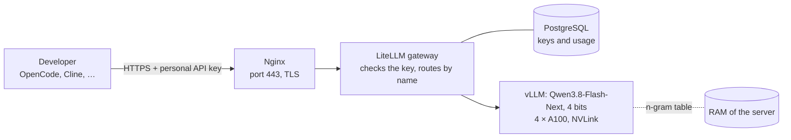

# AI Model Deployment on the HTWG Server

This guide sets up an open-weight AI model on the GPU server of HTWG, so that developers can use it with their AI coding assistants through one API. Every developer authenticates with a personal API key. Code and requests stay on this server; no external provider is involved. There are no costs or quotas per request; only the number of parallel requests per person is limited, so that one person cannot use the whole capacity.

Model, engine settings and server setup are chosen to fit each other and the A100 GPUs. Settings that cannot be decided in advance are measured with a [benchmark](#9-benchmark-and-tuning). How many GPUs we get is still open; the guide describes the setup with 4 GPUs and a variant with 2 (see [How many GPUs](#how-many-gpus)).

It builds on the research in [Our resources](../../recherche/AI-coding-setup/8-our-resources.md) and the [Evaluation](../../recherche/AI-coding-setup/9-evaluation.md).

## Overview



| Part | Task | Runs as | Reachable from | License |
|---|---|---|---|---|
| **vLLM** | runs the model on the GPUs, OpenAI-compatible API | container `vllm/vllm-openai` | only inside the Docker network | Apache 2.0 |
| **LiteLLM** | one endpoint for all uses; checks the personal API keys, sets the right parameters for each use, counts usage | container `ghcr.io/berriai/litellm` | only through Nginx | MIT |
| **PostgreSQL** | stores the API keys and the usage for LiteLLM | container `postgres:16` | only inside the Docker network | PostgreSQL License |
| **Nginx** | encrypts the connection (TLS) | package on the server | HTWG network and VPN, port 443 | BSD |

The model is downloaded once from Hugging Face and stored on the server; its license is `qwen-community-1.0` (see [Why Qwen3.8-Flash-Next](#why-qwen38-flash-next)). Developers only see the LiteLLM endpoint. vLLM itself has no authentication and must never be reachable from outside.

## Server

### What is known

HTWG has a GPU cluster with **8 × NVIDIA A100 40 GB** (320 GB VRAM), two processors with together 192 cores and, according to HTWG, 5 PetaFLOPS. It was bought for the BMBF project "Deep Doubt" of Prof. Dr. Oliver Dürr at the Institute for Optical Systems (IOS) and is used by professors, doctoral candidates and student assistants, later also for theses *(HTWG: [Gamer würden neidisch werden](https://www.htwg-konstanz.de/hochschule/magazin/gamer-wuerden-neidisch-werden), 18 February 2021)*. RAM, storage, network and the exact system are not published, and there is no newer source. Who operates the server today and decides about our request is not clear yet; this guide calls them **the operator**. According to what we heard, the server belongs to IOS itself and not to central HTWG IT. Where it is located and whether it is in the HTWG network is not known. The guide assumes access from the HTWG network and VPN; if the server is in another network, Nginx, firewall and DNS name change accordingly.

8 × A100 40 GB, 320 GB and 5 PetaFLOPS are exactly the data of an **NVIDIA DGX A100**, which has 1 TB RAM, local NVMe storage and connects all GPUs with NVLink through NVSwitch ([NVIDIA DGX A100 user guide](https://docs.nvidia.com/dgx/dgxa100-user-guide/introduction-to-dgxa100.html)). A DGX A100 has 2 × 64 cores, not 2 × 96, so this is an assumption that has to be confirmed.

### How many GPUs

How many GPUs we get is still open. The guide describes the setup with **4 GPUs**. With only **2 GPUs**, a smaller model runs with the same software; only the model and a few settings change (see [Variant with 2 GPUs](#variant-with-2-gpus)).

| | 4 GPUs (preferred) | 2 GPUs (minimum) |
|---|---|---|
| Model | Qwen3.8-Flash-Next, 4 bits | Qwen3.8-27B-FP8 |
| Quality for agentic programming | better (DeepSWE 58.7) | weaker (DeepSWE 42.2), see [Why Qwen3.8-Flash-Next](#why-qwen38-flash-next) |
| Free RAM | at least 192 GB | no special needs (no n-gram table) |
| Storage on the local SSD | about 400 GB (model about 188 GB) | about 100 GB (model about 28 GB) |

### What the setup needs from the server

| Resource | Needed | Why |
|---|---|---|
| GPU | 4 (or 2) × A100 40 GB, **SXM with NVLink**, MIG off, only for us | the model is split across the GPUs, which exchange data after every layer; over PCIe, this is much slower |
| RAM | free for us, amount see [How many GPUs](#how-many-gpus) | with 4 GPUs, the n-gram table of the model (about 102 GB) stays in RAM, see [Memory](#memory) |
| Storage | on a **local NVMe SSD**, amount see [How many GPUs](#how-many-gpus) | the model is read at every start; from a network drive, the start takes much longer |
| NVIDIA driver | new enough for the CUDA version of the vLLM image | see [Check the server](#1-check-the-server) |
| OS | Ubuntu 22.04 / 24.04 or DGX OS, Docker allowed | |
| Software | Docker Engine with Compose, NVIDIA Container Toolkit | runs the containers and gives them access to the GPUs; included in DGX OS |

### What changes on the server

The setup is kept small, so that it does not get in the way of other users and can be removed completely.

| Change | Details |
|---|---|
| One directory on the local SSD, e.g. `/raid/ai-api` | configuration, model files, database, secrets (`.env`, mode 600) |
| Nginx site | `/etc/nginx/sites-available/ai-api` |
| Firewall rule | port 443 only from the HTWG network and VPN, set by us or centrally by the operator |
| Our user in the `docker` group | to manage the containers without `sudo` |
| Extra rights for the vLLM container | `ipc: host` for the data exchange between the GPU processes, `memlock: unlimited` to pin the n-gram table in RAM; both need the consent of the operator |
| Nothing else | no systemd services, drivers or kernel changes; the containers restart by themselves after a reboot |

Isolation from other users: our GPUs and CPU cores are fixed in Docker (`device_ids`, `cpuset`), so other GPUs are not touched.

| Network | What | When |
|---|---|---|
| incoming | HTTPS (443) from the HTWG network and VPN | permanently |
| incoming | SSH for us | permanently |
| outgoing | Hugging Face (model), Docker Hub and ghcr.io (images), Ubuntu packages | only during setup and updates |

Our team does the setup, updates, key management and troubleshooting. The operator only manages the server itself, including the NVIDIA driver and GPU settings such as MIG and persistence mode.

### Clarify with the operator

Possible contacts: Prof. Dr. Georg Umlauf (director of IOS) or Prof. Dr. Oliver Dürr ([HTWG research report 2024](https://www.htwg-konstanz.de/fileadmin/pub/forschung/Forschungsreferat/Relaunch_2025/fue_jahresbericht_HTWG_oeffentlich_2024.pdf)).

**Questions**

- Hardware
    - Which system is it exactly (DGX A100?), how much RAM, local NVMe storage?
    - How many GPUs can we get exclusively (4 preferred, at least 2), ideally attached to the same CPU? Who else uses the cluster today?
    - Is MIG switched off on these GPUs?
    - Which NVIDIA driver is installed, and can it be updated if the vLLM image needs a newer one?
- Permissions
    - May we run a **permanent service** for our team, not only time-limited compute jobs?
    - Are Docker, Docker Compose and the NVIDIA Container Toolkit installed, or may we install them?
    - Are `ipc: host` and `memlock: unlimited` allowed for our vLLM container (see [step 5](#5-docker-compose))?
    - Are there rules for software, licenses or updates that we have to follow?
- Network
    - Where is the server located, and in which network? Can it be reached from the HTWG network and the VPN?
    - May we set up Nginx and the firewall rule ourselves?
    - May the server download the model from Hugging Face and images from Docker Hub and ghcr.io (only during setup and updates)?

**What we need from the operator**

- SSH access with a key, a user in the `docker` group, and sudo for Nginx and the firewall
- A directory on the local NVMe SSD, e.g. `/raid/ai-api`, owned by our user
- A DNS name, e.g. `ai-api.htwg-konstanz.de`, and a TLS certificate for it
- The address ranges of the HTWG network and the VPN for the firewall

## Model

One model serves three uses. Clients use the **names of the uses**, not the name of the model, so the model or its settings can later be changed without changing the configuration of each developer.

| Name in the API | Use | Setting |
|---|---|---|
| `coding-agent` | Agentic programming: the assistant reads and edits files, runs commands and uses tools | thinking on, maximum effort |
| `coding` | Programming: questions, explanations, small changes; answers faster | thinking off |
| `docs` | Documentation, READMEs and other longer texts | thinking on, medium effort |

### Why Qwen3.8-Flash-Next

The strongest open-weight models, such as Kimi K3, DeepSeek-V4-Pro or GLM-5.3, have several hundred billion to trillions of parameters and need far more than the 160 GB VRAM of 4 × A100 40 GB *([Morph](https://www.morphllm.com/best-open-source-llm))*. Among the models that fit, Qwen3.8-Flash-Next is the strongest for agentic programming. Compared to Qwen3.8-27B, the strongest model that would fit on two GPUs *(Vendor: [model card](https://huggingface.co/Qwen/Qwen3.8-Flash-Next))*:

| Benchmark | Qwen3.8-Flash-Next | Qwen3.8-27B |
|---|---|---|
| DeepSWE 1.1 (agentic software engineering) | **58.7** | 42.2 |
| JobBench (agentic tasks) | **55.7** | 33.4 |
| Toolathlon Verified (tool use) | **73.5** | 67.1 |
| SWE-bench Multilingual | **81.0** | 73.8 |
| SWE-bench Pro | 62.5 | 61.7 |
| IFBench (following instructions) | 81.3 | 79.5 |

It also fits the hardware well:

- **Fast on the A100:** the speed of answers is limited by how fast the GPUs read the weights from memory. Flash-Next is a mixture-of-experts model with 125B parameters, of which only 6B are active per token. In 4 bits, it reads only a few GB per token, spread across four GPUs. The dense Qwen3.8-27B reads all 27B parameters for every token (see [Active parameters](../../recherche/AI-coding-setup/5-models.md#active-parameters)).
- **Small context memory:** only 12 of its 48 layers store a classic KV cache, so many long agent sessions fit at the same time.
- **Multi-token prediction (MTP):** the model can propose several tokens at once, which vLLM checks in one step. This makes answers faster without changing them.
- **One model for all uses:** a separate model for documentation would need GPUs of its own; then only a weaker model would fit for programming. Flash-Next follows instructions well (IFBench 81.3) and is also used for documentation.

!!! warning "Open points"
    - **Benchmarks** are reported by Qwen and were not reproduced independently.
    - **License:** the model is licensed under `qwen-community-1.0`, not Apache 2.0. Read it before use.
    - **4-bit version from the community:** Qwen only publishes BF16 and FP8. The 4-bit version used here comes from a single author. Test it with the [test tasks of the evaluation](../../recherche/AI-coding-setup/9-evaluation.md#5-test-task) before the team relies on it. If it does not work, use the [fallback with two models](#fallback-two-smaller-models) (4 GPUs) or the [variant with 2 GPUs](#variant-with-2-gpus).

### Memory

The model has about 180B parameters in total: 125B in the language model, a table of 51B parameters for an n-gram embedding, a 4B layer for MTP and a vision encoder. The n-gram table is only used for lookups, so vLLM can keep it in the RAM of the server instead of the GPUs ([vLLM recipe](https://recipes.vllm.ai/Qwen/Qwen3.8-Flash-Next)).

| Version | GPU memory for the weights | Fits into 4 × A100 40 GB (about 147 GB usable) |
|---|---|---|
| BF16 (original) | about 335 GB | – |
| FP8 (official), n-gram table in RAM | about 125 GB | only just, too little room for context |
| **4 bits (GPTQ), n-gram table in RAM** | **about 80 GB** | **✓, about 60 GB for context** |

We use [`btbtyler09/Qwen3.8-Flash-Next-GPTQ-4bit`](https://huggingface.co/btbtyler09/Qwen3.8-Flash-Next-GPTQ-4bit):

- The experts and the attention projections are quantized to 4 bits (GPTQ, group size 32); the other parts, including the n-gram table, stay in BF16.
- The author measured almost no loss against the original: perplexity +0.58 % on text and −0.02 % on Python code, the most likely next token is the same in 91–96 % of cases. The calibration data contained code.
- **Fits the A100:** GPTQ runs on the A100 with Marlin kernels, which compute with 4-bit weights and 16-bit activations (W4A16), a format the A100 supports. FP4 formats such as NVFP4 or MXFP4 need newer GPUs.

**Context:** 12 layers with 2 KV heads of size 256 need 2 × 12 × 2 × 256 × 2 bytes = 24 KB per token at 16 bits, so 64K tokens need about 1.5 GB per user *(calculation from the [model card](https://huggingface.co/Qwen/Qwen3.8-Flash-Next))*. With four GPUs, each KV head is stored on two GPUs, so about 3 GB per user. The about 60 GB left are enough for about 15–20 users with 64K context at the same time. With the full 128K context (`--max-model-len`), about 6 GB per user, so about 10 users at the same time; most requests use much less. After starting, vLLM logs the real value (`Maximum concurrency`).

## Installation

### 1. Check the server

```bash
# GPU model, memory, driver, persistence mode
nvidia-smi --query-gpu=index,name,memory.total,driver_version,persistence_mode --format=csv

# MIG must be off
nvidia-smi --query-gpu=index,mig.mode.current --format=csv

# Connection between the GPUs and their CPU/NUMA affinity
nvidia-smi topo -m

# RAM, NUMA nodes and storage
free -g
lscpu | grep -i numa
df -h
```

| Check | Expected | If not |
|---|---|---|
| Name | `NVIDIA A100-SXM4-40GB` | a PCIe version works, but splitting across 4 GPUs is slower; ask the operator whether there is NVLink |
| `mig.mode.current` | `Disabled` | ask the operator to switch MIG off for our GPUs |
| `persistence_mode` | `Enabled` | ask the operator to run `nvidia-smi -pm 1`; otherwise the GPUs are re-initialised for every container start |
| `nvidia-smi topo -m` between our GPUs | `NV…` (NVLink) | `SYS` or `PHB` means PCIe only: works, but slower; ask for GPUs connected with NVLink |
| RAM: column `available` of `free -g` | at least 192 GB (4 GPUs) | the model does not start; ask the operator for more RAM or use the [variant with 2 GPUs](#variant-with-2-gpus) |

**Choose the GPUs:** in `nvidia-smi topo -m`, the columns *CPU Affinity* and *NUMA Affinity* show to which CPU each GPU is attached. Choose 4 GPUs with the **same NUMA affinity**, if the operator lets us choose (with 2 GPUs, choose 2). Then the n-gram lookups in RAM and the data transfers do not have to cross between the two CPUs. Note the GPU numbers and the CPU cores of this NUMA node for [step 5](#5-docker-compose).

**Driver and CUDA:** every vLLM image is built for a CUDA version, and the driver must support it. The driver version shown by `nvidia-smi` must be at least the minimum listed in the [CUDA release notes](https://docs.nvidia.com/cuda/cuda-toolkit-release-notes/) for the CUDA version of the image. If it is older, ask the operator to update the driver. The cluster is managed by the operator; do not install drivers yourself.

### 2. Docker and NVIDIA Container Toolkit

If Docker and the toolkit are already installed (as on DGX OS), skip to the test at the end. Otherwise, the operator should install them. If we do it ourselves, only after the operator has agreed:

- Install Docker from Docker's apt repository ([Docker: install on Ubuntu](https://docs.docker.com/engine/install/ubuntu/)), not with the convenience script `get.docker.com`, which Docker does not recommend for production servers.
- `sudo systemctl restart docker` briefly stops **all** containers on the server, including those of other users. Agree on a time with the operator.

```bash
# Docker: follow the apt instructions linked above, then
sudo usermod -aG docker $USER   # log out and in again afterwards

# NVIDIA Container Toolkit
curl -fsSL https://nvidia.github.io/libnvidia-container/gpgkey | \
    sudo gpg --dearmor -o /usr/share/keyrings/nvidia-container-toolkit-keyring.gpg
curl -s -L https://nvidia.github.io/libnvidia-container/stable/deb/nvidia-container-toolkit.list | \
    sed 's#deb https://#deb [signed-by=/usr/share/keyrings/nvidia-container-toolkit-keyring.gpg] https://#g' | \
    sudo tee /etc/apt/sources.list.d/nvidia-container-toolkit.list
sudo apt-get update
sudo apt-get install -y nvidia-container-toolkit
sudo nvidia-ctk runtime configure --runtime=docker
sudo systemctl restart docker

# Test with our GPUs only (numbers from step 1): should list exactly these GPUs
docker run --rm --gpus '"device=0,1,2,3"' nvidia/cuda:12.4.1-base-ubuntu22.04 nvidia-smi
```

### 3. Directory and secrets

The directory lies on the local NVMe SSD (on a DGX usually `/raid`), so that the model loads quickly. The operator creates it for our user, or, with sudo:

```bash
sudo mkdir -p /raid/ai-api && sudo chown $USER /raid/ai-api
cd /raid/ai-api
```

Create `/raid/ai-api/.env`. It contains secrets and must not be committed to a repository:

```bash
# Admin key for LiteLLM; only for creating and revoking developer keys
LITELLM_MASTER_KEY=sk-admin-<random value>
# Password of the database for LiteLLM
POSTGRES_PASSWORD=<random value>
# Only needed if a model on Hugging Face requires accepting a license
HF_TOKEN=
```

Generate the random values with `openssl rand -hex 32`. Then protect the file:

```bash
chmod 600 .env
```

### 4. LiteLLM configuration

`/raid/ai-api/litellm-config.yaml`. All three names point to the same vLLM server and only differ in their parameters:

```yaml
model_list:
  # Agentic programming: thinking with maximum effort (default of the model)
  - model_name: coding-agent
    litellm_params:
      model: hosted_vllm/qwen3.8-flash-next
      api_base: http://vllm:8000/v1

  # Programming: thinking off for faster answers
  - model_name: coding
    litellm_params:
      model: hosted_vllm/qwen3.8-flash-next
      api_base: http://vllm:8000/v1
      extra_body:
        chat_template_kwargs:
          enable_thinking: false

  # Documentation: thinking with medium effort
  - model_name: docs
    litellm_params:
      model: hosted_vllm/qwen3.8-flash-next
      api_base: http://vllm:8000/v1
      reasoning_effort: medium

litellm_settings:
  drop_params: true   # ignore parameters the model does not support

general_settings:
  master_key: os.environ/LITELLM_MASTER_KEY
  database_url: os.environ/DATABASE_URL
```

The Qwen3.8 models are documented with `reasoning_effort` (`xhigh`, `medium`, `low`) and thinking on by default ([Qwen3.8-27B](https://huggingface.co/Qwen/Qwen3.8-27B)). The model card of Flash-Next does not describe how to switch thinking off. Check after the start that `coding` answers without a thinking part and `docs` with a shorter one (see [API tests](#api)). Because of `drop_params: true`, LiteLLM silently drops `reasoning_effort` if it does not pass it on to `hosted_vllm`; then `docs` behaves like `coding-agent`. In that case, send it in `extra_body` instead, like `enable_thinking`.

### 5. Docker Compose

`/raid/ai-api/compose.yaml`. Replace the GPU numbers and CPU cores with those from [step 1](#1-check-the-server). Pin the versions of vLLM and LiteLLM to releases you have tested instead of `latest`. Qwen3.8-Flash-Next needs at least vLLM 0.30 ([vLLM recipe](https://recipes.vllm.ai/Qwen/Qwen3.8-Flash-Next)). Version 0.33.0 was tested locally on the CPU with a small model, to check that the parts work together; whether it runs Flash-Next on the A100 is checked at the first start and in the [benchmark](#9-benchmark-and-tuning).

```yaml
services:
  vllm:
    image: vllm/vllm-openai:v0.33.0        # at least 0.30, see above
    restart: unless-stopped
    ipc: host                               # shared memory between the 4 GPU processes
    cpuset: "0-47"                          # example; CPU cores of the NUMA node(s) of our GPUs, see step 1
    ulimits:
      memlock: -1                           # allow pinned RAM for the n-gram table
      stack: 67108864
    environment:
      - HF_TOKEN=${HF_TOKEN}
      - VLLM_PLE_CPU_OFFLOAD=1              # n-gram table in pinned RAM, not on the GPUs
      - VLLM_ENGINE_READY_TIMEOUT_S=1800    # loading the large model takes long
    volumes:
      - ./models:/root/.cache/huggingface   # on the local NVMe SSD
    command: >
      btbtyler09/Qwen3.8-Flash-Next-GPTQ-4bit
      --served-model-name qwen3.8-flash-next
      --dtype bfloat16
      --tensor-parallel-size 4
      --enable-expert-parallel
      --gpu-memory-utilization 0.92
      --max-model-len 131072
      --max-num-seqs 32
      --max-num-batched-tokens 16384
      --enable-prefix-caching
      --speculative-config '{"method":"mtp","num_speculative_tokens":3}'
      --enable-auto-tool-choice
      --tool-call-parser qwen3_coder
      --reasoning-parser qwen3
    deploy:
      resources:
        reservations:
          devices:
            - driver: nvidia
              device_ids: ["0", "1", "2", "3"]   # our 4 GPUs, see step 1
              capabilities: [gpu]

  litellm:
    image: ghcr.io/berriai/litellm:main-stable   # replace with a fixed stable release before the setup
    restart: unless-stopped
    depends_on: [db, vllm]
    env_file: .env
    environment:
      - DATABASE_URL=postgresql://litellm:${POSTGRES_PASSWORD}@db:5432/litellm
    volumes:
      - ./litellm-config.yaml:/app/config.yaml:ro
    command: ["--config", "/app/config.yaml", "--port", "4000", "--num_workers", "4"]
    ports:
      - "127.0.0.1:4000:4000"   # only local, Nginx forwards to it

  db:
    image: postgres:16
    restart: unless-stopped
    environment:
      - POSTGRES_USER=litellm
      - POSTGRES_PASSWORD=${POSTGRES_PASSWORD}
      - POSTGRES_DB=litellm
    volumes:
      - ./postgres:/var/lib/postgresql/data
```

#### How the settings fit model and server

| Setting | Fits | Effect |
|---|---|---|
| `--dtype bfloat16` | model | required by the sparse attention of the model ([model](https://huggingface.co/btbtyler09/Qwen3.8-Flash-Next-GPTQ-4bit)); the A100 computes natively in BF16 |
| `--tensor-parallel-size 4` | server | splits every layer across the 4 GPUs, which compute at the same time; needs the fast NVLink connection between them ([vLLM](https://docs.vllm.ai/en/latest/serving/parallelism_scaling/)) |
| `--enable-expert-parallel` | model + server | distributes the 512 small experts across the GPUs instead of cutting each expert into 4 pieces; the vLLM recipe uses this for all multi-GPU setups. Compare with and without in the [benchmark](#9-benchmark-and-tuning) |
| `VLLM_PLE_CPU_OFFLOAD=1` + `memlock: -1` | model + server | keeps the n-gram table in pinned RAM, from which the GPUs read the few rows they need directly. Without `memlock`, the container may not pin that much memory. If RAM is short, use `VLLM_PLE_MMAP=1` instead: the table is then read from the SSD as needed, which is slower. `stack: 67108864` (64 MB) follows NVIDIA's recommendation for PyTorch containers |
| `cpuset` | server | keeps vLLM on the CPU to which our GPUs and the pinned RAM are attached |
| `--gpu-memory-utilization 0.92` | server | the GPUs are only used by us, so 92 % can be used for weights and context |
| `--max-num-seqs 32` | team | at most 32 requests at the same time, enough for the team (8 people with at most 4 parallel requests each). A lower limit leaves more memory for context than the default of 256 |
| `--max-num-batched-tokens 16384` | use | agents send long prompts; larger chunks process them faster, while short answers of others still continue in between (chunked prefill) |
| `--max-model-len 131072` | use | maximum context per request; 128K leaves room for long agent sessions, most requests use much less |
| `--enable-prefix-caching` | use | agents send the same beginning (system prompt, files read so far) again with every step; vLLM reuses it instead of computing it again. This is the biggest speed-up for agents |
| `--speculative-config` (MTP) | model | uses the MTP layer of the model to propose 3 tokens at once; faster answers with few parallel users. Compare in the [benchmark](#9-benchmark-and-tuning) |
| `--tool-call-parser`, `--reasoning-parser` | model | return tool calls and thinking in the format the assistants expect ([vLLM recipe](https://recipes.vllm.ai/Qwen/Qwen3.8-Flash-Next)) |
| `--num_workers 4` | LiteLLM | several worker processes for LiteLLM, so that the gateway is not a bottleneck with many streamed answers |
| no `ports` for vLLM and the database | security | only reachable inside the Docker network. Docker writes its own firewall rules and bypasses `ufw`, so a published port like `-p 8000:8000` would be open to everyone even with firewall rules ([Docker](https://docs.docker.com/engine/network/packet-filtering-firewalls/)). LiteLLM is bound to `127.0.0.1` for the same reason |
| `restart: unless-stopped` | operation | starts the containers again after a crash or a reboot; no systemd services are needed |

Settings that are deliberately **not** used:

- `--enforce-eager`: switches off CUDA graphs and makes every step slower.
- `--disable-custom-all-reduce`: the fast data exchange between the GPUs works over NVLink; only needed if vLLM hangs at start (see [Troubleshooting](#troubleshooting)).
- `--kv-cache-dtype fp8`: memory for context is not the bottleneck with this model, so the context stays in 16 bits without any loss.

### 6. Start

```bash
cd /raid/ai-api
docker compose up -d
docker compose logs -f vllm    # the first start downloads about 188 GB, this takes a while
```

The server is ready when the log shows `Application startup complete`. Note the line with `Maximum concurrency`.

### 7. Nginx with TLS

Nginx runs directly on the server, encrypts the connection and forwards to LiteLLM:

```bash
sudo apt-get install -y nginx
```

`/etc/nginx/sites-available/ai-api`:

```nginx
upstream litellm {
    server 127.0.0.1:4000;
    keepalive 32;               # reuse connections to LiteLLM
}

server {
    listen 443 ssl http2;
    server_name ai-api.htwg-konstanz.de;          # DNS name from the operator

    ssl_certificate     /etc/ssl/certs/ai-api.pem;  # certificate from the operator
    ssl_certificate_key /etc/ssl/private/ai-api.key;

    client_max_body_size 50m;   # agents send large requests

    # Only the API for the developers; the admin endpoints (/key/…, /ui) stay local
    location /v1/ {
        proxy_pass http://litellm;
        proxy_http_version 1.1;
        proxy_set_header Connection "";
        proxy_set_header Host $host;
        proxy_set_header X-Forwarded-For $proxy_add_x_forwarded_for;
        proxy_buffering off;        # pass streamed answers on token by token
        proxy_read_timeout 600s;    # long answers with thinking
    }

    location / {
        return 404;
    }
}
```

```bash
sudo ln -s /etc/nginx/sites-available/ai-api /etc/nginx/sites-enabled/
sudo nginx -t
sudo systemctl reload nginx
```

- **Only `/v1/` is forwarded.** Creating and revoking keys and the admin interface are only reachable on the server itself (`127.0.0.1:4000`), from outside through an SSH tunnel (see [Authentication](#authentication)). So the master key is never sent over the network and the admin endpoints cannot be attacked from outside.
- **Nginx already running:** on a shared server, Nginx may already serve other sites. Then only add our site and leave the others alone. Only if Nginx was newly installed for us, remove its default site: `sudo rm /etc/nginx/sites-enabled/default`.
- **HTTP/2:** `listen 443 ssl http2;` works with the Nginx versions of Ubuntu 22.04 (1.18) and 24.04 (1.24). From Nginx 1.25.1, write `listen 443 ssl;` and `http2 on;` instead.

### 8. Firewall

Only SSH and HTTPS from the HTWG network and VPN are allowed. Agree on the rules with the operator first: other users may run services on the server that must stay reachable. If the operator manages the firewall of the cluster centrally, ask them to open port 443 instead. Get the address ranges from the operator or the computing centre.

```bash
sudo ufw status verbose     # is ufw already active, and with which rules?
```

**ufw already active:** only add our rules for port 443 and leave the others alone:

```bash
sudo ufw allow from <HTWG network> to any port 443 proto tcp
sudo ufw allow from <VPN network> to any port 443 proto tcp
```

**ufw not active, and the operator agrees:** allow SSH **before** enabling the firewall, otherwise the SSH connection is cut. `deny incoming` blocks everything else, including services of other users:

```bash
sudo ufw default deny incoming
sudo ufw allow from <HTWG network> to any port 22 proto tcp
sudo ufw allow from <VPN network> to any port 22 proto tcp
sudo ufw allow from <HTWG network> to any port 443 proto tcp
sudo ufw allow from <VPN network> to any port 443 proto tcp
sudo ufw enable
```

### 9. Benchmark and tuning

Some settings can only be decided by measuring on the real server. vLLM includes a benchmark that sends many requests at the same time and measures:

- **TTFT** (time to first token): how long until the answer starts; for agents mainly the processing of the long prompt
- **TPOT** (time per output token): how fast the answer is written
- **Throughput:** tokens per second for all users together

Run it inside the vLLM container, with requests similar to those of an agent (long prompt, medium answer):

```bash
docker compose exec vllm vllm bench serve \
  --backend openai-chat \
  --endpoint /v1/chat/completions \
  --base-url http://localhost:8000 \
  --model qwen3.8-flash-next \
  --tokenizer btbtyler09/Qwen3.8-Flash-Next-GPTQ-4bit \
  --dataset-name random \
  --random-input-len 16000 \
  --random-output-len 1000 \
  --num-prompts 64 \
  --max-concurrency 8
```

Run it with `--max-concurrency` 1, 4 and 8, and compare these variants. Change one setting in `compose.yaml`, then run `docker compose up -d` and the benchmark again:

| Variant | Expectation | Keep if |
|---|---|---|
| with / without `--enable-expert-parallel` | expert parallelism is usually faster for many small experts | throughput and TPOT are better |
| with / without `--speculative-config`, or `num_speculative_tokens` 1, 2, 3 | MTP helps with few users, can cost throughput with many | TPOT at concurrency 1–4 is better without a loss at 8 |
| `--max-num-batched-tokens` 8192 / 16384 / 32768 | larger values lower TTFT for long prompts, can slow down running answers | TTFT is lower and TPOT stays similar |

**MTP needs real text:** with `--dataset-name random`, the prompts consist of random tokens, which MTP can hardly predict, so it looks worse than it is. Compare MTP with real prompts instead, e.g. `--dataset-name sharegpt` with the ShareGPT dataset ([vLLM benchmarks](https://docs.vllm.ai/en/latest/contributing/benchmarks/)) or the prompts of the test tasks.

Note the results and the chosen settings on this page. Then check the quality of the answers with the three [test tasks of the evaluation](../../recherche/AI-coding-setup/9-evaluation.md#5-test-task) using `coding-agent`, and compare with GWDG Chat AI and Claude Code from the evaluation. The 4-bit kernels for this model are new, so the author recommends this check on your own hardware.

## Authentication

Every developer gets their own API key from LiteLLM. The master key from `.env` is only used by the admin to create and revoke keys; it is never handed out.

The admin endpoints are not forwarded by Nginx (see [step 7](#7-nginx-with-tls)). Run the commands on the server, or open an SSH tunnel from your own computer, which forwards `localhost:4000` to LiteLLM on the server:

```bash
ssh -L 4000:127.0.0.1:4000 <user>@<server>
```

### Create a key

```bash
curl http://localhost:4000/key/generate \
  -H "Authorization: Bearer $LITELLM_MASTER_KEY" \
  -H "Content-Type: application/json" \
  -d '{
    "key_alias": "max.mustermann",
    "models": ["coding-agent", "coding", "docs"],
    "max_parallel_requests": 4
  }'
```

The answer contains the key (`"key": "sk-…"`). Hand it to the developer over a secure channel. `max_parallel_requests` keeps a single person from using the whole capacity and matches `--max-num-seqs 32` for a team of 8 ([LiteLLM virtual keys](https://docs.litellm.ai/docs/proxy/virtual_keys)).

### Revoke a key

```bash
curl http://localhost:4000/key/delete \
  -H "Authorization: Bearer $LITELLM_MASTER_KEY" \
  -H "Content-Type: application/json" \
  -d '{"key_aliases": ["max.mustermann"]}'
```

The key stops working immediately; the keys of all others stay valid.

### Usage

LiteLLM stores the requests and tokens per key. They can be viewed in the admin interface at `http://localhost:4000/ui` through the SSH tunnel (login with the master key).

## Tests

The API is OpenAI-compatible; every request sends the personal key as `Authorization: Bearer`. How developers connect their assistants is described on a separate page: [Connect an AI Coding Assistant](connect-ai-assistant.md). `ai-api.htwg-konstanz.de` is a placeholder until the operator gives us the DNS name.

Run these tests after the setup and after every change to Nginx, the firewall or `compose.yaml`. For the tests, create a key for yourself (see [Create a key](#create-a-key)) and store it in `HTWG_AI_API_KEY`.

### API

```bash
API=https://ai-api.htwg-konstanz.de

# Which models can my key use?
curl $API/v1/models -H "Authorization: Bearer $HTWG_AI_API_KEY"

# A short request without thinking
curl $API/v1/chat/completions \
  -H "Authorization: Bearer $HTWG_AI_API_KEY" \
  -H "Content-Type: application/json" \
  -d '{
    "model": "coding",
    "messages": [{"role": "user", "content": "Write a Python function that reverses a string."}]
  }'
```

The answer of `coding` should not contain a `reasoning_content` field; the same request with `coding-agent` should, and with `docs` a shorter one.

**Tool call:** the answer must contain `tool_calls` with the function `get_weather`, not plain text. This checks `--tool-call-parser`, which agents depend on:

```bash
curl $API/v1/chat/completions \
  -H "Authorization: Bearer $HTWG_AI_API_KEY" \
  -H "Content-Type: application/json" \
  -d '{
    "model": "coding",
    "messages": [{"role": "user", "content": "What is the weather in Konstanz?"}],
    "tools": [{"type": "function", "function": {
      "name": "get_weather",
      "description": "Get the current weather for a city",
      "parameters": {"type": "object", "properties": {"city": {"type": "string"}}, "required": ["city"]}
    }}]
  }'
```

**Streaming:** the answer must appear piece by piece, not all at once. This checks `proxy_buffering off` in Nginx:

```bash
curl -N $API/v1/chat/completions \
  -H "Authorization: Bearer $HTWG_AI_API_KEY" \
  -H "Content-Type: application/json" \
  -d '{"model": "coding", "stream": true, "messages": [{"role": "user", "content": "Count from 1 to 20."}]}'
```

**Access:** without a key, the API must answer `401`; the admin endpoints must not be reachable from outside (`404`):

```bash
curl -s -o /dev/null -w "%{http_code}\n" $API/v1/models               # 401
curl -s -o /dev/null -w "%{http_code}\n" -X POST $API/key/generate    # 404
```

### Access from outside

From a device that is **neither in the HTWG network nor connected to the VPN**, e.g. a laptop on a mobile hotspot, the server must not be reachable at all:

```bash
curl -m 10 -s -o /dev/null -w "%{http_code}\n" https://ai-api.htwg-konstanz.de/v1/models
```

Expected: a timeout or `Connection refused` (curl prints `000`). Then connect the same device to the VPN and run the command again: now the answer must be `401`. If the server answers from outside, check the firewall rules ([step 8](#8-firewall)) and whether the operator's firewall lets port 443 through from everywhere.

### Restart after a reboot

The containers start again by themselves, if Docker starts at boot and the restart policy is set:

```bash
systemctl is-enabled docker                                           # enabled
docker inspect -f '{{.Name}} {{.HostConfig.RestartPolicy.Name}}' $(docker compose ps -q)   # unless-stopped for all
```

Then test a real reboot. The server is shared, so the operator decides when it is rebooted; ask them to tell us before the next reboot, or agree on a time. After the reboot, without logging in to start anything:

1. wait until vLLM has loaded the model (`docker compose logs -f vllm`, several minutes)
2. run the [API tests](#api) again: the models are listed and requests are answered

Note the date and the result on this page.

### OpenCode

Connect OpenCode as described in [Connect an AI Coding Assistant](connect-ai-assistant.md) and let it create a file in an empty test directory. If the file is created, tool calls work end to end. Before the rollout, check which of the two key variants (`{file:…}` or `{env:…}`) works with the current OpenCode version: in a local test, OpenCode 2.2.7 did not send the key with `{env:…}`, and the file variant has not been tested yet.

The `limit` values in the OpenCode configuration must match the server: `context` is `--max-model-len` from [step 5](#5-docker-compose), `output` must be smaller. vLLM rejects a request whose prompt and requested output together exceed `--max-model-len`, and OpenCode needs the value to know when to compact a long session. If `--max-model-len` changes, update the configuration on the connection page.

### Acceptance criteria

The criteria of the [task #68](https://github.com/Teamprojekt-MSI-BIT-SS26/documentation/issues/68) and how they are checked:

| Criterion | Check | Result |
|---|---|---|
| Reachable only from the HTWG network or the VPN | [Access from outside](#access-from-outside) | open |
| Requests without valid authentication are rejected | [API tests](#api): `401` without key, `404` for admin endpoints; a revoked key returns `401` | open |
| The service restarts after a reboot | [Restart after a reboot](#restart-after-a-reboot) | open |
| At least two team members have connected their assistant | each of them follows [Connect an AI Coding Assistant](connect-ai-assistant.md) and runs a task with `coding-agent` | open |
| A guide for connecting an assistant is in the repository | [Connect an AI Coding Assistant](connect-ai-assistant.md) | done |

## Other setups

The software, the names in the API and the configuration of the developers stay the same in all setups; only the vLLM part of `compose.yaml` and `model` in `litellm-config.yaml` change.

### Variant with 2 GPUs

If we only get two GPUs, Flash-Next does not fit. Then [Qwen3.8-27B-FP8](https://huggingface.co/Qwen/Qwen3.8-27B) (about 28 GB, official weights) serves all three names. The A100 cannot compute in FP8, but vLLM runs FP8 weights on it with 16-bit activations (Marlin kernels).

Changes to the vLLM service in [step 5](#5-docker-compose):

- model `Qwen/Qwen3.8-27B-FP8`, `--served-model-name qwen3.8-27b`, `--tensor-parallel-size 2`, `device_ids` with our two GPUs
- remove `VLLM_PLE_CPU_OFFLOAD`, `memlock` and `--enable-expert-parallel`: the model has no n-gram table and no experts
- take `--tool-call-parser`, `--reasoning-parser` and the MTP setting from the [vLLM recipe](https://recipes.vllm.ai/Qwen/Qwen3.8-27B)
- in `litellm-config.yaml`, change `model` of all three names to `hosted_vllm/qwen3.8-27b`

`ipc: host` stays, because the two GPU processes exchange data in the same way. The model is dense, so each token needs more context memory than with Flash-Next and fewer long sessions fit at the same time; check `Maximum concurrency` in the log and lower `--max-model-len` or `--max-num-seqs` if needed. Change `limit.context` in the [OpenCode configuration](connect-ai-assistant.md#opencode) to match.

### Fallback: two smaller models

If we get 4 GPUs, but the 4-bit version of Flash-Next does not run on the A100 or its quality is not good enough, two smaller models with official weights fit on two GPUs each:

| Name in the API | Model | GPUs |
|---|---|---|
| `coding-agent`, `coding` | [Qwen3.8-27B-FP8](https://huggingface.co/Qwen/Qwen3.8-27B) (about 28 GB), `--tensor-parallel-size 2` | 0 + 1 |
| `docs` | [Gemma 4 31B](https://huggingface.co/google/gemma-4-31B-it) (BF16, about 62 GB), `--tensor-parallel-size 2`, `--tool-call-parser gemma4 --reasoning-parser gemma4` | 2 + 3 |

Then use two vLLM services with `device_ids: ["0", "1"]` and `["2", "3"]` and change `api_base` in `litellm-config.yaml`. The names in the API stay the same, so developers do not need to change anything.

Gemma 4 31B in BF16 leaves only about 10 GB for context on two GPUs, enough for a few long sessions at the same time. Start with a lower `--max-model-len` for Gemma, e.g. `32768`, check `Maximum concurrency` in the log, and set `limit.context` of `docs` in the [OpenCode configuration](connect-ai-assistant.md#opencode) to match.

## Backup

PostgreSQL stores all keys and the usage. If it is lost, every developer needs a new key. Back up the database regularly and **before every update of LiteLLM**, which may change the database schema:

```bash
cd /raid/ai-api
mkdir -p backups
docker compose exec -T db pg_dump -U litellm litellm | gzip > backups/litellm-$(date +%F).sql.gz
```

Restore into an empty database (stop LiteLLM first):

```bash
docker compose stop litellm
gunzip -c backups/litellm-<date>.sql.gz | docker compose exec -T db psql -U litellm litellm
docker compose start litellm
```

The configuration files and `.env` are small; keep a copy of them as well, but not in a repository, because `.env` contains secrets.

## Updating

Updates interrupt the service: after a restart, vLLM loads the model again, which takes several minutes. Agree on a time with the team.

```bash
cd /raid/ai-api
# back up the database first (see Backup), change the image versions in compose.yaml, then:
docker compose pull
docker compose up -d
docker image prune -f      # remove old images, so that they do not fill the disk
```

After every update of vLLM, run the [benchmark](#9-benchmark-and-tuning) again: new versions often change the default settings and the speed. To replace the model, change the model name in the vLLM `command` in `compose.yaml` and `model` in `litellm-config.yaml`. The names in the API stay the same.

## Removal

```bash
cd /raid/ai-api
docker compose down --rmi all      # stop the containers and remove their images

# model and database files belong to the container users; delete them through a container, so no sudo is needed
docker run --rm -v /raid/ai-api:/data alpine sh -c 'rm -rf /data/* /data/.env'
sudo rmdir /raid/ai-api            # the empty directory itself; or ask the operator

sudo rm /etc/nginx/sites-enabled/ai-api /etc/nginx/sites-available/ai-api
sudo systemctl reload nginx
```

Then:

- remove our firewall rules for port 443 (`sudo ufw status numbered`, `sudo ufw delete <number>`)
- if Nginx was installed only for us: `sudo apt-get remove nginx`
- ask the operator to remove our user from the `docker` group, or our account entirely

After that, nothing of the setup remains on the server.

## Troubleshooting

| Problem | Check | Solution |
|---|---|---|
| A container does not start | `docker compose logs <service>` | read the error at the end of the log |
| `CUDA driver version is insufficient` | `nvidia-smi` | the driver is too old for the image; ask the operator for an update or use an older vLLM image (at least 0.30) |
| `CUDA out of memory` at start | log of vLLM | check that `VLLM_PLE_CPU_OFFLOAD=1` is set; lower `--max-model-len`, `--max-num-seqs` or `--gpu-memory-utilization` |
| Error about pinned or locked memory | log of vLLM | check `ulimits: memlock: -1`; otherwise use `VLLM_PLE_MMAP=1` |
| Server runs out of RAM, the system swaps | `free -h` | the n-gram table needs about 102 GB RAM; switch to `VLLM_PLE_MMAP=1` or ask the operator for more RAM |
| Start is aborted after some minutes | log: timeout | raise `VLLM_ENGINE_READY_TIMEOUT_S` |
| Error with `--enable-expert-parallel` | log of vLLM | remove the option; the GPTQ version was tested by its author without it |
| Garbled or very poor answers | test tasks | remove `--speculative-config`; try a newer vLLM version; otherwise use the [fallback](#fallback-two-smaller-models) |
| vLLM hangs at start with four GPUs | log stops after loading | add `--disable-custom-all-reduce` |
| Slow despite few users | `nvidia-smi topo -m`, `nvidia-smi -q -d CLOCK` | check NVLink between our GPUs, persistence mode and that no other processes use the GPUs |
| Slow when several people work | `Maximum concurrency` in the log, benchmark | lower `max_parallel_requests` per key or `--max-model-len` |
| `401 Unauthorized` | key in the request | key revoked or mistyped; create a new one |
| `400` with "model not allowed" | `/v1/models` with the key | allow the model for the key with `/key/update`, on the server or through the SSH tunnel (see [Authentication](#authentication)) |
| `502 Bad Gateway` from Nginx | `docker compose logs litellm` | LiteLLM is not ready yet or has stopped |
| `404` from Nginx | base URL in the client | the base URL must end with `/v1`; admin endpoints are only reachable through the SSH tunnel |
| OpenCode: `max_completion_tokens … cannot be greater than max_model_len` | `limit` in `opencode.json` | set `limit.context` and `limit.output` to fit `--max-model-len`, see [Connect an AI Coding Assistant](connect-ai-assistant.md#opencode) |
| OpenCode: `Authentication Error, No api key passed in.` | `apiKey` in `opencode.json` | switch between `{file:…}` and `{env:…}`, see [Connect an AI Coding Assistant](connect-ai-assistant.md#opencode) |
| Tools are not called or thinking appears in the answer | flags in `compose.yaml` | check `--tool-call-parser` and `--reasoning-parser` against the current vLLM recipe |
| A GPU is missing in `nvidia-smi` | | contact the operator, do not reinstall drivers |

## Sources

As of 17 November 2026.

- Server: [HTWG: Gamer würden neidisch werden](https://www.htwg-konstanz.de/hochschule/magazin/gamer-wuerden-neidisch-werden), [HTWG research report 2024](https://www.htwg-konstanz.de/fileadmin/pub/forschung/Forschungsreferat/Relaunch_2025/fue_jahresbericht_HTWG_oeffentlich_2024.pdf), [NVIDIA DGX A100](https://docs.nvidia.com/dgx/dgxa100-user-guide/introduction-to-dgxa100.html), [CUDA release notes](https://docs.nvidia.com/cuda/cuda-toolkit-release-notes/)
- Model: [Qwen3.8-Flash-Next](https://huggingface.co/Qwen/Qwen3.8-Flash-Next), [GPTQ 4-bit version](https://huggingface.co/btbtyler09/Qwen3.8-Flash-Next-GPTQ-4bit), comparison: [Qwen3.8-27B](https://huggingface.co/Qwen/Qwen3.8-27B), overview of open-weight models: [Morph](https://www.morphllm.com/best-open-source-llm)
- vLLM: [recipe Qwen3.8-Flash-Next](https://recipes.vllm.ai/Qwen/Qwen3.8-Flash-Next), [parallelism](https://docs.vllm.ai/en/latest/serving/parallelism_scaling/), [optimization and tuning](https://docs.vllm.ai/en/latest/configuration/optimization/), [benchmarks](https://docs.vllm.ai/en/latest/contributing/benchmarks/)
- Other setups: [recipe Qwen3.8-27B](https://recipes.vllm.ai/Qwen/Qwen3.8-27B), [recipe Gemma 4 31B](https://recipes.vllm.ai/Google/gemma-4-31B-it)
- LiteLLM: [vLLM as provider](https://docs.litellm.ai/docs/providers/vllm), [virtual keys](https://docs.litellm.ai/docs/proxy/virtual_keys), [config settings](https://docs.litellm.ai/docs/proxy/config_settings)
- OpenCode: [configuration](https://opencode.ai/docs/config/)
- Docker: [install on Ubuntu](https://docs.docker.com/engine/install/ubuntu/), [NVIDIA Container Toolkit](https://docs.nvidia.com/datacenter/cloud-native/container-toolkit/latest/install-guide.html), [Docker and firewalls](https://docs.docker.com/engine/network/packet-filtering-firewalls/)
- Research: [Our resources](../../recherche/AI-coding-setup/8-our-resources.md), [Evaluation](../../recherche/AI-coding-setup/9-evaluation.md)
