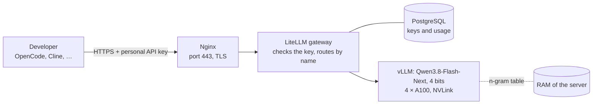

# AI Model Deployment on the HTWG Server

This guide sets up an open-weight AI model on the GPU server of HTWG, so that developers can use it with their AI coding assistants through one API. Every developer authenticates with a personal API key. The code never leaves HTWG, and there are no request limits apart from the capacity of the GPUs.

Model, engine and server are chosen and configured to fit each other, so that the server delivers as much performance as possible: the best model that fits, an engine configuration for this model and these GPUs, and a server setup that avoids bottlenecks. Where a setting cannot be decided in advance, the guide measures it with a [benchmark](#9-benchmark-and-tuning).

It builds on the research in [Our resources](../../recherche/AI-coding-setup/8-our-resources.md) and the [Evaluation](../../recherche/AI-coding-setup/9-evaluation.md).

## Overview



| Part | Task | Reachable from |
|---|---|---|
| **vLLM** | runs the model on the GPUs, OpenAI-compatible API | only inside the Docker network |
| **LiteLLM** | one endpoint for all uses; checks the personal API keys, sets the right parameters for each use, counts usage | only through Nginx |
| **PostgreSQL** | stores the API keys and the usage for LiteLLM | only inside the Docker network |
| **Nginx** | encrypts the connection (TLS) | HTWG network and VPN, port 443 |

Developers only see the LiteLLM endpoint. vLLM itself has no authentication and must never be reachable from outside.

## Server

### What is known

The Institute for Optical Systems (IOS) runs a GPU cluster with **8 × NVIDIA A100 40 GB** (320 GB VRAM), two processors with together 192 cores and, according to HTWG, 5 PetaFLOPS. It was bought for the BMBF project "Deep Doubt" of Prof. Dr. Oliver Dürr and is used by professors, doctoral candidates and student assistants, later also for theses *(HTWG: [Gamer würden neidisch werden](https://www.htwg-konstanz.de/hochschule/magazin/gamer-wuerden-neidisch-werden), 18 February 2021)*. RAM, storage, network and the exact system are not published, and there is no newer source.

8 × A100 40 GB, 320 GB and 5 PetaFLOPS are exactly the data of an **NVIDIA DGX A100**, which has 1 TB RAM, local NVMe storage and connects all GPUs with NVLink through NVSwitch ([NVIDIA DGX A100 user guide](https://docs.nvidia.com/dgx/dgxa100-user-guide/introduction-to-dgxa100.html)). A DGX A100 has 2 × 64 cores, not 2 × 96, so this is an assumption that has to be confirmed. **This guide assumes 4 of the 8 GPUs for us.**

### What the setup needs from the server

| Resource | Needed | Why |
|---|---|---|
| GPU | 4 × A100 40 GB, **SXM with NVLink**, MIG off | the model is split across 4 GPUs, which exchange data after every layer; over PCIe, this is much slower |
| RAM | **at least 192 GB**, free for us | the n-gram table of the model (about 102 GB) stays in RAM, see [Memory](#memory) |
| Storage | 400 GB on a **local NVMe SSD** | the model (about 188 GB) is read at every start; from a network drive, the start takes much longer |
| NVIDIA driver | new enough for the CUDA version of the vLLM image | see [Check the server](#1-check-the-server) |
| OS | Ubuntu 22.04 / 24.04 or DGX OS, Docker allowed | |

### Clarify with IOS

Contact: Prof. Dr. Georg Umlauf (director of IOS) or Prof. Dr. Oliver Dürr ([HTWG research report 2024](https://www.htwg-konstanz.de/fileadmin/pub/forschung/Forschungsreferat/Relaunch_2025/fue_jahresbericht_HTWG_oeffentlich_2024.pdf)).

- Which system is it exactly (DGX A100?), how much RAM, local NVMe storage?
- May we run a **permanent service** for our team, not only time-limited compute jobs?
- Can we get 4 GPUs exclusively, ideally 4 GPUs attached to the same CPU? Who else uses the cluster today?
- Is MIG switched off on these GPUs?
- Which NVIDIA driver is installed, and can it be updated if the vLLM image needs a newer one?
- May we run our own containers with Docker and the NVIDIA Container Toolkit?
- A DNS name, e.g. `ai-api.htwg-konstanz.de`, and a TLS certificate for it
- Access from the HTWG network and through VPN, and the address ranges of both for the firewall
- SSH access with a key and sudo rights

## Model

One model runs on all four GPUs and serves three uses. Clients use the **names of the uses**, not the name of the model, so the model or its settings can later be changed without changing the configuration of each developer.

| Name in the API | Use | Setting |
|---|---|---|
| `coding-agent` | Agentic programming: the assistant reads and edits files, runs commands and uses tools | thinking on, maximum effort |
| `coding` | Programming: questions, explanations, small changes; answers faster | thinking off |
| `docs` | Documentation, READMEs and other longer texts | thinking on, medium effort |

### Why Qwen3.8-Flash-Next

The strongest open-weight models, such as Kimi K3, DeepSeek-V4-Pro or GLM-5.3, have several hundred billion to trillions of parameters and need far more than the 160 GB VRAM of 4 × A100 40 GB *([Morph](https://www.morphllm.com/best-open-source-llm))*. Among the models that fit, Qwen3.8-Flash-Next is the strongest for agentic programming. Compared to Qwen3.8-27B, the strongest model that would fit on two GPUs *(Vendor: [model card](https://huggingface.co/Qwen/Qwen3.8-Flash-Next))*:

| Benchmark | Qwen3.8-Flash-Next | Qwen3.8-27B |
|---|---|---|
| DeepSWE 1.1 (agentic software engineering) | **58.7** | 42.2 |
| JobBench (agentic tasks) | **55.7** | 33.4 |
| Toolathlon Verified (tool use) | **73.5** | 67.1 |
| SWE-bench Multilingual | **81.0** | 73.8 |
| SWE-bench Pro | 62.5 | 61.7 |
| IFBench (following instructions) | 81.3 | 79.5 |

It also fits the hardware well:

- **Fast on the A100:** the speed of answers is limited by how fast the GPUs read the weights from memory. Flash-Next is a mixture-of-experts model with 125B parameters, of which only 6B are active per token. In 4 bits, it reads only a few GB per token, spread across four GPUs. The dense Qwen3.8-27B reads all 27B parameters for every token (see [Active parameters](../../recherche/AI-coding-setup/5-models.md#active-parameters)).
- **Small context memory:** only 12 of its 48 layers store a classic KV cache, so many long agent sessions fit at the same time.
- **Multi-token prediction (MTP):** the model can propose several tokens at once, which vLLM checks in one step. This makes answers faster without changing them.
- **One model for all uses:** a separate model for documentation would need GPUs of its own; then only a weaker model would fit for programming. Flash-Next follows instructions well (IFBench 81.3) and is also used for documentation.

!!! warning "Open points"
    - **Benchmarks** are reported by Qwen and were not reproduced independently.
    - **License:** the model is licensed under `qwen-community-1.0`, not Apache 2.0. Read it before use.
    - **4-bit version from the community:** Qwen only publishes BF16 and FP8. The 4-bit version used here comes from a single author. Test it with the [test tasks of the evaluation](../../recherche/AI-coding-setup/9-evaluation.md#5-test-task) before the team relies on it. If it does not work, use the [fallback with two models](#fallback-two-smaller-models).

### Memory

The model has about 180B parameters in total: 125B in the language model, a table of 51B parameters for an n-gram embedding, a 4B layer for MTP and a vision encoder. The n-gram table is only used for lookups, so vLLM can keep it in the RAM of the server instead of the GPUs ([vLLM recipe](https://recipes.vllm.ai/Qwen/Qwen3.8-Flash-Next)).

| Version | GPU memory for the weights | Fits into 4 × A100 40 GB (about 147 GB usable) |
|---|---|---|
| BF16 (original) | about 335 GB | – |
| FP8 (official), n-gram table in RAM | about 125 GB | only just, too little room for context; the A100 cannot compute in FP8 |
| **4 bits (GPTQ), n-gram table in RAM** | **about 80 GB** | **✓, about 60 GB for context** |

We use [`btbtyler09/Qwen3.8-Flash-Next-GPTQ-4bit`](https://huggingface.co/btbtyler09/Qwen3.8-Flash-Next-GPTQ-4bit):

- The experts and the attention projections are quantized to 4 bits (GPTQ, group size 32); the other parts, including the n-gram table, stay in BF16.
- The author measured almost no loss against the original: perplexity +0.58 % on text and −0.02 % on Python code, the most likely next token is the same in 91–96 % of cases. The calibration data contained code.
- **Fits the A100:** GPTQ runs on the A100 with Marlin kernels, which compute with 4-bit weights and 16-bit activations (W4A16), a format the A100 supports. FP4 formats such as NVFP4 or MXFP4 need newer GPUs.

**Context:** 12 layers with 2 KV heads of size 256 need 2 × 12 × 2 × 256 × 2 bytes = 24 KB per token at 16 bits, so 64K tokens need about 1.5 GB per user. With four GPUs, each KV head is stored on two GPUs, so about 3 GB per user. The about 60 GB left are enough for about 15–20 users with a full 64K context at the same time. *(Calculation from the [model card](https://huggingface.co/Qwen/Qwen3.8-Flash-Next))* After starting, vLLM logs the real value (`Maximum concurrency`).

## Installation

### 1. Check the server

```bash
# GPU model, memory, driver, persistence mode
nvidia-smi --query-gpu=index,name,memory.total,driver_version,persistence_mode --format=csv

# MIG must be off
nvidia-smi --query-gpu=index,mig.mode.current --format=csv

# Connection between the GPUs and their CPU/NUMA affinity
nvidia-smi topo -m

# RAM, NUMA nodes and storage
free -g
lscpu | grep -i numa
df -h
```

| Check | Expected | If not |
|---|---|---|
| Name | `NVIDIA A100-SXM4-40GB` | a PCIe version works, but splitting across 4 GPUs is slower; ask IOS whether there is NVLink |
| `mig.mode.current` | `Disabled` | ask IOS to switch MIG off for our GPUs |
| `persistence_mode` | `Enabled` | ask IOS to run `nvidia-smi -pm 1`; otherwise the GPUs are re-initialised for every container start |
| `nvidia-smi topo -m` between our GPUs | `NV…` (NVLink) | `SYS` or `PHB` means PCIe only |
| Free RAM | at least 192 GB | the model does not start; ask IOS for more RAM |

**Choose the GPUs:** in `nvidia-smi topo -m`, the columns *CPU Affinity* and *NUMA Affinity* show to which CPU each GPU is attached. Choose 4 GPUs with the **same NUMA affinity**, if IOS lets us choose. Then the n-gram lookups in RAM and the data transfers do not have to cross between the two CPUs. Note the GPU numbers and the CPU cores of this NUMA node for [step 5](#5-docker-compose).

**Driver and CUDA:** every vLLM image is built for a CUDA version, and the driver must support it. The driver version shown by `nvidia-smi` must be at least the minimum listed in the [CUDA release notes](https://docs.nvidia.com/cuda/cuda-toolkit-release-notes/) for the CUDA version of the image. If it is older, ask IOS to update the driver. The cluster is managed by IOS; do not install drivers yourself.

### 2. Docker and NVIDIA Container Toolkit

If Docker and the toolkit are already installed (as on DGX OS), skip to the test at the end.

```bash
# Docker
curl -fsSL https://get.docker.com -o get-docker.sh
sudo sh get-docker.sh
sudo usermod -aG docker $USER   # log out and in again afterwards

# NVIDIA Container Toolkit
curl -fsSL https://nvidia.github.io/libnvidia-container/gpgkey | \
    sudo gpg --dearmor -o /usr/share/keyrings/nvidia-container-toolkit-keyring.gpg
curl -s -L https://nvidia.github.io/libnvidia-container/stable/deb/nvidia-container-toolkit.list | \
    sed 's#deb https://#deb [signed-by=/usr/share/keyrings/nvidia-container-toolkit-keyring.gpg] https://#g' | \
    sudo tee /etc/apt/sources.list.d/nvidia-container-toolkit.list
sudo apt-get update
sudo apt-get install -y nvidia-container-toolkit
sudo nvidia-ctk runtime configure --runtime=docker
sudo systemctl restart docker

# Test: should list the GPUs
docker run --rm --gpus all nvidia/cuda:12.4.1-base-ubuntu22.04 nvidia-smi
```

### 3. Directory and secrets

Put the directory on the local NVMe SSD (on a DGX usually `/raid`), so that the model loads quickly:

```bash
sudo mkdir -p /raid/ai-api && sudo chown $USER /raid/ai-api
cd /raid/ai-api
```

Create `/raid/ai-api/.env`. It contains secrets and must not be committed to a repository:

```bash
# Admin key for LiteLLM; only for creating and revoking developer keys
LITELLM_MASTER_KEY=sk-admin-<random value>
# Password of the database for LiteLLM
POSTGRES_PASSWORD=<random value>
# Only needed if a model on Hugging Face requires accepting a license
HF_TOKEN=
```

Generate the random values with `openssl rand -hex 32`. Then protect the file:

```bash
chmod 600 .env
```

### 4. LiteLLM configuration

`/raid/ai-api/litellm-config.yaml`. All three names point to the same vLLM server and only differ in their parameters:

```yaml
model_list:
  # Agentic programming: thinking with maximum effort (default of the model)
  - model_name: coding-agent
    litellm_params:
      model: hosted_vllm/qwen3.8-flash-next
      api_base: http://vllm:8000/v1

  # Programming: thinking off for faster answers
  - model_name: coding
    litellm_params:
      model: hosted_vllm/qwen3.8-flash-next
      api_base: http://vllm:8000/v1
      extra_body:
        chat_template_kwargs:
          enable_thinking: false

  # Documentation: thinking with medium effort
  - model_name: docs
    litellm_params:
      model: hosted_vllm/qwen3.8-flash-next
      api_base: http://vllm:8000/v1
      reasoning_effort: medium

litellm_settings:
  drop_params: true   # ignore parameters the model does not support

general_settings:
  master_key: os.environ/LITELLM_MASTER_KEY
  database_url: os.environ/DATABASE_URL
```

The Qwen3.8 models are documented with `reasoning_effort` (`xhigh`, `medium`, `low`) and thinking on by default ([Qwen3.8-27B](https://huggingface.co/Qwen/Qwen3.8-27B)). The model card of Flash-Next does not describe how to switch thinking off. Check after the start that `coding` answers without a thinking part and `docs` with a shorter one (see [Test](#test)).

### 5. Docker Compose

`/raid/ai-api/compose.yaml`. Replace the GPU numbers and CPU cores with those from [step 1](#1-check-the-server). Pin the versions of vLLM and LiteLLM to releases you have tested instead of `latest`. Qwen3.8-Flash-Next needs at least vLLM 0.30 ([vLLM recipe](https://recipes.vllm.ai/Qwen/Qwen3.8-Flash-Next)).

```yaml
services:
  vllm:
    image: vllm/vllm-openai:v0.XX.X        # pin a tested version, at least 0.30
    restart: unless-stopped
    ipc: host                               # shared memory between the 4 GPU processes
    cpuset: "0-47"                          # CPU cores of the NUMA node of our GPUs, see step 1
    ulimits:
      memlock: -1                           # allow pinned RAM for the n-gram table
      stack: 67108864
    environment:
      - HF_TOKEN=${HF_TOKEN}
      - VLLM_PLE_CPU_OFFLOAD=1              # n-gram table in pinned RAM, not on the GPUs
      - VLLM_ENGINE_READY_TIMEOUT_S=1800    # loading the large model takes long
    volumes:
      - ./models:/root/.cache/huggingface   # on the local NVMe SSD
    command: >
      --model btbtyler09/Qwen3.8-Flash-Next-GPTQ-4bit
      --served-model-name qwen3.8-flash-next
      --dtype bfloat16
      --tensor-parallel-size 4
      --enable-expert-parallel
      --gpu-memory-utilization 0.92
      --max-model-len 131072
      --max-num-seqs 32
      --max-num-batched-tokens 16384
      --enable-prefix-caching
      --speculative-config '{"method":"mtp","num_speculative_tokens":3}'
      --enable-auto-tool-choice
      --tool-call-parser qwen3_coder
      --reasoning-parser qwen3
    deploy:
      resources:
        reservations:
          devices:
            - driver: nvidia
              device_ids: ["0", "1", "2", "3"]   # our 4 GPUs, see step 1
              capabilities: [gpu]

  litellm:
    image: ghcr.io/berriai/litellm:main-stable   # pin a tested version
    restart: unless-stopped
    depends_on: [db, vllm]
    env_file: .env
    environment:
      - DATABASE_URL=postgresql://litellm:${POSTGRES_PASSWORD}@db:5432/litellm
    volumes:
      - ./litellm-config.yaml:/app/config.yaml:ro
    command: ["--config", "/app/config.yaml", "--port", "4000", "--num_workers", "4"]
    ports:
      - "127.0.0.1:4000:4000"   # only local, Nginx forwards to it

  db:
    image: postgres:16
    restart: unless-stopped
    environment:
      - POSTGRES_USER=litellm
      - POSTGRES_PASSWORD=${POSTGRES_PASSWORD}
      - POSTGRES_DB=litellm
    volumes:
      - ./postgres:/var/lib/postgresql/data
```

#### How the settings fit model and server

| Setting | Fits | Effect |
|---|---|---|
| `--dtype bfloat16` | model | required by the sparse attention of the model ([model](https://huggingface.co/btbtyler09/Qwen3.8-Flash-Next-GPTQ-4bit)); the A100 computes natively in BF16 |
| `--tensor-parallel-size 4` | server | splits every layer across the 4 GPUs, which compute at the same time; needs the fast NVLink connection between them ([vLLM](https://docs.vllm.ai/en/latest/serving/parallelism_scaling/)) |
| `--enable-expert-parallel` | model + server | distributes the 512 small experts across the GPUs instead of cutting each expert into 4 pieces; the vLLM recipe uses this for all multi-GPU setups. Compare with and without in the [benchmark](#9-benchmark-and-tuning) |
| `VLLM_PLE_CPU_OFFLOAD=1` + `memlock: -1` | model + server | keeps the n-gram table in pinned RAM, from which the GPUs read the few rows they need directly. Without `memlock`, the container may not pin that much memory. If RAM is short, use `VLLM_PLE_MMAP=1` instead: the table is then read from the SSD as needed, which is slower |
| `cpuset` | server | keeps vLLM on the CPU to which our GPUs and the pinned RAM are attached |
| `--gpu-memory-utilization 0.92` | server | the GPUs are only used by us, so 92 % can be used for weights and context |
| `--max-num-seqs 32` | team | at most 32 requests at the same time, enough for the team (8 people with at most 4 parallel requests each). A lower limit leaves more memory for context than the default of 256 |
| `--max-num-batched-tokens 16384` | use | agents send long prompts; larger chunks process them faster, while short answers of others still continue in between (chunked prefill) |
| `--max-model-len 131072` | use | maximum context per request; 128K leaves room for long agent sessions, most requests use much less |
| `--enable-prefix-caching` | use | agents send the same beginning (system prompt, files read so far) again with every step; vLLM reuses it instead of computing it again. This is the biggest speed-up for agents |
| `--speculative-config` (MTP) | model | uses the MTP layer of the model to propose 3 tokens at once; faster answers with few parallel users. Compare in the [benchmark](#9-benchmark-and-tuning) |
| `--tool-call-parser`, `--reasoning-parser` | model | return tool calls and thinking in the format the assistants expect ([vLLM recipe](https://recipes.vllm.ai/Qwen/Qwen3.8-Flash-Next)) |
| `--num_workers 4` | LiteLLM | several worker processes for LiteLLM, so that the gateway is not a bottleneck with many streamed answers |
| no `ports` for vLLM and the database | security | only reachable inside the Docker network. Docker writes its own firewall rules and bypasses `ufw`, so a published port like `-p 8000:8000` would be open to everyone even with firewall rules ([Docker](https://docs.docker.com/engine/network/packet-filtering-firewalls/)). LiteLLM is bound to `127.0.0.1` for the same reason |
| `restart: unless-stopped` | operation | starts the containers again after a crash or a reboot; no systemd services are needed |

Settings that are deliberately **not** used:

- `--enforce-eager`: switches off CUDA graphs and makes every step slower.
- `--disable-custom-all-reduce`: the fast data exchange between the GPUs works over NVLink; only needed if vLLM hangs at start (see [Troubleshooting](#troubleshooting)).
- `--kv-cache-dtype fp8`: memory for context is not the bottleneck with this model, so the context stays in 16 bits without any loss.

### 6. Start

```bash
cd /raid/ai-api
docker compose up -d
docker compose logs -f vllm    # the first start downloads about 188 GB, this takes a while
```

The server is ready when the log shows `Application startup complete`. Note the line with `Maximum concurrency`.

### 7. Nginx with TLS

Nginx runs directly on the server, encrypts the connection and forwards to LiteLLM:

```bash
sudo apt-get install -y nginx
```

`/etc/nginx/sites-available/ai-api`:

```nginx
upstream litellm {
    server 127.0.0.1:4000;
    keepalive 32;               # reuse connections to LiteLLM
}

server {
    listen 443 ssl;
    http2 on;
    server_name ai-api.htwg-konstanz.de;          # DNS name from IOS

    ssl_certificate     /etc/ssl/certs/ai-api.pem;  # certificate from IOS
    ssl_certificate_key /etc/ssl/private/ai-api.key;

    client_max_body_size 50m;   # agents send large requests

    location / {
        proxy_pass http://litellm;
        proxy_http_version 1.1;
        proxy_set_header Connection "";
        proxy_set_header Host $host;
        proxy_set_header X-Forwarded-For $proxy_add_x_forwarded_for;
        proxy_buffering off;        # pass streamed answers on token by token
        proxy_read_timeout 600s;    # long answers with thinking
    }
}
```

```bash
sudo ln -s /etc/nginx/sites-available/ai-api /etc/nginx/sites-enabled/
sudo rm /etc/nginx/sites-enabled/default
sudo nginx -t
sudo systemctl reload nginx
```

`http2 on` needs Nginx 1.25.1 or newer; on older versions, write `listen 443 ssl http2;` instead.

### 8. Firewall

Only SSH and HTTPS from the HTWG network and VPN are allowed. Allow SSH **before** enabling the firewall, otherwise the SSH connection is cut:

```bash
sudo ufw default deny incoming
sudo ufw allow OpenSSH
sudo ufw allow from <HTWG network> to any port 443 proto tcp
sudo ufw allow from <VPN network> to any port 443 proto tcp
sudo ufw enable
```

Get the address ranges from IOS or the computing centre. If IOS manages the firewall of the cluster centrally, ask them to open port 443 instead.

### 9. Benchmark and tuning

Some settings can only be decided by measuring on the real server. vLLM includes a benchmark that sends many requests at the same time and measures:

- **TTFT** (time to first token): how long until the answer starts; for agents mainly the processing of the long prompt
- **TPOT** (time per output token): how fast the answer is written
- **Throughput:** tokens per second for all users together

Run it inside the vLLM container, with requests similar to those of an agent (long prompt, medium answer):

```bash
docker compose exec vllm vllm bench serve \
  --backend openai-chat \
  --endpoint /v1/chat/completions \
  --base-url http://localhost:8000 \
  --model qwen3.8-flash-next \
  --tokenizer btbtyler09/Qwen3.8-Flash-Next-GPTQ-4bit \
  --dataset-name random \
  --random-input-len 16000 \
  --random-output-len 1000 \
  --num-prompts 64 \
  --max-concurrency 8
```

Run it with `--max-concurrency` 1, 4 and 8, and compare these variants. Change one setting in `compose.yaml`, then run `docker compose up -d` and the benchmark again:

| Variant | Expectation | Keep if |
|---|---|---|
| with / without `--enable-expert-parallel` | expert parallelism is usually faster for many small experts | throughput and TPOT are better |
| with / without `--speculative-config`, or `num_speculative_tokens` 1, 2, 3 | MTP helps with few users, can cost throughput with many | TPOT at concurrency 1–4 is better without a loss at 8 |
| `--max-num-batched-tokens` 8192 / 16384 / 32768 | larger values lower TTFT for long prompts, can slow down running answers | TTFT is lower and TPOT stays similar |

Note the results and the chosen settings on this page. Then check the quality of the answers with the three [test tasks of the evaluation](../../recherche/AI-coding-setup/9-evaluation.md#5-test-task) using `coding-agent`, and compare with GWDG Chat AI and Claude Code from the evaluation. The 4-bit kernels for this model are new, so the author recommends this check on your own hardware.

## Authentication

Every developer gets their own API key from LiteLLM. The master key from `.env` is only used by the admin to create and revoke keys; it is never handed out.

### Create a key

```bash
curl https://ai-api.htwg-konstanz.de/key/generate \
  -H "Authorization: Bearer $LITELLM_MASTER_KEY" \
  -H "Content-Type: application/json" \
  -d '{
    "key_alias": "max.mustermann",
    "models": ["coding-agent", "coding", "docs"],
    "max_parallel_requests": 4
  }'
```

The answer contains the key (`"key": "sk-…"`). Hand it to the developer over a secure channel. `max_parallel_requests` keeps a single person from using the whole capacity and matches `--max-num-seqs 32` for a team of 8 ([LiteLLM virtual keys](https://docs.litellm.ai/docs/proxy/virtual_keys)).

### Revoke a key

```bash
curl https://ai-api.htwg-konstanz.de/key/delete \
  -H "Authorization: Bearer $LITELLM_MASTER_KEY" \
  -H "Content-Type: application/json" \
  -d '{"key_aliases": ["max.mustermann"]}'
```

The key stops working immediately; the keys of all others stay valid.

### Usage

LiteLLM stores the requests and tokens per key. They can be viewed in the admin interface at `https://ai-api.htwg-konstanz.de/ui` (login with the master key).

## Using the API

The API is OpenAI-compatible. Every request sends the personal key as `Authorization: Bearer`.

| Setting | Value |
|---|---|
| Base URL | `https://ai-api.htwg-konstanz.de/v1` |
| API key | personal key, e.g. as environment variable `HTWG_AI_API_KEY` |
| Models | `coding-agent`, `coding`, `docs` |

### Test

```bash
# Which models can my key use?
curl https://ai-api.htwg-konstanz.de/v1/models \
  -H "Authorization: Bearer $HTWG_AI_API_KEY"

# A short request without thinking
curl https://ai-api.htwg-konstanz.de/v1/chat/completions \
  -H "Authorization: Bearer $HTWG_AI_API_KEY" \
  -H "Content-Type: application/json" \
  -d '{
    "model": "coding",
    "messages": [{"role": "user", "content": "Write a Python function that reverses a string."}]
  }'
```

The answer of `coding` should not contain a `reasoning_content` field; the same request with `coding-agent` should.

### OpenCode

Store the key as an environment variable, not in the configuration file, e.g. in `~/.zshrc`:

```bash
export HTWG_AI_API_KEY="sk-…"
```

`opencode.json`:

```json
{
  "$schema": "https://opencode.ai/config.json",
  "model": "htwg/coding-agent",
  "small_model": "htwg/coding",
  "provider": {
    "htwg": {
      "npm": "@ai-sdk/openai-compatible",
      "name": "HTWG",
      "options": {
        "baseURL": "https://ai-api.htwg-konstanz.de/v1",
        "apiKey": "{env:HTWG_AI_API_KEY}"
      },
      "models": {
        "coding-agent": { "name": "Agentic programming", "reasoning": true },
        "coding":       { "name": "Programming, fast" },
        "docs":         { "name": "Documentation", "reasoning": true }
      }
    }
  }
}
```

Other assistants such as Cline are set up the same way with the provider "OpenAI Compatible", the base URL and the key.

**Tip for speed:** agents profit from prefix caching only if the beginning of the prompt stays the same. Avoid changing the system prompt, rules files or the order of tools during a session.

## Fallback: two smaller models

If the 4-bit version of Flash-Next does not run on the A100 or its quality is not good enough, two smaller models with official weights fit on two GPUs each:

| Name in the API | Model | GPUs |
|---|---|---|
| `coding-agent`, `coding` | [Qwen3.8-27B-FP8](https://huggingface.co/Qwen/Qwen3.8-27B) (about 28 GB), `--tensor-parallel-size 2` | 0 + 1 |
| `docs` | [Gemma 4 31B](https://huggingface.co/google/gemma-4-31B-it) (BF16, about 62 GB), `--tensor-parallel-size 2`, `--tool-call-parser gemma4 --reasoning-parser gemma4` | 2 + 3 |

Then use two vLLM services with `device_ids: ["0", "1"]` and `["2", "3"]` and change `api_base` in `litellm-config.yaml`. The names in the API stay the same, so developers do not need to change anything.

## Updating

```bash
cd /raid/ai-api
# change the image versions in compose.yaml, then:
docker compose pull
docker compose up -d
```

After every update of vLLM, run the [benchmark](#9-benchmark-and-tuning) again: new versions often change the default settings and the speed. To replace the model, change `--model` in `compose.yaml` and `model` in `litellm-config.yaml`. The names in the API stay the same.

## Troubleshooting

| Problem | Check | Solution |
|---|---|---|
| A container does not start | `docker compose logs <service>` | read the error at the end of the log |
| `CUDA driver version is insufficient` | `nvidia-smi` | the driver is too old for the image; ask IOS for an update or use an older vLLM image (at least 0.30) |
| `CUDA out of memory` at start | log of vLLM | check that `VLLM_PLE_CPU_OFFLOAD=1` is set; lower `--max-model-len`, `--max-num-seqs` or `--gpu-memory-utilization` |
| Error about pinned or locked memory | log of vLLM | check `ulimits: memlock: -1`; otherwise use `VLLM_PLE_MMAP=1` |
| Server runs out of RAM, the system swaps | `free -h` | the n-gram table needs about 102 GB RAM; switch to `VLLM_PLE_MMAP=1` or ask IOS for more RAM |
| Start is aborted after some minutes | log: timeout | raise `VLLM_ENGINE_READY_TIMEOUT_S` |
| Error with `--enable-expert-parallel` | log of vLLM | remove the option; the GPTQ version was tested by its author without it |
| Garbled or very poor answers | test tasks | remove `--speculative-config`; try a newer vLLM version; otherwise use the [fallback](#fallback-two-smaller-models) |
| vLLM hangs at start with four GPUs | log stops after loading | add `--disable-custom-all-reduce` |
| Slow despite few users | `nvidia-smi topo -m`, `nvidia-smi -q -d CLOCK` | check NVLink between our GPUs, persistence mode and that no other processes use the GPUs |
| Slow when several people work | `Maximum concurrency` in the log, benchmark | lower `max_parallel_requests` per key or `--max-model-len` |
| `401 Unauthorized` | key in the request | key revoked or mistyped; create a new one |
| `400` with "model not allowed" | `/v1/models` with the key | allow the model for the key with `/key/update` |
| Tools are not called or thinking appears in the answer | flags in `compose.yaml` | check `--tool-call-parser` and `--reasoning-parser` against the current vLLM recipe |
| A GPU is missing in `nvidia-smi` | | contact IOS, do not reinstall drivers |

## Sources

As of 14 November 2026.

- Server: [HTWG: Gamer würden neidisch werden](https://www.htwg-konstanz.de/hochschule/magazin/gamer-wuerden-neidisch-werden), [HTWG research report 2024](https://www.htwg-konstanz.de/fileadmin/pub/forschung/Forschungsreferat/Relaunch_2025/fue_jahresbericht_HTWG_oeffentlich_2024.pdf), [NVIDIA DGX A100](https://docs.nvidia.com/dgx/dgxa100-user-guide/introduction-to-dgxa100.html), [CUDA release notes](https://docs.nvidia.com/cuda/cuda-toolkit-release-notes/)
- Model: [Qwen3.8-Flash-Next](https://huggingface.co/Qwen/Qwen3.8-Flash-Next), [GPTQ 4-bit version](https://huggingface.co/btbtyler09/Qwen3.8-Flash-Next-GPTQ-4bit), comparison: [Qwen3.8-27B](https://huggingface.co/Qwen/Qwen3.8-27B), overview of open-weight models: [Morph](https://www.morphllm.com/best-open-source-llm)
- vLLM: [recipe Qwen3.8-Flash-Next](https://recipes.vllm.ai/Qwen/Qwen3.8-Flash-Next), [parallelism](https://docs.vllm.ai/en/latest/serving/parallelism_scaling/), [optimization and tuning](https://docs.vllm.ai/en/latest/configuration/optimization/), [benchmarks](https://docs.vllm.ai/en/latest/contributing/benchmarks/)
- Fallback: [recipe Qwen3.8-27B](https://recipes.vllm.ai/Qwen/Qwen3.8-27B), [recipe Gemma 4 31B](https://recipes.vllm.ai/Google/gemma-4-31B-it)
- LiteLLM: [vLLM as provider](https://docs.litellm.ai/docs/providers/vllm), [virtual keys](https://docs.litellm.ai/docs/proxy/virtual_keys), [config settings](https://docs.litellm.ai/docs/proxy/config_settings)
- Docker: [NVIDIA Container Toolkit](https://docs.nvidia.com/datacenter/cloud-native/container-toolkit/latest/install-guide.html), [Docker and firewalls](https://docs.docker.com/engine/network/packet-filtering-firewalls/)
- Research: [Our resources](../../recherche/AI-coding-setup/8-our-resources.md), [Evaluation](../../recherche/AI-coding-setup/9-evaluation.md)
