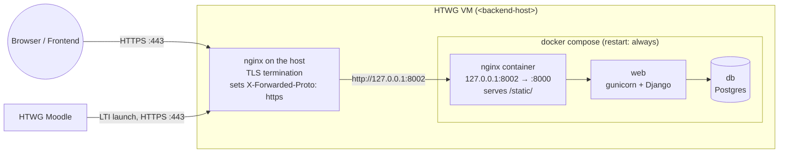

# Deployment: Backend on the HTWG server

!!! info "What this is about"
    This guide describes how the Teamable backend is run permanently on a VM of the HTWG computing center (Rechenzentrum, RZ): reachable via HTTPS under a fixed address, with a health check, an automatic restart after a reboot and without secrets in the repository.

    **Code:** [`teamable-backend`](https://github.com/Teamprojekt-MSI-BIT-SS26/teamable-backend). Paths without a prefix refer to this repository.

    **Assumptions:** Debian 12 (Linux) on the HTWG VM, Docker Engine with the Compose plugin. Values in angle brackets such as `<backend-host>` are placeholders and have to be replaced.

---

## 1. Target architecture



- The repository already contains a working container setup: `docker-compose.yml` starts `nginx`, `web` (gunicorn, `scripts/runserver.sh` runs `collectstatic` and `migrate` on every start) and `db` (Postgres).
- TLS is **not** handled by the containers. An nginx on the host terminates HTTPS and forwards to the container nginx. Only ports 80 and 443 are open to the outside.
- The container nginx forwards the header `X-Forwarded-Proto` unchanged (`config/nginx.conf`). Django uses it to detect HTTPS (`SECURE_PROXY_SSL_HEADER` in `src/teamable/settings.py`). The host nginx therefore **must** set it to `https`, otherwise CSRF checks, redirects and LTI launches fail.

---

## 2. Request from the RZ

Processing times at the RZ are outside our control. Request everything at once:

| What | Details |
|---|---|
| **VM** | Debian 12 (Debian 11+ works too), 2 vCPU, 4 GB RAM, 20 GB disk are enough. SSH access for the team members (public keys). `sudo` rights. |
| **DNS entry** | Fixed host name, e.g. `<backend-host>` = `teamable-api.<subdomain>.htwg-konstanz.de` |
| **Firewall** | Incoming TCP **443** (HTTPS) and **80** (redirect, and Let's Encrypt if used). Clarify whether it is reachable from the internet or only from the campus network/VPN. |
| **Outgoing traffic** | HTTPS to the HTWG Moodle (LTI token requests, NRPS), to Docker Hub/PyPI (image build) and to GitHub (clone). |
| **TLS certificate** | Ask whether the RZ issues a server certificate (e.g. via GÉANT TCS) or whether Let's Encrypt is allowed. Let's Encrypt only works if port 80 is reachable from the internet. |

!!! tip
    Moodle sends the LTI launch through the user's browser, so campus-only access is enough for the launch. For the student import, however, the **backend** calls Moodle directly (`/mod/lti/token.php`, NRPS). The VM must be allowed to reach the Moodle server.

---

## 3. Required changes in `teamable-backend` before the first deployment

The current state of the repository does not meet the acceptance criteria in four places. These changes belong in the backend repository (separate PR), not on the server.

### 3.1 `SECRET_KEY` from the environment

`src/teamable/settings.py` contains a hard-coded `SECRET_KEY`. It is used for sessions, CSRF and the sign-up JWTs. Everyone who knows the repository can forge them.

```python
# src/teamable/settings.py
SECRET_KEY = os.environ.get("SECRET_KEY") or (
    "django-insecure-local-only" if DEBUG else None
)
if not SECRET_KEY:
    raise RuntimeError("SECRET_KEY must be set when DEBUG is not TRUE")
```

### 3.2 Remove `db.env` from the repository

`db.env` is committed and contains the Postgres password (`YourPasswordHere1234`). `.gitignore` only covers `.env*`, not `db.env`.

```bash
git mv db.env db.env.sample
echo "db.env" >> .gitignore
```

Then use a new, random password on the server (section 5). The old password is public and must not be used.

### 3.3 Health check endpoint

There is no health endpoint yet. A minimal one that also checks the database connection:

```python
# src/teamable/urls.py
from django.db import connection
from django.http import JsonResponse


def health(request):
    with connection.cursor() as cursor:
        cursor.execute("SELECT 1")
    return JsonResponse({"status": "ok"})


urlpatterns = [
    path("health/", health),
    # ... existing entries
]
```

If the database is not reachable, the view raises an exception and Django answers with `500`. This is enough for a simple monitoring check.

!!! note "Without this change"
    `GET /admin/login/` returns `200` with the login page and can be used as a replacement health check.

### 3.4 CORS for the frontend and container port only on localhost

- `CORS_ALLOW_ALL_ORIGINS` is only set with `DEBUG=TRUE`. In production, the frontend (different origin) cannot call the API. Add:

    ```python
    # src/teamable/settings.py
    CORS_ALLOWED_ORIGINS = os.environ.get("CORS_ALLOWED_ORIGINS", "").split()
    ```

- `docker-compose.yml` publishes port `8002` on all interfaces. Bind it to localhost so that only the host nginx can reach it. Also pin the Postgres version: with `postgres:latest`, a `docker compose pull` can switch to a new major version that cannot read the existing data directory.

    ```yaml
    services:
        nginx:
            ports:
                - 127.0.0.1:8002:8000
        db:
            image: postgres:16
    ```

---

## 4. Prepare the VM

All commands run on the VM via SSH.

```bash
# Docker Engine + Compose plugin (official repository)
sudo apt-get update
sudo apt-get install -y ca-certificates curl git nginx
curl -fsSL https://get.docker.com | sudo sh

# Start Docker on boot (needed for the auto-restart)
sudo systemctl enable --now docker

# Allow your own user to run docker without sudo (log in again afterwards)
sudo usermod -aG docker "$USER"
```

Check out the code into a fixed location:

```bash
sudo mkdir -p /opt/teamable
sudo chown "$USER":"$USER" /opt/teamable
git clone https://github.com/Teamprojekt-MSI-BIT-SS26/teamable-backend.git /opt/teamable/backend
cd /opt/teamable/backend
git checkout <branch-or-tag>
```

---

## 4.1 Debian-specific setup

On Debian 12, Docker from the official repository is recommended. The installation script above adds the Docker repository and installs the latest stable version.

If you encounter any issues with the Docker installation, ensure that your system is up to date:

```bash
sudo apt-get update && sudo apt-get upgrade -y
```

---

## 5. Secrets and configuration (only on the server)

All secrets live **only** in files on the VM that are listed in `.gitignore`. They are never committed. Each file gets the permissions `600`.

### 5.1 `.env`

```bash
cd /opt/teamable/backend
cp sample.env .env
chmod 600 .env
```

Content for production:

```bash
DEBUG=FALSE
SERVER_NAME=<backend-host>
SECRET_KEY=<random value, see below>
CORS_ALLOWED_ORIGINS=https://<frontend-host>

# LTI config (file in src/lti/config/, see 5.3)
LTI_CONF_FOLDER=lti/config
LTI_CONF_FILE_NAME=lti_config_settings.json

# Canvas is not used, but the variables are read
CANVAS_BASE_URL=
CANVAS_OAUTH_CLIENT_ID=
CANVAS_OAUTH_CLIENT_SECRET=

FRONTEND_BASE_URL=https://<frontend-host>
```

- `DEBUG=FALSE` switches to Postgres, checks the LTI deployment ID and makes `SERVER_NAME` mandatory. `SERVER_NAME` fills `ALLOWED_HOSTS` and `CSRF_TRUSTED_ORIGINS` (as `https://<backend-host>`). Several names are separated by spaces.
- Generate `SECRET_KEY`:

    ```bash
    python3 -c "import secrets; print(secrets.token_urlsafe(50))"
    ```

### 5.2 `db.env`

```bash
cp db.env.sample db.env     # before change 3.2: edit the existing db.env, do not commit it
chmod 600 db.env
```

```bash
POSTGRES_HOST=db
POSTGRES_PORT=5432
POSTGRES_DB=teamable
POSTGRES_USER=teamable
POSTGRES_PASSWORD=<random value: openssl rand -base64 32>
```

!!! warning
    Postgres only reads `POSTGRES_USER`/`POSTGRES_PASSWORD` when the data directory (`srv/postgres-data/`) is created for the first time. If the password is changed later, it has to be changed in the database as well (`ALTER USER ...`).

### 5.3 LTI configuration and key pair

The folder `src/lti/config/` is in `.gitignore`. Create the key pair and `lti_config_settings.json` there as described in [Local setup: Moodle + Teamable](../../recherche/LMS-Anbindung/local-moodle-teamable-setup.md), with the values of the HTWG Moodle instead of `localhost:8008`:

- Top-level key = **Platform ID** of the HTWG Moodle (exactly, without a trailing `/`)
- `auth_login_url`, `auth_token_url`, `key_set_url` point to the HTWG Moodle
- `client_id` and `deployment_ids` from the tool registration in Moodle
- In Moodle, register the tool with `https://<backend-host>/lti/login/` (initiate login) and `https://<backend-host>/lti/launch/` (redirect URI / tool URL)

```bash
chmod 600 src/lti/config/private.key
```

!!! note
    The `Dockerfile` copies `src/` into the image, including `src/lti/config/`. After changing the LTI configuration, the image has to be rebuilt (`docker compose up -d --build`). The image stays local on the VM and is not pushed to a registry.

### 5.4 Check that no secrets are tracked

```bash
git status --ignored --short | grep -E "\.env|db\.env|lti/config"   # must show "!!" (ignored)
git ls-files | grep -E "(^|/)(\.env|db\.env)$|lti/config"             # must print nothing
```

---

## 6. HTTPS with nginx on the host

### 6.1 Get a certificate

=== "Option A: Let's Encrypt"

    Only if port 80 is reachable from the internet.

    ```bash
    sudo apt-get install -y certbot python3-certbot-nginx
    sudo certbot --nginx -d <backend-host>
    ```

    Certbot installs a systemd timer that renews the certificate automatically. Check it with:

    ```bash
    systemctl list-timers | grep certbot
    sudo certbot renew --dry-run
    ```

    !!! note "Debian 12 note"
        On Debian 12, certbot is available in the standard repositories. No additional repositories need to be added.

=== "Option B: Certificate from the RZ"

    Create a private key and a certificate signing request (CSR) on the VM and send only the CSR to the RZ:

    ```bash
    sudo mkdir -p /etc/ssl/teamable && cd /etc/ssl/teamable
    sudo openssl req -new -newkey rsa:3072 -nodes \
      -keyout <backend-host>.key -out <backend-host>.csr \
      -subj "/CN=<backend-host>"
    sudo chmod 600 <backend-host>.key
    ```

    Store the returned certificate **including the intermediate chain** as `/etc/ssl/teamable/<backend-host>.fullchain.pem`. Note the expiry date: renewal is manual.

The private key never leaves the VM and never goes into a repository.

### 6.2 nginx site

On Debian, nginx configuration files are placed in `/etc/nginx/sites-available/` and enabled via symlinks in `/etc/nginx/sites-enabled/`.

`/etc/nginx/sites-available/teamable`:

```nginx
server {
    listen 80;
    server_name <backend-host>;
    return 301 https://$host$request_uri;
}

server {
    listen 443 ssl;
    http2 on;
    server_name <backend-host>;

    # Option A: paths written by certbot
    # ssl_certificate     /etc/letsencrypt/live/<backend-host>/fullchain.pem;
    # ssl_certificate_key /etc/letsencrypt/live/<backend-host>/privkey.pem;
    # Option B:
    ssl_certificate     /etc/ssl/teamable/<backend-host>.fullchain.pem;
    ssl_certificate_key /etc/ssl/teamable/<backend-host>.key;

    ssl_protocols TLSv1.2 TLSv1.3;
    add_header Strict-Transport-Security "max-age=31536000" always;

    client_max_body_size 20m;

    location / {
        proxy_pass http://127.0.0.1:8002;
        proxy_set_header Host $host;
        proxy_set_header X-Forwarded-Proto https;
        proxy_set_header X-Real-IP $remote_addr;
        proxy_set_header X-Forwarded-For $proxy_add_x_forwarded_for;
        proxy_read_timeout 3600;
    }
}
```

```bash
sudo ln -s /etc/nginx/sites-available/teamable /etc/nginx/sites-enabled/
sudo rm -f /etc/nginx/sites-enabled/default
sudo nginx -t && sudo systemctl reload nginx
sudo systemctl enable nginx
```

!!! note "Debian 12 nginx defaults"
    On Debian 12, the default site may not exist by default. If `rm -f /etc/nginx/sites-enabled/default` fails with "No such file", this is normal and can be ignored.

`proxy_read_timeout 3600` matches the timeouts of gunicorn and the container nginx, because team generation can take a long time.

---

## 7. Start the backend

```bash
cd /opt/teamable/backend
docker compose up -d --build
docker compose ps                 # all three services "running"
docker compose logs -f web        # collectstatic, migrate, gunicorn "Booting worker"
```

Create an admin account once:

```bash
docker compose exec web python manage.py createsuperuser
```

Then create the organization in the admin (`https://<backend-host>/admin/`) as in the local setup (LMS type `MOODLE`, LMS API URL = Platform ID).

---

## 8. Checks

### 8.1 Endpoint and health check

```bash
# from your own machine (campus network/VPN)
curl -i https://<backend-host>/health/
# HTTP/2 200
# {"status": "ok"}

# HTTP is redirected
curl -I http://<backend-host>/health/       # 301 → https://

# Certificate is valid and the chain is complete
curl -vI https://<backend-host>/ 2>&1 | grep -E "subject|issuer|expire"
```

A `400 Bad Request` means that the host name is missing from `SERVER_NAME`. A `403 CSRF verification failed` on the admin login means that `X-Forwarded-Proto` does not arrive as `https`.

### 8.2 Container port is not reachable from outside

```bash
# on the VM
ss -tlnp | grep 8002       # must show 127.0.0.1:8002, not 0.0.0.0:8002
```

### 8.3 Auto-restart after a reboot

Docker starts on boot (`systemctl enable docker`), and all services in `docker-compose.yml` have `restart: always`. Docker therefore restarts the containers on its own. No separate systemd unit is needed.

```bash
sudo reboot
# log in again after about one minute
docker compose -f /opt/teamable/backend/docker-compose.yml ps
curl -s https://<backend-host>/health/
```

!!! warning
    `docker compose down` removes the containers. They are then **not** started again after a reboot. To stop temporarily, use `docker compose stop` instead.

---

## 9. Update to a new version

```bash
cd /opt/teamable/backend
git fetch && git checkout <branch-or-tag> && git pull
docker compose up -d --build      # migrations run automatically on start
curl -s https://<backend-host>/health/
```

Backup of the database before larger updates:

```bash
docker compose exec -T db sh -c 'pg_dump -U "$POSTGRES_USER" "$POSTGRES_DB"' \
  > ~/teamable-$(date +%F).sql
```

---

## 10. Troubleshooting

| Symptom | Cause / solution |
|---|---|
| `KeyError: 'SERVER_NAME'` in `docker compose logs web` | `.env` is missing or `SERVER_NAME` is not set |
| `400 Bad Request` | Requested host name is not in `SERVER_NAME` |
| `403 CSRF verification failed` | Host nginx does not set `X-Forwarded-Proto https`, or the host name is not in `SERVER_NAME` |
| `502 Bad Gateway` from the host nginx | Containers are not running (`docker compose ps`), or `web` is still starting |
| `web` restarts in a loop, `password authentication failed` | Password in `db.env` differs from the one used when the data directory was created (see 5.2) |
| Admin without CSS | `collectstatic` failed, check `docker compose logs web`. The folder `staticfiles/` is shared by `web` and the container nginx. |
| Frontend: CORS error in the browser console | Frontend origin is missing in `CORS_ALLOWED_ORIGINS` (change 3.4) |
| "LTI disabled" | `LTI_CONF_FOLDER`/`LTI_CONF_FILE_NAME` missing in `.env`, or the image was built before `src/lti/config/` existed |
| Student import fails, timeout to Moodle | VM is not allowed to reach the Moodle server (outgoing firewall, section 2) |
| `sudo: unable to resolve host <hostname>` | Run `sudo hostnamectl set-hostname <backend-host>` and update `/etc/hosts` (Debian-specific hostname configuration) |

---

## 11. Acceptance criteria

| Criterion | Where it is covered |
|---|---|
| HTTPS under a fixed address | DNS entry (section 2), certificate and host nginx (section 6), check 8.1 |
| Health check | `GET /health/` (change 3.3), check 8.1 |
| Auto-restart after a VM reboot | `systemctl enable docker` + `restart: always` (sections 4, 8.3) |
| No credentials in the repository | Changes 3.1 and 3.2, secrets only on the VM (section 5), check 5.4 |
| Deployment steps documented | This page |
