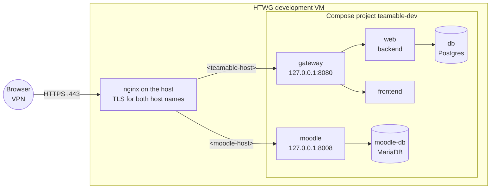

# Dev instance on the HTWG VM

!!! info "What this is about"
    This guide sets up a **development VM** of the HTWG computing center (Rechenzentrum, RZ). It runs the [dev stack](dev-stack.md): Teamable frontend, Teamable backend and an own Moodle 4.5 with test data, reachable via HTTPS under two fixed host names, only through the HTWG VPN.

    The VM is used to test the LTI launch and the student import on a server, to show Teamable to others and to try out Moodle versions (e.g. 5.3 for the RZ). It holds **test data only**. Running Teamable for the HTWG Moodle with real student data is a later step (section 11).

    **Code:** [`teamable-dev-stack`](https://github.com/Teamprojekt-MSI-BIT-SS26/teamable-dev-stack), plus checkouts of [`teamable-backend`](https://github.com/Teamprojekt-MSI-BIT-SS26/teamable-backend) and [`teamable-frontend`](https://github.com/Teamprojekt-MSI-BIT-SS26/teamable-frontend).

    **Assumptions:** Debian 13 on the VM, Docker Engine with the Compose plugin. Values in angle brackets such as `<teamable-host>` are placeholders.

    The earlier, detailed plan for production and staging is kept as [Production plan (draft)](production-plan.md).

---

## Prerequisite: Docker

The stack needs **Docker Engine with the Compose plugin** (Compose 2.17 or newer, because of `dockerfile_inline`). Install it from the official Docker repository as described in the Docker documentation:

- [Install Docker Engine on Debian](https://docs.docker.com/engine/install/debian/), method "Install using the `apt` repository"
- [Linux post-installation steps](https://docs.docker.com/engine/install/linux-postinstall/) (start on boot, use Docker without `sudo`)

Do not use the packages `docker.io`/`docker-compose` from Debian: they are older and come without the Compose plugin in the required version. Check the installation:

```bash
docker --version
docker compose version     # v2.17 or newer
sudo docker run --rm hello-world
```

Section 3 contains the settings for the VM that come on top of the installation (log size, group `docker`).

---

## 1. Overview



| | Address |
|---|---|
| Teamable | `https://<teamable-host>` |
| Moodle | `https://<moodle-host>` |

The host nginx terminates TLS and forwards each host name to its container port. Only the host nginx is reachable from outside. Everything else is the same as locally, including the path routing in the [gateway](dev-stack.md#the-gateway).

---

## 2. Request from the RZ

| What | Value |
|---|---|
| **DNS** | `<teamable-host>` and `<moodle-host>`, e.g. `teamable-dev.in.htwg-konstanz.de` and `moodle-dev.in.htwg-konstanz.de` (not fixed yet) |
| **Firewall** | 443 (HTTPS), 80 (HTTP, redirects to HTTPS), 22 (SSH) |
| **TLS certificate** | One certificate from the RZ for both host names (section 5.1) |

---

## 3. Prepare the VM

All commands run on the VM via SSH.

```bash
sudo apt-get update && sudo apt-get upgrade -y
sudo apt-get install -y ca-certificates curl git nginx openssl
```

Install Docker as described in the [prerequisites](#prerequisite-docker), then start it on boot:

```bash
sudo systemctl enable --now docker
```

Limit the size of the container logs, otherwise they grow until the disk is full:

```bash
sudo tee /etc/docker/daemon.json > /dev/null <<'EOF'
{
  "log-driver": "json-file",
  "log-opts": { "max-size": "10m", "max-file": "5" }
}
EOF
sudo systemctl restart docker
sudo usermod -aG docker "$USER"    # log in again afterwards
```

!!! warning
    Members of the group `docker` are effectively root on the VM. Only add team members who also have `sudo` rights.

`teamable-dev-stack` is private (backend and frontend are public). The VM gets read-only access to it via a **deploy key**. SSH goes over port 443 (`ssh.github.com`), so no outgoing port 22 is needed.

```bash
ssh-keygen -t ed25519 -N "" -C "htwg-vm teamable-dev-stack" -f ~/.ssh/deploy_teamable-dev-stack
cat ~/.ssh/deploy_teamable-dev-stack.pub
```

Add the public key on GitHub in `teamable-dev-stack`: *Settings → Deploy keys → Add deploy key*, without "Allow write access" (needs admin rights on the repository). Then add a host alias to `~/.ssh/config`:

```text
Host github-teamable-dev-stack
    HostName ssh.github.com
    Port 443
    User git
    IdentityFile ~/.ssh/deploy_teamable-dev-stack
    IdentitiesOnly yes
```

```bash
chmod 600 ~/.ssh/config
ssh -T github-teamable-dev-stack     # "Hi Teamprojekt-MSI-BIT-SS26/teamable-dev-stack! You've successfully authenticated..."
```

Clone the stack and the two application repositories:

```bash
sudo mkdir -p /opt/teamable
sudo chown "$USER":"$USER" /opt/teamable
git clone github-teamable-dev-stack:Teamprojekt-MSI-BIT-SS26/teamable-dev-stack.git /opt/teamable/teamable-dev-stack

cd /opt/teamable/teamable-dev-stack
git clone -b local-moodle-lti-nrps-import https://github.com/Teamprojekt-MSI-BIT-SS26/teamable-backend.git
git clone https://github.com/Teamprojekt-MSI-BIT-SS26/teamable-frontend.git
```

For the backend branch, see [dev stack](dev-stack.md), section 3.

---

## 4. `.env` for the VM

```bash
cd /opt/teamable/teamable-dev-stack
cp .env.example .env
chmod 600 .env
```

Change these values compared to `.env.example`:

```bash
COMPOSE_PROJECT_NAME=teamable-dev

# --- Addresses ---
TEAMABLE_HOST=<teamable-host>
TEAMABLE_URL=https://<teamable-host>
MOODLE_HOST=<moodle-host>
MOODLE_URL=https://<moodle-host>
MOODLE_SSLPROXY=true

# --- Backend ---
DEBUG=FALSE
SECRET_KEY=<random>

# --- Passwords ---
POSTGRES_PASSWORD=<random>
MOODLE_DB_ROOT_PASSWORD=<random>
MOODLE_DB_PASSWORD=<random>
```

Replace each `<random>` with its own value:

```bash
openssl rand -hex 32
```

- **URLs** without a trailing `/`. `MOODLE_URL` is also the LTI Platform ID; changing it later means a new Moodle installation or a changed `wwwroot`, a new tool registration and a new `lti_config_settings.json`.
- **`MOODLE_SSLPROXY=true`:** Moodle only sees HTTP from the host nginx and would otherwise build `http://` links and redirect in a loop.
- **`DEBUG=FALSE`:** Postgres instead of SQLite (data survives a rebuild), only `TEAMABLE_HOST` allowed, deployment ID checked. Django detects HTTPS via `X-Forwarded-Proto`, which the host nginx sets and the gateway passes on.
- **`SECRET_KEY`:** the backend still has a hard-coded key in `settings.py` and does not read the variable yet (section 11). Set it anyway, so that nothing has to change once it does.
- **Passwords:** Postgres and MariaDB only read them when their volume is created for the first time. Changing them later also needs a change in the database.

---

## 5. TLS and host nginx

### 5.1 Certificate from the RZ

Create a private key and a CSR for both host names on the VM and send only the CSR to the RZ:

```bash
sudo mkdir -p /etc/ssl/teamable && cd /etc/ssl/teamable
sudo openssl req -new -newkey rsa:3072 -nodes \
  -keyout teamable-dev.key -out teamable-dev.csr \
  -subj "/CN=<teamable-host>" \
  -addext "subjectAltName=DNS:<teamable-host>,DNS:<moodle-host>"
sudo chmod 600 teamable-dev.key
```

Store the returned certificate **including the intermediate chain** as `/etc/ssl/teamable/teamable-dev.fullchain.pem`. Note the expiry date: renewal is manual (new CSR or the same one, depending on the RZ).

The private key never leaves the VM and never goes into a repository.

### 5.2 nginx sites

The templates are in `teamable-dev-stack`. Copy them and set the two host names in the first lines; `sed` then replaces the placeholders `<teamable-host>` and `<moodle-host>` in the copy:

```bash
TEAMABLE_HOST=teamable-dev.in.htwg-konstanz.de   # your host names (section 2)
MOODLE_HOST=moodle-dev.in.htwg-konstanz.de

cd /opt/teamable/teamable-dev-stack
sudo cp teamable-proxy.conf /etc/nginx/snippets/teamable-proxy.conf
sudo cp host-nginx.conf /etc/nginx/sites-available/teamable-dev
sudo sed -i "s/<teamable-host>/$TEAMABLE_HOST/g; s/<moodle-host>/$MOODLE_HOST/g" \
  /etc/nginx/sites-available/teamable-dev

sudo ln -s /etc/nginx/sites-available/teamable-dev /etc/nginx/sites-enabled/
sudo rm -f /etc/nginx/sites-enabled/default
sudo nginx -t && sudo systemctl reload nginx
sudo systemctl enable nginx
```

`host-nginx.conf` redirects HTTP to HTTPS and has one HTTPS server per host name with the same certificate: `<teamable-host>` → `127.0.0.1:8080`, `<moodle-host>` → `127.0.0.1:8008`. The snippet sets `Host` and `X-Forwarded-Proto https`. `nginx -t` fails with `cannot load certificate` until the certificate from 5.1 exists.

`http2 on;` needs nginx 1.25.1 or newer (Debian 13 ships 1.26). On Debian 12, write `listen 443 ssl http2;` instead.

---

## 6. Start the stack

```bash
cd /opt/teamable/teamable-dev-stack
docker compose up -d --build
docker compose ps                 # all services "running"/"healthy"
docker compose logs -f web        # collectstatic, migrate, gunicorn "Booting worker"
```

The first build takes several minutes (frontend `yarn build`). Then create an admin account for Teamable:

```bash
docker compose exec web python manage.py createsuperuser
```

All services have `restart: unless-stopped` and Docker starts on boot, so the stack comes back after a reboot. `docker compose down` removes the containers; they only come back with the next `docker compose up -d`.

---

## 7. Moodle and LTI registration

1. Open `https://<moodle-host>` and run the installation wizard (admin account, site name). The database settings come from `moodle-config.php`.
2. Create the key pair **on the VM** in `teamable-backend/src`, register the tool in Moodle and write `lti_config_settings.json`, as in the [dev stack](dev-stack.md), section 6, with `https://<teamable-host>` and `https://<moodle-host>`. Use a separate key pair for the VM, not the one from your local stack.

    | Where | Field | Value |
    |---|---|---|
    | Moodle tool | Tool URL | `https://<teamable-host>/lti/launch/` |
    | Moodle tool | Initiate login URL | `https://<teamable-host>/lti/login/` |
    | Moodle tool | Redirection URI(s) | `https://<teamable-host>/lti/launch/` |
    | `lti_config_settings.json` | top-level key | `https://<moodle-host>` |
    | `lti_config_settings.json` | `auth_login_url` | `https://<moodle-host>/mod/lti/auth.php` |
    | `lti_config_settings.json` | `auth_token_url` | `https://<moodle-host>/mod/lti/token.php` |
    | `lti_config_settings.json` | `key_set_url` | `https://<moodle-host>/mod/lti/certs.php` |

3. Protect the key:

    ```bash
    chmod 700 teamable-backend/src/lti/config
    chmod 600 teamable-backend/src/lti/config/private.key
    ```

4. At `https://<teamable-host>/admin/` → *Organizations* → *Add*: LMS type **MOODLE**, LMS API URL `https://<moodle-host>`.
5. Test course and test students as in the [local setup](../../recherche/LMS-Anbindung/local-moodle-teamable-setup.md), sections 6 and 8. Never use real student data on this VM.

---

## 8. Checks

```bash
# from your own machine (VPN)
curl -I https://<teamable-host>/              # 200 or 3xx from the frontend, not 502
curl -I https://<teamable-host>/admin/login/  # 200 from the backend
curl -I https://<moodle-host>/                # 200 or 303 to the login page
curl -I http://<teamable-host>/               # 301 → https://

# certificate valid for both names, chain complete
for h in <teamable-host> <moodle-host>; do
  echo "== $h"; curl -vI "https://$h/" 2>&1 | grep -E "subject|issuer|expire|SSL certificate"
done
```

`curl` fails with `SSL certificate problem` or `no alternative certificate subject name matches` if the chain is incomplete or a host name is missing from the certificate.

```bash
# on the VM
cd /opt/teamable/teamable-dev-stack

# container ports only on 127.0.0.1
ss -tlnp | grep -E ':(8080|8008)\b'           # must show 127.0.0.1, not 0.0.0.0

# backend reaches Moodle via host-gateway and the host nginx
docker compose exec web python -c "import urllib.request; print(urllib.request.urlopen('https://<moodle-host>/mod/lti/certs.php').status)"
```

Then the end-to-end test: open the Teamable activity in the test course as a teacher, check that Teamable opens and that the student import shows the test students. Also check that the Django admin shows CSS (static files) and that the admin login works (no `403 CSRF`), and that Moodle under *Site administration → Notifications* shows no warning that cron has not run (`moodle-cron`, check with `docker compose logs moodle-cron`).

Once the backend has a health endpoint (section 11), `https://<teamable-host>/health/` is routed to it already.

---

## 9. Updates

### 9.1 System

Keep Debian up to date, including Docker and nginx:

```bash
sudo apt-get update && sudo apt-get upgrade -y
```

Security updates can be installed automatically:

```bash
sudo apt-get install -y unattended-upgrades
sudo dpkg-reconfigure -plow unattended-upgrades
```

By default, `unattended-upgrades` only installs updates from the Debian security repository. Docker comes from the Docker repository and is only updated by the manual `apt-get upgrade`. An update of Docker restarts the daemon; the containers come back on their own (`restart: unless-stopped`).

### 9.2 Application code

```bash
cd /opt/teamable/teamable-dev-stack
git -C teamable-backend pull
git -C teamable-frontend pull
docker compose up -d --build        # migrations run automatically on start
docker compose logs -f web
```

### 9.3 Stack files

```bash
cd /opt/teamable/teamable-dev-stack
git pull
diff .env.example .env              # new variables? add them to .env
docker compose up -d --build
```

If `host-nginx.conf` or `teamable-proxy.conf` changed, copy them again as in section 5.2.

### 9.4 Another Moodle version

The Moodle version is set via `MOODLE_IMAGE` in `.env`; `moodle` and `moodle-cron` both use it. Moodle can only be upgraded, not downgraded, and the upgrade changes the database. Alternatively, test a new version in a second Compose project with its own `COMPOSE_PROJECT_NAME`, ports and host names.

Back up database and `moodledata` first:

```bash
cd /opt/teamable/teamable-dev-stack
mkdir -p ~/moodle-backup

# database dump
docker compose exec -T moodle-db sh -c 'mariadb-dump -u root -p"$MARIADB_ROOT_PASSWORD" --single-transaction moodle' \
  | gzip > ~/moodle-backup/moodle-db-$(date +%F).sql.gz

# moodledata (one-off container with the same volumes as the moodle service)
docker compose run --rm --no-deps -v ~/moodle-backup:/backup --entrypoint tar moodle \
  czf /backup/moodledata-$(date +%F).tar.gz -C /var/www/moodledata .
```

Then upgrade:

```bash
# set the new MOODLE_IMAGE in .env, then
docker compose up -d moodle moodle-cron
docker compose exec -u www-data moodle php /var/www/html/admin/cli/upgrade.php --non-interactive
```

The upgrade can also be started in the browser: log in as admin, Moodle then shows the upgrade page. To go back, import the dump into an empty database, unpack the archive into the emptied `moodledata` volume and set the old `MOODLE_IMAGE` again.

Before switching to a new image, check:

- **Image:** whether `brandkern/moodle` offers a tag for the target version at all (e.g. 5.3). If not, another image is needed, and `docker-compose.yml` and `moodle-config.php` have to be adapted to it.
- **`moodle-config.php`:** it is mounted to `/var/www/html/config.php` and reads the variables `DB_*`, `WWWROOT` and `MOODLE_SSLPROXY`. Since Moodle 5.1, the web root is the subfolder `public/`, while `config.php` stays in the main folder. Check the path of the Moodle code in the new image, the mount target and the web server configuration of the image.

This is the environment for testing Teamable against Moodle 5.3 for the RZ.

### 9.5 Data

The VM only has test data, so there are no regular backups. Moodle (`moodledata`, `moodle-db-data`) and Teamable (`postgres-data`) live in Docker volumes of the project `teamable-dev`. `docker compose down -v` or a changed `COMPOSE_PROJECT_NAME` loses them or makes them invisible. `git clean -x` in `teamable-backend` deletes the LTI key pair.

---

## 10. Troubleshooting

Errors in the LTI launch and the Moodle registration: see the troubleshooting of the [dev stack](dev-stack.md#troubleshooting).

| Symptom | Cause / solution |
|---|---|
| `apt-get`, Docker installation, `docker compose build` or `git clone` hang until a timeout | Outgoing traffic is blocked by the RZ firewall. Ask the RZ to allow outgoing 80/443 and DNS (53) |
| `git clone` of `teamable-dev-stack`: `Permission denied (publickey)` or `Repository not found` | Deploy key missing in the repository or `~/.ssh/config` wrong (section 3). Test with `ssh -T github-teamable-dev-stack`. |
| SSH connection breaks or parts of the HTWG network are unreachable after Docker starts | Docker networks (`172.17.0.0/16` and following) overlap with addresses of the HTWG network or the VPN. Add `default-address-pools` to the existing `/etc/docker/daemon.json` from section 3 (e.g. `{"base": "10.200.0.0/16", "size": 24}`, choose a range the HTWG does not use), restart Docker and recreate the stack (`docker compose down && docker compose up -d`) |
| `502 Bad Gateway` from the host nginx | Stack not running (`docker compose ps`), `web`/`frontend` still starting, or ports in `host-nginx.conf` do not match `TEAMABLE_PORT`/`MOODLE_PORT` |
| `403 CSRF verification failed` | `X-Forwarded-Proto https` does not arrive: snippet not included in the host nginx, or `TEAMABLE_URL` is not `https://` |
| Moodle redirects to `http://`, redirect loop, or mixed content | `MOODLE_SSLPROXY` is not `true`, or `MOODLE_URL` is not `https://<moodle-host>` |
| Moodle: "Incorrect access detected, this server may be accessed only through … address" | Moodle was opened under another address than `MOODLE_URL` (other host name, `http://` instead of `https://`, or a port) |
| `web` cannot reach Moodle (`certs.php`, import) | Firewall on the VM (e.g. `ufw`) blocks connections from the Docker bridge to port 443 of the host. Allow 443 for the Docker networks. |
| LTI launch: `Permission denied` on `private.key` in `docker compose logs web` | The backend in the container runs as a user that cannot read the file after `chmod 600` (section 7). Use `chmod 644` on `private.key`, or give the file to the user the container runs as. |
| `nginx -t`: `cannot load certificate` | Certificate from section 5.1 not there yet, or wrong file name |
| Browser: certificate not valid for `<moodle-host>` | The certificate is missing the SAN for the second host name |
| `password authentication failed` / `Access denied` in the database logs | Password in `.env` differs from the one used when the volume was created (section 4) |
| Disk full | Docker build cache and old images: `docker system prune` (never with `--volumes`, that deletes the data) |

---

## 11. Later: production

Running Teamable for the HTWG Moodle with real student data is a separate step. The detailed, earlier plan is the [Production plan (draft)](production-plan.md); it uses a different container setup, but its code snippets and commands can be reused. In short:

- **Separate environment:** own VM (or at least its own Compose project), own host name. Do not mix test and real data.
- **Own Compose file without Moodle:** no `moodle`, `moodle-db` and `moodle-cron`; the backend talks to the HTWG Moodle.
- **Who must reach Teamable?** The frontend calls the API from the browser. If teachers open Teamable from Moodle at home without VPN, production has to be reachable from the internet, with the hardening below. Then Let's Encrypt is also possible.
- **Changes in `teamable-backend`** before real data:
    - merge the Moodle support into `master` with a linear migration history and deploy tags
    - `SECRET_KEY` from the environment instead of hard-coded in `settings.py`
    - remove the committed Postgres password (`db.env`) and the UBC API key from the code; both stay in the Git history and count as public
    - health endpoint `/health/` with a database check
    - `SESSION_COOKIE_SECURE`/`CSRF_COOKIE_SECURE`, switchable via an environment variable: set fixed whenever `DEBUG` is off, they break the local stack with `DEBUG=FALSE` over `http://` (the browser does not send the cookies, the admin login fails); then `manage.py check --deploy`
    - a `.dockerignore`, so that the image does not contain `src/lti/config/` with the private key
    - a supported Python version instead of 3.10
- **Operations:** daily Postgres dumps with a copy outside the VM, a tested restore, updates tested on the development VM first, monitoring of the health endpoint.
- **Backup of secrets:** `.env` and the LTI key pair, stored encrypted or in another protected place. Without the key pair, the tool has to be registered in Moodle again after losing the VM.
- **Data protection:** clarify the processing of student data (names, courses, teams) with the data protection officer of the HTWG before going live, e.g. entry in the record of processing activities and deletion periods.
- **Logs:** after the LTI launch the backend redirects to `/authenticate?token=…`. The token ends up in the access logs; treat them as confidential, or move the token out of the URL.
- **Moodle side:** the RZ registers the tool in the HTWG Moodle with the production URLs (same fields as in section 7).
