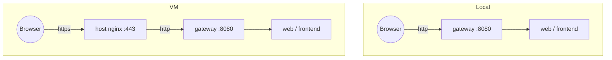

# Teamable dev stack

!!! info "What this is about"
    The dev stack runs Moodle 4.5, the Teamable backend and the Teamable frontend together in **one Docker Compose project**, with frontend and backend behind one [gateway](#the-gateway). It is used to test the LTI launch and the student import end to end.

    The **same stack** runs locally and on the [dev instance on the HTWG VM](backend-htwg-vm.md). Only the `.env` differs: locally plain HTTP on `*.localhost`, on the VM HTTPS via the host nginx.

    **Files:** repository [`teamable-dev-stack`](https://github.com/Teamprojekt-MSI-BIT-SS26/teamable-dev-stack) (private for now; access via the GitHub organization). This page explains them; it does not repeat them.

    **Tested on 2026-11-16 with:** `teamable-dev-stack` `0af8dd9`, backend branch `local-moodle-lti-nrps-import` (`7a5850d`), frontend `main` (`98ce1c8`), Moodle `v4.5.4`, Docker Desktop on macOS. Local with `DEBUG=TRUE` and `DEBUG=FALSE`: Moodle with the own `config.php`, `moodle-cron`, LTI launch and student import via NRPS work. Not tested yet: the VM.

    For a setup without Docker for backend and frontend, see [Local setup: Moodle + Teamable via LTI](../../recherche/LMS-Anbindung/local-moodle-teamable-setup.md). Moodle registration, test course and test students are the same there; this page only lists the differences.

## Overview

| Service | Local address | Notes |
| --- | --- | --- |
| Teamable (frontend + backend) | `http://teamable.localhost:8080` | one origin, path routing in the `gateway` container |
| Moodle 4.5 + MariaDB | `http://moodle.localhost:8008` | `WWWROOT` = LTI Platform ID |

Chrome and Firefox resolve every `*.localhost` name to `127.0.0.1` without any configuration. Other browsers may need entries in `/etc/hosts`. Both ports are only bound to `127.0.0.1`.

!!! warning "Use the host names everywhere"
    Always open Teamable as `teamable.localhost` and Moodle as `moodle.localhost`, never as `localhost` or `127.0.0.1`. Moodle only knows itself under `MOODLE_URL`, and with `DEBUG=FALSE` the backend only accepts `TEAMABLE_HOST`. The same names have to be used in the Moodle tool registration and in `lti_config_settings.json`.

## 1. Files

| File | Purpose |
| --- | --- |
| `docker-compose.yml` | Services `gateway`, `web` (backend), `db` (Postgres), `frontend`, `moodle`, `moodle-db` (MariaDB), `moodle-cron`. Host names and URLs come from `.env`. |
| `.env.example` | Template for `.env` with the local values |
| `gateway.conf.template` | Configuration of the `gateway` container ([see below](#the-gateway)) |
| `moodle-config.php` | Own `config.php` instead of the one the Moodle image generates: same database and `wwwroot` settings, plus `sslproxy` (needed behind HTTPS on the VM) |
| `host-nginx.conf`, `teamable-proxy.conf` | Only for the VM: templates for the host nginx ([VM guide](backend-htwg-vm.md), section 5) |
| `.gitignore` | Ignores `.env` and the two checkouts |

Points worth knowing:

- **Host names from `.env`:** `TEAMABLE_HOST`, `TEAMABLE_URL`, `MOODLE_HOST`, `MOODLE_URL`. The backend gets them as `SERVER_NAME` and `FRONTEND_BASE_URL`, the frontend as build args, Moodle as `WWWROOT`.
- **Frontend build args:** `next.config.js` writes `BACKEND_BASE_URI` into the client bundle at build time. After changing `TEAMABLE_URL`, rebuild the frontend (`docker compose build frontend`). `dockerfile_inline` needs Docker Compose 2.17 or newer.
- **Moodle image:** pinned to `brandkern/moodle:v4.5.4` (`MOODLE_IMAGE`). `moodle-cron` runs the scheduled tasks of Moodle with the same image and configuration.

## 2. The gateway {#the-gateway}

`gateway` is a plain `nginx:1.28` container with `gateway.conf.template` as its configuration. It is part of this stack, not of the backend or frontend repository. The stack only builds the `Dockerfile` of the backend and does not use its `docker-compose.yml` with its own nginx.

It puts frontend and backend behind **one origin**: backend paths (`/api/`, `/admin/`, `/lti/`, `/oauth/`, `/health/` once the backend has it) go to `web:8000`, `/static/` is served from the volume `backend-static` (CSS of the Django admin), everything else goes to `frontend:3000`. With one origin there is no CORS, and the redirect from the backend to the frontend after the LTI launch stays on the same host.

The backend prefixes are fixed in `gateway.conf.template`. A backend route with a new prefix (e.g. `/auth/…`) ends up in the frontend and gets a `404` from Next.js until the `location` for the backend is extended. The other way round, the frontend must not use pages under these prefixes.



On the VM, the host nginx only terminates TLS and picks the target by host name. The path routing happens in the gateway in both cases, which is why the same stack runs locally and on the VM. Moodle does not go through the gateway; it has its own port.

Headers the backend depends on:

- **`Host`** is `$http_host` (with port), so that the backend builds redirects and LTI URLs with `:8080` locally.
- **`X-Forwarded-Proto`** keeps the value from the host nginx (`https` on the VM) and only falls back to the own scheme if the header is missing (locally `http`). Django uses it to detect HTTPS for CSRF checks, redirects and the LTI launch.

## 3. Folder layout and checkouts

Clone `teamable-dev-stack` and the two application repositories into it (ignored by Git):

```text
teamable-dev-stack/
├── docker-compose.yml, gateway.conf.template, moodle-config.php, ...
├── .env                  # from .env.example, never commit
├── teamable-backend/     # git clone, branch local-moodle-lti-nrps-import
└── teamable-frontend/    # git clone, branch main
```

```bash
git clone https://github.com/Teamprojekt-MSI-BIT-SS26/teamable-dev-stack.git
cd teamable-dev-stack
git clone -b local-moodle-lti-nrps-import https://github.com/Teamprojekt-MSI-BIT-SS26/teamable-backend.git
git clone https://github.com/Teamprojekt-MSI-BIT-SS26/teamable-frontend.git
```

The backend branch `local-moodle-lti-nrps-import` is a spike branch with the Moodle support (LTI with standard claims, import via NRPS). Switch to `main`/`master` as soon as the Moodle support is merged there.

Existing checkouts elsewhere can be used instead of new clones, via `.env`:

```bash
BACKEND_DIR=../teamable-backend
FRONTEND_DIR=../teamable-frontend
```

The LTI configuration and the key pair live in the backend checkout (`src/lti/config/`, ignored by Git). With an existing checkout they are already in place; with a new clone, copy the folder over or create them again (section 6).

## 4. `.env`

```bash
cp .env.example .env
```

The values of `.env.example` work locally as they are. The most important switch is `DEBUG`:

| | `DEBUG=TRUE` | `DEBUG=FALSE` |
| --- | --- | --- |
| Database | SQLite **inside** the `web` container | Postgres in the volume `postgres-data` |
| Allowed host names | all | only `TEAMABLE_HOST` |
| LTI deployment ID | not checked | `deployment_ids` needed in the LTI config |
| Errors | detailed Django error page in the browser | plain `500`, details in `docker compose logs web` |

Switching `DEBUG` means switching the database: superuser and organization have to be created again in the other one (section 6), otherwise the launch fails with an `IntegrityError` (see troubleshooting).

!!! warning "`DEBUG=TRUE` loses data"
    With `DEBUG=TRUE`, superuser, organization, courses and imported students are gone as soon as `web` is recreated (`docker compose up --build`, `down`/`up`). For data that should survive, use `DEBUG=FALSE`.

The placeholder passwords are acceptable for a local stack that is only bound to `127.0.0.1`. They must never be used on the VM.

!!! tip "Keep the data of the old local stack"
    The previous version of this stack used the Compose project name `teamable-local`. To keep its volumes (Moodle installation, Postgres), set `COMPOSE_PROJECT_NAME=teamable-local` in `.env`. The new default `teamable-dev` starts with empty volumes.

## 5. Start

```bash
docker compose up -d --build
docker compose ps
```

The first build takes several minutes, mostly because of `yarn build` in the frontend.

1. Only on the first start (empty volume): install Moodle at `http://moodle.localhost:8008` (installation wizard, admin account), see the local setup, section 1. With an existing volume, skip this step.
2. Create a superuser for the Teamable admin (again after each switch of `DEBUG` and, with `DEBUG=TRUE`, after each recreation of `web`):

    ```bash
    docker compose exec web python manage.py createsuperuser
    ```

Check:

```bash
curl -I http://teamable.localhost:8080/admin/login/   # 200
curl -I http://moodle.localhost:8008/                 # 200 or 303
docker compose logs moodle-cron | tail -3             # "Cron run completed correctly"
```

Until Moodle is installed, `moodle-cron` logs errors; they stop after the installation.

## 6. Key pair, Moodle registration and LTI configuration

Create the key pair **on the host**, in `teamable-backend/src` (not inside the container, the folder is mounted read-only):

```bash
cd teamable-backend/src
mkdir -p lti/config
openssl genrsa -out lti/config/private.key 2048
openssl rsa -in lti/config/private.key -pubout -out lti/config/public.key
cat lti/config/public.key
```

Register the tool in Moodle as in the local setup, section 3. `<TEAMABLE_URL>` and `<MOODLE_URL>` are the values from `.env` (locally `http://teamable.localhost:8080` and `http://moodle.localhost:8008`):

| Field | Value |
| --- | --- |
| Tool URL | `<TEAMABLE_URL>/lti/launch/` |
| Initiate login URL | `<TEAMABLE_URL>/lti/login/` |
| Redirection URI(s) | `<TEAMABLE_URL>/lti/launch/` |
| Public key | complete content of `public.key`, including the `BEGIN`/`END` lines |

Tool URL and Redirection URI(s) must be identical, and the Initiate login URL must not be empty (see troubleshooting).

`teamable-backend/src/lti/config/lti_config_settings.json`, with Client ID and Deployment ID from *View configuration details* in Moodle:

```json
{
  "http://moodle.localhost:8008": [
    {
      "default": true,
      "client_id": "<CLIENT-ID>",
      "auth_login_url": "http://moodle.localhost:8008/mod/lti/auth.php",
      "auth_token_url": "http://moodle.localhost:8008/mod/lti/token.php",
      "key_set_url": "http://moodle.localhost:8008/mod/lti/certs.php",
      "key_set": null,
      "private_key_file": "private.key",
      "public_key_file": "public.key",
      "deployment_ids": ["<DEPLOYMENT-ID>"]
    }
  ]
}
```

The **top-level key** is the Platform ID and must be exactly `MOODLE_URL`, the value Moodle sends as `iss`. The file is read again on every launch; no restart is needed.

At `<TEAMABLE_URL>/admin/` → *Organizations* → *Add*: LMS type **MOODLE**, LMS API URL = `MOODLE_URL` (without a trailing `/`). The organization is required before the first launch, otherwise the launch fails with an `IntegrityError` (see troubleshooting).

Test course, test students and the test itself: local setup, sections 6 and 8.

## 7. How the containers reach each other

| From | To | How |
| --- | --- | --- |
| Browser | Teamable, Moodle | locally `*.localhost` → `127.0.0.1`, ports `8080`/`8008`; on the VM via the host nginx |
| `gateway` | `web`, `frontend` | Compose network (`web:8000`, `frontend:3000`) |
| `web` | Moodle (`certs.php` at launch, `token.php` and NRPS at import) | `MOODLE_HOST` → `host-gateway` |
| `frontend` (server side) | backend | `TEAMABLE_HOST` → `host-gateway` |
| `moodle` | tool URLs | `TEAMABLE_HOST` → `host-gateway` |

The backend calls Moodle under the Platform ID, not under the Compose service name, because the URLs come from the LTI configuration and the NRPS address that Moodle sends. Locally `host-gateway` leads to the published ports, on the VM to the host nginx on port 443.

!!! note "Docker Engine on Linux (local)"
    On Docker Desktop (macOS, Windows), `host-gateway` also reaches ports that are bound to `127.0.0.1` on the host. With Docker Engine on Linux, it does not. Locally on Linux, bind the ports to the Docker bridge as well, or put the containers into one network with the aliases `moodle.localhost`/`teamable.localhost` on `moodle`/`gateway`. On the VM this does not matter, because the host nginx listens on all interfaces.

## Troubleshooting

| Error | Cause and solution |
| --- | --- |
| Opening Teamable in Moodle reloads `mod/lti/launch.php` endlessly | **Initiate login URL** in the Moodle tool is empty. Moodle then generates a login form with `action=""` that posts back to itself. |
| `Exception: iss http://moodle.localhost:8008 not found in settings` | The **top-level key** of `lti_config_settings.json` is not exactly `MOODLE_URL` (e.g. still `http://localhost:8008`). Changing only the three URLs below it is not enough. |
| Moodle: "Invalid request" | Tool URL and Redirection URI(s) in Moodle are not identical, e.g. one of them still uses `localhost:8080`. Or the page was reloaded: start the activity again from the course. |
| `400 Bad Request` from the backend | Only with `DEBUG=FALSE`: the requested host name is not `TEAMABLE_HOST`, e.g. Teamable opened as `localhost:8080`, or the tool URLs in Moodle use `localhost`. With `DEBUG=TRUE` all host names are allowed. |
| LTI launch: `IntegrityError … NOT NULL constraint failed: app_course.organization_id` | No organization in Teamable whose LMS API URL is exactly `MOODLE_URL` (section 6). With `DEBUG=TRUE` this happens after every recreation of `web`, because the SQLite database is new. Create the organization, then start the launch again from the course. |
| Organization, superuser and students are gone | `DEBUG=TRUE` and `web` was recreated (section 4), or `COMPOSE_PROJECT_NAME` changed, so Compose uses other volumes. |
| Error when fetching `certs.php` or `token.php`, import times out | `web` cannot reach `MOODLE_HOST`. Check `extra_hosts` and the Linux note in section 7. |
| Frontend calls `localhost:8000` or an old address | Frontend image built without the current build args. `docker compose build frontend` after changing `TEAMABLE_URL`. |

For further errors, see the troubleshooting of the [local setup](../../recherche/LMS-Anbindung/local-moodle-teamable-setup.md#troubleshooting).
