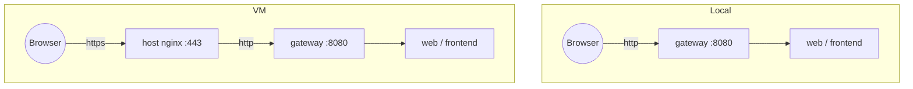

# Local setup with Docker

!!! info "What this is about"
    Runs Moodle 4.5, the Teamable backend and the Teamable frontend locally in **one Docker Compose project**, with frontend and backend behind one [gateway](#the-gateway). It is used for development and to test the LTI launch and the student import end to end.

    The **same stack** runs on the HTWG VM; only the `.env` differs (locally plain HTTP on `*.localhost`, on the VM HTTPS via the host nginx). This page only describes what is different locally and otherwise refers to [Set up the HTWG VM](vm-setup.md).

    **Files:** repository [`teamable-dev-stack`](https://github.com/Teamprojekt-MSI-BIT-SS26/teamable-dev-stack).

    For a setup without Docker for backend and frontend, see [Local setup: Moodle + Teamable via LTI](../../recherche/LMS-Anbindung/local-moodle-teamable-setup.md).

## Overview

| Service | Local address | Notes |
| --- | --- | --- |
| Teamable (frontend + backend) | `http://teamable.localhost:8080` | one origin, path routing in the `gateway` container |
| Moodle 4.5 + MariaDB | `http://moodle.localhost:8008` | `WWWROOT` = LTI Platform ID |

Chrome and Firefox resolve every `*.localhost` name to `127.0.0.1` without any configuration. Other browsers may need entries in `/etc/hosts`. Both ports are only bound to `127.0.0.1`.

!!! warning "Use the host names everywhere"
    Always open Teamable as `teamable.localhost:8080` and Moodle as `moodle.localhost:8008`, never as `localhost` or `127.0.0.1`. Moodle only knows itself under `MOODLE_URL`, and with `DEBUG=FALSE` the backend only accepts `TEAMABLE_HOST`. The same names have to be used in the Moodle tool registration and in `lti_config_settings.json`.

## 1. Requirements

- Docker Desktop (macOS, Windows) or Docker Engine with the Compose plugin (Linux), Compose 2.17 or newer. On Linux, read the note in [section 6.3](#63-how-the-containers-reach-each-other) first.
- `git` and `openssl`

## 2. Clone the repositories

Clone `teamable-dev-stack` and the two application repositories into it (ignored by Git):

```bash
git clone https://github.com/Teamprojekt-MSI-BIT-SS26/teamable-dev-stack.git
cd teamable-dev-stack
git clone -b local-moodle-lti-nrps-import https://github.com/Teamprojekt-MSI-BIT-SS26/teamable-backend.git
git clone https://github.com/Teamprojekt-MSI-BIT-SS26/teamable-frontend.git
```

```text
teamable-dev-stack/
├── docker-compose.yml, gateway.conf.template, moodle-config.php, ...
├── .env                  # from .env.example, never commit
├── teamable-backend/     # branch local-moodle-lti-nrps-import
└── teamable-frontend/    # branch main
```

The backend branch `local-moodle-lti-nrps-import` is a spike branch with the Moodle support (LTI with standard claims, import via NRPS). Since 2026-11-18, `master` also has Moodle support, but it generates teams via the separate algorithms API, which the stack does not contain yet. Until the stack is switched, use the spike branch.

Existing checkouts elsewhere can be used instead of new clones, via `.env`:

```bash
BACKEND_DIR=../teamable-backend
FRONTEND_DIR=../teamable-frontend
```

## 3. `.env`

```bash
cp .env.example .env
```

The values of `.env.example` work locally as they are. The most important switch is `DEBUG`:

| | `DEBUG=TRUE` (default) | `DEBUG=FALSE` |
| --- | --- | --- |
| Database | SQLite **inside** the `web` container | Postgres in the volume `postgres-data` |
| Allowed host names | all | only `TEAMABLE_HOST` |
| LTI deployment ID | not checked | `deployment_ids` needed in the LTI config |
| Errors | detailed Django error page in the browser | plain `500`, details in `docker compose logs web` |

Switching `DEBUG` means switching the database: superuser and organization have to be created again in the other one (sections 4 and 5), otherwise the launch fails with an `IntegrityError`.

!!! warning "`DEBUG=TRUE` loses data"
    With `DEBUG=TRUE`, superuser, organization, courses and imported students are gone as soon as `web` is recreated (`docker compose up --build`, `down`/`up`). For data that should survive, use `DEBUG=FALSE`.

The placeholder passwords are acceptable for a local stack that is only bound to `127.0.0.1`. On the VM, they are replaced ([VM setup, section 4](vm-setup.md#4-env)).

!!! tip "Keep the data of the old local stack"
    The previous version of this stack used the Compose project name `teamable-local`. To keep its volumes (Moodle installation, Postgres), set `COMPOSE_PROJECT_NAME=teamable-local` in `.env`. The default `teamable-dev` starts with empty volumes.

## 4. Key pair and start

Create the LTI key pair **before** the first start, as in [VM setup, section 7](vm-setup.md#7-lti-key-pair), in `teamable-backend/src` of your checkout. An existing checkout may already have it in `src/lti/config/` (ignored by Git).

```bash
docker compose up -d --build
docker compose ps
docker compose exec web python manage.py createsuperuser
```

The first build takes several minutes, mostly because of `yarn build` in the frontend. Create the superuser again after each switch of `DEBUG` and, with `DEBUG=TRUE`, after each recreation of `web`.

Check:

```bash
curl -I http://teamable.localhost:8080/admin/login/   # 200
curl -I http://moodle.localhost:8008/                 # 200 or 303
```

## 5. Moodle, LTI registration and test data

Follow [VM setup](vm-setup.md), sections 9 to 13, with the local values:

| VM setup | Local value |
| --- | --- |
| Moodle address (9) | `http://moodle.localhost:8008` |
| Tool URL and Redirection URI(s) (10) | `http://teamable.localhost:8080/lti/launch/` |
| Initiate login URL (10) | `http://teamable.localhost:8080/lti/login/` |
| Top-level key in `lti_config_settings.json` (11) | `http://moodle.localhost:8008`; the three Moodle URLs below it start with the same prefix |
| LMS API URL of the organization (12.1) | `http://moodle.localhost:8008` |
| Teamable admin (12.1) | `http://teamable.localhost:8080/admin/` |
| Folder in the commands | your checkout of `teamable-dev-stack` instead of `/opt/teamable/teamable-dev-stack` |

Differences to the VM:

- **`http://` and the port** belong to the URLs. The rule "no port" from section 10 only applies to the VM; locally the URLs must match `TEAMABLE_URL` and `MOODLE_URL` in `.env` exactly.
- **No certificate:** no warning in the browser; `MOODLE_SSLPROXY` stays `false`.
- **Moodle installation** (9) only on the first start with an empty volume.
- **`DEBUG=TRUE`:** `deployment_ids` is not checked, and the organization (12.1) has to be created again after each recreation of `web`.

## 6. How the stack works

### 6.1 Files

| File | Purpose |
| --- | --- |
| `docker-compose.yml` | Services `gateway`, `web` (backend), `db` (Postgres), `frontend`, `moodle`, `moodle-db` (MariaDB), `moodle-cron`. Host names and URLs come from `.env`. |
| `.env.example` | Template for `.env` with the local values |
| `gateway.conf.template` | Configuration of the `gateway` container ([section 6.2](#the-gateway)) |
| `moodle-config.php` | Own `config.php` instead of the one the Moodle image generates: same database and `wwwroot` settings, plus `sslproxy` (needed behind HTTPS on the VM) |
| `host-nginx.conf`, `teamable-proxy.conf` | Only for the VM: templates for the host nginx ([VM setup, section 6](vm-setup.md#6-host-nginx)) |
| `.gitignore` | Ignores `.env`, `docker-compose.override.yml` and the two checkouts |
| `README.md` | Short start and links to this documentation |

Points worth knowing:

- **Host names from `.env`:** `TEAMABLE_HOST`, `TEAMABLE_URL`, `MOODLE_HOST`, `MOODLE_URL`. The backend gets them as `SERVER_NAME` and `FRONTEND_BASE_URL`, the frontend as build args, Moodle as `WWWROOT`.
- **Frontend build args:** `next.config.js` writes `BACKEND_BASE_URI` into the client bundle at build time. After changing `TEAMABLE_URL`, rebuild the frontend (`docker compose build frontend`). `dockerfile_inline` needs Docker Compose 2.17 or newer.
- **Moodle image:** pinned to `brandkern/moodle:v4.5.4` (`MOODLE_IMAGE`). `moodle-cron` runs the scheduled tasks of Moodle with the same image and configuration.
- **LTI configuration:** `teamable-backend/src/lti/config/` is mounted read-only into `web`. Create or edit the files on the host, not inside the container.

### 6.2 The gateway {#the-gateway}

`gateway` is a plain `nginx:1.28` container with `gateway.conf.template` as its configuration. It is part of this stack, not of the backend or frontend repository. The stack only builds the `Dockerfile` of the backend and does not use its `docker-compose.yml` with its own nginx.

It puts frontend and backend behind **one origin**: backend paths (`/api/`, `/admin/`, `/lti/`, `/oauth/`) go to `web:8000`, `/static/` is served from the volume `backend-static` (CSS of the Django admin), everything else goes to `frontend:3000`. With one origin there is no CORS, and the redirect from the backend to the frontend after the LTI launch stays on the same host.

The backend prefixes are fixed in `gateway.conf.template`. A backend route with a new prefix (e.g. `/auth/…`) ends up in the frontend and gets a `404` from Next.js until the `location` for the backend is extended. The other way round, the frontend must not use pages under these prefixes.



On the VM, the host nginx only terminates TLS and picks the target by host name. The path routing happens in the gateway in both cases, which is why the same stack runs locally and on the VM. Moodle does not go through the gateway; it has its own port.

Headers the backend depends on:

- **`Host`** is `$http_host` (with port), so that the backend builds redirects and LTI URLs with `:8080` locally.
- **`X-Forwarded-Proto`** keeps the value from the host nginx (`https` on the VM) and only falls back to the own scheme if the header is missing (locally `http`). Django uses it to detect HTTPS for CSRF checks, redirects and the LTI launch.

### 6.3 How the containers reach each other

| From | To | How |
| --- | --- | --- |
| Browser | Teamable, Moodle | locally `*.localhost` → `127.0.0.1`, ports `8080`/`8008`; on the VM via the host nginx |
| `gateway` | `web`, `frontend` | Compose network (`web:8000`, `frontend:3000`) |
| `web` | Moodle (`certs.php` at launch, `token.php` and NRPS at import) | `MOODLE_HOST` → `host-gateway` |
| `frontend` (server side) | backend | `TEAMABLE_HOST` → `host-gateway` |
| `moodle` | tool URLs | `TEAMABLE_HOST` → `host-gateway` |

The backend calls Moodle under the Platform ID, not under the Compose service name, because the URLs come from the LTI configuration and the NRPS address that Moodle sends. Locally `host-gateway` leads to the published ports, on the VM to the host nginx on port 443.

!!! note "Docker Engine on Linux (local)"
    On Docker Desktop (macOS, Windows), `host-gateway` also reaches ports that are bound to `127.0.0.1` on the host. With Docker Engine on Linux, it does not. Locally on Linux, bind the ports to the Docker bridge as well, or put the containers into one network with the aliases `moodle.localhost`/`teamable.localhost` on `moodle`/`gateway`. On the VM this does not matter, because the host nginx listens on all interfaces.

## Troubleshooting

Errors that are specific to the local stack. Errors in the LTI launch, the registration and the import: [VM setup, section 13](vm-setup.md#13-test) and [troubleshooting](vm-setup.md#troubleshooting).

| Error | Cause and solution |
| --- | --- |
| `Exception: iss http://moodle.localhost:8008 not found in settings` | The **top-level key** of `lti_config_settings.json` is not exactly `MOODLE_URL` (e.g. still `http://localhost:8008`). Changing only the three URLs below it is not enough. |
| Moodle: "Invalid request" | Tool URL and Redirection URI(s) in Moodle are not identical, e.g. one of them still uses `localhost:8080`. Or the page was reloaded: start the activity again from the course. |
| `400 Bad Request` from the backend | Only with `DEBUG=FALSE`: the requested host name is not `TEAMABLE_HOST`, e.g. Teamable opened as `localhost:8080`, or the tool URLs in Moodle use `localhost`. With `DEBUG=TRUE` all host names are allowed. |
| LTI launch: `IntegrityError … NOT NULL constraint failed: app_course.organization_id` | No organization whose LMS API URL is exactly `MOODLE_URL`. With `DEBUG=TRUE` this happens after every recreation of `web`, because the SQLite database is new. Create the organization (section 5), then start the launch again from the course. |
| Organization, superuser and students are gone | `DEBUG=TRUE` and `web` was recreated (section 3), or `COMPOSE_PROJECT_NAME` changed, so Compose uses other volumes. |
| Error when fetching `certs.php` or `token.php`, import times out | `web` cannot reach `MOODLE_HOST`. On Linux, see the note in section 6.3. |
| Frontend calls `localhost:8000` or an old address | Frontend image built without the current build args. `docker compose build frontend` after changing `TEAMABLE_URL`. |

For setups without Docker, see the troubleshooting of the [local setup](../../recherche/LMS-Anbindung/local-moodle-teamable-setup.md#troubleshooting).
