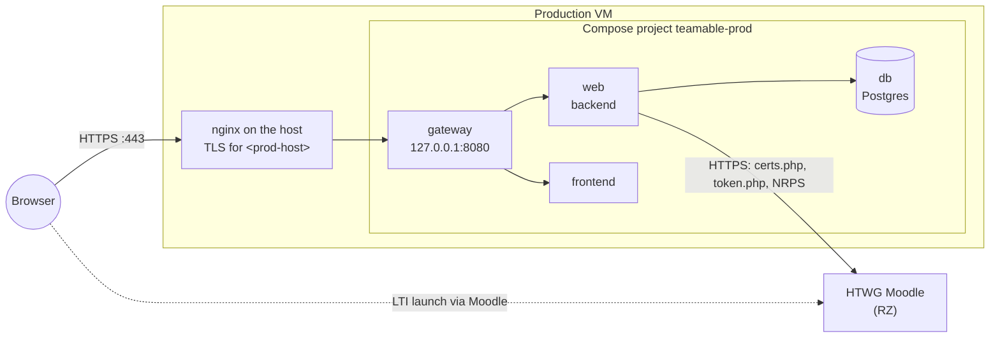

# Production plan (draft)

!!! warning "Draft, not implemented"
    This page plans running Teamable **in production**: frontend and backend for the HTWG Moodle, with real student data. Nothing of it is implemented yet. It builds on the [dev instance on the HTWG VM](vm-setup.md), which runs since November 2026, and only describes what is different in production. Open decisions are listed in section 2.

    An earlier version of this plan used the `docker-compose.yml` of the backend repository with its own nginx, path routing in the host nginx, Debian 13 and staging on the production VM. It is in the Git history of this page.

!!! info "What this is about"
    Production uses the same setup as the dev VM: one Docker Compose project with `gateway`, `web`, `db` and `frontend` behind nginx on the host, which terminates TLS. The differences: the backend talks to the HTWG Moodle, a tagged backend version, backups and stricter settings. Whether production keeps an own Moodle for testing is still open (section 2).

    **Not the GPU server:** the backend does **not** run on the GPU cluster of the Institute for Optical Systems, which hosts the AI model (see "AI Model Deployment on the HTWG Server"). Team generation runs inside the backend (`src/app/services/team_generation.py` calls no external API). If this changes, outgoing traffic from the VM to the GPU server has to be requested from the RZ.

    **Code:** [`teamable-dev-stack`](https://github.com/Teamprojekt-MSI-BIT-SS26/teamable-dev-stack), [`teamable-backend`](https://github.com/Teamprojekt-MSI-BIT-SS26/teamable-backend), [`teamable-frontend`](https://github.com/Teamprojekt-MSI-BIT-SS26/teamable-frontend). `<prod-host>` and `<htwg-moodle-url>` are placeholders.

---

## 1. Target architecture



The gateway does the path routing as on the dev VM ([local setup with Docker](dev-stack.md#the-gateway)): backend paths to `web`, everything else to `frontend`, one origin, no CORS.

| | Dev VM | Production |
|---|---|---|
| VM | `teamable-analytics.in.htwg-konstanz.de` | own VM (section 2) |
| Compose file | `docker-compose.yml` of `teamable-dev-stack` | own file without Moodle (section 4.2), if production has no own Moodle |
| Moodle | own Moodle 4.5 in the stack, test data | HTWG Moodle (4.5.14), operated by the RZ; an own test Moodle is open (section 2) |
| Host names | two (Teamable, Moodle) | `<prod-host>`, more if production keeps an own Moodle |
| Backend code | spike branch `local-moodle-lti-nrps-import` | tag on `master` (section 4.1) |
| Certificate | RZ, temporarily self-signed | RZ or Let's Encrypt (section 2), never self-signed for users |
| Reachability | VPN only | open (section 2) |
| Backups | none | daily, with a copy outside the VM (section 6.2) |

New versions are tested on the dev VM first, then deployed to production. The dev VM therefore takes the role that staging had in the earlier plan.

---

## 2. Open decisions

!!! warning "Who must reach Teamable?"
    The frontend calls the API **from the user's browser**. If production is only reachable via VPN, Teamable does not work for teachers who open it from Moodle at home without VPN, although Moodle itself is reachable from the internet.

    - **Internet:** works everywhere like Moodle. The backend is publicly exposed, so all changes in section 4.1 are mandatory. Let's Encrypt becomes possible.
    - **VPN only:** smaller attack surface, users need the VPN. Certificate from the RZ, as on the dev VM.

    The dev VM is only reachable via VPN (RZ firewall, inbound 22/80/443).

| Decision | Options | Proposal |
|---|---|---|
| Reachability | internet / VPN only | team decision, see above |
| VM | own VM / second Compose project on the dev VM | **own VM**: experiments and Moodle upgrades on the dev VM must not affect real student data |
| Own Moodle for testing | none, tests on the dev VM / second Compose project with Teamable and Moodle (dev stack) on the production VM / Moodle in the production project, one Teamable for both Moodles | open; the dev VM has an own Moodle so that the team can test everything now. With Moodle in the production project, test and real data share one database |
| Production Compose file | `docker-compose.prod.yml` in `teamable-dev-stack` / own repository | **`docker-compose.prod.yml` in `teamable-dev-stack`**: same gateway, same templates; maybe rename the repository to `teamable-stack` |
| Backend branch for `master` | one of the Moodle branches (section 4.1) | the branch that runs on the dev VM (`local-moodle-lti-nrps-import`) |

---

## 3. Request from the RZ

The same process as for the dev VM. Its request (VM, DNS, firewall, certificate from the RZ) worked; outgoing traffic was already allowed.

| What | Details |
|---|---|
| **VM** | Ubuntu 26.04 LTS like the dev VM, 2 vCPU, 4 GB RAM (the frontend build needs it), 40 GB disk, SSH and `sudo` for the team members |
| **DNS** | one name, `<prod-host>`, forward and reverse |
| **Firewall inbound** | 443 (HTTPS), 80 (redirect, and Let's Encrypt if used), from the internet or the VPN depending on section 2. 22 (SSH) from the VPN only |
| **Firewall outbound** | HTTPS to the HTWG Moodle (LTI and student import), to Docker Hub, GitHub, the npm registry and PyPI (builds), DNS |
| **TLS certificate** | for `<prod-host>`, from the RZ as on the dev VM ([VM setup, 5.1](vm-setup.md#51-certificates-from-the-rz)), or Let's Encrypt if reachable from the internet |
| **Backup storage** | a place outside the VM for the database dumps (section 6.2), e.g. a network share or the RZ backup system |
| **Moodle** | tool registration in the HTWG Moodle with the production URLs (section 5.3) |

Processing times at the RZ are long: send the request as soon as section 2 is decided.

---

## 4. Required changes before go-live

### 4.1 `teamable-backend`

These changes belong in the backend repository (separate PRs). Deploy a **tag** that contains all of them.

**Moodle support on `master`.** On `master`, the LTI launch only supports Canvas (`src/lti/views.py` requires `canvas_course_id`/`canvas_user_id`). The Moodle support (standard claims, import via NRPS) only exists on unmerged branches:

- `52-technical-task-33-moodle-module-lti-standard-fields-integration-in-backend`
- `local-backend-instance-moodle-lti`
- `local-moodle-lti-nrps-import` (runs on the dev VM)

They overlap and contain conflicting migrations (`0009_*`). Merge one into `master` with a linear migration history. Migrations must not be renumbered after the first production deployment.

**`SECRET_KEY` from the environment.** `src/teamable/settings.py` contains a hard-coded key, used for sessions, CSRF and the sign-up JWTs (`CourseMember.create_jwt_token`). Everyone who knows the repository can forge them. The stack already passes `SECRET_KEY` from `.env`; the backend has to read it. Place the code after the definition of `DEBUG`:

```python
# src/teamable/settings.py
SECRET_KEY = os.environ.get("SECRET_KEY") or (
    "django-insecure-local-only" if DEBUG else None
)
if not SECRET_KEY:
    raise RuntimeError("SECRET_KEY must be set when DEBUG is not TRUE")
```

**Credentials in the repository.** `db.env` contains a Postgres password, and `src/app/services/team_generation.py` a commented-out UBC API key. Remove both (`git mv db.env db.env.sample`, `db.env` into `.gitignore`). They stay in the Git history and count as public; inform the owner of the UBC API if the key is still valid. The stack does not use `db.env`; production gets its own random password in `.env`.

**Secure cookies, switchable.** Session and CSRF cookies are also sent over HTTP. Setting them fixed whenever `DEBUG` is off breaks the local stack with `DEBUG=FALSE` over `http://` (the browser does not send the cookies back, the admin login fails). Proposal:

```python
# src/teamable/settings.py, after DEBUG
SECURE_COOKIES = os.environ.get("SECURE_COOKIES", "FALSE" if DEBUG else "TRUE") == "TRUE"
SESSION_COOKIE_SECURE = SECURE_COOKIES
CSRF_COOKIE_SECURE = SECURE_COOKIES
```

The local `.env.example` of the stack then gets `SECURE_COOKIES=FALSE`. Afterwards check with `python manage.py check --deploy` (section 5.4).

**`.dockerignore`.** The `Dockerfile` copies `src/` into the image, including `src/lti/config/` with the private key. The stack mounts the folder at runtime, so it does not belong in the image:

```text
# .dockerignore
src/lti/config/
src/db.sqlite3
src/debug.log
.env*
db.env
srv/
logs/
staticfiles/
```

**Python version.** The `Dockerfile` uses `python:3.10.12`, end of life since October 2026. Updating (e.g. `python:3.13-slim`) needs a test of all dependencies.

**Auth token in the URL.** After the LTI launch, the backend redirects to `/authenticate?token=…`. The token ends up in the access logs of the host nginx and the gateway (section 6.4). Moving it out of the URL is a change in backend and frontend; not a blocker, but worth doing.

The `docker-compose.yml` of the backend repository (`privileged: true`, port `8002` on all interfaces, `latest` images) is not used by the stack. It needs no change for production, but must not be used on a server.

### 4.2 `teamable-dev-stack`: Compose file for production

Depends on the decision about an own Moodle (section 2). Without Moodle in the production project: `docker-compose.prod.yml`, derived from `docker-compose.yml`:

- remove the services `moodle`, `moodle-db` and `moodle-cron` and their volumes `moodle-db-data` and `moodledata`
- remove `extra_hosts` from `web`: on the dev VM it sends `MOODLE_HOST` to the host nginx; in production `web` must reach the real HTWG Moodle via DNS
- keep `extra_hosts` of `frontend` (`TEAMABLE_HOST` → `host-gateway`), so that server-side requests of Next.js reach the host nginx
- default project name `teamable-prod` instead of `teamable-dev`

`.env` selects the file with `COMPOSE_FILE=docker-compose.prod.yml`; then every `docker compose` command uses it without `-f`. Also add `docker-compose.override.yml` to `.gitignore` (VM setup, section 8.1).

Test the file before go-live. How is still open: on the production VM against a test course in the HTWG Moodle, or on the dev VM in a second Compose project (own `COMPOSE_PROJECT_NAME`, `TEAMABLE_PORT` and host name) against its Moodle.

---

## 5. Setup on the VM

Follow the [VM setup](vm-setup.md) with these differences.

### 5.1 Prepare the VM (VM setup, sections 1 to 3)

Same steps. Clone the backend at the release tag instead of the spike branch:

```bash
cd /opt/teamable/teamable-dev-stack
git clone https://github.com/Teamprojekt-MSI-BIT-SS26/teamable-backend.git
git -C teamable-backend checkout <tag>
git clone https://github.com/Teamprojekt-MSI-BIT-SS26/teamable-frontend.git
git -C teamable-frontend checkout <tag>
```

### 5.2 `.env` (VM setup, section 4)

```bash
COMPOSE_PROJECT_NAME=teamable-prod
COMPOSE_FILE=docker-compose.prod.yml

TEAMABLE_HOST=<prod-host>
TEAMABLE_URL=https://<prod-host>

DEBUG=FALSE
SECRET_KEY=<random>            # read by the backend after section 4.1
POSTGRES_PASSWORD=<random>
```

No `MOODLE_*` variables. New random values, never the ones of the dev VM.

### 5.3 TLS, host nginx and LTI (VM setup, sections 5 to 7, 10 and 11)

- **Certificate:** one certificate from the RZ for `<prod-host>`. A temporary self-signed certificate is acceptable during the setup, but go live only with the real one. Section 8.1 of the VM setup (CA bundle for `web`) is not needed: the HTWG Moodle has a publicly trusted certificate.
- **Host nginx:** only the Teamable `server` block of `host-nginx.conf` (and the HTTP redirect for `<prod-host>`). Once the real certificate is in place, add HSTS: `add_header Strict-Transport-Security "max-age=31536000" always;`.
- **LTI:** own key pair on the VM. The RZ registers the tool in the HTWG Moodle with `https://<prod-host>/lti/launch/` (Tool URL and Redirection URI, identical) and `https://<prod-host>/lti/login/` (Initiate login URL). The top-level key of `lti_config_settings.json` is exactly the Platform ID of the HTWG Moodle (`<htwg-moodle-url>`), `client_id` and `deployment_ids` come from the RZ.
- **Organization** in the Teamable admin: LMS type `MOODLE`, LMS API URL = `<htwg-moodle-url>`.

### 5.4 Checks (VM setup, sections 8, 13 and 15.1)

In addition to the checks of the VM setup:

```bash
# on the VM
cd /opt/teamable/teamable-dev-stack
docker compose exec web python manage.py check --deploy
docker compose exec web python -c "import requests; print(requests.get('<htwg-moodle-url>/mod/lti/certs.php').status_code)"   # 200
```

`check --deploy` may warn about `SECURE_SSL_REDIRECT` and `SECURE_HSTS_SECONDS`; the host nginx redirects to HTTPS and sets HSTS. Then the end-to-end test in a test course of the HTWG Moodle, with a teacher account and a few students that agreed to it.

---

## 6. Operations

### 6.1 Updates

Deploy a new tag to the dev VM first, then to production. Create a backup before (section 6.2):

```bash
cd /opt/teamable/teamable-dev-stack
git -C teamable-backend fetch --tags && git -C teamable-backend checkout <new-tag>
git -C teamable-frontend fetch --tags && git -C teamable-frontend checkout <new-tag>
docker compose up -d --build        # migrations run automatically on start
docker compose logs -f web
```

**Rollback:** check out the previous tags and rebuild. If the new version has run migrations, the old code may not work with the new schema; then restore the backup from before the update.

System updates (Ubuntu, Docker, nginx): as on the dev VM (VM setup, section 15.2).

### 6.2 Backup and restore

Postgres lives in the Docker volume `postgres-data` of the project `teamable-prod`. Daily dump at 03:00, kept 14 days:

```bash
sudo mkdir -p /var/backups/teamable
sudo chown "$USER":"$USER" /var/backups/teamable
chmod 700 /var/backups/teamable
crontab -e
```

```cron
0 3 * * * cd /opt/teamable/teamable-dev-stack && docker compose exec -T db sh -c 'pg_dump -U "$POSTGRES_USER" "$POSTGRES_DB"' | gzip > /var/backups/teamable/teamable-$(date +\%F).sql.gz && find /var/backups/teamable -name '*.sql.gz' -mtime +14 -delete
```

Copy the dumps regularly to the backup storage outside the VM (section 3). They contain personal data of students and have to be protected like the database.

Restore:

```bash
cd /opt/teamable/teamable-dev-stack
docker compose stop web
docker compose exec -T db sh -c 'dropdb -U "$POSTGRES_USER" --if-exists "$POSTGRES_DB" && createdb -U "$POSTGRES_USER" "$POSTGRES_DB"'
gunzip -c /var/backups/teamable/<file>.sql.gz \
  | docker compose exec -T db sh -c 'psql -U "$POSTGRES_USER" -d "$POSTGRES_DB"'
docker compose start web
```

Test the restore once after the first deployment, on the production VM in a second Compose project, and delete it afterwards. Not on the dev VM: it is meant for test data only.

Also keep `.env` and the LTI key pair (`teamable-backend/src/lti/config/`) encrypted in a protected place. Without the key pair, the tool has to be registered in the HTWG Moodle again after losing the VM.

`docker compose down -v`, a changed `COMPOSE_PROJECT_NAME` or `git clean -x` in `teamable-backend` lose the database or the key pair (VM setup, section 15.6).

### 6.3 Monitoring

- expiry date of the certificate; renewal of an RZ certificate is manual
- free disk space (Docker build cache: `docker system prune`, never with `--volumes`)

### 6.4 Logs

Container logs are limited by `/etc/docker/daemon.json` (VM setup, section 2). The access logs of the host nginx (`/var/log/nginx/`) and of the gateway (`docker compose logs gateway`) contain the auth token after the LTI launch (section 4.1); treat them as confidential.

---

## 7. Go-live checklist

| Criterion | Where |
|---|---|
| Reachability decided, RZ request done | sections 2 and 3 |
| Backend tag with all changes from 4.1 | section 4.1 |
| `docker-compose.prod.yml` tested | section 4.2 |
| HTTPS with a trusted certificate, HSTS | section 5.3, check 5.4 |
| `check --deploy` without relevant warnings | check 5.4 |
| No credentials in the repositories or images | section 4.1 (`SECRET_KEY`, `db.env`, UBC key, `.dockerignore`) |
| Auto-restart after a reboot | `restart: unless-stopped` and Docker on boot (VM setup, section 2) |
| Daily backup with a copy outside the VM, restore tested | section 6.2 |
| `.env` and LTI key pair backed up | section 6.2 |
| Tool registered in the HTWG Moodle, end-to-end test passed | sections 5.3 and 5.4 |
| Data protection clarified with the data protection officer of the HTWG (record of processing activities, deletion periods for names, courses, teams) | before go-live |

---

## 8. Troubleshooting

Errors that only occur in production. For everything else, see the troubleshooting of the [VM setup](vm-setup.md#troubleshooting) and the [local setup with Docker](dev-stack.md#troubleshooting).

| Symptom | Cause / solution |
|---|---|
| `RuntimeError: SECRET_KEY must be set` | `SECRET_KEY` missing in `.env` (section 4.1) |
| `Missing canvas_course_id/canvas_user_id custom claims` | deployed backend has no Moodle support (section 4.1) |
| `iss … not found in settings` | top-level key of `lti_config_settings.json` is not exactly the Platform ID of the HTWG Moodle |
| `certs.php`, `token.php` or the import time out | the VM may not reach the HTWG Moodle (outbound firewall, section 3), or `web` still has the `extra_hosts` entry of the dev stack (section 4.2) |
| Admin login fails without an error, CSRF cookie missing | `SECURE_COOKIES` active, but the page was opened over `http://` |
| `docker compose ps` shows Moodle services | `COMPOSE_FILE=docker-compose.prod.yml` missing in `.env` |
