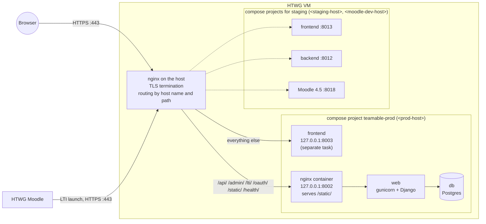

# Production plan (draft)

!!! warning "Draft, not implemented"
    This page is the earlier plan for running Teamable **in production** on an HTWG VM. It has not been implemented. The current setup is the [development VM](backend-htwg-vm.md) with the [dev stack](dev-stack.md); its section 11 summarizes what production still needs.

    Differences to the current setup:

    - The backend runs with the `docker-compose.yml` of the backend repository (with its own container nginx), not with `teamable-dev-stack`. There is no gateway; the host nginx does the path routing.
    - Production and staging run side by side on one or two VMs. The current plan has one development VM instead of staging.
    - Section numbers on this page refer to this page.

    The code snippets (backend changes in section 3), the backup and restore commands (section 10) and the update and rollback procedure (section 9) can be reused.

!!! info "What this is about"
    This guide describes how the Teamable backend is run permanently on a VM of the HTWG computing center (Rechenzentrum, RZ): reachable via HTTPS under a fixed address, with a health check, an automatic restart after a reboot and without secrets in the repository.

    **Scope:** The VM will host two environments: **production** (frontend and backend for the HTWG Moodle) and **staging** (frontend, backend and an own Moodle 4.5 with test data). This guide sets up the **production backend** and prepares everything so that the frontend and the staging environment can be added without changes (section 13). The RZ request in section 2 already covers the whole target architecture, because processing times at the RZ are long.

    **Not the GPU server:** The backend does **not** run on the GPU cluster of the Institute for Optical Systems (8 × A100), which hosts the AI model (see the guide "AI Model Deployment on the HTWG Server"). The backend currently does not depend on the GPU server: team generation runs inside the backend (`src/app/services/team_generation.py` does not call any external API). If this changes, outgoing traffic from the VM to the GPU server has to be added to the RZ request.

    **Code:** [`teamable-backend`](https://github.com/Teamprojekt-MSI-BIT-SS26/teamable-backend). Paths without a prefix refer to this repository.

    **Assumptions:** Debian 13 (Linux) on the HTWG VM, Docker Engine with the Compose plugin. Values in angle brackets such as `<prod-host>` are placeholders and have to be replaced.

---

## 1. Target architecture

Each environment has **one origin** (one host name). The host nginx sends the backend paths to the backend and everything else to the frontend. Frontend and backend are therefore on the same origin: no CORS, one certificate per environment, and the redirect from the backend to the frontend after the LTI launch stays on the same host.



### Host names

| Environment | Host name (example) | Placeholder |
|---|---|---|
| Production | `teamable.<subdomain>.htwg-konstanz.de` | `<prod-host>` |
| Staging | `teamable-dev.<subdomain>.htwg-konstanz.de` | `<staging-host>` |
| Staging Moodle | `moodle-dev.<subdomain>.htwg-konstanz.de` | `<moodle-dev-host>` |

### Path routing

| Path | Goes to | Why |
|---|---|---|
| `/api/`, `/admin/`, `/lti/`, `/oauth/`, `/static/`, `/health/` | backend (container nginx) | all routes of `src/teamable/urls.py`, the Django static files and the health check |
| everything else (`/`, `/course/…`, `/accounts/…`, `/authenticate`, `/_next/…`) | frontend | Next.js pages and assets |

The frontend has no routes that start with one of the backend prefixes (see [Frontend inventory](../../current-state/frontend-inventory.md)). New routes in either project must keep it that way.

### Ports and directories

Each environment is a separate Compose project with its own containers, networks, database, secrets and checkout. The containers only listen on `127.0.0.1`; only the host nginx is reachable from outside.

| | Production | Staging |
|---|---|---|
| Compose project name | `teamable-prod` | `teamable-staging` |
| Checkout | `/opt/teamable/prod/backend` | `/opt/teamable/staging/backend` |
| Backend (container nginx) | `127.0.0.1:8002` | `127.0.0.1:8012` |
| Frontend | `127.0.0.1:8003` | `127.0.0.1:8013` |
| Moodle | – | `127.0.0.1:8018` |
| Backups | `/var/backups/teamable/prod` | not needed (test data only) |

### Notes on the existing container setup

- `docker-compose.yml` starts `nginx`, `web` (gunicorn, `scripts/runserver.sh` runs `collectstatic` and `migrate` on every start) and `db` (Postgres).
- TLS is **not** handled by the containers. The host nginx terminates HTTPS.
- The container nginx forwards the header `X-Forwarded-Proto` unchanged (`config/nginx.conf`). Django uses it to detect HTTPS (`SECURE_PROXY_SSL_HEADER` in `src/teamable/settings.py`). The host nginx therefore **must** set it to `https`, otherwise CSRF checks, redirects and LTI launches fail.

---

## 2. Request from the RZ

Clarify the open decision below first, then request everything at once:

| What | Details |
|---|---|
| **VM** | Preferred: **two VMs**, so that experiments in staging cannot affect production with real student data. Production: 2 vCPU, 4 GB RAM, 40 GB disk. Staging (incl. Moodle): 2 vCPU, 6 GB RAM, 40 GB disk. Fallback: **one VM** with 4 vCPU, 8 GB RAM, 60 GB disk. Debian 13, SSH access for the team members (public keys), `sudo` rights. |
| **DNS entries** | `<prod-host>`, `<staging-host>`, `<moodle-dev-host>` (section 1) |
| **Firewall** | Incoming TCP **443** (HTTPS) and **80** (redirect, and Let's Encrypt if used). Reachability: see the open decision below. |
| **Outgoing traffic** | HTTPS to the HTWG Moodle (LTI token requests, NRPS), to Docker Hub, PyPI and the npm registry (image builds) and to GitHub (clone). The VM must also reach its own host names (staging backend → staging Moodle, server-side requests of the frontend). |
| **TLS certificate** | For all three host names. Ask whether the RZ issues server certificates (e.g. via GÉANT TCS) or whether Let's Encrypt is allowed. Let's Encrypt only works if port 80 is reachable from the internet. |
| **Backup storage** | A place outside the VM for the database dumps of production (section 10), e.g. a network share or the RZ backup system. |

The rest of this guide works the same with one or two VMs. With two VMs, the staging environment simply uses the second VM.

!!! warning "Open decision: who must reach Teamable?"
    The frontend calls the API **from the user's browser**. If the VM is only reachable from the campus network/VPN, Teamable does not work for teachers who open it from Moodle at home without VPN, although Moodle itself is reachable from the internet. The team has to decide for production between:

    - **Internet:** Teamable works everywhere like Moodle. The backend is publicly exposed, so the hardening in section 3 is mandatory.
    - **Campus network/VPN only:** smaller attack surface, but users need the VPN. Let's Encrypt is then not possible (certificate from the RZ, option B in section 6.2).

    Staging, and especially the staging Moodle, only needs to be reachable from the campus network/VPN.

    Independent of this decision, the **backend** calls Moodle directly for the student import (`/mod/lti/token.php`, NRPS). The VM must be allowed to reach the Moodle server.

---

## 3. Required changes in `teamable-backend` before the first deployment

The current state of the repository (`master`) does not meet the acceptance criteria. These changes belong in the backend repository (separate PRs), not on the server. Deploy a **tag** that contains all of them.

### 3.1 Moodle support on `master`

On `master`, the LTI launch only supports Canvas: `src/lti/views.py` requires the custom claims `canvas_course_id`/`canvas_user_id` and then starts the Canvas OAuth flow (`canvas-oauth-initiate`). A launch from Moodle fails with `Missing canvas_course_id/canvas_user_id custom claims`.

The Moodle support (LTI launch with standard claims, student import via NRPS) only exists on unmerged branches:

- `52-technical-task-33-moodle-module-lti-standard-fields-integration-in-backend`
- `local-backend-instance-moodle-lti`
- `local-moodle-lti-nrps-import`

These branches overlap and contain conflicting migrations (`0009_*`). Choose one, merge it into `master` with a single, linear migration history and create a tag for the deployment. Migrations must not be renumbered after the first production deployment.

### 3.2 `SECRET_KEY` from the environment

`src/teamable/settings.py` contains a hard-coded `SECRET_KEY`. It is used for sessions, CSRF and the sign-up JWTs (`CourseMember.create_jwt_token`). Everyone who knows the repository can forge them.

Replace the line and place it **after** the definition of `DEBUG`, because it uses `DEBUG`:

```python
# src/teamable/settings.py
DEBUG = os.environ.get("DEBUG", "FALSE") == "TRUE"

SECRET_KEY = os.environ.get("SECRET_KEY") or (
    "django-insecure-local-only" if DEBUG else None
)
if not SECRET_KEY:
    raise RuntimeError("SECRET_KEY must be set when DEBUG is not TRUE")
```

### 3.3 Remove credentials from the repository

`src/app/services/team_generation.py` contains a commented-out request to the UBC team generation API with an `X-Api-Key`. Remove the key from the code. It stays in the Git history, so it has to be considered public; inform the owner of the UBC API if the key is still valid.

`db.env` is committed and contains the Postgres password (`YourPasswordHere1234`). `.gitignore` only covers `.env*`, not `db.env`.

```bash
git mv db.env db.env.sample
echo "db.env" >> .gitignore
```

The password stays in the Git history. Therefore use a new, random password on the server (section 5.2). The old password is public and must not be used.

### 3.4 Health check endpoint

There is no health endpoint yet. A minimal one that also checks the database connection:

```python
# src/teamable/urls.py
from django.db import connection
from django.http import JsonResponse


def health(request):
    with connection.cursor() as cursor:
        cursor.execute("SELECT 1")
    return JsonResponse({"status": "ok"})


urlpatterns = [
    path("health/", health),
    # ... existing entries
]
```

If the database is not reachable, the view raises an exception and Django answers with `500`. This is enough for a simple monitoring check.

### 3.5 Cookie security

- Session and CSRF cookies are also sent over HTTP. In the `else` branch of `if DEBUG:` (production), add:

    ```python
    SESSION_COOKIE_SECURE = True
    CSRF_COOKIE_SECURE = True
    ```

- Check the production settings with `python manage.py check --deploy` (section 7). Warnings about `SECURE_SSL_REDIRECT` and `SECURE_HSTS_SECONDS` can be ignored, because the host nginx redirects to HTTPS and sets HSTS (section 6.3).

CORS settings are not needed: frontend and backend share one origin (section 1).

### 3.6 Harden the container setup and allow several environments

`docker-compose.yml` has several problems for a server that runs permanently:

- `web` and `db` run with `privileged: true`. A privileged container has almost full access to the host, so a vulnerability in Django or Postgres means control over the VM. Neither service needs it.
- Port `8002` is published on all interfaces and therefore reachable from outside, past the host nginx. Docker writes its own firewall rules and bypasses `ufw`.
- The port is fixed, so a second environment on the same VM cannot start.
- `web` uses the fixed image name `teamable:latest`. Production and staging would overwrite each other's image: after a staging build, a `docker compose up -d` in production would start the staging code.
- `nginx:latest` and `postgres:latest` are not pinned. With `postgres:latest`, a `docker compose pull` can switch to a new major version that cannot read the existing data directory.
- The `Dockerfile` copies `src/` into the image, including `src/lti/config/` with the LTI private key. There is no `.dockerignore`.

Changes:

```yaml
# docker-compose.yml
services:
    nginx:
        image: nginx:1.28
        ports:
            - 127.0.0.1:${BACKEND_PORT:-8002}:8000
    web:
        build: .
        # remove "image: teamable:latest": Compose then names the image
        # after the project, e.g. teamable-prod-web
        # remove "privileged: true"
        volumes:
            - ./staticfiles:/code/staticfiles
            - ./src/lti/config:/code/lti/config:ro
    db:
        image: postgres:17
        # remove "privileged: true"
```

```text
# .dockerignore
src/lti/config/
src/db.sqlite3
src/debug.log
.env*
db.env
srv/
logs/
staticfiles/
```

```text
# add to .gitignore (server-specific settings, see section 13)
docker-compose.override.yml
```

The project name and the port come from the `.env` of each checkout (section 5.1). The LTI configuration is mounted read-only at runtime and is no longer part of the image. Any fixed major version of Postgres works; it can only be changed later with a dump and restore.

!!! note "Python version"
    The `Dockerfile` uses `python:3.10.12`. Python 3.10 has been end of life since October 2026 and gets no more security fixes. Updating to a supported version (e.g. `python:3.13-slim`) is a separate change that needs a test of all dependencies.

---

## 4. Prepare the VM

All commands run on the VM via SSH.

```bash
sudo apt-get update && sudo apt-get upgrade -y
sudo apt-get install -y ca-certificates curl git nginx

# Docker Engine + Compose plugin from the official Docker repository
curl -fsSL https://get.docker.com -o get-docker.sh
less get-docker.sh                 # check the script before running it as root
sudo sh get-docker.sh

# Start Docker on boot (needed for the auto-restart)
sudo systemctl enable --now docker
```

Limit the size of the container logs, otherwise they grow until the disk is full:

```bash
sudo tee /etc/docker/daemon.json > /dev/null <<'EOF'
{
  "log-driver": "json-file",
  "log-opts": { "max-size": "10m", "max-file": "5" }
}
EOF
sudo systemctl restart docker
```

Allow your own user to run docker without `sudo` (log in again afterwards):

```bash
sudo usermod -aG docker "$USER"
```

!!! warning
    Members of the group `docker` can start containers with access to the whole file system and are therefore effectively root on the VM. Only add team members who also have `sudo` rights.

Check out the code into the directory of the environment (section 1):

```bash
sudo mkdir -p /opt/teamable/prod
sudo chown -R "$USER":"$USER" /opt/teamable
git clone https://github.com/Teamprojekt-MSI-BIT-SS26/teamable-backend.git /opt/teamable/prod/backend
cd /opt/teamable/prod/backend
git checkout <tag>
```

!!! danger "The database lives inside the checkout"
    Postgres stores its data in `srv/postgres-data/` inside the checkout (ignored by Git). `git clean -fdx` or deleting the checkout **deletes the database**. Never run `git clean` with `-x` here.

---

## 5. Secrets and configuration (only on the server)

All secrets live **only** in files on the VM that are listed in `.gitignore`. They are never committed. Each file gets the permissions `600`.

### 5.1 `.env`

```bash
cd /opt/teamable/prod/backend
cp sample.env .env
chmod 600 .env
```

Content for production:

```bash
# Read by Docker Compose: project name and port (section 1)
COMPOSE_PROJECT_NAME=teamable-prod
BACKEND_PORT=8002

DEBUG=FALSE
SERVER_NAME=<prod-host>
SECRET_KEY=<random value, see below>

# LTI config (folder is mounted into the container, see 5.3)
LTI_CONF_FOLDER=lti/config
LTI_CONF_FILE_NAME=lti_config_settings.json

# Canvas is not used, but settings.py reads the variables
CANVAS_BASE_URL=
CANVAS_OAUTH_CLIENT_ID=
CANVAS_OAUTH_CLIENT_SECRET=

# Same origin as the backend (section 1)
FRONTEND_BASE_URL=https://<prod-host>
```

- Docker Compose reads `COMPOSE_PROJECT_NAME` and `BACKEND_PORT` from the `.env` in the project directory. Every `docker compose` command in this checkout therefore uses the right project, without `-p`. Both checkouts are called `backend`; without `COMPOSE_PROJECT_NAME`, production and staging would be the same Compose project.
- `DEBUG=FALSE` switches to Postgres, checks the LTI deployment ID and makes `SERVER_NAME` mandatory. `SERVER_NAME` fills `ALLOWED_HOSTS` and `CSRF_TRUSTED_ORIGINS` (as `https://<prod-host>`).
- `LOCAL_DB`, `TEAM_GENERATION_API_URL` and `TEAM_GENERATION_API_KEY` from `sample.env` are not read by the code and can be removed.
- Generate `SECRET_KEY`:

    ```bash
    python3 -c "import secrets; print(secrets.token_urlsafe(50))"
    ```

### 5.2 `db.env`

```bash
cp db.env.sample db.env
chmod 600 db.env
```

```bash
POSTGRES_HOST=db
POSTGRES_PORT=5432
POSTGRES_DB=teamable
POSTGRES_USER=teamable
POSTGRES_PASSWORD=<random value: openssl rand -base64 32>
```

!!! warning
    Postgres only reads `POSTGRES_USER`/`POSTGRES_PASSWORD` when the data directory (`srv/postgres-data/`) is created for the first time. If the password is changed later, it has to be changed in the database as well (`ALTER USER ...`).

### 5.3 LTI configuration and key pair

The folder `src/lti/config/` is in `.gitignore`. Create the key pair and `lti_config_settings.json` there as described in [Local setup: Moodle + Teamable](../../recherche/LMS-Anbindung/local-moodle-teamable-setup.md), with the values of the HTWG Moodle instead of `localhost:8008`:

- Top-level key = **Platform ID** of the HTWG Moodle (exactly, without a trailing `/`). Moodle sends it as `iss`; if the key does not match, the launch fails with `iss … not found in settings`, even if the URLs below it are correct.
- `auth_login_url`, `auth_token_url`, `key_set_url` point to the HTWG Moodle
- `client_id` and `deployment_ids` from the tool registration in Moodle
- In Moodle, register the tool with:

    | Field | Value |
    |---|---|
    | Tool URL | `https://<prod-host>/lti/launch/` |
    | Initiate login URL | `https://<prod-host>/lti/login/` (must not be empty, otherwise the launch loops in `mod/lti/launch.php`) |
    | Redirection URI(s) | `https://<prod-host>/lti/launch/`, **identical** to the Tool URL. Teamable sends the Tool URL back as `redirect_uri`; any difference leads to "Invalid request" in Moodle. |

Create the key pair **on the VM host** in `/opt/teamable/prod/backend/src` (commands in the local setup, paths relative to `src`), not inside the container: the folder is mounted read-only (change 3.6). Use a **separate key pair** for each environment.

The [dev stack](dev-stack.md) uses the same routing and mounts and can be used to test a registration before it is done on the HTWG Moodle.

```bash
chmod 700 src/lti/config
chmod 600 src/lti/config/private.key
```

The folder is mounted read-only into the `web` container (change 3.6). After changing the LTI configuration, a restart is enough: `docker compose restart web`.

### 5.4 Check that no secrets are tracked

```bash
git status --ignored --short | grep -E "\.env|db\.env|lti/config"   # must show "!!" (ignored)
git ls-files | grep -E "(^|/)(\.env|db\.env)$|lti/config"             # must print nothing
```

---

## 6. HTTPS with nginx on the host

On Debian, nginx sites are placed in `/etc/nginx/sites-available/` and enabled via symlinks in `/etc/nginx/sites-enabled/`. Each environment gets its own site. The order matters: the HTTP site has to exist before a certificate can be requested, and the HTTPS site can only be enabled once the certificate exists.

### 6.1 HTTP site

`/etc/nginx/sites-available/teamable-prod`:

```nginx
server {
    listen 80;
    server_name <prod-host>;
    return 301 https://$host$request_uri;
}
```

```bash
sudo ln -s /etc/nginx/sites-available/teamable-prod /etc/nginx/sites-enabled/
sudo rm /etc/nginx/sites-enabled/default
sudo nginx -t && sudo systemctl reload nginx
sudo systemctl enable nginx
```

### 6.2 Get a certificate

=== "Option A: Let's Encrypt"

    Only if port 80 is reachable from the internet.

    ```bash
    sudo apt-get install -y certbot python3-certbot-nginx
    sudo certbot certonly --nginx -d <prod-host> \
      --deploy-hook "systemctl reload nginx"
    ```

    `certonly` only fetches the certificate and does not change the nginx configuration. The certificate is stored in `/etc/letsencrypt/live/<prod-host>/`. Certbot installs a systemd timer that renews it automatically and reloads nginx afterwards. Check it with:

    ```bash
    systemctl list-timers | grep certbot
    sudo certbot renew --dry-run
    ```

=== "Option B: Certificate from the RZ"

    Create a private key and a certificate signing request (CSR) on the VM and send only the CSR to the RZ:

    ```bash
    sudo mkdir -p /etc/ssl/teamable && cd /etc/ssl/teamable
    sudo openssl req -new -newkey rsa:3072 -nodes \
      -keyout <prod-host>.key -out <prod-host>.csr \
      -subj "/CN=<prod-host>" \
      -addext "subjectAltName=DNS:<prod-host>"
    sudo chmod 600 <prod-host>.key
    ```

    Store the returned certificate **including the intermediate chain** as `/etc/ssl/teamable/<prod-host>.fullchain.pem`. Note the expiry date: renewal is manual.

The private key never leaves the VM and never goes into a repository.

### 6.3 HTTPS site with path routing

The proxy settings are the same for every location and environment. Put them into a snippet, `/etc/nginx/snippets/teamable-proxy.conf`:

```nginx
proxy_set_header Host $host;
proxy_set_header X-Forwarded-Proto https;
proxy_set_header X-Real-IP $remote_addr;
proxy_set_header X-Forwarded-For $proxy_add_x_forwarded_for;
proxy_read_timeout 3600;
```

Add the second `server` block to `/etc/nginx/sites-available/teamable-prod` and keep only the certificate lines of the option you used:

```nginx
server {
    listen 443 ssl;
    http2 on;
    server_name <prod-host>;

    # Option A (Let's Encrypt):
    ssl_certificate     /etc/letsencrypt/live/<prod-host>/fullchain.pem;
    ssl_certificate_key /etc/letsencrypt/live/<prod-host>/privkey.pem;
    # Option B (RZ):
    # ssl_certificate     /etc/ssl/teamable/<prod-host>.fullchain.pem;
    # ssl_certificate_key /etc/ssl/teamable/<prod-host>.key;

    ssl_protocols TLSv1.2 TLSv1.3;
    add_header Strict-Transport-Security "max-age=31536000" always;

    client_max_body_size 20m;

    # Backend: all Django routes, static files and the health check
    location ~ ^/(api|admin|lti|oauth|static|health)(/|$) {
        proxy_pass http://127.0.0.1:8002;
        include snippets/teamable-proxy.conf;
    }

    # Frontend: replaced by "proxy_pass http://127.0.0.1:8003;" and the
    # include above when the frontend is deployed (section 13.1)
    location / {
        return 404;
    }
}
```

```bash
sudo nginx -t && sudo systemctl reload nginx
```

!!! note "Debian 12"
    `http2 on;` needs nginx 1.25.1 or newer. Debian 13 ships 1.26. On Debian 12 (nginx 1.22), remove the line `http2 on;` and write `listen 443 ssl http2;` instead.

`proxy_read_timeout 3600` matches the timeouts of gunicorn (`config/gunicorn.conf.py`) and the container nginx, because team generation can take a long time.

!!! warning "Auth token in the access logs"
    After the LTI launch, the backend redirects to `https://<prod-host>/authenticate?token=…` (`src/canvas_oauth/oauth.py`). URLs with query strings end up in the access logs of the host nginx (`/var/log/nginx/`, rotated by logrotate, readable only by root and the group `adm`) and of the container nginx (`logs/nginx/` in the checkout, **not** rotated). Treat both as confidential and delete old container logs regularly. Moving the token out of the URL is a change in the backend and frontend.

---

## 7. Start the backend

```bash
cd /opt/teamable/prod/backend
docker compose up -d --build
docker compose ps                 # project teamable-prod, all three services "running"
docker compose logs -f web        # collectstatic, migrate, gunicorn "Booting worker"
```

Check the production settings (change 3.5):

```bash
docker compose exec web python manage.py check --deploy
```

Create an admin account once:

```bash
docker compose exec web python manage.py createsuperuser
```

Then create the organization in the admin (`https://<prod-host>/admin/`) as in the local setup (LMS type `MOODLE`, LMS API URL = Platform ID).

---

## 8. Checks

### 8.1 Endpoint and health check

```bash
# from your own machine
curl -i https://<prod-host>/health/
# HTTP/2 200
# {"status": "ok"}

# HTTP is redirected
curl -I http://<prod-host>/health/       # 301 → https://

# Certificate is valid and the chain is complete
curl -vI https://<prod-host>/health/ 2>&1 | grep -E "subject|issuer|expire"
```

On the VM itself, without nginx and TLS (for example for a local monitoring check), the `Host` header has to be set. Otherwise Django answers with `400`, because `127.0.0.1` is not in `ALLOWED_HOSTS`:

```bash
curl -i -H "Host: <prod-host>" -H "X-Forwarded-Proto: https" http://127.0.0.1:8002/health/
```

A `400 Bad Request` means that the host name is missing from `SERVER_NAME`. A `403 CSRF verification failed` on the admin login means that `X-Forwarded-Proto` does not arrive as `https`. As long as the frontend is not deployed, `https://<prod-host>/` answers with `404`; this is expected.

### 8.2 Container port is not reachable from outside

```bash
# on the VM
ss -tlnp | grep 8002       # must show 127.0.0.1:8002, not 0.0.0.0:8002
```

### 8.3 Auto-restart after a reboot

Docker starts on boot (`systemctl enable docker`), and all services in `docker-compose.yml` have `restart: always`. Docker therefore restarts the containers on its own. No separate systemd unit is needed.

```bash
sudo reboot
# log in again after about one minute
cd /opt/teamable/prod/backend && docker compose ps
curl -s https://<prod-host>/health/
```

!!! warning
    `docker compose down` removes the containers. They are then **not** started again after a reboot, until the next `docker compose up -d`. `docker compose stop` only stops them until the next reboot: because of `restart: always`, Docker starts stopped containers again when the daemon starts.

---

## 9. Update to a new version

Create a backup first (section 10), then:

```bash
cd /opt/teamable/prod/backend
git fetch --tags
git checkout <new-tag>
docker compose up -d --build      # migrations run automatically on start
docker compose logs -f web
curl -s https://<prod-host>/health/
```

Deploy a new tag to staging first (section 13) and only then to production.

**Rollback:** if the new version does not work, check out the previous tag and rebuild. If the new version has already run migrations, the old code may not work with the new schema. Restore the backup made before the update (section 10.2):

```bash
git checkout <previous-tag>
docker compose up -d --build
```

---

## 10. Backup and restore

### 10.1 Daily backup

```bash
sudo mkdir -p /var/backups/teamable/prod
sudo chown -R "$USER":"$USER" /var/backups/teamable
chmod 700 /var/backups/teamable
crontab -e
```

```cron
# daily at 03:00, keep 14 days
0 3 * * * cd /opt/teamable/prod/backend && docker compose exec -T db sh -c 'pg_dump -U "$POSTGRES_USER" "$POSTGRES_DB"' | gzip > /var/backups/teamable/prod/teamable-$(date +\%F).sql.gz && find /var/backups/teamable/prod -name '*.sql.gz' -mtime +14 -delete
```

A backup on the same VM does not help if the VM or its disk is lost. Copy the dumps regularly to the backup storage outside the VM (section 2), e.g. with `rsync` or the tool provided by the RZ. The dumps contain personal data of students and have to be protected like the database itself.

Before an update, create a backup manually:

```bash
cd /opt/teamable/prod/backend
docker compose exec -T db sh -c 'pg_dump -U "$POSTGRES_USER" "$POSTGRES_DB"' \
  | gzip > /var/backups/teamable/prod/teamable-$(date +%F-%H%M).sql.gz
```

### 10.2 Restore

```bash
cd /opt/teamable/prod/backend
docker compose stop web nginx
docker compose exec -T db sh -c 'dropdb -U "$POSTGRES_USER" --if-exists "$POSTGRES_DB" && createdb -U "$POSTGRES_USER" "$POSTGRES_DB"'
gunzip -c /var/backups/teamable/prod/<file>.sql.gz \
  | docker compose exec -T db sh -c 'psql -U "$POSTGRES_USER" -d "$POSTGRES_DB"'
docker compose start web nginx
```

Test the restore once after the first deployment, for example by restoring a production dump into staging. Staging then contains real personal data, so delete it again after the test.

---

## 11. Troubleshooting

| Symptom | Cause / solution |
|---|---|
| `KeyError: 'SERVER_NAME'` in `docker compose logs web` | `.env` is missing or `SERVER_NAME` is not set |
| `RuntimeError: SECRET_KEY must be set` | `SECRET_KEY` is missing in `.env` (change 3.2) |
| `400 Bad Request` | Requested host name is not in `SERVER_NAME` |
| `403 CSRF verification failed` | Host nginx does not set `X-Forwarded-Proto https`, or the host name is not in `SERVER_NAME` |
| `502 Bad Gateway` from the host nginx | Containers are not running (`docker compose ps`), `web` is still starting, or the port in the nginx site does not match `BACKEND_PORT` |
| `404` from the host nginx for a backend URL | The path prefix is missing in the backend `location` of section 6.3 |
| `docker compose ps` shows the containers of the other environment | `COMPOSE_PROJECT_NAME` is missing in `.env` (section 5.1) |
| `port is already allocated` on `docker compose up` | Both environments use the same `BACKEND_PORT` |
| `nginx -t`: `unknown directive "http2"` | nginx older than 1.25.1 (Debian 12), see the note in 6.3 |
| `nginx -t`: `cannot load certificate` | Certificate lines of the wrong option are active in 6.3, or the certificate does not exist yet |
| `web` restarts in a loop, `password authentication failed` | Password in `db.env` differs from the one used when the data directory was created (see 5.2) |
| Admin without CSS | `collectstatic` failed, check `docker compose logs web`. The folder `staticfiles/` is shared by `web` and the container nginx. |
| CORS error in the browser console | The frontend was built with a backend address of another origin (section 13.1) |
| "LTI disabled" | `LTI_CONF_FOLDER`/`LTI_CONF_FILE_NAME` missing in `.env` |
| LTI launch: file `lti_config_settings.json` not found | Volume `./src/lti/config:/code/lti/config:ro` missing in `docker-compose.yml` (change 3.6) |
| LTI launch: `iss … not found in settings` | Top-level key of `lti_config_settings.json` is not exactly the Platform ID of Moodle (section 5.3) |
| Opening Teamable in Moodle reloads `mod/lti/launch.php` endlessly | Initiate login URL of the Moodle tool is empty (section 5.3) |
| Moodle shows "Invalid request" after the redirect from `/lti/login/` | Tool URL and Redirection URI(s) of the Moodle tool differ (section 5.3), or the launch was reloaded: start it again from the course |
| `Missing canvas_course_id/canvas_user_id custom claims` | Deployed version has no Moodle support (change 3.1) |
| Student import fails, timeout to Moodle | VM is not allowed to reach the Moodle server (outgoing firewall, section 2) |
| Disk full | Container logs without limit (section 4), `logs/nginx/` or old backups in `/var/backups/teamable` |

---

## 12. Acceptance criteria

| Criterion | Where it is covered |
|---|---|
| HTTPS under a fixed address | DNS entry (section 2), certificate and host nginx (section 6), check 8.1 |
| Health check | `GET /health/` (change 3.4), check 8.1 |
| Auto-restart after a VM reboot | `systemctl enable docker` + `restart: always` (sections 4, 8.3) |
| No credentials in the repository | Changes 3.2, 3.3 and 3.6, secrets only on the VM (section 5), check 5.4 |
| Deployment steps documented | This page |

---

## 13. Outlook: frontend and staging

These parts are separate tasks. This section lists what they have to consider so that they fit the setup above.

### 13.1 Frontend

- **Build per environment:** `next.config.js` inserts `BACKEND_BASE_URI` into the client bundle **at build time**. The same image with a different `.env` is not enough; each environment needs its own build with `BACKEND_BASE_URI=https://<prod-host>` or `https://<staging-host>`. The Project Sets page also reads `NEXT_PUBLIC_BACKEND_URL` (see [Frontend inventory](../../current-state/frontend-inventory.md)); set it to the same value or remove it from the code.
- **Port:** bind the container to `127.0.0.1:8003` (production) or `127.0.0.1:8013` (staging) and use its own `COMPOSE_PROJECT_NAME`, e.g. `teamable-prod-frontend`.
- **Host nginx:** replace `return 404;` in `location /` (section 6.3) with `proxy_pass http://127.0.0.1:8003;` and `include snippets/teamable-proxy.conf;`.
- **Server-side requests:** server components of Next.js call the backend from inside the container via `https://<prod-host>`. The VM must reach its own host name (section 2).

### 13.2 Staging backend

Same steps as for production (sections 4 to 9) with these values:

| Setting | Value |
|---|---|
| Checkout | `/opt/teamable/staging/backend` |
| `.env`: `COMPOSE_PROJECT_NAME` / `BACKEND_PORT` | `teamable-staging` / `8012` |
| `.env`: `SERVER_NAME`, `FRONTEND_BASE_URL` | `<staging-host>`, `https://<staging-host>` |
| `.env`: `SECRET_KEY`, `db.env`: `POSTGRES_PASSWORD` | own random values, never the ones from production |
| LTI configuration | own key pair, Platform ID and URLs of the staging Moodle (`https://<moodle-dev-host>`) |
| nginx site | `/etc/nginx/sites-available/teamable-staging`, `proxy_pass` to `127.0.0.1:8012` |
| Data | test data only, no backups needed |

On a shared VM, limit the memory of the staging containers so that staging cannot push production out of memory. `docker-compose.override.yml` is read automatically by Docker Compose and is ignored by Git (change 3.6):

```yaml
# /opt/teamable/staging/backend/docker-compose.override.yml
services:
    web:
        mem_limit: 1g
    db:
        mem_limit: 512m
    nginx:
        mem_limit: 128m
```

### 13.3 Staging Moodle

The [dev stack](dev-stack.md) already runs frontend, backend and Moodle behind one gateway with this routing and is the closest template for staging. Neither it nor the `docker-compose.moodle.yml` of the local setup is suitable for a server as it is:

- **Address:** `WWWROOT` is also the LTI Platform ID. On the VM it has to be `https://<moodle-dev-host>` instead of `http://localhost:8008`, behind the host nginx with its own site and certificate, container port `127.0.0.1:8018`.
- **Secrets:** the database passwords (`root`/`moodle`) are written into the file. Move them into an `.env` with random values.
- **Image:** `brandkern/moodle:4.5-latest` is a community image without a fixed version. Pin a tested tag (the HTWG Moodle runs 4.5.14).
- **Access:** reachable only from the campus network/VPN, or protected with HTTP basic auth in the host nginx.
- **Backend → Moodle:** the staging backend calls `https://<moodle-dev-host>/mod/lti/token.php` from inside its container. If the VM cannot reach its own public address, add `extra_hosts: ["<moodle-dev-host>:host-gateway"]` to the `web` service in `docker-compose.override.yml`; the host nginx listens on all interfaces and answers there.
- **Memory:** plan for about 1.5–2 GB RAM for Moodle and MariaDB together; set `mem_limit` as for the staging backend.
