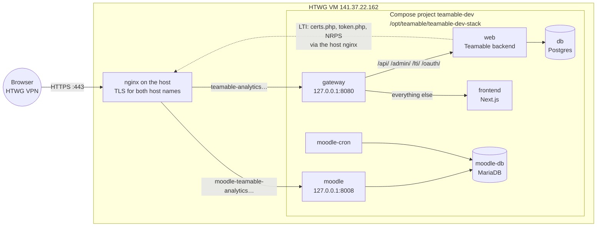

# Set up the HTWG VM

!!! info "What this is about"
    Step-by-step setup and operation of the dev instance on the HTWG VM: Teamable (frontend and backend) and an own Moodle 4.5 with test data, behind HTTPS, reachable via the HTWG VPN. It runs the Teamable dev stack; how the stack works is explained in [Local setup with Docker](dev-stack.md#6-how-the-stack-works).

    The VM is used to test the LTI launch and the student import on a server, to show Teamable to others and to try out Moodle versions (e.g. 5.3 for the RZ). It holds **test data only**. Production with real student data builds on this setup: [Production plan (draft)](production-plan.md).

    This page lists the commands in the order that works. The [local setup with Docker](dev-stack.md) uses the same stack and refers to sections 7 and 9 to 13 of this page.

| | Value |
|---|---|
| VM | `141.37.22.162` |
| Teamable | `https://teamable-analytics.in.htwg-konstanz.de` |
| Moodle | `https://moodle-teamable-analytics.in.htwg-konstanz.de` |
| Stack | `/opt/teamable/teamable-dev-stack` |
| TLS files (from the RZ) | `/etc/ssl/certs/<host>.pem`, `/etc/ssl/private/<host>.key` |



The browser only talks to the host nginx, which picks the target by host name. The gateway splits Teamable into backend and frontend by path. The backend reaches Moodle via its public HTTPS address, that is, through the host nginx again.

---

## 0. Before you start

From the RZ:

- the VM with SSH access and `sudo` rights
- DNS for both host names on `141.37.22.162`
- firewall: inbound 22, 80 and 443 from the VPN; outbound HTTPS and DNS (for `apt`, Docker Hub, GitHub)
- TLS certificates for both host names, stored on the VM (5.1). If they take longer, start with a temporary certificate (5.2)

Connect to the HTWG VPN, then log in via SSH. All commands below run on the VM.

---

## 1. Update the system

```bash
sudo apt update && sudo apt full-upgrade -y
sudo apt autoremove -y
sudo apt install -y ca-certificates curl git nginx openssl
```

---

## 2. Install Docker

Install Docker Engine with the Compose plugin from the official Docker repository, as described in the Docker documentation:

- [Install Docker Engine on Ubuntu](https://docs.docker.com/engine/install/ubuntu/): first "Uninstall old versions", then "Install using the `apt` repository"
- [Linux post-installation steps](https://docs.docker.com/engine/install/linux-postinstall/)

Check:

```bash
docker --version
docker compose version     # v2.17 or newer
sudo docker run --rm hello-world
```

Limit the container logs and allow your user to run Docker without `sudo`:

```bash
sudo tee /etc/docker/daemon.json > /dev/null <<'EOF'
{
  "log-driver": "json-file",
  "log-opts": { "max-size": "10m", "max-file": "5" }
}
EOF
sudo systemctl restart docker
sudo systemctl enable docker
sudo usermod -aG docker "$USER"
```

Log out and in again, so that the group `docker` takes effect.

---

## 3. Clone the repositories

```bash
sudo mkdir -p /opt/teamable
sudo chown "$USER":"$USER" /opt/teamable
git clone https://github.com/Teamprojekt-MSI-BIT-SS26/teamable-dev-stack.git /opt/teamable/teamable-dev-stack

cd /opt/teamable/teamable-dev-stack
git clone -b local-moodle-lti-nrps-import https://github.com/Teamprojekt-MSI-BIT-SS26/teamable-backend.git
git clone https://github.com/Teamprojekt-MSI-BIT-SS26/teamable-frontend.git
```

---

## 4. `.env`

```bash
cd /opt/teamable/teamable-dev-stack
cp .env.example .env
chmod 600 .env
nano .env
```

Values on the VM (everything else as in `.env.example`):

```bash
COMPOSE_PROJECT_NAME=teamable-dev

TEAMABLE_HOST=teamable-analytics.in.htwg-konstanz.de
TEAMABLE_URL=https://teamable-analytics.in.htwg-konstanz.de
MOODLE_HOST=moodle-teamable-analytics.in.htwg-konstanz.de
MOODLE_URL=https://moodle-teamable-analytics.in.htwg-konstanz.de
MOODLE_SSLPROXY=true

DEBUG=FALSE
SECRET_KEY=<random>

POSTGRES_PASSWORD=<random>
MOODLE_DB_ROOT_PASSWORD=<random>
MOODLE_DB_PASSWORD=<random>
```

Create each `<random>` with `openssl rand -hex 32`. Set the passwords before the first start: the databases only read them when their volume is created.

The backend does not read `SECRET_KEY` yet; it still uses the key hard-coded in `src/teamable/settings.py`. Set it anyway, so that nothing has to change once it does.

---

## 5. TLS certificate

Set the host names in the shell (again after each new SSH login):

```bash
TEAMABLE_HOST=teamable-analytics.in.htwg-konstanz.de
MOODLE_HOST=moodle-teamable-analytics.in.htwg-konstanz.de
```

### 5.1 Certificates from the RZ

The RZ creates the key and the certificate for each host name itself and stores them on the VM; no CSR is needed. It renews them automatically at the same place:

| File | Content |
|---|---|
| `/etc/ssl/certs/<host>.pem` | certificate including the intermediate chain |
| `/etc/ssl/private/<host>.key` | private key (`root`, `600`) |

Check whether they are there:

```bash
for H in "$TEAMABLE_HOST" "$MOODLE_HOST"; do
  echo "== $H"
  openssl x509 -in /etc/ssl/certs/$H.pem -noout -subject -issuer -enddate -ext subjectAltName
  grep -c 'BEGIN CERTIFICATE' /etc/ssl/certs/$H.pem      # 2 or more: chain included
  sudo ls -l /etc/ssl/private/$H.key
done
```

Expected: issuer `GEANT TLS ECC 1`, the own host name in the SAN, and a key file for each name. If both certificates are there, skip 5.2, 8.1 and section 14.

The folders `/etc/ssl/certs` and `/etc/ssl/private` belong to the RZ: do not store any own files there.

### 5.2 Temporary self-signed certificate

Only while the RZ certificates are not there yet: nginx needs a certificate to start. Create one for both host names in an own folder:

```bash
sudo mkdir -p /etc/ssl/teamable && cd /etc/ssl/teamable
sudo openssl req -x509 -newkey rsa:3072 -nodes -days 90 \
  -keyout teamable-dev.key -out teamable-dev.pem \
  -subj "/CN=$TEAMABLE_HOST" \
  -addext "subjectAltName=DNS:$TEAMABLE_HOST,DNS:$MOODLE_HOST"
sudo chmod 600 teamable-dev.key
```

Browsers show a certificate warning; accept it for both host names. Check the expiry date with `sudo openssl x509 -in teamable-dev.pem -noout -enddate`. Switch to the RZ certificates as soon as they arrive (section 14).

---

## 6. Host nginx

```bash
cd /opt/teamable/teamable-dev-stack
sudo cp teamable-proxy.conf /etc/nginx/snippets/teamable-proxy.conf
sudo cp host-nginx.conf /etc/nginx/sites-available/teamable-dev
sudo sed -i "s/<teamable-host>/$TEAMABLE_HOST/g; s/<moodle-host>/$MOODLE_HOST/g" \
  /etc/nginx/sites-available/teamable-dev
```

`host-nginx.conf` is used unchanged; `sed` only fills in the host names. Each HTTPS server uses the RZ certificate of its host name (5.1).

**Only with the temporary certificate from 5.2:** point both servers to it instead:

```bash
sudo sed -i -E \
  -e 's|/etc/ssl/certs/[^;]+\.pem|/etc/ssl/teamable/teamable-dev.pem|' \
  -e 's|/etc/ssl/private/[^;]+\.key|/etc/ssl/teamable/teamable-dev.key|' \
  /etc/nginx/sites-available/teamable-dev
```

Check which certificates nginx uses, then enable the site:

```bash
grep -n 'ssl_certificate' /etc/nginx/sites-available/teamable-dev

sudo ln -sf /etc/nginx/sites-available/teamable-dev /etc/nginx/sites-enabled/
sudo rm -f /etc/nginx/sites-enabled/default
sudo nginx -t && sudo systemctl reload nginx
sudo systemctl enable nginx
```

---

## 7. LTI key pair

Create the key pair **before** the first start of the stack. Otherwise Docker creates the folder `lti/config` as `root` (it is mounted into `web`), and writing into it fails with `Permission denied`.

```bash
cd /opt/teamable/teamable-dev-stack/teamable-backend/src
mkdir -p lti/config
openssl genrsa -out lti/config/private.key 2048
openssl rsa -in lti/config/private.key -pubout -out lti/config/public.key
chmod 700 lti/config
chmod 600 lti/config/private.key
```

The backend in the container runs as `root` and can read the key.

---

## 8. Start the stack

```bash
cd /opt/teamable/teamable-dev-stack
docker compose up -d --build
docker compose ps                 # all services "running"/"healthy"
docker compose logs -f web        # collectstatic, migrate, gunicorn "Booting worker"
```

The first build takes several minutes. Then create the admin account for Teamable:

```bash
docker compose exec web python manage.py createsuperuser
```

Health check: Teamable answers via HTTPS (must print `200`). With the temporary certificate from 5.2, add `-k`:

```bash
curl -s -o /dev/null -w '%{http_code}\n' "https://$TEAMABLE_HOST/admin/login/"
```

### 8.1 Let `web` trust the temporary certificate

!!! warning "Only with the self-signed certificate"
    This step is only needed while the temporary self-signed certificate from 5.2 is in use. Skip it if nginx already uses the RZ certificates: `web` trusts their chain without a CA bundle. When you switch to the RZ certificates later, undo this step (section 14).

With the self-signed certificate from 5.2, the backend cannot fetch `certs.php` from Moodle; the LTI launch fails with `500` and `CERTIFICATE_VERIFY_FAILED` in `docker compose logs web`. Give `web` a CA bundle that contains the certificate:

```bash
sudo sh -c 'cat /etc/ssl/certs/ca-certificates.crt /etc/ssl/teamable/teamable-dev.pem > /etc/ssl/teamable/ca-bundle-dev.pem'
sudo chmod 644 /etc/ssl/teamable/ca-bundle-dev.pem

cd /opt/teamable/teamable-dev-stack
cat > docker-compose.override.yml <<'EOF'
services:
  web:
    volumes:
      - /etc/ssl/teamable/ca-bundle-dev.pem:/etc/ssl/ca-bundle-dev.pem:ro
    environment:
      REQUESTS_CA_BUNDLE: /etc/ssl/ca-bundle-dev.pem
      SSL_CERT_FILE: /etc/ssl/ca-bundle-dev.pem
EOF
docker compose up -d web
```

Keep the indentation of the YAML exactly as above. Check (must print `200`):

```bash
docker compose exec web python -c "import requests; print(requests.get('https://$MOODLE_HOST/mod/lti/certs.php').status_code)"
```

Do not commit `docker-compose.override.yml`.

---

## 9. Install Moodle

Moodle runs in the stack (`moodle`, `moodle-db`, `moodle-cron`) and was started with it in section 8. On the first start the database is empty, so Moodle has to be installed once in the browser.

Check first that the Moodle containers run:

```bash
cd /opt/teamable/teamable-dev-stack
docker compose ps moodle moodle-db     # moodle "running", moodle-db "healthy"
```

Then open **`https://moodle-teamable-analytics.in.htwg-konstanz.de`** in the browser (with VPN). With the temporary certificate from 5.2, accept the certificate warning. Always use exactly this address: Moodle only accepts its `MOODLE_URL` from `.env`.

The database settings and the paths come from `moodle-config.php` of the stack, so the wizard does not ask for them. It starts directly with the installation:

1. **License:** read the GPL notice and click **Continue**.
2. **Release information and server checks:** all checks have to show **OK**; warnings for optional extensions can be ignored. Click **Continue**.
3. **Installation:** Moodle creates the tables and installs all plugins. The page grows for several minutes; do not reload it. At the end, click **Continue**.
4. **Admin account:** username (e.g. `admin`), a strong password, first name, last name and email address. The email does not have to work; Moodle sends no mails from this VM. Click **Update profile**.
5. **Site settings:**
    - Full site name: e.g. `Teamable Test Moodle`
    - Short name for site: e.g. `teamable-test`
    - Default timezone: `Europe/Berlin`
    - No-reply address and support email: any address, e.g. the one of the admin account

    Click **Save changes**.
6. **Registration:** Moodle offers to register the site with moodle.org. Skip it (**Skip** at the bottom of the page).

The Moodle dashboard appears. The installation is complete; it is stored in the volumes `moodle-db-data` and `moodledata` and survives restarts and rebuilds.

Check that the scheduled tasks run (after about a minute):

```bash
docker compose logs moodle-cron | tail -3     # "Cron run completed correctly"
```

Until the installation is complete, `moodle-cron` logs errors; they stop afterwards.

| Problem | Cause / solution |
|---|---|
| "Database connection failed" | MariaDB is still starting on the very first start. Wait a few seconds and reload |
| "Incorrect access detected, this server may be accessed only through … address" | Moodle was opened under another address than `MOODLE_URL`, e.g. with `http://` or the IP address |
| Redirect loop or links with `http://` | `MOODLE_SSLPROXY=true` missing in `.env`; set it and run `docker compose up -d moodle moodle-cron` |
| `502 Bad Gateway` | `moodle` not running yet: `docker compose ps`, `docker compose logs moodle` |

---

## 10. Register Teamable in Moodle

Show the public key from section 7 on the VM and copy it completely:

```bash
cat /opt/teamable/teamable-dev-stack/teamable-backend/src/lti/config/public.key
```

In Moodle, log in as admin and open *Site administration → Plugins → Activity modules → External tool → **Manage tools***. Click **configure a tool manually** and fill in the form. Some fields only appear after clicking **Show more...** in their section.

**Tool settings**

| Field | Value |
|---|---|
| Tool name | `Teamable` |
| Tool URL | `https://teamable-analytics.in.htwg-konstanz.de/lti/launch/` |
| LTI version | **LTI 1.3** |
| Public key type | **RSA key** |
| Public key | complete output of `cat public.key` above, including `-----BEGIN PUBLIC KEY-----` and `-----END PUBLIC KEY-----` |
| Initiate login URL | `https://teamable-analytics.in.htwg-konstanz.de/lti/login/` |
| Redirection URI(s) | `https://teamable-analytics.in.htwg-konstanz.de/lti/launch/` |
| Custom parameters | the two lines below |
| Tool configuration usage | **Show in activity chooser and as a preconfigured tool** |
| Default launch container | **New window** |

Custom parameters, both lines:

```text
canvas_course_id=$Context.id
canvas_user_id=$User.id
```

**Services**

| Field | Value |
|---|---|
| IMS LTI Names and Role Provisioning | **Use this service to retrieve members' information as per privacy settings** |

**Privacy**

| Field | Value |
|---|---|
| Share launcher's name with tool | **Always** |
| Share launcher's email with tool | **Always** |

Leave all other fields at their defaults and click **Save changes**.

Points that often go wrong:

- **Tool URL and Redirection URI(s) must be identical.** Teamable sends the Tool URL back as `redirect_uri`; any difference leads to "Invalid request" in Moodle.
- **The Initiate login URL must not be empty.** Otherwise opening Teamable in Moodle reloads `mod/lti/launch.php` endlessly.
- **`https://` and the exact host name** in all three URLs, no `localhost`, no IP address and no port.
- **New window:** Django forbids embedding Teamable in an iframe, so it cannot open inside the Moodle page.
- **RSA key:** with the pasted key, Moodle does not need to fetch a key from Teamable over the network.
- **Custom parameters:** the launch of the current backend still expects the Canvas fields `canvas_course_id` and `canvas_user_id`; Moodle fills them with the course ID and the user ID.
- **Names and Role Provisioning** is needed for the student import, **name and email** so that Teamable knows the teacher.

### Where to find Client ID and Deployment ID

After saving, Moodle shows the tool as a card in *Manage tools*. Click the list icon **"View configuration details"** on the Teamable card. It shows:

| Moodle shows | Goes into `lti_config_settings.json` as |
|---|---|
| Platform ID | top-level key (`https://moodle-teamable-analytics.in.htwg-konstanz.de`) |
| Client ID | `client_id` |
| Deployment ID | `deployment_ids` (as a string in a list, e.g. `["1"]`) |
| Public keyset URL | `key_set_url` |
| Access token URL | `auth_token_url` |
| Authentication request URL | `auth_login_url` |

---

## 11. LTI configuration in Teamable

```bash
cd /opt/teamable/teamable-dev-stack/teamable-backend/src
nano lti/config/lti_config_settings.json
```

```json
{
  "https://moodle-teamable-analytics.in.htwg-konstanz.de": [
    {
      "default": true,
      "client_id": "<Client ID from Moodle>",
      "auth_login_url": "https://moodle-teamable-analytics.in.htwg-konstanz.de/mod/lti/auth.php",
      "auth_token_url": "https://moodle-teamable-analytics.in.htwg-konstanz.de/mod/lti/token.php",
      "key_set_url": "https://moodle-teamable-analytics.in.htwg-konstanz.de/mod/lti/certs.php",
      "key_set": null,
      "private_key_file": "private.key",
      "public_key_file": "public.key",
      "deployment_ids": ["<Deployment ID from Moodle>"]
    }
  ]
}
```

The file is read on every launch; no restart needed.

---

## 12. Organization, test course, test students

### 12.1 Organization in Teamable

Open **`https://teamable-analytics.in.htwg-konstanz.de/admin/`** and log in with the superuser from section 8. Under *Organizations* click **Add**:

| Field | Value |
|---|---|
| Name | `HTWG Test` |
| LMS type | **MOODLE** |
| LMS API URL | `https://moodle-teamable-analytics.in.htwg-konstanz.de` (without a trailing `/`) |

Click **Save**.

- Without an organization, the LTI launch fails with an `IntegrityError`: every course is attached to an organization.
- With LMS type `CANVAS`, "Import students" runs the Canvas import and fails.
- The LMS API URL must be exactly the Platform ID of Moodle (the top-level key in `lti_config_settings.json`). Teamable uses it to find the LTI configuration for the import.

### 12.2 Test course in Moodle

In Moodle as admin: *Site administration → Courses → **Manage courses and categories*** → **Create new course**:

| Field | Value |
|---|---|
| Course full name | `Kurs 1` |
| Course short name | `Kurs1` |

Leave the rest at the defaults and click **Save and display**. The short name matters: the CSV file in 12.3 enrolls the students by it.

### 12.3 Test students via CSV upload

The course `Kurs1` from 12.2 has to exist **before** the upload. Otherwise Moodle creates the users but does not enroll them and reports an unknown course in the result.

Save the following content **on your own machine** as `test-students.csv`, encoding **UTF-8**:

```csv
username,password,firstname,lastname,email,idnumber,course1,role1
anna.mueller,Test1234!,Anna,Müller,anna.mueller@example.com,100001,Kurs1,student
ben.schmidt,Test1234!,Ben,Schmidt,ben.schmidt@example.com,100002,Kurs1,student
clara.weber,Test1234!,Clara,Weber,clara.weber@example.com,100003,Kurs1,student
david.fischer,Test1234!,David,Fischer,david.fischer@example.com,100004,Kurs1,student
emma.wagner,Test1234!,Emma,Wagner,emma.wagner@example.com,100005,Kurs1,student
felix.becker,Test1234!,Felix,Becker,felix.becker@example.com,100006,Kurs1,student
```

| Column | Meaning |
|---|---|
| `username`, `password` | login of the test student in Moodle |
| `idnumber` | ID number in Moodle, at the HTWG the student ID number (Matrikelnummer). Arrives in Teamable via NRPS as `lis_person_sourcedid` |
| `course1` | short name of the course the student is enrolled in (`Kurs1`) |
| `role1` | `student` enrolls the person as a student |

Upload it in Moodle: *Site administration → Users → Accounts → **Upload users***

1. Choose `test-students.csv` (drag and drop or *Choose a file*).
2. CSV delimiter **`,`**, encoding **UTF-8**, then **Upload users**.
3. The preview shows the six rows. Leave the settings at the defaults and click **Upload users** again.
4. Moodle shows the result: six users created and enrolled in `Kurs 1`. Click **Continue**.

Check: in the course `Kurs 1` → *Participants*, the six students are listed with the role *Student*.

Use invented test data only. Never upload real students to this VM.

### 12.4 Add Teamable to the course

In the course `Kurs 1`:

1. Turn on **Edit mode** (switch at the top right).
2. In any section, click **Add an activity or resource**.
3. Choose **Teamable** (the tool from section 10, shown because of "Show in activity chooser").
4. Enter a name, e.g. `Teamable`, and click **Save and return to course**.

---

## 13. Test

1. In Moodle, as admin, open the course `Kurs 1` and click the activity **Teamable**. It opens in a **new window** (allow pop-ups for the Moodle address if the browser blocks it).
2. You land directly in the Teamable frontend in the course `Kurs 1`, without a separate login. The address is `https://teamable-analytics.in.htwg-konstanz.de/…`.
3. Click **Import students**.
4. Under **Students**, the six test students appear with first name, last name and student ID (`100001` to `100006`).

Check on the VM:

```bash
cd /opt/teamable/teamable-dev-stack
docker compose logs --tail=100 web     # LTI launch, then "NRPS members:" with the data from Moodle
```

In the Teamable admin (`https://teamable-analytics.in.htwg-konstanz.de/admin/`), *Course members* lists the six students with the role *Student*.

| Problem | Cause / solution |
|---|---|
| Launch: `500`, log: `CERTIFICATE_VERIFY_FAILED` | nginx uses the temporary certificate from 5.2, but the workaround from 8.1 is missing. Check with `grep ssl_certificate /etc/nginx/sites-available/teamable-dev` |
| Launch: `IntegrityError … organization` | organization missing (12.1); create it and start the activity again from the course |
| `iss … [client_id=…] not found in settings` | Platform ID or Client ID in `lti_config_settings.json` does not match Moodle exactly (sections 10 and 11) |
| `Missing canvas_course_id/canvas_user_id custom claims` | custom parameters of the Moodle tool missing or incomplete (section 10) |
| Moodle: "Invalid request" | Tool URL and Redirection URI(s) differ, or the page was reloaded: start the activity again from the course |
| `mod/lti/launch.php` reloads endlessly | Initiate login URL of the tool is empty (section 10) |
| `400 Bad Request` from Teamable | Teamable opened under another host name than `TEAMABLE_HOST`, e.g. in the tool URLs |
| "Unable to import students. Please relaunch Teamable from your Canvas dashboard …" | organization not set to `MOODLE` (12.1), or Names and Role Provisioning not enabled on the tool (section 10). The message is hard-coded and always mentions Canvas |
| Import shows no students | students not enrolled in `Kurs 1`, e.g. because the course did not exist yet during the upload: check *Participants*, create the course and upload the CSV file again with *Upload type* **Add new and update existing users** (12.2, 12.3); the default skips existing users and does not enroll them |

---

## 14. Switch to the RZ certificates

Only if the VM was set up with the temporary certificate from 5.2. As soon as the RZ certificates are there (check from 5.1), set the host names as in section 5 and copy the nginx configuration again, this time without redirecting it to the temporary certificate:

```bash
F=/etc/nginx/sites-available/teamable-dev
sudo cp /etc/nginx/sites-available/teamable-dev /root/teamable-dev.nginx.bak
sudo cp /opt/teamable/teamable-dev-stack/host-nginx.conf $F
sudo sed -i "s/<teamable-host>/$TEAMABLE_HOST/g; s/<moodle-host>/$MOODLE_HOST/g" $F
grep -n 'ssl_certificate' $F         # only /etc/ssl/certs/… and /etc/ssl/private/…
sudo nginx -t && sudo systemctl reload nginx
```

If `nginx -t` fails, restore the old configuration with `sudo cp /root/teamable-dev.nginx.bak $F`.

Check that both host names answer without `-k` (must print `200`):

```bash
curl -s -o /dev/null -w '%{http_code}\n' "https://$TEAMABLE_HOST/admin/login/"
curl -s -o /dev/null -w '%{http_code}\n' "https://$MOODLE_HOST/login/index.php"
```

Then remove the workaround from 8.1 and check that `web` trusts the RZ certificate on its own (must print `200`):

```bash
cd /opt/teamable/teamable-dev-stack
rm docker-compose.override.yml
docker compose up -d web
docker compose exec web python -c "import requests; print(requests.get('https://$MOODLE_HOST/mod/lti/certs.php').status_code)"
```

Start the activity in Moodle once more (section 13); the browser no longer shows a certificate warning. Then delete the temporary files:

```bash
sudo rm -r /etc/ssl/teamable
sudo rm /root/teamable-dev.nginx.bak
```

The RZ renews the certificates in place. nginx only reads the renewed files after `sudo systemctl reload nginx`; whether the renewal by the RZ does that is still open.

---

## 15. Operation

### 15.1 Further checks

From your own machine (with VPN):

```bash
curl -I https://teamable-analytics.in.htwg-konstanz.de/          # 200 or 3xx from the frontend, not 502
curl -I http://teamable-analytics.in.htwg-konstanz.de/           # 301 → https://
```

On the VM:

```bash
ss -tlnp | grep -E ':(8080|8008)\b'     # container ports only on 127.0.0.1, not 0.0.0.0
```

In the browser: the Teamable admin (`/admin/`) shows CSS and the login works without `403 CSRF`; Moodle shows no warning about cron under *Site administration → Notifications*.

### 15.2 System updates

Keep Ubuntu up to date, including Docker and nginx:

```bash
sudo apt update && sudo apt upgrade -y
```

Ubuntu Server installs security updates automatically with `unattended-upgrades`, which is installed and enabled by default. Check it, and enable it if needed:

```bash
cat /etc/apt/apt.conf.d/20auto-upgrades     # both values "1"
sudo dpkg-reconfigure -plow unattended-upgrades
```

Kernel updates only take effect after a reboot; if `/var/run/reboot-required` exists, reboot the VM (`sudo reboot`). By default, `unattended-upgrades` only installs updates from the Ubuntu security repository. Docker comes from the Docker repository and is only updated by the manual `apt upgrade`. An update of Docker restarts the daemon; the containers come back on their own (`restart: unless-stopped`).

### 15.3 Application code

```bash
cd /opt/teamable/teamable-dev-stack
git -C teamable-backend pull
git -C teamable-frontend pull
docker compose up -d --build        # migrations run automatically on start
docker compose logs -f web
```

### 15.4 Stack files

```bash
cd /opt/teamable/teamable-dev-stack
git pull
diff .env.example .env              # new variables? add them to .env
docker compose up -d --build
```

If `host-nginx.conf` or `teamable-proxy.conf` changed, copy them again as in section 6.

### 15.5 Another Moodle version

The Moodle version is set via `MOODLE_IMAGE` in `.env`; `moodle` and `moodle-cron` both use it. Moodle can only be upgraded, not downgraded, and the upgrade changes the database. Alternatively, test a new version in a second Compose project with its own `COMPOSE_PROJECT_NAME`, ports and host names.

Back up database and `moodledata` first:

```bash
cd /opt/teamable/teamable-dev-stack
mkdir -p ~/moodle-backup

# database dump
docker compose exec -T moodle-db sh -c 'mariadb-dump -u root -p"$MARIADB_ROOT_PASSWORD" --single-transaction moodle' \
  | gzip > ~/moodle-backup/moodle-db-$(date +%F).sql.gz

# moodledata (one-off container with the same volumes as the moodle service)
docker compose run --rm --no-deps -v ~/moodle-backup:/backup --entrypoint tar moodle \
  czf /backup/moodledata-$(date +%F).tar.gz -C /var/www/moodledata .
```

Then upgrade:

```bash
# set the new MOODLE_IMAGE in .env, then
docker compose up -d moodle moodle-cron
docker compose exec -u www-data moodle php /var/www/html/admin/cli/upgrade.php --non-interactive
```

The upgrade can also be started in the browser: log in as admin, Moodle then shows the upgrade page. To go back, import the dump into an empty database, unpack the archive into the emptied `moodledata` volume and set the old `MOODLE_IMAGE` again.

Before switching to a new image, check:

- **Image:** whether `brandkern/moodle` offers a tag for the target version at all (e.g. 5.3). If not, another image is needed, and `docker-compose.yml` and `moodle-config.php` have to be adapted to it.
- **`moodle-config.php`:** it is mounted to `/var/www/html/config.php` and reads the variables `DB_*`, `WWWROOT` and `MOODLE_SSLPROXY`. Since Moodle 5.1, the web root is the subfolder `public/`, while `config.php` stays in the main folder. Check the path of the Moodle code in the new image, the mount target and the web server configuration of the image.

This is the environment for testing Teamable against Moodle 5.3 for the RZ.

### 15.6 Data

The VM only has test data, so there are no regular backups. Moodle (`moodledata`, `moodle-db-data`) and Teamable (`postgres-data`) live in Docker volumes of the project `teamable-dev`. `docker compose down -v` or a changed `COMPOSE_PROJECT_NAME` loses them or makes them invisible. `git clean -x` in `teamable-backend` deletes the LTI key pair.

---

## Troubleshooting

| Symptom | Cause / solution |
|---|---|
| `nginx -t`: `cannot load certificate` | The file named in `ssl_certificate` does not exist. RZ certificates not there yet: create the temporary certificate (5.2) and point nginx to it (section 6) |
| `openssl genrsa`: `Permission denied` in `lti/config` | The folder belongs to `root`, because the stack was started before it existed. `sudo chown -R "$USER":"$USER" lti/config` in `teamable-backend/src`, then create the keys again |
| LTI launch `500`, log: `CERTIFICATE_VERIFY_FAILED … self-signed certificate` | Only with the self-signed certificate: workaround from 8.1 missing or `web` not recreated (`docker compose up -d web`) |
| LTI launch `500`, log: `CERTIFICATE_VERIFY_FAILED … unable to get local issuer certificate` | The certificate file nginx uses lacks the intermediate chain. The RZ files contain it (check in 5.1); ask the RZ if `grep -c` prints `1` |
| `apt`, Docker installation, `docker compose build` or `git clone` hang until a timeout | Outgoing traffic is blocked by the RZ firewall. Ask the RZ to allow outgoing 80/443 and DNS (53) |
| SSH connection breaks or parts of the HTWG network are unreachable after Docker starts | Docker networks (`172.17.0.0/16` and following) overlap with addresses of the HTWG network or the VPN. Add `default-address-pools` to `/etc/docker/daemon.json` from section 2 (e.g. `{"base": "10.200.0.0/16", "size": 24}`, choose a range the HTWG does not use), restart Docker and recreate the stack (`docker compose down && docker compose up -d`) |
| `502 Bad Gateway` from the host nginx | Stack not running (`docker compose ps`), `web`/`frontend` still starting, or ports in `host-nginx.conf` do not match `TEAMABLE_PORT`/`MOODLE_PORT` |
| `403 CSRF verification failed` | `X-Forwarded-Proto https` does not arrive: snippet not included in the host nginx, or `TEAMABLE_URL` is not `https://` |
| `web` cannot reach Moodle (`certs.php`, import) | Firewall on the VM (e.g. `ufw`) blocks connections from the Docker bridge to port 443 of the host. Allow 443 for the Docker networks |
| `password authentication failed` / `Access denied` in the database logs | Password in `.env` differs from the one used when the volume was created (section 4) |
| Disk full | Docker build cache and old images: `docker system prune` (never with `--volumes`, that deletes the data) |
| More errors | [local setup with Docker](dev-stack.md#troubleshooting), [local setup](../../recherche/LMS-Anbindung/local-moodle-teamable-setup.md#troubleshooting) |
